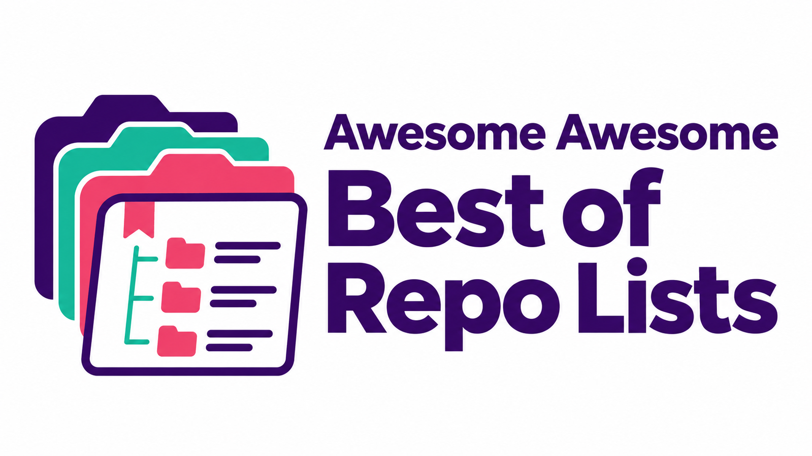

<p align="center">
  
</p>

# Awesome Awesome Best of Repo Lists


<details>
<summary><strong>🌍 Languages · Sprachen · 18</strong></summary>

| | |
| --- | --- |
| [ English](../README.md) | [ Deutsch](README.de.md) |
| [ Español](README.es.md) | [ Français](README.fr.md) |
| [ Italiano](README.it.md) | [ Português](README.pt.md) |
| [ Nederlands](README.nl.md) | [ Polski](README.pl.md) |
| [ Türkçe](README.tr.md) | [ 日本語](README.ja.md) |
| [ 한국어](README.ko.md) | [ 中文](README.zh.md) |
| [ العربية](README.ar.md) | [ हिन्दी](README.hi.md) |
| [ Bahasa Indonesia](README.id.md) | [ Tiếng Việt](README.vi.md) |
| [ Українська](README.uk.md) | [ Svenska](README.sv.md) |

</details>

**🔎 Discovery:** [🧩 Awesome Skills](https://github.com/Supersynergy/awesome-skills) · [💬 Awesome Prompts](https://github.com/Supersynergy/awesome-prompts) · [⭐ gitstars.io](https://gitstars.io/) · [Trending](https://gitstars.io/trending) · [Explore](https://gitstars.io/explore)

**🧭 Meta:** [Awesome](https://github.com/sindresorhus/awesome) · [Awesome Awesomeness](https://github.com/bayandin/awesome-awesomeness) · [Best-of Lists](https://github.com/best-of-lists/best-of) · [Awesome Open Source](https://awesomeopensource.com/) · [GitHub Topics](https://github.com/topics/awesome)


**🧭 Entdecken:** [Alle Kategorien](#inhalt) · [🤖 KI & Agenten](#c-ai-llm-mcp) · [💻 Sprachen](#c-languages) · [🛡️ Security](#c-security-privacy) · [🏠 Self-hosted](#c-selfhosted) · [🏆 Best-of](#c-best-of)

**🔗 Repository-Link kopieren:**

```text
https://github.com/Supersynergy/awesome-awesome-best-of-repo-lists
```

**🧰 Daten & Werkzeuge:** [JSONL-Katalog](../data/sources.jsonl) · [Alle URLs](https://raw.githubusercontent.com/Supersynergy/awesome-awesome-best-of-repo-lists/main/data/urls.txt) · [Anleitung für Agenten](../docs/CATALOG.md)

<p align="center">
  <b>967 Katalogeinträge zu Awesome-Listen, Best-of-Rankings und Meta-Indizes aus dem Open-Source-Ökosystem.</b>
</p>


Eine gepflegte Sammlung der besten Ressourcen-Listen aus dem Open-Source-Ökosystem: von `sindresorhus/awesome` über `awesome-selfhosted` bis zu spezialisierten Listen für AI/LLM, Security, Rust oder Remote-Work.


**✨ So nutzen:** Kategorie wählen, bis zu 20 Ressourcen direkt ansehen und bei Bedarf weitere aufklappen. Für die Suche in allen 967 URLs öffne [Alle URLs](https://raw.githubusercontent.com/Supersynergy/awesome-awesome-best-of-repo-lists/main/data/urls.txt) und nutze die Suchfunktion deines Browsers. Sterne, Lizenzen und Aktivitätsdaten sind Momentaufnahmen aus der GitHub API.


<details>
<summary><strong>🤖 Schnelle Abfragen für Agenten und Entwickler</strong></summary>

Nach dem Klonen lassen sich Links mit `jq` aus dem lokalen Katalog filtern:

```sh
# Alle KI- und Agenten-Ressourcen
jq -r 'select(.cat == "ai-llm-mcp") | .url' data/sources.jsonl

# Ressourcen mit dem Tag security
jq -r 'select(.tags | index("security")) | .url' data/sources.jsonl
```

Die [Anleitung für Agenten](../docs/CATALOG.md) erklärt die Datenfelder und den Stand der Daten.

</details>

---


## Inhalt


| Kategorie | Kategorie |
| --- | --- |
| [Meta-Listen & Querschnitt](#c-meta-meta) · 231 | [AI · LLM · MCP · Agenten](#c-ai-llm-mcp) · 286 |
| [Sprachen & Ökosysteme](#c-languages) · 157 | [Security · Privacy](#c-security-privacy) · 68 |
| [Daten · APIs · Scraping](#c-data-domains) · 62 | [DevOps · Cloud · Infrastruktur](#c-devops) · 35 |
| [Selfhosted · Docker · Homelab](#c-selfhosted) · 20 | [Business · SaaS](#c-business-saas) · 24 |
| [Forschung · Papers](#c-research) · 20 | [Supply Chain · Lizenzen](#c-supply-chain) · 19 |
| [Best-of-Rankings](#c-best-of) · 5 | [Starter · Templates](#c-starters) · 12 |
| [Öffentlicher Sektor](#c-public-sector) · 6 | [Registries · Kataloge](#c-registries) · 14 |
| [Offizielle Kataloge](#c-official-catalogs) · 8 |  |

---

<a id="c-meta-meta"></a>
## 🧭 1. Meta-Listen & Querschnitt <sub>(231)</sub>

*Listen von Listen, beste Übersichten und Such-Indizes — der Einstieg in jede Domain.*

**⭐ Ausgewählte Ressourcen**

- **[codecrafters-io/build-your-own-x](https://github.com/codecrafters-io/build-your-own-x)**<br>
  562k★ aktiv 2026-11 · `reimplement` `learning`<br>
  Master programming by recreating your favorite technologies from scratch.

- **[sindresorhus/awesome](https://github.com/sindresorhus/awesome)**<br>
  535.6k★ `CC0-1.0` aktiv 2026-09 · `awesome` `index` `all`<br>
  😎 Awesome lists about all kinds of interesting topics [NOTE: Pull requests are temporarily disabled until I have a chance to catch up with the existing ones]

- **[public-apis/public-apis](https://github.com/public-apis/public-apis)**<br>
  485k★ `MIT` · `api` `data` `integrations` — Datenquellen und Integrationen

- **[ripienaar/free-for-dev](https://github.com/ripienaar/free-for-dev)**<br>
  142.7k★ aktiv 2026-11 · `saas` `free-tier` `infra`<br>
  A list of SaaS, PaaS and IaaS offerings that have free tiers of interest to devops and infradev

- **[MunGell/awesome-for-beginners](https://github.com/MunGell/awesome-for-beginners)**<br>
  91.3k★ aktiv 2026-10 · `beginner-project` `beginners-friendly` — A list of awesome beginners-friendly projects.

- **[wasabeef/awesome-android-ui](https://github.com/wasabeef/awesome-android-ui)**<br>
  58.4k★ `MIT` aktiv 2026-06 · `android` `ui` — A curated list of awesome Android UI/UX libraries

- **[goabstract/Awesome-Design-Tools](https://github.com/goabstract/Awesome-Design-Tools)**<br>
  41.8k★ `MIT` aktiv 2024-07 · `animations` `design` `design-systems` — The best design tools and plugins for everything 👉

- **[bayandin/awesome-awesomeness](https://github.com/bayandin/awesome-awesomeness)**<br>
  33.8k★ aktiv 2024-06 · `awesome` `index` — A curated list of awesome awesomeness

- **[hesamsheikh/awesome-openclaw-usecases](https://github.com/hesamsheikh/awesome-openclaw-usecases)**<br>
  31.6k★ `MIT` aktiv 2026-03 · `clawdbot` `moltbot` `openclaw`<br>
  A community collection of OpenClaw use cases for making life easier.

- **[abhisheknaiidu/awesome-github-profile-readme](https://github.com/abhisheknaiidu/awesome-github-profile-readme)**<br>
  31.6k★ `CC0-1.0` aktiv 2026-09 · `github` `github-profile-readme` `github-readme`<br>
  😎 A curated list of awesome GitHub Profile which updates in real time

- **[viatsko/awesome-vscode](https://github.com/viatsko/awesome-vscode)**<br>
  29.2k★ `CC0-1.0` aktiv 2026-06 · `visual-studio` `visual-studio-code` `visual-studio-code-extension`<br>
  🎨 A curated list of delightful VS Code packages and resources.

- **[ashishps1/awesome-low-level-design](https://github.com/ashishps1/awesome-low-level-design)**<br>
  28k★ `GPL-3.0` aktiv 2026-08 · `design-patterns` `interview` `interview-practice`<br>
  Learn Low Level Design (LLD) and prepare for interviews using free resources.

- **[Igglybuff/awesome-piracy](https://github.com/Igglybuff/awesome-piracy)**<br>
  26.9k★ `CC0-1.0` aktiv 2023-06 **archiviert** · `audiobooks` `comics` `ebooks` — A curated list of awesome warez and piracy links

- **[awesome-dsh-plugin/awesome-dsh-plugin](https://github.com/awesome-dsh-plugin/awesome-dsh-plugin)**<br>
  24.4k★ `CC0-1.0` aktiv 2026-11 · `deepseek-harness` `dsh` `dsh-plugin`<br>
  A curated list of plugins for DeepSeek Harness (dsh) · DeepSeek Harness 插件精选列表

- **[PicoTrex/Awesome-Nano-Banana-images](https://github.com/PicoTrex/Awesome-Nano-Banana-images)**<br>
  24k★ `Apache-2.0` aktiv 2026-09 · `gemini-2-5-flash-image` `nano-banana`<br>
  A curated collection of fun and creative examples generated with Nano Banana & Nano Banana Pro🍌, Gemini-2.5-flash-image based model. We also release Nano-consistent-150K openly to support the …

- **[jbhuang0604/awesome-computer-vision](https://github.com/jbhuang0604/awesome-computer-vision)**<br>
  23.6k★ aktiv 2024-05 — A curated list of awesome computer vision resources

- **[matiassingers/awesome-readme](https://github.com/matiassingers/awesome-readme)**<br>
  21.7k★ aktiv 2026-11 · `readme` — A curated list of awesome READMEs

- **[iCHAIT/awesome-macOS](https://github.com/iCHAIT/awesome-macOS)**<br>
  19.5k★ aktiv 2026-10 · `apple` `awesome-lists` `mac`<br>
   A curated list of awesome applications, softwares, tools and shiny things for macOS.

- **[gztchan/awesome-design](https://github.com/gztchan/awesome-design)**<br>
  17.8k★ aktiv 2024-07 · `adobe` `creative` `curated` — 🌟 Curated design resources from all over the world.

- **[jtoy/awesome-tensorflow](https://github.com/jtoy/awesome-tensorflow)**<br>
  17.5k★ `CC0-1.0` aktiv 2026-02<br>
  TensorFlow - A curated list of dedicated resources https://tensorflow.org

<details>
<summary><strong>📂 211 weitere Ressourcen anzeigen</strong></summary>

- **[vitejs/awesome-vite](https://github.com/vitejs/awesome-vite)**<br>
  17.3k★ `MIT` aktiv 2026-02 · `vite` `vitejs` — ⚡️ A curated list of awesome things related to Vite.js

- **[thibmaek/awesome-raspberry-pi](https://github.com/thibmaek/awesome-raspberry-pi)**<br>
  17.1k★ aktiv 2026-11 · `raspberry-pi` `rpi`<br>
  📝 A curated list of awesome Raspberry Pi tools, projects, images and resources

- **[chentsulin/awesome-graphql](https://github.com/chentsulin/awesome-graphql)**<br>
  15.2k★ `CC0-1.0` aktiv 2026-11 · `graphql` — Awesome list of GraphQL

- **[nestjs/awesome-nestjs](https://github.com/nestjs/awesome-nestjs)**<br>
  13.2k★ aktiv 2026-11 · `nestjs` — A curated list of awesome things related to NestJS 😎

- **[rShetty/awesome-podcasts](https://github.com/rShetty/awesome-podcasts)**<br>
  13.2k★ aktiv 2024-03 · `awesome-lists` `podcast` `software` — Collection of awesome podcasts

- **[iptv-org/awesome-iptv](https://github.com/iptv-org/awesome-iptv)**<br>
  12.9k★ aktiv 2026-11 · `epg` `iptv` `players` — A curated list of resources related to IPTV

- **[theanalyst/awesome-distributed-systems](https://github.com/theanalyst/awesome-distributed-systems)**<br>
  12.4k★ aktiv 2025-01 · `architecture` `consensus` `distributed-systems` — A curated list to learn about distributed systems

- **[xgrommx/awesome-redux](https://github.com/xgrommx/awesome-redux)**<br>
  12.3k★ aktiv 2022-10 · `redux` `redux-documentation` — Awesome list of Redux examples and middlewares

- **[mehdihadeli/awesome-software-architecture](https://github.com/mehdihadeli/awesome-software-architecture)**<br>
  11.8k★ `CC0-1.0` aktiv 2026-10 · `architectural-patterns` `architectural-styles` `architecture`<br>
  📚 A curated list of awesome articles, videos, and other resources to learn and practice software architecture, patterns, and principles.

- **[oz123/awesome-c](https://github.com/oz123/awesome-c)**<br>
  11.7k★ `CC-BY-SA-4.0` aktiv 2026-09 · `c`<br>
  A curated list of awesome C frameworks, libraries, resources and other shiny things. Inspired by all the other awesome-... projects out there.

- **[cjwirth/awesome-ios-ui](https://github.com/cjwirth/awesome-ios-ui)**<br>
  11.2k★ aktiv 2018-03 — A curated list of awesome iOS UI/UX libraries

- **[kjw0612/awesome-deep-vision](https://github.com/kjw0612/awesome-deep-vision)**<br>
  11.2k★ aktiv 2023-08<br>
  A curated list of deep learning resources for computer vision

- **[bnb/awesome-hyper](https://github.com/bnb/awesome-hyper)**<br>
  11k★ `CC0-1.0` aktiv 2022-09 · `hyper` `hyperterm` `terminal` — 🖥 Delightful Hyper plugins, themes, and resources

- **[webpro/awesome-dotfiles](https://github.com/webpro/awesome-dotfiles)**<br>
  10.9k★ aktiv 2026-10 · `bash` `dotfiles` `dotfiles-resources` — A curated list of dotfiles resources.

- **[timschneeb/awesome-shizuku](https://github.com/timschneeb/awesome-shizuku)**<br>
  10.8k★ aktiv 2026-11 · `adb` `android` `android-mods`<br>
  Curated list of awesome Android apps making use of Shizuku

- **[paralax/awesome-honeypots](https://github.com/paralax/awesome-honeypots)**<br>
  10.7k★ `Artistic-2.0` aktiv 2026-06 · `honeyd` `honeypot` — an awesome list of honeypot resources

- **[rothgar/awesome-tmux](https://github.com/rothgar/awesome-tmux)**<br>
  10.5k★ aktiv 2026-10 · `tmux` — A list of awesome resources for tmux

- **[awesome-lists/awesome-bash](https://github.com/awesome-lists/awesome-bash)**<br>
  10.2k★ `CC0-1.0` aktiv 2026-05 · `bash`<br>
  A curated list of delightful Bash scripts and resources.

- **[aikorea/awesome-rl](https://github.com/aikorea/awesome-rl)**<br>
  10k★ aktiv 2023-05 — Reinforcement learning resources curated

- **[aalhour/awesome-compilers](https://github.com/aalhour/awesome-compilers)**<br>
  10k★ aktiv 2024-05 · `books` `compiler` `interpreter`<br>
  :sunglasses: Curated list of awesome resources on Compilers, Interpreters and Runtimes

- **[awesome-jellyfin/awesome-jellyfin](https://github.com/awesome-jellyfin/awesome-jellyfin)**<br>
  9.9k★ `CC0-1.0` aktiv 2026-11 · `jellyfin`<br>
  A Collection of Awesome Jellyfin Plugins, Themes, Guides and More!

- **[troxler/awesome-css-frameworks](https://github.com/troxler/awesome-css-frameworks)**<br>
  9.6k★ aktiv 2026-11 · `collection` `css` `css-framework` — List of awesome CSS frameworks in 2026

- **[emacs-tw/awesome-emacs](https://github.com/emacs-tw/awesome-emacs)**<br>
  9.4k★ `Unlicense` aktiv 2026-09 · `emacs`<br>
  A community driven list of useful Emacs packages, libraries and other items.

- **[davidsonfellipe/awesome-wpo](https://github.com/davidsonfellipe/awesome-wpo)**<br>
  9.2k★ `MIT` aktiv 2026-10 · `webperf` `webperf-metrics` `webperformance` — A curated list of Web Performance Optimization.

- **[ashishps1/awesome-behavioral-interviews](https://github.com/ashishps1/awesome-behavioral-interviews)**<br>
  9k★ `GPL-3.0` aktiv 2025-08 · `behavioral-interviews` `interview-preparation` `interviews`<br>
  Tips and resources to prepare for Behavioral interviews.

- **[grpc-ecosystem/awesome-grpc](https://github.com/grpc-ecosystem/awesome-grpc)**<br>
  8.4k★ `CC-BY-4.0` aktiv 2025-10 · `grpc` `protocol-buffers` — A curated list of useful resources for gRPC

- **[kitspace/awesome-electronics](https://github.com/kitspace/awesome-electronics)**<br>
  8.4k★ `CC0-1.0` aktiv 2026-10 · `altium` `eagle` `electronics`<br>
  A curated list of awesome resources for Electronic Engineers and hobbyists

- **[crownpku/Awesome-Chinese-NLP](https://github.com/crownpku/Awesome-Chinese-NLP)**<br>
  7.9k★ `Apache-2.0` aktiv 2023-07 · `chinese-nlp` `nlp`<br>
  A curated list of resources for Chinese NLP 中文自然语言处理相关资料

- **[reHackable/awesome-reMarkable](https://github.com/reHackable/awesome-reMarkable)**<br>
  7.8k★ `CC0-1.0` aktiv 2026-10 · `remarkable-tablet`<br>
  A curated list of projects related to the reMarkable tablet

- **[infoslack/awesome-web-hacking](https://github.com/infoslack/awesome-web-hacking)**<br>
  7.4k★ `MIT` aktiv 2026-10 · `appsec` `hacking` `hacking-tools` — A list of web application security

- **[kiloreux/awesome-robotics](https://github.com/kiloreux/awesome-robotics)**<br>
  7.3k★ aktiv 2024-09 · `robotics` — A list of awesome Robotics resources

- **[ChromeDevTools/awesome-chrome-devtools](https://github.com/ChromeDevTools/awesome-chrome-devtools)**<br>
  7.2k★ `CC0-1.0` aktiv 2026-10<br>
  Awesome tooling and resources in the Chrome DevTools & DevTools Protocol ecosystem

- **[RyanNielson/awesome-unity](https://github.com/RyanNielson/awesome-unity)**<br>
  7.1k★ `CC0-1.0` aktiv 2025-01 **archiviert** · `game-development` `unity`<br>
  A curated list of awesome Unity assets, resources, and more.

- **[sirredbeard/awesome-wsl](https://github.com/sirredbeard/awesome-wsl)**<br>
  6.6k★ aktiv 2026-10 · `hacktoberfest-accepted` `microsoft` `windows-10` — Awesome list dedicated to Windows Subsystem for Linux

- **[chubin/awesome-console-services](https://github.com/chubin/awesome-console-services)**<br>
  6.6k★ `MIT` aktiv 2026-02 · `curl` `terminal`<br>
  A curated list of awesome console services (reachable via HTTP, HTTPS and other network protocols)

- **[dontriskit/awesome-ai-system-prompts](https://github.com/dontriskit/awesome-ai-system-prompts)**<br>
  6.3k★ `MIT` aktiv 2026-09<br>
  🧠 Curated collection of system prompts for top AI tools. Perfect for AI agent builders and prompt engineers. Incuding: ChatGPT, Claude, Perplexity, Manus, Claude-Code, Loveable, v0, Grok, same new, …

- **[ebertti/awesome-telegram](https://github.com/ebertti/awesome-telegram)**<br>
  6.2k★ aktiv 2026-11 · `telegram`<br>
  Collection great groups, channels, bots and libraries for Telegram

- **[stoeffel/awesome-fp-js](https://github.com/stoeffel/awesome-fp-js)**<br>
  6k★ aktiv 2026-01<br>
  :sunglasses: A curated list of awesome functional programming stuff in js

- **[djadmin/awesome-bug-bounty](https://github.com/djadmin/awesome-bug-bounty)**<br>
  6k★ `CC0-1.0` aktiv 2026-03<br>
  A comprehensive curated list of available Bug Bounty & Disclosure Programs and Write-ups.

- **[awesome-android-root/awesome-android-root](https://github.com/awesome-android-root/awesome-android-root)**<br>
  6k★ `MIT` aktiv 2026-11 · `android` `android-app` `android-root`<br>
  Discover best root apps, Magisk, KernelSu & LSPosed(xposed) modules & rooting guides

- **[korfuri/awesome-monorepo](https://github.com/korfuri/awesome-monorepo)**<br>
  5.9k★ aktiv 2024-08 · `monorepo`<br>
  A curated list of awesome Monorepo tools, software and architectures.

- **[lightSky/Awesome-MaterialDesign](https://github.com/lightSky/Awesome-MaterialDesign)**<br>
  5.8k★ aktiv 2018-01 — Collection of material design libs and res.

- **[tastejs/awesome-app-ideas](https://github.com/tastejs/awesome-app-ideas)**<br>
  5.7k★ aktiv 2024-06 — List of awesome app ideas

- **[awesome-css-group/awesome-css](https://github.com/awesome-css-group/awesome-css)**<br>
  5.7k★ `CC-BY-SA-4.0` aktiv 2024-10 · `css` — :art: A curated contents of amazing CSS :)

- **[nix-community/awesome-nix](https://github.com/nix-community/awesome-nix)**<br>
  5.5k★ `CC0-1.0` aktiv 2026-07 · `nix` `nixos`<br>
  😎 A curated list of the best resources in the Nix community [maintainer=@cyntheticfox]

- **[wasabeef/awesome-android-libraries](https://github.com/wasabeef/awesome-android-libraries)**<br>
  5.5k★ aktiv 2023-08<br>
  This is an alphabetical list of libraries for Android development, the majority being actively maintained.

- **[zhaoxin94/awesome-domain-adaptation](https://github.com/zhaoxin94/awesome-domain-adaptation)**<br>
  5.5k★ `MIT` aktiv 2025-12 · `adversarial-learning` `domain-adaptation` `few-shot-learning` — A collection of AWESOME things about domain adaptation

- **[onqtam/awesome-cmake](https://github.com/onqtam/awesome-cmake)**<br>
  5.4k★ aktiv 2026-08 · `cmake` `cmake-examples` `cmake-modules`<br>
  A curated list of awesome CMake resources, scripts, modules and examples.

- **[hyprland-community/awesome-hyprland](https://github.com/hyprland-community/awesome-hyprland)**<br>
  5.4k★ `CC0-1.0` aktiv 2026-10 · `awesome-lists` `awesome-readme` `awesome-resources` — Awesome list for Hyprland [maintainer=@yavko]

- **[wesbos/awesome-uses](https://github.com/wesbos/awesome-uses)**<br>
  5.3k★ aktiv 2026-11 · `hacktoberfest`<br>
  A list of /uses pages detailing developer setups, gear, software and configs.

- **[qmonnet/awesome-ebpf](https://github.com/qmonnet/awesome-ebpf)**<br>
  5.2k★ `CC0-1.0` aktiv 2026-11 · `bcc` `bpf` `ebpf` — A curated list of awesome projects related to eBPF.

- **[inputsh/awesome-linux](https://github.com/inputsh/awesome-linux)**<br>
  5.2k★ `WTFPL` aktiv 2023-02 **archiviert** · `desktop-environment` `linux` `linux-distribution`<br>
  :penguin: A list of awesome projects and resources that make Linux even more awesome. :penguin:

- **[hemanth/awesome-pwa](https://github.com/hemanth/awesome-pwa)**<br>
  4.9k★ aktiv 2026-08 · `modern-web` `progressive-web-app` `pwa`<br>
  A curated list of Progressive Web Apps, resources, tools and articles

- **[dustinspecker/awesome-eslint](https://github.com/dustinspecker/awesome-eslint)**<br>
  4.8k★ `CC0-1.0` aktiv 2026-10 · `eslint` — A list of awesome ESLint plugins, configs, etc.

- **[webpack-contrib/awesome-webpack](https://github.com/webpack-contrib/awesome-webpack)**<br>
  4.7k★ `CC0-1.0` aktiv 2021-08 **archiviert** · `documentation` `webpack`<br>
  A curated list of awesome Webpack resources, libraries and tools

- **[willianjusten/awesome-svg](https://github.com/willianjusten/awesome-svg)**<br>
  4.7k★ aktiv 2026-07 · `svg` — A curated list of SVG.

- **[ipfs/awesome-ipfs](https://github.com/ipfs/awesome-ipfs)**<br>
  4.6k★ `CC0-1.0` aktiv 2025-11 · `awesome-ipfs` `ipfs`<br>
  Community list of awesome projects, apps, tools, pinning services and more related to IPFS.

- **[parro-it/awesome-micro-npm-packages](https://github.com/parro-it/awesome-micro-npm-packages)**<br>
  4.6k★ `MIT` aktiv 2023-12 — A curated list of small, focused npm packages.

- **[fosslife/awesome-ricing](https://github.com/fosslife/awesome-ricing)**<br>
  4.6k★ aktiv 2026-09 · `arch-linux` `cli-tool` `linux`<br>
  A curated list of awesome tools and technology to help you out with ricing on linux

- **[yvoronoy/awesome-english](https://github.com/yvoronoy/awesome-english)**<br>
  4.5k★ `CC0-1.0` aktiv 2026-11 · `english` `english-resources` `esl`<br>
  A collection of awesome study resources for learners of English.

- **[tylerha97/awesome-reversing](https://github.com/tylerha97/awesome-reversing)**<br>
  4.5k★ aktiv 2023-08 — A curated list of awesome reversing resources

- **[Ravencentric/awesome-arr](https://github.com/Ravencentric/awesome-arr)**<br>
  4.5k★ `Unlicense` aktiv 2026-10 · `automation` — A collection of *arrs and related stuff.

- **[agarrharr/awesome-macos-screensavers](https://github.com/agarrharr/awesome-macos-screensavers)**<br>
  4.4k★ aktiv 2025-10 **archiviert** · `screensavers` — 🍎 🖥 🎆 A curated list of screensavers for Mac OS X

- **[kakoni/awesome-healthcare](https://github.com/kakoni/awesome-healthcare)**<br>
  4k★ `CC0-1.0` aktiv 2026-11 · `health`<br>
  Curated list of awesome open source healthcare software, libraries, tools and resources.

- **[jinwchoi/awesome-action-recognition](https://github.com/jinwchoi/awesome-action-recognition)**<br>
  4k★ aktiv 2023-05 · `action-classification` `action-detection` `action-recognition`<br>
  A curated list of action recognition and related area resources

- **[JefMari/awesome-wysiwyg-editors](https://github.com/JefMari/awesome-wysiwyg-editors)**<br>
  4k★ aktiv 2026-11 · `rich-text-editor` `wysiwyg` `wysiwyg-editor` — A curated list of awesome WYSIWYG Editors.

- **[micromata/awesome-css-learning](https://github.com/micromata/awesome-css-learning)**<br>
  3.9k★ aktiv 2026-02 · `css` `css-learning` `learning` — A tiny list limited to the best CSS Learning Resources

- **[inputsh/awesome-c](https://github.com/inputsh/awesome-c)**<br>
  3.9k★ aktiv 2022-09 **archiviert** · `c` — Continuing the development of awesome-c list on GitHub

- **[reed-hong/awesome-libra](https://github.com/reed-hong/awesome-libra)**<br>
  3.8k★ aktiv 2021-02 — A Curated List of Awesome Facebook Libra Resources

- **[myles/awesome-static-generators](https://github.com/myles/awesome-static-generators)**<br>
  3.8k★ `CC0-1.0` aktiv 2026-10 **archiviert** · `website` — A curated list of static web site generators.

- **[sporto/awesome-elm](https://github.com/sporto/awesome-elm)**<br>
  3.7k★ aktiv 2026-07 · `elm` `elm-apps` `elm-language`<br>
  A curated list of useful Elm tutorials, libraries and software. Inspired by awesome list. Feel free to contribute. :rocket:

- **[dreamingechoes/awesome-mental-health](https://github.com/dreamingechoes/awesome-mental-health)**<br>
  3.7k★ `CC0-1.0` aktiv 2025-05 · `mental-health` `mental-health-awareness` `self-care`<br>
  A curated list of awesome articles, websites and resources about mental health in the software industry.

- **[oven-sh/awesome-bun](https://github.com/oven-sh/awesome-bun)**<br>
  3.7k★ `CC0-1.0` aktiv 2025-07 · `awesome-bun` `bun` `bunjs` — ⚡️ A curated list of awesome things related to Bun

- **[neiesc/awesome-minimalist](https://github.com/neiesc/awesome-minimalist)**<br>
  3.7k★ `CC0-1.0` aktiv 2026-09 · `awesome-lists` `hacktoberfest` `minimalistic`<br>
  A curated list of awesome minimalist frameworks (simple and lightweight).

- **[mhxion/awesome-discord-communities](https://github.com/mhxion/awesome-discord-communities)**<br>
  3.6k★ `CC-BY-4.0` aktiv 2026-04 · `beginner` `community` `discord`<br>
  A curated list of awesome Discord communities for programmers

- **[web-padawan/awesome-web-components](https://github.com/web-padawan/awesome-web-components)**<br>
  3.6k★ `CC0-1.0` aktiv 2026-10 · `custom-elements` `shadow-dom` `web-components` — A curated list of awesome Web Components resources.

- **[dawdle-deer/awesome-learn-gamedev](https://github.com/dawdle-deer/awesome-learn-gamedev)**<br>
  3.6k★ `CC0-1.0` aktiv 2026-06 · `education` `game-development` `gamedev`<br>
  A curated collection of game development learning resources

- **[sanjeed5/awesome-cursor-rules-mdc](https://github.com/sanjeed5/awesome-cursor-rules-mdc)**<br>
  3.6k★ `CC0-1.0` aktiv 2026-05 — Curated list of awesome Cursor Rules .mdc files

- **[veelenga/awesome-crystal](https://github.com/veelenga/awesome-crystal)**<br>
  3.6k★ `MIT` aktiv 2026-10 · `crystal` `shards`<br>
  :gem: A collection of awesome Crystal libraries, tools, frameworks and software

- **[dweinstein/awesome-frida](https://github.com/dweinstein/awesome-frida)**<br>
  3.6k★ `CC0-1.0` aktiv 2026-10 · `android` `dynamic-analysis` `frida`<br>
  Awesome Frida - A curated list of Frida resources https://www.frida.re/ (https://github.com/frida/frida)

- **[qazbnm456/awesome-cve-poc](https://github.com/qazbnm456/awesome-cve-poc)**<br>
  3.5k★ aktiv 2022-01 · `cve` `poc` — ✍️ A curated list of CVE PoCs.

- **[styfle/awesome-online-ide](https://github.com/styfle/awesome-online-ide)**<br>
  3.5k★ aktiv 2024-12 · `ide` — 🌩️ A list of awesome online development environments

- **[snoopysecurity/awesome-burp-extensions](https://github.com/snoopysecurity/awesome-burp-extensions)**<br>
  3.5k★ `CC0-1.0` aktiv 2026-08 — A curated list of amazingly awesome Burp Extensions

- **[pawelborkar/awesome-repos](https://github.com/pawelborkar/awesome-repos)**<br>
  3.5k★ `MIT` aktiv 2026-11 · `awesome-repos` `free` `github-repos`<br>
  A curated list of GitHub Repositories full of FREE Resources.

- **[jondot/awesome-devenv](https://github.com/jondot/awesome-devenv)**<br>
  3.4k★ aktiv 2024-07<br>
  A curated list of awesome tools, resources and workflow tips making an awesome development environment.

- **[Keycapsss/awesome-mechanical-keyboard](https://github.com/Keycapsss/awesome-mechanical-keyboard)**<br>
  3.3k★ aktiv 2026-09 · `3d-printing` `gridsome-website` `hacktoberfest`<br>
  ⌨️ A curated list of Open Source Mechanical Keyboard resources.

- **[stefanbuck/awesome-browser-extensions-for-github](https://github.com/stefanbuck/awesome-browser-extensions-for-github)**<br>
  3.3k★ aktiv 2024-08 · `browser-extension` `chrome-extension` `github` — A collection of awesome browser extensions for GitHub.

- **[gdcmarinho/awesome-project](https://github.com/gdcmarinho/awesome-project)**<br>
  3.3k★ `MIT` aktiv 2024-06 **archiviert** · `awesome-lists` `collection` `curated` — A curated list of awesome project development links

- **[websemantics/awesome-ant-design](https://github.com/websemantics/awesome-ant-design)**<br>
  3.3k★ aktiv 2025-07<br>
  A curated list of Ant Design resources and related projects. The main idea is that everyone can contribute here, so we can have a central repository of informations about Ant Design that we keep …

- **[desireevl/awesome-quantum-computing](https://github.com/desireevl/awesome-quantum-computing)**<br>
  3.3k★ `CC0-1.0` aktiv 2024-07 · `quantum` `quantum-computing`<br>
  A curated list of awesome quantum computing learning and developing resources.

- **[adamsitnik/awesome-dot-net-performance](https://github.com/adamsitnik/awesome-dot-net-performance)**<br>
  3.3k★ `MIT` aktiv 2026-04<br>
  A curated list of awesome .NET Performance books, courses, trainings, conference talks, blogs and most inspiring open source contributors. Inspired by awesome-... stuff.

- **[shubhamgrg04/awesome-diagramming](https://github.com/shubhamgrg04/awesome-diagramming)**<br>
  3.3k★ aktiv 2024-08 · `diagram` `uml`<br>
  A curated collection of diagramming tools used by leading software engineering teams

- **[emijrp/awesome-awesome](https://github.com/emijrp/awesome-awesome)**<br>
  3.2k★ `CC0-1.0` aktiv 2024-07 — A curated list of awesome curated lists of many topics.

- **[Bogdanp/awesome-advent-of-code](https://github.com/Bogdanp/awesome-advent-of-code)**<br>
  3.2k★ aktiv 2026-10 **archiviert** · `advent-of-code` `advent-of-code-2018` `advent-of-code-2019`<br>
  A collection of awesome resources related to the yearly Advent of Code challenge.

- **[dwisiswant0/awesome-oneliner-bugbounty](https://github.com/dwisiswant0/awesome-oneliner-bugbounty)**<br>
  3.2k★ `MIT` aktiv 2024-07 · `bash` `bug-bounty` `bugbounty`<br>
  A collection of awesome one-liner scripts especially for bug bounty tips.

- **[alfred-workflows/awesome-alfred-workflows](https://github.com/alfred-workflows/awesome-alfred-workflows)**<br>
  3.2k★ aktiv 2024-08 **archiviert** · `alfred` `alfred-workflow` `text-manipulation` — A curated list of awesome alfred workflows

- **[gamontal/awesome-katas](https://github.com/gamontal/awesome-katas)**<br>
  3.2k★ aktiv 2026-07 · `awesome-lists` `code-katas` `coding` — A curated list of code katas

- **[0PandaDEV/awesome-windows](https://github.com/0PandaDEV/awesome-windows)**<br>
  3.1k★ `CC0-1.0` aktiv 2026-11 · `microsoft` `windows`<br>
  An awesome & curated list of tools and apps for Windows 10/11.

- **[ocaml-community/awesome-ocaml](https://github.com/ocaml-community/awesome-ocaml)**<br>
  3.1k★ aktiv 2026-10 · `ocaml` `programming-language`<br>
  A curated collection of awesome OCaml tools, frameworks, libraries and articles.

- **[jkup/awesome-personal-blogs](https://github.com/jkup/awesome-personal-blogs)**<br>
  3.1k★ aktiv 2024-08 — A delightful list of personal tech blogs

- **[postlight/awesome-cms](https://github.com/postlight/awesome-cms)**<br>
  3.1k★ `CC0-1.0` aktiv 2026-03 · `cms` `labs` `toml`<br>
  📚 A collection of open and closed source Content Management Systems (CMS) for your perusal.

- **[kba/awesome-ocr](https://github.com/kba/awesome-ocr)**<br>
  3.1k★ `CC0-1.0` aktiv 2024-07 — Links to awesome OCR projects

- **[ahkscript/awesome-AutoHotkey](https://github.com/ahkscript/awesome-AutoHotkey)**<br>
  3.1k★ aktiv 2026-10<br>
  A curated list of awesome AutoHotkey libraries, library distributions, scripts, tools and resources.

- **[mjebrahimi/Awesome-Microservices-DotNet](https://github.com/mjebrahimi/Awesome-Microservices-DotNet)**<br>
  3.1k★ `CC0-1.0` aktiv 2024-10 · `asp-net` `asp-net-core` `aspnet`<br>
  💎 A collection of awesome training series, articles, videos, books, courses, sample projects, and tools for Microservices in .NET

- **[amusi/awesome-lane-detection](https://github.com/amusi/awesome-lane-detection)**<br>
  3.1k★ aktiv 2024-08 · `lane-detection` `lane-lines-detection` — A paper list of lane detection.

- **[olilarkin/awesome-musicdsp](https://github.com/olilarkin/awesome-musicdsp)**<br>
  3.1k★ `CC-BY-4.0` aktiv 2026-05 · `audio` `audiounit` `dsp`<br>
  A curated list of my favourite music DSP and audio programming resources

- **[manuzhang/awesome-streaming](https://github.com/manuzhang/awesome-streaming)**<br>
  3k★ aktiv 2026-11 · `stream-processing`<br>
  a curated list of awesome streaming frameworks, applications, etc

- **[SubmitGame/awesome-decomp-games](https://github.com/SubmitGame/awesome-decomp-games)**<br>
  3k★ `CC0-1.0` aktiv 2026-11 · `decompilation` `game-preservation` `recompilation`<br>
  Rated, auto-refreshed list of decompiled, recompiled & reverse-engineered games: decomps, static recomps, source ports, engine remakes, browser ports.

- **[CodyReichert/awesome-cl](https://github.com/CodyReichert/awesome-cl)**<br>
  3k★ aktiv 2026-11 · `common-lisp` `common-lisp-tools` `libraries`<br>
  A curated list of awesome Common Lisp frameworks, libraries and other shiny stuff.

- **[aljazceru/awesome-nostr](https://github.com/aljazceru/awesome-nostr)**<br>
  3k★ aktiv 2026-11 · `nostr`<br>
  nostr.net - awesome-nostr is a collection of projects and resources built on nostr to help developers and users find new things

- **[dictcp/awesome-git](https://github.com/dictcp/awesome-git)**<br>
  3k★ `CC0-1.0` aktiv 2026-10 · `awesome-lists` `git`<br>
  A curated list of amazingly awesome Git tools, resources and shiny things

- **[logseq/awesome-logseq](https://github.com/logseq/awesome-logseq)**<br>
  2.9k★ aktiv 2026-04 — Awesome Logseq resources created by the community <3

- **[simonaronsson/awesome-software-architecture](https://github.com/simonaronsson/awesome-software-architecture)**<br>
  2.9k★ `CC0-1.0` aktiv 2026-04 · `architecture` `hacktoberfest` `software-architecture` — A curated list of resources on software architecture

- **[rafi/awesome-vim-colorschemes](https://github.com/rafi/awesome-vim-colorschemes)**<br>
  2.9k★ aktiv 2024-05 · `collection` `color-scheme` `colors`<br>
  Collection of awesome color schemes for Neo/vim, merged for quick use.

- **[YanjieZe/awesome-humanoid-robot-learning](https://github.com/YanjieZe/awesome-humanoid-robot-learning)**<br>
  2.9k★ `MIT` aktiv 2026-11 — A Paper List for Humanoid Robot Learning.

- **[Juude/awesome-android-performance](https://github.com/Juude/awesome-android-performance)**<br>
  2.9k★ `Apache-2.0` aktiv 2019-05 · `android` `android-performance` `memory-leak`<br>
  Android performance optimization tutorials, videos and tools list(Android性能优化视频，文档以及工具)

- **[networktocode/awesome-network-automation](https://github.com/networktocode/awesome-network-automation)**<br>
  2.9k★ aktiv 2026-11 — Curated Awesome list about Network Automation

- **[editor-js/awesome-editorjs](https://github.com/editor-js/awesome-editorjs)**<br>
  2.9k★ `CC0-1.0` aktiv 2026-10 · `editorjs` `libraries` `tools`<br>
  🤩 A curated list of awesome Editor.js tools, libraries and resources.

- **[plenaryapp/awesome-rss-feeds](https://github.com/plenaryapp/awesome-rss-feeds)**<br>
  2.9k★ `CC0-1.0` aktiv 2026-10 · `feed` `opml` `opml-files`<br>
  Awesome RSS feeds - A curated list of RSS feeds (and OPML files) used in Recommended Feeds and local news sections of Plenary - an RSS reader, article downloader and a podcast player app for android

- **[razum2um/awesome-clojure](https://github.com/razum2um/awesome-clojure)**<br>
  2.9k★ aktiv 2026-09 · `clojure` `hacktoberfest`<br>
  A curated list of awesome Clojure libraries and resources. Inspired by awesome-... stuff

- **[diegocard/awesome-html5](https://github.com/diegocard/awesome-html5)**<br>
  2.8k★ `MIT` aktiv 2023-09 — :memo: A curated list of awesome HTML5 resources

- **[nicolesaidy/awesome-web-design](https://github.com/nicolesaidy/awesome-web-design)**<br>
  2.8k★ aktiv 2023-10 · `design` `ui-design` `ux-design`<br>
  🎨 A curated list of awesome resources for digital designers.

- **[ttt30ga/awesome-product-design](https://github.com/ttt30ga/awesome-product-design)**<br>
  2.8k★ `CC0-1.0` aktiv 2025-09 · `article` `bookmark` `design`<br>
  A collection of bookmarks, resources, articles for product designers.

- **[chartjs/awesome](https://github.com/chartjs/awesome)**<br>
  2.7k★ `MIT` aktiv 2026-03 · `chartjs` `charts` `integrations`<br>
  A curated list of awesome Chart.js resources and libraries

- **[rollup/awesome](https://github.com/rollup/awesome)**<br>
  2.7k★ `MIT` aktiv 2026-07 — ⚡️ Delightful Rollup Plugins, Packages, and Resources

- **[iipc/awesome-web-archiving](https://github.com/iipc/awesome-web-archiving)**<br>
  2.7k★ `CC0-1.0` aktiv 2026-11 · `webarchiving` — An Awesome List for getting started with web archiving

- **[jsuarezruiz/awesome-dotnet-maui](https://github.com/jsuarezruiz/awesome-dotnet-maui)**<br>
  2.7k★ aktiv 2025-10 · `dotnet` `dotnet-maui` `maui`<br>
  A curated list of awesome .NET MAUI libraries and resources.

- **[italiaremote/awesome-italia-remote](https://github.com/italiaremote/awesome-italia-remote)**<br>
  2.7k★ `MIT` aktiv 2026-10 · `italy` `jobs` `remote`<br>
  A list of remote-friendly or full-remote companies that targets Italian talents.

- **[docsifyjs/awesome-docsify](https://github.com/docsifyjs/awesome-docsify)**<br>
  2.7k★ aktiv 2026-10 · `docsify` `docsify-plugin` — 💖 A curated list of awesome things related to docsify

- **[chihming/awesome-network-embedding](https://github.com/chihming/awesome-network-embedding)**<br>
  2.6k★ aktiv 2020-12 · `graph-embeddings` `knowledge-graph` `network-embedding` — A curated list of network embedding techniques.

- **[luruke/awesome-casestudy](https://github.com/luruke/awesome-casestudy)**<br>
  2.6k★ aktiv 2022-09 · `case-studies` `development` `frontend`<br>
  📕 Curated list of technical case studies on WebGL and creative development

- **[mauhai/awesome-jupyterlab](https://github.com/mauhai/awesome-jupyterlab)**<br>
  2.6k★ aktiv 2022-11 **archiviert** · `collections` `jupyterlab` `jupyterlab-extension`<br>
  A curated list of awesome JupyterLab extensions and resources

- **[shlomi-noach/awesome-mysql](https://github.com/shlomi-noach/awesome-mysql)**<br>
  2.6k★ aktiv 2026-10<br>
  A curated list of awesome MySQL software, libraries, tools and resources

- **[kgryte/awesome-peer-to-peer](https://github.com/kgryte/awesome-peer-to-peer)**<br>
  2.6k★ aktiv 2023-03 · `p2p` `peer-to-peer` — A list of peer-to-peer resources.

- **[zigcc/awesome-zig](https://github.com/zigcc/awesome-zig)**<br>
  2.6k★ `CC0-1.0` aktiv 2026-10 · `andrew-kelley` `bun` `mach`<br>
  A collaborative list of awesome Zig libraries and resources.

- **[davidgasquez/awesome-duckdb](https://github.com/davidgasquez/awesome-duckdb)**<br>
  2.5k★ `CC0-1.0` aktiv 2026-11 — 🦆 A curated list of awesome DuckDB resources

- **[gabrielelana/awesome-terminal-fonts](https://github.com/gabrielelana/awesome-terminal-fonts)**<br>
  2.5k★ `MIT` aktiv 2024-01<br>
  Tools and instructions on how to have awesome symbols in a terminal with a monospace font

- **[nikgraf/awesome-draft-js](https://github.com/nikgraf/awesome-draft-js)**<br>
  2.5k★ aktiv 2022-05 · `draft-js` — Awesome list of Draft.js resources

- **[heyalexej/awesome-images](https://github.com/heyalexej/awesome-images)**<br>
  2.5k★ aktiv 2026-07<br>
  A curated list of amazingly awesome free (stock) photo resources inspired by all the other awesomes.

- **[bungle/awesome-resty](https://github.com/bungle/awesome-resty)**<br>
  2.5k★ aktiv 2026-05 — A List of Quality OpenResty Libraries, and Resources.

- **[yaolifeng0629/Awesome-independent-tools](https://github.com/yaolifeng0629/Awesome-independent-tools)**<br>
  2.5k★ `AGPL-3.0` aktiv 2026-11 · `awesome-resources` `dev` `developer`<br>
  收录独立开发、AI出海领域最新、最实用的工具与资源（Build Faster with Better Tools）

- **[dend/awesome-product-management](https://github.com/dend/awesome-product-management)**<br>
  2.5k★ `CC0-1.0` aktiv 2026-11 · `pm` `product` `product-management`<br>
  🚀 A curated list of awesome resources for product/program managers to learn and grow.

- **[eug/awesome-opengl](https://github.com/eug/awesome-opengl)**<br>
  2.5k★ aktiv 2026-01 · `computer-graphics` `game-development` `glsl-editors`<br>
  A curated list of awesome OpenGL libraries, debuggers and resources.

- **[aolofsson/awesome-opensource-hardware](https://github.com/aolofsson/awesome-opensource-hardware)**<br>
  2.5k★ `MIT` aktiv 2026-03<br>
  List of awesome open source hardware tools, generators, and reusable designs

- **[mojoaxel/awesome-regression-testing](https://github.com/mojoaxel/awesome-regression-testing)**<br>
  2.4k★ `CC-BY-SA-4.0` aktiv 2026-10 · `test-automation` `testing` `testing-tools`<br>
  🕶️ A curated list of resources around the topic: visual regression testing

- **[awesome-mqtt/awesome-mqtt](https://github.com/awesome-mqtt/awesome-mqtt)**<br>
  2.4k★ `CC0-1.0` aktiv 2026-11 · `internet-of-things` `mqtt` `smarthome`<br>
  Curated list of MQTT brokers, clients, tools, resources and more.

- **[jubalh/awesome-os](https://github.com/jubalh/awesome-os)**<br>
  2.3k★ aktiv 2026-11 · `kernel` `linux` `linux-kernel` — A list of operating systems and stuff

- **[stax76/awesome-mpv](https://github.com/stax76/awesome-mpv)**<br>
  2.3k★ `CC0-1.0` aktiv 2026-02 · `libmpv` `media-player` `mpv` — A curated list of awesome mpv resources.

- **[StefanoCecere/awesome-opensource-unity](https://github.com/StefanoCecere/awesome-opensource-unity)**<br>
  2.3k★ `CC0-1.0` aktiv 2026-02 · `assets` `creative-commons` `game`<br>
  a list of curated opensource Unity packages for future proof Game Developers

- **[t3chnoboy/awesome-awesome-awesome](https://github.com/t3chnoboy/awesome-awesome-awesome)**<br>
  2.3k★ aktiv 2023-11<br>
  :octocat: A a curated list of curated lists of awesome lists.

- **[mundimark/awesome-markdown-editors](https://github.com/mundimark/awesome-markdown-editors)**<br>
  2.3k★ `CC0-1.0` aktiv 2026-08<br>
  A collection of awesome markdown editors & (pre)viewers for Linux, Apple OS X, Microsoft Windows, the World Wide Web & more

- **[workos/awesome-developer-experience](https://github.com/workos/awesome-developer-experience)**<br>
  2.3k★ aktiv 2024-07 **archiviert** — 🤘 A curated list of DX (Developer Experience) resources

- **[uhub/awesome-c](https://github.com/uhub/awesome-c)**<br>
  2.2k★ aktiv 2026-10 · `c` `curated-list`<br>
  A curated list of awesome C frameworks, libraries and software.

- **[vert-x3/vertx-awesome](https://github.com/vert-x3/vertx-awesome)**<br>
  2.2k★ `Apache-2.0` aktiv 2026-06<br>
  A curated list of awesome Vert.x resources, libraries, and other nice things.

- **[stevemao/awesome-git-addons](https://github.com/stevemao/awesome-git-addons)**<br>
  2.2k★ aktiv 2024-10 · `add-on` `add-ons` `addon`<br>
  :sunglasses: A curated list of add-ons that extend/enhance the git CLI.

- **[natpen/awesome-wayland](https://github.com/natpen/awesome-wayland)**<br>
  2.2k★ `CC0-1.0` aktiv 2023-10 **archiviert** · `sway` `swaywm` `wayland` — A curated list of Wayland code and resources.

- **[mobxjs/awesome-mobx](https://github.com/mobxjs/awesome-mobx)**<br>
  2.2k★ aktiv 2024-03 — A collection of awesome things regarding MobX.

- **[Carlos487/awesome-wpf](https://github.com/Carlos487/awesome-wpf)**<br>
  2.2k★ `CC0-1.0` aktiv 2026-10 · `controls` `dotnet` `dotnet-core`<br>
  A collection of awesome WPF resources, libraries and UI controls.

- **[michelpereira/awesome-games-of-coding](https://github.com/michelpereira/awesome-games-of-coding)**<br>
  2.2k★ `CC0-1.0` aktiv 2026-11 · `game` `guido-van-robot` `programming-language`<br>
  A curated list of games that can teach you how to learn a programming language.

- **[akrawchyk/awesome-vim](https://github.com/akrawchyk/awesome-vim)**<br>
  2.1k★ `MIT` aktiv 2025-06 · `vim` — The Vim plugin shortlist

- **[vlang/awesome-v](https://github.com/vlang/awesome-v)**<br>
  2.1k★ `CC0-1.0` aktiv 2026-10 · `v`<br>
  A curated list of awesome V frameworks, libraries, software and resources.

- **[matchai/awesome-pinned-gists](https://github.com/matchai/awesome-pinned-gists)**<br>
  2.1k★ aktiv 2025-08 · `pinned-gist`<br>
  📌✨ A collection of awesome dynamic pinned gists for GitHub

- **[Friz-zy/awesome-linux-containers](https://github.com/Friz-zy/awesome-linux-containers)**<br>
  2.1k★ `Apache-2.0` aktiv 2024-04 · `best-practices` `containers` `linux-containers`<br>
  A curated list of awesome Linux Containers frameworks, libraries and software

- **[Fr0sT-Brutal/awesome-pascal](https://github.com/Fr0sT-Brutal/awesome-pascal)**<br>
  2.1k★ `CC0-1.0` aktiv 2026-02 · `delphi` `freepascal` `lazarus`<br>
  A curated list of awesome Delphi/FreePascal/(any)Pascal frameworks, libraries, resources, and shiny things. Inspired by awesome-... stuff. Open source and freeware only!

- **[ad-si/awesome-3d-printing](https://github.com/ad-si/awesome-3d-printing)**<br>
  2.1k★ `CC0-1.0` aktiv 2026-11 · `3d` `3d-printer` `3d-printing` — A curated list of awesome 3D printing resources

- **[gleam-lang/awesome-gleam](https://github.com/gleam-lang/awesome-gleam)**<br>
  2.1k★ aktiv 2026-06 · `gleam` `libraries` `projects`<br>
  💯 A collection of Gleam libraries, projects, and resources

- **[szabgab/awesome-for-non-programmers](https://github.com/szabgab/awesome-for-non-programmers)**<br>
  2k★ aktiv 2026-08 · `awesome-lists` `readme` — Kuratiere Liste awesome-for-non-programmers

- **[PanJiaChen/awesome-bookmarks](https://github.com/PanJiaChen/awesome-bookmarks)**<br>
  2k★ `CC0-1.0` aktiv 2022-07 — :sparkling_heart: A curated list of awesome things

- **[agarrharr/awesome-static-website-services](https://github.com/agarrharr/awesome-static-website-services)**<br>
  2k★ `CC0-1.0` aktiv 2026-04 **archiviert** — 📄 🛠 A curated list of awesome static websites services

- **[Wenzel/awesome-virtualization](https://github.com/Wenzel/awesome-virtualization)**<br>
  2k★ `GPL-3.0` aktiv 2026-08 · `hypervisor` `virtual-machine` `virtualization` — Collection of resources about Virtualization

- **[thomasdarimont/awesome-keycloak](https://github.com/thomasdarimont/awesome-keycloak)**<br>
  1.9k★ `MIT` aktiv 2026-11<br>
  A curated list of resources for learning about https://www.keycloak.org

- **[mundimark/awesome-markdown](https://github.com/mundimark/awesome-markdown)**<br>
  1.9k★ aktiv 2026-09<br>
  A collection about awesome markdown (& beyond) - let's fix markdown quirks & oddities and let's fill-in / add the missing parts (tables? footnotes? generic blocks? etc.)

- **[mehcode/awesome-atom](https://github.com/mehcode/awesome-atom)**<br>
  1.9k★ `CC0-1.0` aktiv 2019-01 **archiviert** · `atom`<br>
  A curated list of delightful Atom packages and resources.

- **[best-of-lists/best-of](https://github.com/best-of-lists/best-of)**<br>
  1.9k★ `CC-BY-SA-4.0` aktiv 2026-11 · `best-of` `ranking` `quality-score`<br>
  🏆 Discover best-of lists with awesome open-source projects on all kinds of topics.

- **[alexellis/awesome-baremetal](https://github.com/alexellis/awesome-baremetal)**<br>
  1.9k★ `MIT` aktiv 2025-03 — Bare-metal is awesome. Let's share our favourite tools.

- **[awesome-spark/awesome-spark](https://github.com/awesome-spark/awesome-spark)**<br>
  1.9k★ `CC0-1.0` aktiv 2026-02 · `apache-spark` `pyspark` `sparkr`<br>
  A curated list of awesome Apache Spark packages and resources.

- **[Famolus/awesome-sass](https://github.com/Famolus/awesome-sass)**<br>
  1.9k★ `CC0-1.0` aktiv 2026-09 · `css` `sass` `scss`<br>
  🎨 Curated list of awesome Sass and SCSS frameworks, libraries, style guides, articles, and resources.

- **[tramcar/awesome-job-boards](https://github.com/tramcar/awesome-job-boards)**<br>
  1.9k★ aktiv 2026-07 · `job-board` `jobs` — Kuratiere Liste awesome-job-boards

- **[agamm/awesome-developer-first](https://github.com/agamm/awesome-developer-first)**<br>
  1.9k★ aktiv 2026-11 · `developer-first` `developer-tools`<br>
  A curated list of awesome developer-first tools products.

- **[libukai/Awesome-ChatTTS](https://github.com/libukai/Awesome-ChatTTS)**<br>
  1.9k★ aktiv 2024-07 · `ai` `chattts`<br>
  官方推荐的 ChatTTS 资源汇总项目，整理了全网相关资源和常见问题 || Officially recommended ChatTTS resource collection project

- **[MuxaJlbl4/Awesome-PlayStation-Vita](https://github.com/MuxaJlbl4/Awesome-PlayStation-Vita)**<br>
  1.9k★ aktiv 2026-11 · `playstation` `playstation-vita` `ps-vita` — List of awesome stuff for PlayStation Vita

- **[warpnet/awesome-prometheus](https://github.com/warpnet/awesome-prometheus)**<br>
  1.9k★ `CC0-1.0` aktiv 2024-07 · `hacktoberfest` `prometheus`<br>
  A curated list of awesome Prometheus resources, projects and tools.

- **[aloisdg/awesome-regex](https://github.com/aloisdg/awesome-regex)**<br>
  1.8k★ `CC0-1.0` aktiv 2024-10<br>
  A curated collection of awesome Regex libraries, tools, frameworks and software

- **[alexdebrie/awesome-dynamodb](https://github.com/alexdebrie/awesome-dynamodb)**<br>
  1.8k★ aktiv 2026-03<br>
  List of resources for learning about modeling, operating, and using Amazon DynamoDB

- **[practical-tutorials/project-based-learning](https://github.com/practical-tutorials/project-based-learning)**<br>
  `learning` `skeleton` — Lern- und Skelett-Code

- **[EbookFoundation/free-programming-books](https://github.com/EbookFoundation/free-programming-books)**<br>
  `learning` `books` — Wissensbasis

- **[nilbuild/developer-roadmap](https://github.com/nilbuild/developer-roadmap)**<br>
  `learning` `roadmap` — Luecken-Check pro Schicht

- **[donnemartin/system-design-primer](https://github.com/donnemartin/system-design-primer)**<br>
  `architecture` `system-design` — Architektur-Entscheidungen

- **[Smile-L/AwesomeAwesome](https://github.com/Smile-L/AwesomeAwesome)**<br>
  `awesome` `ranking` — Auto-aktualisierte Rangliste von awesome-Listen

- **[star-history.com](https://www.star-history.com)**<br>
  `stars` `trend` — Hype vs. organisches Wachstum

- **[Trendshift](https://trendshift.io)**<br>
  `trending` `momentum` — Fruehindikator neuer Donors

- **[GitHub Trending](https://github.com/trending)**<br>
  `trending` `momentum` `github` — Tages-/Wochentrends

- **[GitHub Topics](https://github.com/topics)**<br>
  `topics` `github` `discovery`<br>
  Dynamischer Cross-Domain-Index (github.com/topics/<topic>)

- **[GitHub Collections](https://github.com/collections)**<br>
  `github` `curated` — Redaktionell kuratierte Themen

- **[GitLab Explore](https://gitlab.com/explore)**<br>
  `forge` `gitlab` `discovery` — Gegen GitHub-Bias

- **[Codeberg Explore](https://codeberg.org/explore/repos)**<br>
  `forge` `codeberg` `foss` — FOSS-first-Forge

- **[OSS Insight](https://ossinsight.io)**<br>
  `analytics` `contributors` — Contributor-/Aktivitaetsanalyse

- **[context-awesome](https://www.context-awesome.com)**<br>
  `awesome` `mcp` `agent` — awesome-Listen als MCP-Server fuer Agenten

- **[Awesome Explorer](https://awexplor.github.io)**<br>
  `awesome` `search` — Filtern nach Sternen/Aktivitaet

- **[Project Awesome](https://project-awesome.org)**<br>
  `awesome` `browse` — Web-Frontend fuer awesome-Listen

- **[alexanderop/awesome-local-first](https://github.com/alexanderop/awesome-local-first)**<br>
  `local-first` `sync` `crdt`<br>
  Local-First-Discovery; Ersatz fuer nicht erreichbare localfirstweb-Liste, kein nachgewiesener Umzug

- **[lo-fi.so Local-First Landscape](https://lo-fi.so)**<br>
  `local-first` `landscape` `products` — kuratierte Local-First-Produktlandschaft

- **[gitstars.io](https://gitstars.io)**<br>
  `trending` `momentum` `api`<br>
  Repo-Velocity-Index (~30M Repos, GitHub+GitLab): /explore?q=-Suche, /rising, /new-hot — morgige Best-Donoren mit starsDelta-Signal; liefert licenseKey+pushedAt ohne Auth

- **[gitstars /explore](https://gitstars.io/explore)**<br>
  `trending` `momentum` `api`<br>
  Volltext-Query ueber den 30M-Index, velocity-ranked mit rollup (stars_delta) — donor discovery per Suchbegriff; page=-Pagination

- **[gitstars /trending](https://gitstars.io/trending)**<br>
  `trending` `momentum` `api`<br>
  Query-unabhaengiges Velocity-Board; q = window (24h|7d|30d); sort/provider/language cursor-paginiert den ganzen Index

- **[szabgab/awesome-lists](https://github.com/szabgab/awesome-lists)**<br>
  `awesome` `index` `discovery` — An index of awesome lists across topics.

- **[Awesome Open Source](https://awesomeopensource.com/)**<br>
  `discovery` `catalog` `open-source` — Search and browse open-source projects by category and language.

- **[GitHub awesome topic](https://github.com/topics/awesome)**<br>
  `github` `awesome` `discovery` — Explore GitHub repositories tagged awesome.

- **[latentcat/latentbox](https://github.com/latentcat/latentbox)**<br>
  `discovery` `index` — Sammlung von Awesome-Listen für KI, Kreativität und Kunst.

- **[bnb/awesome-awesome-nodejs](https://github.com/bnb/awesome-awesome-nodejs)**<br>
  `discovery` `index` — Index von Awesome-Listen rund um Node.js.

- **[ZhiningLiu1998/awesome-machine-learning-resources](https://github.com/ZhiningLiu1998/awesome-machine-learning-resources)**<br>
  `discovery` `index` — Index von Ressourcenlisten zum maschinellen Lernen.

</details>

<a id="c-ai-llm-mcp"></a>
## 🤖 2. AI · LLM · MCP · Agenten <sub>(286)</sub>

*LLM-Tools, MCP-Server, Agent-Frameworks, RAG, GenAI-Stacks und Coding-Assistenten-Ökosysteme.*

**⭐ Ausgewählte Ressourcen**

- **[openclaw/openclaw](https://github.com/openclaw/openclaw)**<br>
  387k★ `MIT` · `agents` `reference` `security-warning`<br>
  Architektur-Studienobjekt only; CVE-2026-25253 RCE, ClawHavoc-Skills-Kampagne

- **[Shubhamsaboo/awesome-llm-apps](https://github.com/Shubhamsaboo/awesome-llm-apps)**<br>
  144.5k★ `Apache-2.0` aktiv 2026-11 · `llm` `agents` `rag`<br>
  100+ AI Agents, Agent Skills and RAG Apps - Free and Open Source.

- **[affaan-m/ECC](https://github.com/affaan-m/ECC)**<br>
  141k★ · `claude-code` `aggregator` — Firehose, nur gezielt durchsuchen

- **[VoltAgent/awesome-design-md](https://github.com/VoltAgent/awesome-design-md)**<br>
  127.1k★ `MIT` aktiv 2026-10 · `design-md` `design-system` `design-tokens`<br>
  A collection of DESIGN.md files analysis by popular brand design systems. Drop one into your project and let coding agents generate a matching UI.

- **[punkpeye/awesome-mcp-servers](https://github.com/punkpeye/awesome-mcp-servers)**<br>
  97.6k★ `MIT` aktiv 2026-11 · `mcp` `integrations` — A collection of MCP servers.

- **[modelcontextprotocol/servers](https://github.com/modelcontextprotocol/servers)**<br>
  91k★ · `mcp` `reference` — Referenzimplementierungen; alte in servers-archived

- **[ComposioHQ/awesome-claude-skills](https://github.com/ComposioHQ/awesome-claude-skills)**<br>
  79.3k★ aktiv 2026-09 · `skills` `claude-code`<br>
  A curated list of awesome Claude Skills, resources, and tools for customizing Claude AI workflows

- **[hesreallyhim/awesome-claude-code](https://github.com/hesreallyhim/awesome-claude-code)**<br>
  57.8k★ aktiv 2026-11 · `claude-code` `hooks` `skills`<br>
  A hand-picked collection of the finest of resources for the most awesome of agents, Claude Code, the undisputed champion of coding companions, from the unstoppable team at Anthropic PBC (no …

- **[VoltAgent/awesome-openclaw-skills](https://github.com/VoltAgent/awesome-openclaw-skills)**<br>
  53.7k★ `MIT` aktiv 2026-10 · `agent-skills` `awesome-lists` `clawd`<br>
  The awesome collection of OpenClaw skills. 5,400+ skills filtered and categorized from the official OpenClaw Skills Registry.🦞

- **[VoltAgent/awesome-agent-skills](https://github.com/VoltAgent/awesome-agent-skills)**<br>
  37.1k★ `MIT` aktiv 2026-11 · `agent-skills` `ai-agents` `claude-code`<br>
  A curated collection of 1000+ agent skills from official dev teams and the community, compatible with Claude Code, Codex, Gemini CLI, Cursor, and more.

- **[e2b-dev/awesome-ai-agents](https://github.com/e2b-dev/awesome-ai-agents)**<br>
  30.9k★ aktiv 2026-08 · `agents` `market` — A list of AI autonomous agents

- **[aishwaryanr/awesome-generative-ai-guide](https://github.com/aishwaryanr/awesome-generative-ai-guide)**<br>
  30.2k★ `MIT` aktiv 2026-11 · `generative-ai` `interview-questions` `large-language-models`<br>
  A one stop repository for generative AI research updates, interview resources, notebooks and much more!

- **[ChristosChristofidis/awesome-deep-learning](https://github.com/ChristosChristofidis/awesome-deep-learning)**<br>
  29.2k★ aktiv 2025-05 · `deep-learning` `deep-learning-tutorial` `deep-networks`<br>
  A curated list of awesome Deep Learning tutorials, projects and communities.

- **[Hannibal046/Awesome-LLM](https://github.com/Hannibal046/Awesome-LLM)**<br>
  27.5k★ `CC0-1.0` aktiv 2025-07 · `llm` `papers` — Awesome-LLM: a curated list of Large Language Model

- **[VoltAgent/awesome-claude-code-subagents](https://github.com/VoltAgent/awesome-claude-code-subagents)**<br>
  26.5k★ `MIT` aktiv 2026-11 · `ai-agent-framework` `ai-agent-tools` `ai-agents`<br>
  A collection of 100+ specialized Claude Code subagents covering a wide range of development use cases

- **[enescingoz/awesome-n8n-templates](https://github.com/enescingoz/awesome-n8n-templates)**<br>
  26.4k★ aktiv 2026-09 · `ai-agents` `ai-automation` `automation`<br>
  280+ free n8n automation templates — ready-to-use workflows for Gmail, Telegram, Slack, Discord, WhatsApp, Google Drive, Notion, OpenAI, and more. AI agents, RAG chatbots, email automation, social …

- **[terryum/awesome-deep-learning-papers](https://github.com/terryum/awesome-deep-learning-papers)**<br>
  26.2k★ aktiv 2024-01 · `deep-learning` `deep-neural-networks` `machine-learning` — The most cited deep learning papers

- **[dipakkr/awesome-ai-engineering](https://github.com/dipakkr/awesome-ai-engineering)**<br>
  22.6k★ `MIT` aktiv 2026-10 · `agentic-ai` `ai-agents` `ai-engineering`<br>
  🚀 A curated collection of AI engineering resources, roadmaps, tools, and projects covering LLMs, RAG, AI Agents, MCP, fine-tuning, evaluations, and production AI systems.

- **[LiLittleCat/awesome-free-chatgpt](https://github.com/LiLittleCat/awesome-free-chatgpt)**<br>
  21.4k★ `MIT` aktiv 2025-06 · `chat` `chatgpt` `free`<br>
  🆓免费的 ChatGPT 镜像网站列表，持续更新。List of free ChatGPT mirror sites, continuously updated.

- **[EthicalML/awesome-production-machine-learning](https://github.com/EthicalML/awesome-production-machine-learning)**<br>
  21.1k★ `MIT` aktiv 2026-11 · `data-mining` `deep-learning` `explainability`<br>
  A curated list of awesome open source libraries to deploy, monitor, version and scale your machine learning

<details>
<summary><strong>📂 266 weitere Ressourcen anzeigen</strong></summary>

- **[keon/awesome-nlp](https://github.com/keon/awesome-nlp)**<br>
  19.2k★ `CC0-1.0` aktiv 2026-10 · `deep-learning` `language` `machine-learning`<br>
  :book: A curated list of resources dedicated to Natural Language Processing (NLP)

- **[composio-community/awesome-codex-skills](https://github.com/composio-community/awesome-codex-skills)**<br>
  17.3k★ aktiv 2026-07 · `awesome-lists` `awesome-resources` `codex`<br>
  A curated list of practical Codex skills for automating workflows across the Codex CLI and API.

- **[owainlewis/awesome-artificial-intelligence](https://github.com/owainlewis/awesome-artificial-intelligence)**<br>
  16.8k★ `MIT` aktiv 2026-08 · `ai` `artificial-intelligence` `deep-learning`<br>
  A curated list of Artificial Intelligence (AI) courses, books, video lectures and papers.

- **[bharathgs/Awesome-pytorch-list](https://github.com/bharathgs/Awesome-pytorch-list)**<br>
  16.8k★ aktiv 2026-09 · `computer-vision` `cv` `data-science`<br>
  A comprehensive list of pytorch related content on github,such as different models,implementations,helper libraries,tutorials etc.

- **[Arindam200/awesome-ai-apps](https://github.com/Arindam200/awesome-ai-apps)**<br>
  16.7k★ `MIT` aktiv 2026-11 · `agents` `ai` `hacktoberfest`<br>
  A collection of projects showcasing RAG, agents, workflows, and other AI use cases

- **[travisvn/awesome-claude-skills](https://github.com/travisvn/awesome-claude-skills)**<br>
  15.8k★ aktiv 2026-04 · `agentic-coding` `anthropic` `awesome-lists`<br>
  A curated list of awesome Claude Skills, resources, and tools for customizing Claude AI workflows — particularly Claude Code

- **[paperswithbacktest/awesome-systematic-trading](https://github.com/paperswithbacktest/awesome-systematic-trading)**<br>
  15.3k★ aktiv 2026-09 · `algorithmic-trading` `algotrading` `alpha`<br>
  A curated list of awesome libraries, packages, strategies, books, blogs, tutorials for systematic trading.

- **[yihui-dev/awesome-opus5-5-videos](https://github.com/yihui-dev/awesome-opus5-5-videos)**<br>
  15k★ `MIT` aktiv 2026-10 · `ai-video` `claude` `claude-opus`<br>
  A growing collection of viral videos made with Claude Opus 5.5 and the prompts behind them. Watch each original next to a live remake on Skillry. Updated regularly.

- **[visenger/awesome-mlops](https://github.com/visenger/awesome-mlops)**<br>
  14.3k★ aktiv 2024-11 · `ai` `data-science` `devops` — A curated list of references for MLOps

- **[donnemartin/awesome-aws](https://github.com/donnemartin/awesome-aws)**<br>
  14.2k★ aktiv 2024-03 · `aws` `aws-cli` `aws-sdk`<br>
  A curated list of awesome Amazon Web Services (AWS) libraries, open source repos, guides, blogs, and other resources. Featuring the Fiery Meter of AWSome.

- **[YouMind-OpenLab/awesome-nano-banana-pro-prompts](https://github.com/YouMind-OpenLab/awesome-nano-banana-pro-prompts)**<br>
  13.8k★ aktiv 2026-11 · `ai-image-generation` `ai-prompts` `gemini`<br>
  🍌 World's largest Nano Banana Pro prompt library — 10,000+ curated prompts with preview images, 16 languages. Google Gemini AI image generation. Free & open source.

- **[mnfst/awesome-free-llm-apis](https://github.com/mnfst/awesome-free-llm-apis)**<br>
  13k★ `CC0-1.0` aktiv 2026-11 · `ai` `aion` `api` — List of Permanent Free LLM API (API Keys)

- **[steven2358/awesome-generative-ai](https://github.com/steven2358/awesome-generative-ai)**<br>
  12.8k★ `CC0-1.0` aktiv 2026-10 · `genai`<br>
  A curated list of modern Generative Artificial Intelligence projects and services

- **[diff-usion/Awesome-Diffusion-Models](https://github.com/diff-usion/Awesome-Diffusion-Models)**<br>
  12.4k★ `MIT` aktiv 2024-08 · `artificial-intelligence` `diffusion-models` `generative-model`<br>
  A collection of resources and papers on Diffusion Models

- **[awesome-opencode/awesome-opencode](https://github.com/awesome-opencode/awesome-opencode)**<br>
  11k★ `CC0-1.0` aktiv 2026-11<br>
  A curated list of awesome plugins, themes, agents, projects, and resources for https://opencode.ai

- **[BehiSecc/awesome-claude-skills](https://github.com/BehiSecc/awesome-claude-skills)**<br>
  10.4k★ aktiv 2026-11 — A curated list of Claude Skills.

- **[ZeroLu/awesome-nanobanana-pro](https://github.com/ZeroLu/awesome-nanobanana-pro)**<br>
  10.4k★ `MIT` aktiv 2026-11 · `gemini` `nanobanana` `nanobanana-pro`<br>
  🚀 An awesome list of curated Nano Banana pro prompts and examples. Your go-to resource for mastering prompt engineering and exploring the creative potential of the Nano banana pro(Nano banana 2) AI …

- **[YouMind-OpenLab/awesome-gpt-image-2](https://github.com/YouMind-OpenLab/awesome-gpt-image-2)**<br>
  10.3k★ aktiv 2026-11 · `ai-image-generation` `ai-prompts` `commercial-illustration`<br>
  🚀 World's largest GPT Image 2 prompt library, updated daily — 2000+ curated prompts with preview images, 16 languages. OpenAI's next-gen image model with pixel-perfect text rendering, cross-image …

- **[CodingDocs/awesome-java](https://github.com/CodingDocs/awesome-java)**<br>
  9.6k★ aktiv 2026-03 · `code-quality` `database` `java`<br>
  Collection of awesome Java project on Github(非常棒的 Java 开源项目集合).

- **[kyrolabs/awesome-langchain](https://github.com/kyrolabs/awesome-langchain)**<br>
  9.6k★ `CC0-1.0` aktiv 2026-11 · `langchain` `rag`<br>
  😎 Awesome list of tools and projects with the awesome LangChain framework

- **[NirantK/awesome-project-ideas](https://github.com/NirantK/awesome-project-ideas)**<br>
  9.4k★ `MIT` aktiv 2023-03 · `classification` `dataset` `deep-learning`<br>
  Curated list of Machine Learning, NLP, Vision, Recommender Systems Project Ideas

- **[ai-boost/awesome-prompts](https://github.com/ai-boost/awesome-prompts)**<br>
  9.2k★ `GPL-3.0` aktiv 2026-11 · `agents` `chatgpt` `context-engineering`<br>
  Curated prompts, frameworks and papers for LLMs and agents, with an engineering bias. Prompt engineering, context engineering, agent harnesses, red teaming.

- **[WangRongsheng/awesome-LLM-resources](https://github.com/WangRongsheng/awesome-LLM-resources)**<br>
  9.1k★ `Apache-2.0` aktiv 2026-11 · `book` `course` `large-language-models`<br>
  🧑‍🚀 全世界最好的LLM资料总结（多模态生成、Agent、辅助编程、AI审稿、数据处理、模型训练、模型推理、o1 模型、MCP、小语言模型、视觉语言模型） | Summary of the world's best LLM resources.

- **[MrNeRF/awesome-3D-gaussian-splatting](https://github.com/MrNeRF/awesome-3D-gaussian-splatting)**<br>
  9k★ `MIT` aktiv 2026-10 · `3d-gaussian-splatting` `3dgs` `gaussian-splatting`<br>
  Curated list of papers and resources focused on 3D Gaussian Splatting, intended to keep pace with the anticipated surge of research in the coming months.

- **[WenyuChiou/awesome-agentic-ai-zh](https://github.com/WenyuChiou/awesome-agentic-ai-zh)**<br>
  8.7k★ `MIT` aktiv 2026-11 · `agentic-ai` `agentic-workflows` `ai-agent`<br>
  A trilingual (繁中 / English / 简中) learning roadmap for agentic AI: from LLM basics to multi-agent systems, with 240+ curated resources and hands-on examples. 中文 AI agent 學習地圖。

- **[humanloop/awesome-chatgpt](https://github.com/humanloop/awesome-chatgpt)**<br>
  8.2k★ aktiv 2025-10 · `chatgpt` `gpt-3` `gpt3`<br>
  Curated list of awesome tools, demos, docs for ChatGPT and GPT-3

- **[jamez-bondos/awesome-gpt4o-images](https://github.com/jamez-bondos/awesome-gpt4o-images)**<br>
  8.2k★ aktiv 2025-05 · `ai-art` `ai-image-examples` `anime-ai-art`<br>
  Awesome curated collection of images and prompts generated by GPT-4o and gpt-image-1. Explore AI generated visuals created with ChatGPT and Sora, showcasing OpenAI’s advanced image generation …

- **[agmmnn/awesome-blender](https://github.com/agmmnn/awesome-blender)**<br>
  7.6k★ `CC0-1.0` aktiv 2026-11 · `3d` `3d-models` `blender`<br>
  🪐 A curated list of awesome Blender add-ons, extensions, AI/MCP tools, tutorials, and 3D resources.

- **[bkrem/awesome-solidity](https://github.com/bkrem/awesome-solidity)**<br>
  7.1k★ aktiv 2026-09 · `contract-solidity` `dapps` `ethereum`<br>
  ⟠ A curated list of awesome Solidity resources, libraries, tools and more

- **[likedan/Awesome-CoreML-Models](https://github.com/likedan/Awesome-CoreML-Models)**<br>
  7.1k★ `MIT` aktiv 2025-06 · `apple` `caffe` `caffemodel` — Largest list of models for Core ML (for iOS 11+)

- **[pliang279/awesome-multimodal-ml](https://github.com/pliang279/awesome-multimodal-ml)**<br>
  7k★ `MIT` aktiv 2024-08 · `computer-vision` `deep-learning` `healthcare`<br>
  Reading list for research topics in multimodal machine learning

- **[hijkzzz/Awesome-LLM-Strawberry](https://github.com/hijkzzz/Awesome-LLM-Strawberry)**<br>
  6.9k★ `Apache-2.0` aktiv 2025-12 · `chain-of-thought` `coding` `llm`<br>
  A collection of LLM papers, blogs, and projects, with a focus on OpenAI o1 🍓 and reasoning techniques.

- **[awesome-NeRF/awesome-NeRF](https://github.com/awesome-NeRF/awesome-NeRF)**<br>
  6.8k★ `MIT` aktiv 2025-01 · `nerf` — A curated list of awesome neural radiance fields papers

- **[georgezouq/awesome-ai-in-finance](https://github.com/georgezouq/awesome-ai-in-finance)**<br>
  6.7k★ `CC0-1.0` aktiv 2026-11 · `analysis` `cryptocurrency` `deep-learning`<br>
  🔬 A curated list of awesome LLMs & deep learning strategies & tools in financial market.

- **[src-d/awesome-machine-learning-on-source-code](https://github.com/src-d/awesome-machine-learning-on-source-code)**<br>
  6.7k★ `CC-BY-SA-4.0` aktiv 2020-12 · `machine-learning` `machine-learning-on-source-code`<br>
  Cool links & research papers related to Machine Learning applied to source code (MLonCode)

- **[punkpeye/awesome-mcp-clients](https://github.com/punkpeye/awesome-mcp-clients)**<br>
  6.6k★ `MIT` aktiv 2026-06 · `clients` `mcp` — A collection of MCP clients.

- **[fr0gger/Awesome-GPT-Agents](https://github.com/fr0gger/Awesome-GPT-Agents)**<br>
  6.6k★ `Apache-2.0` aktiv 2024-07 · `agents` `cybersecurity` `infosec` — A curated list of GPT agents for cybersecurity

- **[mahseema/awesome-ai-tools](https://github.com/mahseema/awesome-ai-tools)**<br>
  6.6k★ `MIT` aktiv 2025-12 · `ai-tools` — A curated list of Artificial Intelligence Top Tools

- **[sindresorhus/awesome-chatgpt](https://github.com/sindresorhus/awesome-chatgpt)**<br>
  6.5k★ `CC0-1.0` aktiv 2026-02 · `ai` `artificial-intelligence` `chatgpt`<br>
  🤖 Awesome list for ChatGPT — an artificial intelligence chatbot developed by OpenAI [SUBMISSIONS ARE TEMPORARILY PAUSED BECAUSE OF TOO MANY LOW QUALITY SUBMISSIONS]

- **[VoltAgent/awesome-codex-subagents](https://github.com/VoltAgent/awesome-codex-subagents)**<br>
  6.5k★ `MIT` aktiv 2026-11 · `ai-agents` `chatgpt` `codex`<br>
  A collection of 130+ specialized Codex subagents covering a wide range of development use cases.

- **[reorx/awesome-chatgpt-api](https://github.com/reorx/awesome-chatgpt-api)**<br>
  6.5k★ aktiv 2026-03 · `chatgpt` `chatgpt-api`<br>
  Curated list of apps and tools that not only use the new ChatGPT API, but also allow users to configure their own API keys, enabling free and on-demand usage of their own quota.

- **[jason718/awesome-self-supervised-learning](https://github.com/jason718/awesome-self-supervised-learning)**<br>
  6.4k★ aktiv 2026-02 · `computer-vision` `deep-learning` `machine-learning` — A curated list of awesome self-supervised methods

- **[promptslab/Awesome-Prompt-Engineering](https://github.com/promptslab/Awesome-Prompt-Engineering)**<br>
  6.4k★ `Apache-2.0` aktiv 2026-11 · `chatgpt` `chatgpt-api` `deep-learning`<br>
  This repository contains a hand-curated resources for Prompt Engineering with a focus on Generative Pre-trained Transformer (GPT), ChatGPT, PaLM etc

- **[heilcheng/awesome-agent-skills](https://github.com/heilcheng/awesome-agent-skills)**<br>
  6.4k★ `MIT` aktiv 2026-11 · `agent-skills` `ai-agents` `ai-development` — Tutorials, Guides and Agent Skills Directories

- **[ikaijua/Awesome-AITools](https://github.com/ikaijua/Awesome-AITools)**<br>
  6.3k★ `CC-BY-4.0` aktiv 2026-11 · `agent-skills` `agents` `ai`<br>
  This repo collects awesome AI tools. Welcome everyone to recommend more awesome AI tools together!

- **[kjw0612/awesome-rnn](https://github.com/kjw0612/awesome-rnn)**<br>
  6.2k★ aktiv 2022-02<br>
  Recurrent Neural Network - A curated list of resources dedicated to RNN

- **[EwingYangs/awesome-open-gpt](https://github.com/EwingYangs/awesome-open-gpt)**<br>
  6.1k★ aktiv 2025-05 · `agentgpt` `ai` `aigc`<br>
  Collection of Open Source Projects Related to GPT，GPT相关开源项目合集🚀、精选🔥🔥

- **[0xNyk/awesome-hermes-agent](https://github.com/0xNyk/awesome-hermes-agent)**<br>
  6k★ aktiv 2026-10 · `agent-skills` `ai-agents` `ai-tools`<br>
  Independent directory of useful skills, plugins, memory providers, tools, surfaces, and guides for Nous Research's open-source Hermes Agent.

- **[tensorchord/Awesome-LLMOps](https://github.com/tensorchord/Awesome-LLMOps)**<br>
  6k★ `CC0-1.0` aktiv 2026-11 · `ai-development-tools` `llmops` `mlops`<br>
  An awesome & curated list of best LLMOps tools for developers

- **[appcypher/awesome-mcp-servers](https://github.com/appcypher/awesome-mcp-servers)**<br>
  5.8k★ aktiv 2026-05 **archiviert** · `ai` `anthropic-claude` `context`<br>
  Awesome MCP Servers - A curated list of Model Context Protocol servers

- **[showlab/Awesome-Video-Diffusion](https://github.com/showlab/Awesome-Video-Diffusion)**<br>
  5.8k★ aktiv 2026-10 · `diffusion-models` `motion-customization` `video-editing`<br>
  A curated list of recent diffusion models for video generation, editing, and various other applications.

- **[lauragift21/awesome-learning-resources](https://github.com/lauragift21/awesome-learning-resources)**<br>
  5.8k★ `MIT` aktiv 2025-07 · `ai` `css` `developer-stories` — 🔥 Awesome list of resources on Web Development.

- **[xlite-dev/Awesome-LLM-Inference](https://github.com/xlite-dev/Awesome-LLM-Inference)**<br>
  5.6k★ `GPL-3.0` aktiv 2026-10 · `awesome-llm` `deepseek` `deepseek-r1`<br>
  📚A curated list of Awesome LLM/VLM Inference Papers with Codes: Flash-Attention, Paged-Attention, WINT8/4, Parallelism, etc.🎉

- **[filipecalegario/awesome-vibe-coding](https://github.com/filipecalegario/awesome-vibe-coding)**<br>
  5.4k★ `CC0-1.0` aktiv 2026-04 · `ai-agent` `ai-agents` `ai-coding-assistant`<br>
  A curated list of vibe coding references, collaborating with AI to write code.

- **[sacridini/Awesome-Geospatial](https://github.com/sacridini/Awesome-Geospatial)**<br>
  5.4k★ `CC0-1.0` aktiv 2026-11 · `data-analysis` `deep-learning` `earth-observation` — Long list of geospatial tools and resources

- **[kelvins/awesome-mlops](https://github.com/kelvins/awesome-mlops)**<br>
  5.3k★ aktiv 2026-10 · `ai` `data-science` `machine-learning` — :sunglasses: A curated list of awesome MLOps tools

- **[libukai/awesome-agent-skills](https://github.com/libukai/awesome-agent-skills)**<br>
  5.2k★ aktiv 2026-10 · `agent` `awsome-list` `claudecode`<br>
  Agent Skills 终极指南：快速入门、资源推荐、精选技能与实用工具 ｜The Ultimate Guide to Agent Skills: QuickStart, Resources, Features&Toolkit

- **[ai-boost/awesome-harness-engineering](https://github.com/ai-boost/awesome-harness-engineering)**<br>
  5.1k★ aktiv 2026-11 · `agent-harness` `agent-memory` `agent-orchestration`<br>
  Awesome list for AI agent harness engineering: tools, patterns, evals, memory, MCP, permissions, observability, and orchestration.

- **[nibzard/awesome-agentic-patterns](https://github.com/nibzard/awesome-agentic-patterns)**<br>
  5.1k★ `Apache-2.0` aktiv 2026-10 — A curated catalogue of awesome agentic AI patterns

- **[cmhungsteve/Awesome-Transformer-Attention](https://github.com/cmhungsteve/Awesome-Transformer-Attention)**<br>
  5k★ aktiv 2024-07 · `attention-mechanism` `attention-mechanisms` `computer-vision`<br>
  An ultimately comprehensive paper list of Vision Transformer/Attention, including papers, codes, and related websites

- **[alvinreal/awesome-opensource-ai](https://github.com/alvinreal/awesome-opensource-ai)**<br>
  5k★ `CC0-1.0` aktiv 2026-11 · `agents` `ai` `artificial-intelligence`<br>
  Curated list of the best truly open-source AI projects, models, tools, and infrastructure. Daily updated.

- **[serenakeyitan/awesome-notebookLM-prompts](https://github.com/serenakeyitan/awesome-notebookLM-prompts)**<br>
  4.8k★ `MIT` aktiv 2026-06 · `ai` `ai-agents` `gemini`<br>
  A curated collection of the strongest NotebookLM slide prompts sourced from the real creative underground . Your go-to resource for AI powerpoint :P

- **[nichtdax/awesome-totally-open-chatgpt](https://github.com/nichtdax/awesome-totally-open-chatgpt)**<br>
  4.8k★ `CC0-1.0` aktiv 2023-05 · `alternative` `awesome-lists` `chatgpt` — A list of totally open alternatives to ChatGPT

- **[xixu-me/awesome-persona-distill-skills](https://github.com/xixu-me/awesome-persona-distill-skills)**<br>
  4.7k★ `CC0-1.0` aktiv 2026-10 · `agent-skills` `persona-distill`<br>
  Curated list of Agent Skills centered on people, relationships, commemorative scenes, and methodological perspectives

- **[gostor/awesome-go-storage](https://github.com/gostor/awesome-go-storage)**<br>
  4.7k★ `MIT` aktiv 2024-12 · `golang` `hacktoberfest` `storage`<br>
  A curated list of awesome Go storage projects and libraries

- **[walkinglabs/awesome-harness-engineering](https://github.com/walkinglabs/awesome-harness-engineering)**<br>
  4.7k★ `CC0-1.0` aktiv 2026-11 · `agent` `agentic` `agentic-ai` — 🛠️ Awesome tools & guides for harness engineering.

- **[armankhondker/awesome-ai-ml-resources](https://github.com/armankhondker/awesome-ai-ml-resources)**<br>
  4.7k★ `MIT` aktiv 2026-05 · `artifical-intelligense` `machine-learning` `roadmap`<br>
  Learn AI/ML for beginners with a roadmap and free resources.

- **[Astrosp/Awesome-OSINT-List](https://github.com/Astrosp/Awesome-OSINT-List)**<br>
  4.7k★ `GPL-3.0` aktiv 2026-11 · `ai` `ai-tools` `bug-bounty`<br>
  📡 Comprehensive collection of OSINT tools for cybersecurity professionals, researchers, and bug bounty hunters. Topics: information gathering, reverse search, red team, trust & safety, AI.

- **[luban-agi/Awesome-AIGC-Tutorials](https://github.com/luban-agi/Awesome-AIGC-Tutorials)**<br>
  4.6k★ `MIT` aktiv 2024-03 · `ai` `aigc` `chatgpt`<br>
  Curated tutorials and resources for Large Language Models, AI Painting, and more.

- **[GT-RIPL/Awesome-LLM-Robotics](https://github.com/GT-RIPL/Awesome-LLM-Robotics)**<br>
  4.5k★ `BSD-3-Clause` aktiv 2026-10<br>
  A comprehensive list of papers using large language/multi-modal models for Robotics/RL, including papers, codes, and related websites

- **[HumanSignal/awesome-data-labeling](https://github.com/HumanSignal/awesome-data-labeling)**<br>
  4.4k★ aktiv 2024-06 · `3d-annotation` `annotation` `annotation-tool` — A curated list of awesome data labeling tools

- **[opendilab/awesome-RLHF](https://github.com/opendilab/awesome-RLHF)**<br>
  4.4k★ `Apache-2.0` aktiv 2026-05 · `deep-learning` `deep-reinforcement-learning` `human-feedback`<br>
  A curated list of reinforcement learning with human feedback resources (continually updated)

- **[wong2/awesome-mcp-servers](https://github.com/wong2/awesome-mcp-servers)**<br>
  4.4k★ `MIT` aktiv 2026-07 · `mcp` — A curated list of Model Context Protocol (MCP) servers

- **[hibayesian/awesome-automl-papers](https://github.com/hibayesian/awesome-automl-papers)**<br>
  4.2k★ `Apache-2.0` aktiv 2024-06 · `automated-feature-engineering` `automl` `hyperparameter-optimization`<br>
  A curated list of automated machine learning papers, articles, tutorials, slides and projects

- **[jphall663/awesome-machine-learning-interpretability](https://github.com/jphall663/awesome-machine-learning-interpretability)**<br>
  4.1k★ `CC0-1.0` aktiv 2026-06 · `ai-safety` `data-science` `explainable-ml`<br>
  A curated list of awesome responsible machine learning resources.

- **[jamesmurdza/awesome-ai-devtools](https://github.com/jamesmurdza/awesome-ai-devtools)**<br>
  4k★ aktiv 2026-08 — Curated list of AI-powered developer tools.

- **[jghoman/awesome-apache-airflow](https://github.com/jghoman/awesome-apache-airflow)**<br>
  3.9k★ aktiv 2026-10 · `airflow` `apache-airflow` `workflow-management` — Curated list of resources about Apache Airflow

- **[chrieke/awesome-satellite-imagery-datasets](https://github.com/chrieke/awesome-satellite-imagery-datasets)**<br>
  3.9k★ `MIT` aktiv 2022-07 **archiviert** · `computer-vision` `deep-learning` `earth-observation`<br>
  🛰️ List of satellite image training datasets with annotations for computer vision and deep learning

- **[M-3LAB/awesome-industrial-anomaly-detection](https://github.com/M-3LAB/awesome-industrial-anomaly-detection)**<br>
  3.9k★ aktiv 2026-11 · `anomaly-detection` `anomaly-segmentation` `computer-vision`<br>
  Paper list and datasets for industrial image anomaly/defect detection (updating). 工业异常/瑕疵检测论文及数据集检索库(持续更新)。

- **[eosphoros-ai/Awesome-Text2SQL](https://github.com/eosphoros-ai/Awesome-Text2SQL)**<br>
  3.8k★ `MIT` aktiv 2026-01 · `ai` `datset` `deep-learning`<br>
  Curated tutorials and resources for Large Language Models, Text2SQL, Text2DSL、Text2API、Text2Vis and more.

- **[openblockchains/awesome-blockchains](https://github.com/openblockchains/awesome-blockchains)**<br>
  3.8k★ `CC0-1.0` aktiv 2023-02 · `blockchain` `content-addressable-storage` `cryptohash`<br>
  A collection about awesome blockchains - open distributed public databases w/ crypto hashes incl. git ;-). Blockchains are the new tulips :tulip::tulip::tulip:. Distributed is the new centralized.

- **[nightrome/really-awesome-gan](https://github.com/nightrome/really-awesome-gan)**<br>
  3.8k★ aktiv 2025-08<br>
  A list of papers on Generative Adversarial (Neural) Networks

- **[krishnakumarsekar/awesome-quantum-machine-learning](https://github.com/krishnakumarsekar/awesome-quantum-machine-learning)**<br>
  3.7k★ `CC0-1.0` aktiv 2024-05 · `ai` `ant-colony-optimization` `artificial-intelligence`<br>
  Here you can get all the Quantum Machine learning Basics, Algorithms ,Study Materials ,Projects and the descriptions of the projects around the web

- **[krzjoa/awesome-python-data-science](https://github.com/krzjoa/awesome-python-data-science)**<br>
  3.6k★ `CC-BY-4.0` aktiv 2026-04 · `awesome-python` `data-analysis` `data-science`<br>
  Probably the best curated list of data science software in Python.

- **[bergside/awesome-design-skills](https://github.com/bergside/awesome-design-skills)**<br>
  3.6k★ `MIT` aktiv 2026-06 · `agent-skills` `agentic-ai` `agentic-workflow`<br>
  List of 67 awesome DESIGN.md and SKILL.md design skill files for agentic tools like Claude Design, Google Stitch, Codex, Cursor, and other AI tools

- **[awesome-scripts/awesome-userscripts](https://github.com/awesome-scripts/awesome-userscripts)**<br>
  3.6k★ aktiv 2026-10 · `ad-blocking` `chatgpt` `chrome` — 📖 A curated list of Awesome Userscripts.

- **[dk-liang/Awesome-Visual-Transformer](https://github.com/dk-liang/Awesome-Visual-Transformer)**<br>
  3.6k★ aktiv 2025-01 · `detr` `transformer` `transformer-awesome`<br>
  Collect some papers about transformer with vision. Awesome Transformer with Computer Vision (CV)

- **[filipecalegario/awesome-generative-ai](https://github.com/filipecalegario/awesome-generative-ai)**<br>
  3.6k★ `CC0-1.0` aktiv 2025-12 · `ai-art` `chatgpt` `dall-e`<br>
  A curated list of Generative AI tools, works, models, and references

- **[knightnemo/Awesome-World-Models](https://github.com/knightnemo/Awesome-World-Models)**<br>
  3.5k★ `BSD-3-Clause` aktiv 2026-11 · `dynamical-systems` `embodied-ai` `generative-model`<br>
  A Curated List of Awesome Works in World Modeling, Aiming to Serve as a One-stop Resource for Researchers, Practitioners, and Enthusiasts Interested in World Modeling.

- **[codefuse-ai/Awesome-Code-LLM](https://github.com/codefuse-ai/Awesome-Code-LLM)**<br>
  3.5k★ aktiv 2026-05 · `ai` `datasets` `llm`<br>
  [TMLR] A curated list of language modeling researches for code (and other software engineering activities), plus related datasets.

- **[taishi-i/awesome-ChatGPT-repositories](https://github.com/taishi-i/awesome-ChatGPT-repositories)**<br>
  3.4k★ `CC0-1.0` aktiv 2026-11 · `agent` `agent-skills` `ai`<br>
  A curated list of open source GitHub repositories related to ChatGPT, the OpenAI API, and Codex. Searchable via Claude Code and Codex skills.

- **[Meirtz/Awesome-Context-Engineering](https://github.com/Meirtz/Awesome-Context-Engineering)**<br>
  3.3k★ `MIT` aktiv 2026-05 · `agent` `agentic-ai` `agi`<br>
  🔥 Comprehensive survey on Context Engineering: from prompt engineering to production-grade AI systems. hundreds of papers, frameworks, and implementation guides for LLMs and AI agents.

- **[yoloytang/Awesome-LLMs-for-Video-Understanding](https://github.com/yoloytang/Awesome-LLMs-for-Video-Understanding)**<br>
  3.3k★ aktiv 2026-11<br>
  🔥🔥🔥 [IEEE TCSVT] Latest Papers, Codes and Datasets on Vid-LLMs.

- **[dangkhoasdc/awesome-ai-residency](https://github.com/dangkhoasdc/awesome-ai-residency)**<br>
  3.3k★ aktiv 2025-04 · `artificial-intelligence` `internships` `jobs` — List of AI Residency Programs

- **[rob-med/awesome-TS-anomaly-detection](https://github.com/rob-med/awesome-TS-anomaly-detection)**<br>
  3.2k★ aktiv 2024-10 · `anomaly-detection` `data-analysis` `data-mining`<br>
  List of tools & datasets for anomaly detection on time-series data.

- **[luspr/awesome-ml-courses](https://github.com/luspr/awesome-ml-courses)**<br>
  3.1k★ aktiv 2024-12 · `ai-courses` `artificial-intelligence` `deep-learning`<br>
  Awesome free machine learning and AI courses with video lectures.

- **[RKiding/Awesome-finance-skills](https://github.com/RKiding/Awesome-finance-skills)**<br>
  3.1k★ `Apache-2.0` aktiv 2026-03 · `agent` `agent-skills` `finances`<br>
  A collection of Awesome Finance Agent Skills for free and easy to start | 一系列开源免费的金融分析Agent Skills

- **[jslee02/awesome-robotics-libraries](https://github.com/jslee02/awesome-robotics-libraries)**<br>
  3.1k★ `CC0-1.0` aktiv 2026-11 · `machine-learning` `motion-planning` `multibody-dynamics`<br>
  :sunglasses: A curated list of robotics libraries and software

- **[weiaicunzai/awesome-image-classification](https://github.com/weiaicunzai/awesome-image-classification)**<br>
  3.1k★ aktiv 2022-04 · `computer-vision` `deep-learning` `image-classification`<br>
  A curated list of deep learning image classification papers and codes

- **[rafska/awesome-local-llm](https://github.com/rafska/awesome-local-llm)**<br>
  3.1k★ `MIT` aktiv 2026-11 · `ai` `llm` `local`<br>
  A curated list of awesome platforms, tools, practices and resources that helps run LLMs locally

- **[punkpeye/awesome-remote-mcp-servers](https://github.com/punkpeye/awesome-remote-mcp-servers)**<br>
  3k★ `MIT` aktiv 2026-11 · `mcp` — A collection of remote MCP servers.

- **[endymecy/awesome-deeplearning-resources](https://github.com/endymecy/awesome-deeplearning-resources)**<br>
  3k★ `MIT` aktiv 2026-10 · `code` `corpus` `deep-learning`<br>
  Deep Learning and deep reinforcement learning research papers and some codes

- **[kyrolabs/awesome-agents](https://github.com/kyrolabs/awesome-agents)**<br>
  3k★ aktiv 2026-11 — 🤖 Awesome list of AI Agents

- **[ybayle/awesome-deep-learning-music](https://github.com/ybayle/awesome-deep-learning-music)**<br>
  3k★ `MIT` aktiv 2023-12 · `article` `audio` `audio-processing`<br>
  List of articles related to deep learning applied to music

- **[subeeshvasu/Awesome-Deblurring](https://github.com/subeeshvasu/Awesome-Deblurring)**<br>
  2.9k★ aktiv 2025-06 · `burst-deblurring` `camera-shake` `deblurring`<br>
  A curated list of resources for Image and Video Deblurring

- **[hoya012/awesome-anomaly-detection](https://github.com/hoya012/awesome-anomaly-detection)**<br>
  2.9k★ aktiv 2022-09 · `anomaly` `anomaly-detection` `anomalydetection` — A curated list of awesome anomaly detection resources

- **[slavakurilyak/awesome-ai-agents](https://github.com/slavakurilyak/awesome-ai-agents)**<br>
  2.9k★ `MIT` aktiv 2026-10 · `agent` `agentic` `agents` — Awesome list of 300+ agentic AI resources

- **[FreedomIntelligence/Awesome-AI4Med](https://github.com/FreedomIntelligence/Awesome-AI4Med)**<br>
  2.9k★ aktiv 2026-08 · `awesome-lists` `collection` `datasets`<br>
  A curated list of medical LLMs, multimodal systems, datasets, benchmarks, and more. 🏥

- **[moul/awesome-ssh](https://github.com/moul/awesome-ssh)**<br>
  2.9k★ `CC0-1.0` aktiv 2023-08 · `devops` `mosh` `openssh` — :computer: A curated list of SSH resources.

- **[i365dev/awesome-seo](https://github.com/i365dev/awesome-seo)**<br>
  2.9k★ `MIT` aktiv 2026-10 · `ai-search` `content-marketing` `generative-engine-optimization`<br>
  Curated SEO, GEO & AI Search resources — technical SEO, agent discoverability, analytics, and traffic monetization.

- **[ZeroLu/awesome-seedance](https://github.com/ZeroLu/awesome-seedance)**<br>
  2.8k★ `MIT` aktiv 2026-11 · `ai` `how-to-use` `prompt-engineering`<br>
  The ultimate collection of high-fidelity Seedance 2.0 prompts and Seedance AI resources. Discover Seedance 2.0 how to use for cinematic film, anime, UGC, social media, meme and advertising. …

- **[rohitg00/awesome-claude-code-toolkit](https://github.com/rohitg00/awesome-claude-code-toolkit)**<br>
  2.8k★ `Apache-2.0` aktiv 2026-05 · `claude` `claude-code` `claudecode`<br>
  The most comprehensive toolkit for Claude Code -- 135 agents, 35 curated skills, 42 commands, 176+ plugins, 20 hooks, 15 rules, 7 templates, 14 MCP configs, 26 companion apps, 52 ecosystem entries, …

- **[merrymercy/awesome-tensor-compilers](https://github.com/merrymercy/awesome-tensor-compilers)**<br>
  2.8k★ aktiv 2024-10 · `code-generation` `compiler` `deep-learning`<br>
  A list of awesome compiler projects and papers for tensor computation and deep learning.

- **[underlines/awesome-ml](https://github.com/underlines/awesome-ml)**<br>
  2.7k★ `MIT` aktiv 2025-04<br>
  Curated list of useful LLM / Analytics / Datascience resources

- **[subeeshvasu/Awesome-Learning-with-Label-Noise](https://github.com/subeeshvasu/Awesome-Learning-with-Label-Noise)**<br>
  2.7k★ aktiv 2025-05 · `deep-neural-networks` `label-noise` `noisy-data`<br>
  A curated list of resources for Learning with Noisy Labels

- **[DEEP-PolyU/Awesome-GraphRAG](https://github.com/DEEP-PolyU/Awesome-GraphRAG)**<br>
  2.7k★ `MIT` aktiv 2026-06 · `graphrag` `graphrag-paper` `graphrag-survey`<br>
  Awesome-GraphRAG: A curated list of resources (surveys, papers, benchmarks, and opensource projects) on graph-based retrieval-augmented generation.

- **[vsitzmann/awesome-implicit-representations](https://github.com/vsitzmann/awesome-implicit-representations)**<br>
  2.7k★ `MIT` aktiv 2024-02<br>
  A curated list of resources on implicit neural representations.

- **[guyulongcs/Awesome-Deep-Learning-Papers-for-Search-Recommendation-Advertising](https://github.com/guyulongcs/Awesome-Deep-Learning-Papers-for-Search-Recommendation-Advertising)**<br>
  2.6k★ aktiv 2026-09 · `advertising` `ctr` `cvr`<br>
  Awesome Deep Learning papers for industrial Search, Recommendation and Advertisement. They focus on Embedding, Matching, Pre-Ranking, Ranking, Post Ranking, Relevance, LLM and RL. Please cite our …

- **[reacher-z/Awesome-REA](https://github.com/reacher-z/Awesome-REA)**<br>
  2.6k★ `MIT` aktiv 2026-11 · `agent-skills` `ai-agents` `android-reverse-engineering`<br>
  Curated tools, case studies and papers for reverse engineering websites, games, apps, binaries, firmware and protocols. Source-reviewed, English and Chinese.

- **[RManLuo/Awesome-LLM-KG](https://github.com/RManLuo/Awesome-LLM-KG)**<br>
  2.6k★ aktiv 2025-05 · `awsome` `chatgpt` `gpt-4` — Awesome papers about unifying LLMs and KGs

- **[webfuse-com/awesome-autoresearch](https://github.com/webfuse-com/awesome-autoresearch)**<br>
  2.6k★ aktiv 2026-09 · `agentic-systems` `ai-agents` `ai-research`<br>
  A curated list of autonomous improvement loops, research agents, and autoresearch-style systems inspired by Karpathy's autoresearch.

- **[yibie/awesome-jev](https://github.com/yibie/awesome-jev)**<br>
  2.6k★ aktiv 2026-11 · `jev` `llm`<br>
  A curated list of public projects, integrations, and discussions built on Jev — TypeSafe AI's System One model for typed decisions.

- **[hwalsuklee/awesome-deep-text-detection-recognition](https://github.com/hwalsuklee/awesome-deep-text-detection-recognition)**<br>
  2.5k★ `Apache-2.0` aktiv 2021-08 · `awesome-lists` `deep-learning` `ocr`<br>
  A curated list of resources for text detection/recognition (optical character recognition ) with deep learning methods.

- **[LearnPrompt/awesome-seedance](https://github.com/LearnPrompt/awesome-seedance)**<br>
  2.5k★ `MIT` aktiv 2026-11 · `agent-skill` `ai-video` `ai-video-generation`<br>
  🎬 Evidence-led Seedance 2.5 / 2.0 prompt library: 840+ cases traced to original posts, 490+ cross-model retest runs, 27 copy-ready templates, 79 installable AI-video Skills. Synced daily from …

- **[akuity/awesome-argo](https://github.com/akuity/awesome-argo)**<br>
  2.5k★ `Apache-2.0` aktiv 2026-09 · `argo` `argo-events` `argo-rollouts`<br>
  A curated list of awesome projects and resources related to Argo (a CNCF graduated project)

- **[he-y/Awesome-Pruning](https://github.com/he-y/Awesome-Pruning)**<br>
  2.5k★ aktiv 2024-04 · `model-acceleration` `model-compression` `pruning` — A curated list of neural network pruning resources.

- **[benedekrozemberczki/awesome-decision-tree-papers](https://github.com/benedekrozemberczki/awesome-decision-tree-papers)**<br>
  2.5k★ `CC0-1.0` aktiv 2025-12 · `cart` `catboost` `classification-model`<br>
  A collection of research papers on decision, classification and regression trees with implementations.

- **[cbsudux/awesome-human-pose-estimation](https://github.com/cbsudux/awesome-human-pose-estimation)**<br>
  2.5k★ aktiv 2022-10 · `2d-human-pose` `3d-human-pose` `computer-vision`<br>
  A collection of awesome resources in Human Pose estimation.

- **[AI-Efficiency/Awesome-Model-Quantization](https://github.com/AI-Efficiency/Awesome-Model-Quantization)**<br>
  2.5k★ aktiv 2026-10 · `awesome-lists` `binarization` `binary-neural-networks`<br>
  A curated collection of papers, benchmarks, surveys, and tools for model quantization, covering low-bit networks, LLMs, multimodal and generative models, vector and lattice quantization, and …

- **[benedekrozemberczki/awesome-community-detection](https://github.com/benedekrozemberczki/awesome-community-detection)**<br>
  2.5k★ `CC0-1.0` aktiv 2025-12 · `bigclam` `clustering` `community-detection`<br>
  A curated list of community detection research papers with implementations.

- **[Jason2Brownlee/awesome-llm-books](https://github.com/Jason2Brownlee/awesome-llm-books)**<br>
  2.5k★ aktiv 2025-10 · `books` `gpt` `llm-book`<br>
  Awesome LLM Books: Curated list of books on Large Language Models

- **[XiaoxinHe/Awesome-Graph-LLM](https://github.com/XiaoxinHe/Awesome-Graph-LLM)**<br>
  2.5k★ `MIT` aktiv 2025-11<br>
  A collection of AWESOME things about Graph-Related LLMs.

- **[sindresorhus/awesome-whisper](https://github.com/sindresorhus/awesome-whisper)**<br>
  2.4k★ `CC0-1.0` aktiv 2026-09 · `ai` `artificial-intelligence` `gpt`<br>
  🔊 Awesome list for Whisper — an open-source AI-powered speech recognition system developed by OpenAI

- **[qosf/awesome-quantum-software](https://github.com/qosf/awesome-quantum-software)**<br>
  2.4k★ `CC0-1.0` aktiv 2026-09 · `compilers` `quantum-algorithms` `quantum-annealing` — Curated list of open-source quantum software projects.

- **[eon01/awesome-chatgpt](https://github.com/eon01/awesome-chatgpt)**<br>
  2.4k★ aktiv 2026-07 · `chatbot` `chatgpt` `chatgpt-api`<br>
  🧠 A curated list of awesome ChatGPT resources, including libraries, SDKs, APIs, and more. 🌟 Please consider supporting this project by giving it a star.

- **[yudataguy/awesome-japanese](https://github.com/yudataguy/awesome-japanese)**<br>
  2.4k★ `CC0-1.0` aktiv 2026-11 · `hiragana` `japan` `japanese-language` — Awesome Japanese Learning Resources

- **[andyrewlee/awesome-agent-orchestrators](https://github.com/andyrewlee/awesome-agent-orchestrators)**<br>
  2.4k★ `CC0-1.0` aktiv 2026-11 · `agent-coordination` `agent-orchestration` `agent-swarm` — List of agent orchestrators

- **[KrishMunot/awesome-startup](https://github.com/KrishMunot/awesome-startup)**<br>
  2.4k★ `MIT` aktiv 2026-08 · `ai` `ai-agents` `ai-tools`<br>
  :sunglasses: All the required resources to build your own startup

- **[manfreddiaz/awesome-autonomous-vehicles](https://github.com/manfreddiaz/awesome-autonomous-vehicles)**<br>
  2.4k★ aktiv 2024-03 · `autonomous-cars` `autonomous-vehicles` `car-driving`<br>
  Curated List of Self-Driving Cars and Autonomous Vehicles Resources

- **[wenhwu/awesome-remote-sensing-change-detection](https://github.com/wenhwu/awesome-remote-sensing-change-detection)**<br>
  2.4k★ aktiv 2026-09 · `change-detection` `dataset` `deep-learning`<br>
  A comprehensive and up-to-date compilation of datasets, tools, methods, review papers, and competitions for remote sensing change detection.

- **[weihaox/awesome-neural-rendering](https://github.com/weihaox/awesome-neural-rendering)**<br>
  2.4k★ `MIT` aktiv 2026-07 · `computer-graphics` `computer-vision` `neural-rendering` — Resources of Neural Rendering

- **[D-X-Y/Awesome-AutoDL](https://github.com/D-X-Y/Awesome-AutoDL)**<br>
  2.4k★ `MIT` aktiv 2022-09 · `autodl` `automl` `deep-learning`<br>
  Automated Deep Learning: Neural Architecture Search Is Not the End (a curated list of AutoDL resources and an in-depth analysis)

- **[WLiK/LLM4Rec-Awesome-Papers](https://github.com/WLiK/LLM4Rec-Awesome-Papers)**<br>
  2.3k★ aktiv 2025-03 · `datasets` `large-language-models` `llm4rec`<br>
  A list of awesome papers and resources of recommender system on large language model (LLM).

- **[TrustAGI-Lab/Awesome-Graph-Neural-Networks](https://github.com/TrustAGI-Lab/Awesome-Graph-Neural-Networks)**<br>
  2.3k★ aktiv 2023-12 · `convolutional-networks` `deep-learning` `generated-graphs` — Paper Lists for Graph Neural Networks

- **[LMD0311/Awesome-World-Model](https://github.com/LMD0311/Awesome-World-Model)**<br>
  2.3k★ aktiv 2026-11 · `artificial-intelligence` `artificial-intelligence-algorithms` `autonomous-driving`<br>
  Collect some World Models for Autonomous Driving (and Robotic, etc.) papers.

- **[ZeroLu/awesome-gpt-image](https://github.com/ZeroLu/awesome-gpt-image)**<br>
  2.3k★ `MIT` aktiv 2026-11 · `gpt-image` `gpt-image-2` `gpt-image-2-5`<br>
  A curated collection of the best GPT Image 2 and GPT Image 2.5 prompts and examples. The prompts come from top creators on X.

- **[ActiveVisionLab/Awesome-LLM-3D](https://github.com/ActiveVisionLab/Awesome-LLM-3D)**<br>
  2.3k★ `MIT` aktiv 2026-04<br>
  Awesome-LLM-3D: a curated list of Multi-modal Large Language Model in 3D world Resources

- **[ai-for-developers/awesome-ai-coding-tools](https://github.com/ai-for-developers/awesome-ai-coding-tools)**<br>
  2.3k★ `MIT` aktiv 2026-09 · `ai-code-generation` `ai-code-generator` `ai-coding` — A curated list of AI-powered coding tools

- **[MaxBenChrist/awesome_time_series_in_python](https://github.com/MaxBenChrist/awesome_time_series_in_python)**<br>
  2.3k★ aktiv 2023-02 · `machine-learning` `python` `statistics`<br>
  This curated list contains python packages for time series analysis

- **[vaaaaanquish/Awesome-Rust-MachineLearning](https://github.com/vaaaaanquish/Awesome-Rust-MachineLearning)**<br>
  2.3k★ `MIT` aktiv 2023-09 · `awasome` `deep-learning` `image-processing`<br>
  This repository is a list of machine learning libraries written in Rust. It's a compilation of GitHub repositories, blogs, books, movies, discussions, papers, etc. 🦀

- **[hyp1231/awesome-llm-powered-agent](https://github.com/hyp1231/awesome-llm-powered-agent)**<br>
  2.3k★ `MIT` aktiv 2025-04 · `chatgpt` `embodied-agent` `embodied-ai`<br>
  Awesome things about LLM-powered agents. Papers / Repos / Blogs / ...

- **[radi-cho/awesome-gpt4](https://github.com/radi-cho/awesome-gpt4)**<br>
  2.2k★ `CC0-1.0` aktiv 2024-03 · `gpt-4`<br>
  A curated list of prompts, tools, and resources regarding the GPT-4 language model.

- **[FoundationAgents/awesome-foundation-agents](https://github.com/FoundationAgents/awesome-foundation-agents)**<br>
  2.2k★ `MIT` aktiv 2025-07<br>
  About Awesome things towards foundation agents. Papers / Repos / Blogs / ...

- **[UnderleveledBuilder/awesome-short-drama-skills](https://github.com/UnderleveledBuilder/awesome-short-drama-skills)**<br>
  2.2k★ `CC0-1.0` aktiv 2026-11 · `agent-skills` `ai-drama` `ai-short-drama`<br>
  AI 短剧 · 漫剧 Skill（技能包）精选：剧本、改编、分镜、Seedance / 可灵 / MiniMax 视频提示词，千问、豆包、龙虾 OpenClaw、WorkBuddy、Claude Code、Codex 等智能体可用 | Curated agent skills for AI short drama, micro drama / microdrama, vertical …

- **[wangkai930418/awesome-diffusion-categorized](https://github.com/wangkai930418/awesome-diffusion-categorized)**<br>
  2.2k★ aktiv 2026-03 · `continual-learning` `controlnet` `detection`<br>
  collection of diffusion model papers categorized by their subareas

- **[pliang279/awesome-phd-advice](https://github.com/pliang279/awesome-phd-advice)**<br>
  2.2k★ `MIT` aktiv 2024-07 · `computer-science` `machine-learning` `phd-application`<br>
  Collection of advice for prospective and current PhD students

- **[YouMind-OpenLab/awesome-seedance-2-prompts](https://github.com/YouMind-OpenLab/awesome-seedance-2-prompts)**<br>
  2.2k★ aktiv 2026-11 · `ai-video` `prompt-engineering` `seedance`<br>
  🎬 2000+ curated Seedance 2.0 video generation prompts — cinematic, anime, UGC, ads, meme styles. Includes Seedance API guides, character consistency tips, and advanced video workflows.

- **[bleedline/Awesome-gptlike-shellsite](https://github.com/bleedline/Awesome-gptlike-shellsite)**<br>
  2.2k★ aktiv 2024-03<br>
  深入探索精选的套壳站和必备API资源。本文为初学者和经验丰富的运营者提供一站式指南，涵盖常见问题解答和基础攻略，助您迈向套壳站副业成功之路。Dive into a curated selection of shell sites and essential APIs. This article offers a comprehensive guide for both beginners …

- **[Xnhyacinth/Awesome-LLM-Long-Context-Modeling](https://github.com/Xnhyacinth/Awesome-LLM-Long-Context-Modeling)**<br>
  2.2k★ `MIT` aktiv 2026-10 · `agent` `awsome-list` `benchmark`<br>
  📰 Must-read papers and blogs on LLM based Long Context Modeling 🔥

- **[Thinklab-SJTU/awesome-ml4co](https://github.com/Thinklab-SJTU/awesome-ml4co)**<br>
  2.2k★ aktiv 2026-11 · `combinatorial-optimization` `machine-learning` `operations-research`<br>
  Awesome machine learning for combinatorial optimization papers.

- **[n2cholas/awesome-jax](https://github.com/n2cholas/awesome-jax)**<br>
  2.2k★ `CC0-1.0` aktiv 2026-01 · `autograd` `deep-learning` `jax`<br>
  JAX - A curated list of resources https://github.com/google/jax

- **[imaurer/awesome-llm-json](https://github.com/imaurer/awesome-llm-json)**<br>
  2.2k★ `MIT` aktiv 2025-02 · `function-calling` `gpt-actions` `large-language-models`<br>
  Resource list for generating JSON using LLMs via function calling, tools, CFG. Libraries, Models, Notebooks, etc.

- **[devisasari/awesome-gpt-store](https://github.com/devisasari/awesome-gpt-store)**<br>
  2.1k★ `Apache-2.0` aktiv 2024-10 · `ai` `chatgpt` `gpt` — A curated list of awesome GPTs in the GPT Store

- **[CryptoAILab/Awesome-LM-SSP](https://github.com/CryptoAILab/Awesome-LM-SSP)**<br>
  2.1k★ `Apache-2.0` aktiv 2026-09 · `adversarial-attacks` `diffusion-models` `jailbreak`<br>
  A reading list for large models safety, security, and privacy (including Awesome LLM Security, Safety, etc.).

- **[innovation-cat/Awesome-Federated-Machine-Learning](https://github.com/innovation-cat/Awesome-Federated-Machine-Learning)**<br>
  2.1k★ aktiv 2024-05 · `computer-vision` `deep-learning` `differential-privacy`<br>
  Everything about federated learning, including research papers, books, codes, tutorials, videos and beyond

- **[ai4s-research/awesome-ai-for-science](https://github.com/ai4s-research/awesome-ai-for-science)**<br>
  2.1k★ `MIT` aktiv 2026-11 · `ai-for-science` `ai4s` `ai4science`<br>
  A curated list of awesome AI tools, libraries, papers, datasets, and frameworks that accelerate scientific discovery — from physics and chemistry to biology, materials, and beyond.

- **[caramaschiHG/awesome-ai-agents-2026](https://github.com/caramaschiHG/awesome-ai-agents-2026)**<br>
  2.1k★ aktiv 2026-06 · `2026` `ai-agents` `artificial-intelligence`<br>
  🤖 The most comprehensive list of AI agents, frameworks & tools in 2026. 300+ resources · 20+ categories · Updated monthly.

- **[morluto/awesome-reverse-engineering](https://github.com/morluto/awesome-reverse-engineering)**<br>
  2.1k★ `CC0-1.0` aktiv 2026-11 · `agent-skills` `ai-agents` `binary-analysis`<br>
  Curated reverse-engineering tools and learning resources for binaries, apps, firmware, formats, and protocols.

- **[xinychen/awesome-latex-drawing](https://github.com/xinychen/awesome-latex-drawing)**<br>
  2.1k★ `MIT` aktiv 2025-05 · `latex` `machine-learning`<br>
  Drawing Bayesian networks, graphical models, tensors, technical frameworks, and illustrations in LaTeX.

- **[cbailes/awesome-deep-trading](https://github.com/cbailes/awesome-deep-trading)**<br>
  2.1k★ `MIT` aktiv 2023-08 · `cryptocurrency` `deep-learning` `deep-neural-networks`<br>
  List of awesome resources for machine learning-based algorithmic trading

- **[leofan90/Awesome-World-Models](https://github.com/leofan90/Awesome-World-Models)**<br>
  2.1k★ `BSD-3-Clause` aktiv 2026-11 · `artificial-intelligence` `autonomous-driving` `deep-learning`<br>
  A comprehensive list of papers for the definition of World Models and using World Models for General Video Generation, Embodied AI, and Autonomous Driving, including papers, codes, and related websites.

- **[horseee/Awesome-Efficient-LLM](https://github.com/horseee/Awesome-Efficient-LLM)**<br>
  2.1k★ aktiv 2025-06 · `compression` `efficient-llm` `knowledge-distillation` — A curated list for Efficient Large Language Models

- **[janhq/awesome-local-ai](https://github.com/janhq/awesome-local-ai)**<br>
  2k★ aktiv 2024-11 — An awesome repository of local AI tools

- **[vonzosten/awesome-LangGraph](https://github.com/vonzosten/awesome-LangGraph)**<br>
  2k★ `CC0-1.0` aktiv 2026-10 · `ai` `langchain` `langgraph`<br>
  An index of the LangChain + LangGraph ecosystem: concepts, projects, tools, templates, and guides for LLM & multi-agent apps.

- **[jim-schwoebel/awesome_ai_agents](https://github.com/jim-schwoebel/awesome_ai_agents)**<br>
  2k★ `Apache-2.0` aktiv 2026-03 · `agent-based-modeling` `agentic` `agentic-ai`<br>
  🤖 A comprehensive list of 1,500+ resources and tools related to AI agents.

- **[chaoyanghe/Awesome-Federated-Learning](https://github.com/chaoyanghe/Awesome-Federated-Learning)**<br>
  2k★ aktiv 2022-09 · `adversarial-attack-and-defense` `communication-efficiency` `computation-efficiency`<br>
  FedML - The Research and Production Integrated Federated Learning Library: https://fedml.ai

- **[youngfish42/Awesome-FL](https://github.com/youngfish42/Awesome-FL)**<br>
  2k★ `CC-BY-SA-4.0` aktiv 2026-11 · `artificial-intelligence` `computer-vision` `data-mining`<br>
  Comprehensive and timely academic information on federated learning (papers, frameworks, datasets, tutorials, workshops)

- **[brunopulis/awesome-a11y](https://github.com/brunopulis/awesome-a11y)**<br>
  2k★ `CC0-1.0` aktiv 2026-08 · `a11y` `accessibility` `assistive-technology` — A curate list about A11Y

- **[AstraZeneca/awesome-explainable-graph-reasoning](https://github.com/AstraZeneca/awesome-explainable-graph-reasoning)**<br>
  2k★ `Apache-2.0` aktiv 2022-04 · `deep-learning` `explainable-ai` `explainable-ml`<br>
  A collection of research papers and software related to explainability in graph machine learning.

- **[composio-community/awesome-claude-plugins](https://github.com/composio-community/awesome-claude-plugins)**<br>
  2k★ aktiv 2026-11 · `anthropic` `claude-ai` `claude-code`<br>
  A curated list of Plugins that let you extend Claude Code with custom commands, agents, hooks, and MCP servers through the plugin system.

- **[Guang000/Awesome-Dataset-Distillation](https://github.com/Guang000/Awesome-Dataset-Distillation)**<br>
  2k★ `MIT` aktiv 2026-11 · `deep-learning`<br>
  A curated list of awesome papers on dataset distillation and related applications.

- **[ydyjya/Awesome-LLM-Safety](https://github.com/ydyjya/Awesome-LLM-Safety)**<br>
  1.9k★ aktiv 2026-07<br>
  A curated list of safety-related papers, articles, and resources focused on Large Language Models (LLMs). This repository aims to provide researchers, practitioners, and enthusiasts with insights …

- **[Picrew/awesome-agent-harness](https://github.com/Picrew/awesome-agent-harness)**<br>
  1.9k★ aktiv 2026-11 · `agent-harness` `context-engineering` `harness-engineering`<br>
  An awesome list of Agent Harness engineering resources, including GitHub projects, tools, benchmarks, and practical guides.

- **[yenchenlin/awesome-adversarial-machine-learning](https://github.com/yenchenlin/awesome-adversarial-machine-learning)**<br>
  1.9k★ aktiv 2020-11<br>
  A curated list of awesome adversarial machine learning resources

- **[zchoi/Awesome-Embodied-Robotics-and-Agent](https://github.com/zchoi/Awesome-Embodied-Robotics-and-Agent)**<br>
  1.9k★ `Apache-2.0` aktiv 2026-11 · `agent` `embodied-agent` `embodied-ai`<br>
  This is a curated list of "Embodied AI or robot with Large Language Models" research. Watch this repository for the latest updates! 🔥

- **[wq2012/awesome-diarization](https://github.com/wq2012/awesome-diarization)**<br>
  1.9k★ `Apache-2.0` aktiv 2026-10 · `deep-learning` `machine-learning` `speaker-diarization`<br>
  A curated list of awesome Speaker Diarization papers, libraries, datasets, and other resources.

- **[Thinklab-SJTU/Awesome-LLM4AD](https://github.com/Thinklab-SJTU/Awesome-LLM4AD)**<br>
  1.9k★ `Apache-2.0` aktiv 2026-10 · `large-language-models` `vision-language-action-model` `vision-language-model`<br>
  A curated list of awesome LLM/VLM/VLA/World Model for Autonomous Driving(LLM4AD) resources (continually updated)

- **[ZHOUYI1023/awesome-radar-perception](https://github.com/ZHOUYI1023/awesome-radar-perception)**<br>
  1.9k★ aktiv 2025-04 · `autonomous-driving` `autonomous-vehicles` `dataset`<br>
  A curated list of radar datasets, detection, tracking and fusion

- **[VoltAgent/awesome-ai-agent-papers](https://github.com/VoltAgent/awesome-ai-agent-papers)**<br>
  1.9k★ `MIT` aktiv 2026-11 · `ai-agents` `llm` `llm-agents`<br>
  A curated collection of AI agent research papers released in 2026, covering agent engineering, memory, evaluation, workflows, and autonomous systems.

- **[HuangOwen/Awesome-LLM-Compression](https://github.com/HuangOwen/Awesome-LLM-Compression)**<br>
  1.9k★ `MIT` aktiv 2026-10 — Awesome LLM compression research papers and tools.

- **[zhihongz/awesome-low-light-image-enhancement](https://github.com/zhihongz/awesome-low-light-image-enhancement)**<br>
  1.9k★ aktiv 2026-11 · `computer-vision` `contrast-enhancement` `deep-learning` — This is a resouce list for low light image enhancement

- **[Hironsan/awesome-embedding-models](https://github.com/Hironsan/awesome-embedding-models)**<br>
  1.9k★ `MIT` aktiv 2019-04 · `embedding-models` `embeddings` `machine-learning`<br>
  A curated list of awesome embedding models tutorials, projects and communities.

- **[Prat011/awesome-llm-skills](https://github.com/Prat011/awesome-llm-skills)**<br>
  1.9k★ aktiv 2026-07 · `anthropic` `awesome-lists` `claude-code`<br>
  A curated list of awesome LLM and AI Agent Skills, resources and tools for customising AI Agent workflows - that works with Claude Code, Codex, Gemini CLI and your custom AI Agents

- **[yassouali/awesome-semi-supervised-learning](https://github.com/yassouali/awesome-semi-supervised-learning)**<br>
  1.9k★ `MIT` aktiv 2024-05 · `computer-vision` `deep-learning` `generative-model`<br>
  😎 An up-to-date & curated list of awesome semi-supervised learning papers, methods & resources.

- **[Awesome-Interview/Awesome-Interview](https://github.com/Awesome-Interview/Awesome-Interview)**<br>
  1.8k★ aktiv 2020-09 · `android` `backend` `cpp` — Collection of awesome interview references.

- **[benedekrozemberczki/awesome-fraud-detection-papers](https://github.com/benedekrozemberczki/awesome-fraud-detection-papers)**<br>
  1.8k★ `CC0-1.0` aktiv 2026-01 · `churn` `classification` `classifier`<br>
  A curated list of data mining papers about fraud detection.

- **[altryne/awesome-ai-art-image-synthesis](https://github.com/altryne/awesome-ai-art-image-synthesis)**<br>
  1.8k★ aktiv 2022-12 · `ai`<br>
  A list of awesome tools, ideas, prompt engineering tools, colabs, models, and helpers for the prompt designer playing with aiArt and image synthesis. Covers Dalle2, MidJourney, StableDiffusion, and …

- **[guillaume-chevalier/Awesome-Deep-Learning-Resources](https://github.com/guillaume-chevalier/Awesome-Deep-Learning-Resources)**<br>
  1.8k★ `CC0-1.0` aktiv 2024-01 · `cnn` `deep-learning` `lstm`<br>
  Rough list of my favorite deep learning resources, useful for revisiting topics or for reference. I have got through all of the content listed there, carefully. - Guillaume Chevalier

- **[modelcontextprotocol/registry](https://github.com/modelcontextprotocol/registry)**<br>
  `mcp` `registry` `api`<br>
  Maschinenlesbare Donor-Suche, REST+OpenAPI; Preview, kein Security-Scan

- **[Smithery](https://smithery.ai)**<br>
  `mcp` `marketplace` — Hosted MCP-Discovery

- **[PulseMCP](https://www.pulsemcp.com)**<br>
  `mcp` `news` — Kuratierte MCP-News, Registry-WG

- **[Glama MCP](https://glama.ai/mcp/servers)**<br>
  `mcp` `search` — MCP-Suche/Filter

- **[agentsmd/agents.md](https://github.com/agentsmd/agents.md)**<br>
  `agents-md` `standard` — Offenes AGENTS.md-Format

- **[malteos/awesome-anonymization-for-llms](https://github.com/malteos/awesome-anonymization-for-llms)**<br>
  `pii` `dsgvo` `gdpr` — Zentrale DSGVO/PII-Donor-Liste

- **[Hugging Face Trending Papers](https://huggingface.co/papers/trending)**<br>
  `papers` `research` — Nachfolger Papers with Code (Redirect seit 2025-07)

- **[Supersynergy/awesome-skills](https://github.com/Supersynergy/awesome-skills)**<br>
  `skills` `agents` `index` — Curated index of AI agent skills, collections and official sources.

- **[Supersynergy/awesome-prompts](https://github.com/Supersynergy/awesome-prompts)**<br>
  `prompts` `index` — Curated index of prompt libraries, guides and cookbooks.

- **[anthropics/skills](https://github.com/anthropics/skills)**<br>
  `skills` `agents` `official` — Anthropic public Agent Skills repository.

- **[openai/skills](https://github.com/openai/skills)**<br>
  `skills` `codex` `official` — OpenAI skills catalog for Codex.

- **[agentskills/agentskills](https://github.com/agentskills/agentskills)**<br>
  `skills` `specification` `agents` — Agent Skills open format specification and documentation.

- **[vercel-labs/agent-skills](https://github.com/vercel-labs/agent-skills)**<br>
  `skills` `agents` `official` — Vercel official agent skills collection.

- **[github/awesome-copilot](https://github.com/github/awesome-copilot)**<br>
  `skills` `prompts` `copilot` — Community prompts, instructions, agents and skills for GitHub Copilot.

- **[sickn33/agentic-awesome-skills](https://github.com/sickn33/agentic-awesome-skills)**<br>
  `skills` `agents` `catalog` — Agent skill collection with local catalog and selection tools.

- **[gamedev-skills/awesome-gamedev-agent-skills](https://github.com/gamedev-skills/awesome-gamedev-agent-skills)**<br>
  `skills` `gamedev` `agents` — Game development agent skills across multiple engines.

- **[LLMSecurity/awesome-agent-skills-security](https://github.com/LLMSecurity/awesome-agent-skills-security)**<br>
  `skills` `security` `agents` — Resources on attacks, defenses and evaluations for agent skills.

- **[f/prompts.chat](https://github.com/f/prompts.chat)**<br>
  `prompts` `community` `catalog` — Community prompt discovery and sharing, formerly Awesome ChatGPT Prompts.

- **[dair-ai/Prompt-Engineering-Guide](https://github.com/dair-ai/Prompt-Engineering-Guide)**<br>
  `prompts` `guide` `llm` — Guides, papers and lessons for prompt and context engineering.

- **[NirDiamant/Prompt_Engineering](https://github.com/NirDiamant/Prompt_Engineering)**<br>
  `prompts` `notebooks` `guide` — Hands-on notebooks for prompt engineering techniques.

- **[brexhq/prompt-engineering](https://github.com/brexhq/prompt-engineering)**<br>
  `prompts` `guide` `historical` — Historical prompt engineering notes; last pushed in 2023.

- **[langgptai/awesome-claude-prompts](https://github.com/langgptai/awesome-claude-prompts)**<br>
  `prompts` `claude` `collection` — Claude prompt collection.

- **[browser-use/awesome-prompts](https://github.com/browser-use/awesome-prompts)**<br>
  `prompts` `browser` `automation` — Prompt examples for browser automation.

- **[ai-boost/awesome-image-video-prompts](https://github.com/ai-boost/awesome-image-video-prompts)**<br>
  `prompts` `image` `video` — Prompt examples and sources for image and video generation.

- **[openai/openai-cookbook](https://github.com/openai/openai-cookbook)**<br>
  `prompts` `cookbook` `openai` — Examples and guides for the OpenAI API.

- **[anthropics/claude-cookbooks](https://github.com/anthropics/claude-cookbooks)**<br>
  `prompts` `cookbook` `anthropic` — Notebooks and recipes for Claude.

- **[google-gemini/cookbook](https://github.com/google-gemini/cookbook)**<br>
  `prompts` `cookbook` `gemini` — Examples and guides for the Gemini API.

- **[snwfdhmp/awesome-gpt-prompt-engineering](https://github.com/snwfdhmp/awesome-gpt-prompt-engineering)**<br>
  `prompts` `guide` `llm` — Curated resources and tools for GPT prompt engineering.

- **[addyosmani/agent-skills](https://github.com/addyosmani/agent-skills)**<br>
  `skills` `agents` — Entwicklungs-Skills für KI-Coding-Agenten.

- **[muratcankoylan/Agent-Skills-for-Context-Engineering](https://github.com/muratcankoylan/Agent-Skills-for-Context-Engineering)**<br>
  `skills` `agents` — Skills für Context Engineering und Multi-Agenten-Systeme.

- **[K-Dense-AI/scientific-agent-skills](https://github.com/K-Dense-AI/scientific-agent-skills)**<br>
  `skills` `agents` — Skills für wissenschaftliche Arbeitsabläufe.

- **[supabase/agent-skills](https://github.com/supabase/agent-skills)**<br>
  `skills` `agents` — Skills für die Entwicklung mit Supabase.

- **[twostraws/Swift-Agent-Skills](https://github.com/twostraws/Swift-Agent-Skills)**<br>
  `skills` `agents` — Skills für Swift und Apple-Plattformen.

- **[apify/agent-skills](https://github.com/apify/agent-skills)**<br>
  `skills` `agents` — Agenten-Skills von Apify.

- **[WordPress/agent-skills](https://github.com/WordPress/agent-skills)**<br>
  `skills` `agents` — Skills für WordPress-Entwicklung.

- **[callstackincubator/agent-skills](https://github.com/callstackincubator/agent-skills)**<br>
  `skills` `agents` — Skills für React-Native-Entwicklung.

- **[Kotlin/kotlin-agent-skills](https://github.com/Kotlin/kotlin-agent-skills)**<br>
  `skills` `agents` — Skills für Kotlin-Entwicklung.

- **[thirtysix/awesome-agent-skills](https://github.com/thirtysix/awesome-agent-skills)**<br>
  `skills` `agents` — Sicherheitsorientierter Skill-Katalog mit Offline-Scanergebnissen.

- **[0xeb/TheBigPromptLibrary](https://github.com/0xeb/TheBigPromptLibrary)**<br>
  `prompts` `libraries` — Sammlung von Prompts, Systemprompts und LLM-Anweisungen.

- **[harish-garg/gemini-cli-prompt-library](https://github.com/harish-garg/gemini-cli-prompt-library)**<br>
  `prompts` `libraries` — Prompt-Vorlagen für Entwicklungsaufgaben mit Gemini CLI.

- **[Awesome-llms-labs/awesome-prompt-engineering](https://github.com/Awesome-llms-labs/awesome-prompt-engineering)**<br>
  `prompts` `guides` — Leitfaden zu Prompting-Techniken, Evaluation und Optimierung.

- **[brandonhimpfen/awesome-prompt-engineering](https://github.com/brandonhimpfen/awesome-prompt-engineering)**<br>
  `prompts` `guides` — Ressourcen, Fachartikel und Werkzeuge für Prompt Engineering.

- **[microsoft/generative-ai-for-beginners](https://github.com/microsoft/generative-ai-for-beginners)**<br>
  `prompts` `guides` — Einführende Lektionen zu generativer KI.

- **[GoogleCloudPlatform/generative-ai](https://github.com/GoogleCloudPlatform/generative-ai)**<br>
  `prompts` `cookbooks` — Beispiele und Notebooks für Gemini auf Google Cloud.

- **[promptfoo/promptfoo](https://github.com/promptfoo/promptfoo)**<br>
  `prompts` `evaluation` — Tests und Red-Teaming für Prompts, Agenten und Retrieval.

- **[langfuse/langfuse](https://github.com/langfuse/langfuse)**<br>
  `prompts` `evaluation` — Beobachtbarkeit, Evaluation und Prompt-Verwaltung.

- **[openai/evals](https://github.com/openai/evals)**<br>
  `prompts` `evaluation` — Framework und Benchmark-Verzeichnis zur Evaluation von Sprachmodellen.

- **[microsoft/promptflow](https://github.com/microsoft/promptflow)**<br>
  `prompts` `evaluation` — Werkzeuge für Entwicklung und Evaluation von LLM-Anwendungen.

- **[pisterlabs/promptset](https://github.com/pisterlabs/promptset)**<br>
  `prompts` `evaluation` — Forschungsdatensatz mit Entwickler-Prompts.

- **[microsoft/skills](https://github.com/microsoft/skills)**<br>
  `skills` `agents` — Skills, MCP-Server und Agentenanweisungen von Microsoft.

- **[trailofbits/skills](https://github.com/trailofbits/skills)**<br>
  `skills` `agents` — Skills von Trail of Bits für Sicherheitsanalyse und Tests.

- **[anthropics/claude-plugins-official](https://github.com/anthropics/claude-plugins-official)**<br>
  `skills` `agents` — Offizieller Anthropic-Plugin-Marktplatz für Claude Code.

- **[vercel-labs/skills](https://github.com/vercel-labs/skills)**<br>
  `skills` `agents` — Kommandozeilenwerkzeug für das offene Agent-Skills-Ökosystem.

- **[wshobson/agents](https://github.com/wshobson/agents)**<br>
  `skills` `agents` — Plugins, Agenten und Skills für Coding-Werkzeuge.

- **[coreyhaines31/marketingskills](https://github.com/coreyhaines31/marketingskills)**<br>
  `skills` `agents` — Agenten-Skills für Marketing-Workflows.

- **[alirezarezvani/claude-skills](https://github.com/alirezarezvani/claude-skills)**<br>
  `skills` `agents` — Sammlung von Skills, Agenten und Plugins.

- **[Nutlope/hallmark](https://github.com/Nutlope/hallmark)**<br>
  `skills` `agents` — Design-Skill für Coding-Agenten.

- **[NVIDIA/SkillSpector](https://github.com/NVIDIA/SkillSpector)**<br>
  `skills` `agents` — Sicherheitsscanner für KI-Agenten-Skills.

- **[hashgraph-online/awesome-codex-plugins](https://github.com/hashgraph-online/awesome-codex-plugins)**<br>
  `skills` `agents` — Verzeichnis von Codex-Plugins, Skills und Ressourcen.

- **[25 agent skills to improve your workflow in GitHub Copilot](https://www.youtube.com/watch?v=9yPyoxlyc5Q)**<br>
  `video` `youtube` — GitHub Copilot Day: Matt Pocock stellt Agenten-Skills vor.

- **[Introducing Agent Skills in VS Code](https://www.youtube.com/watch?v=JepVi1tBNEE)**<br>
  `video` `youtube` — Einführung des Visual-Studio-Code-Teams in Agent Skills.

- **[The complete guide to Agent Skills](https://www.youtube.com/watch?v=fabAI1OKKww)**<br>
  `video` `youtube` — Burke Holland erklärt Agent Skills.

- **[google-labs-code/jules-awesome-list](https://github.com/google-labs-code/jules-awesome-list)**<br>
  `prompts` `research` — Prompt-Sammlung für den Coding-Agenten Jules.

- **[rockbenben/ChatGPT-Shortcut](https://github.com/rockbenben/ChatGPT-Shortcut)**<br>
  `prompts` `research` — Durchsuchbare Bibliothek für KI-Prompts.

- **[microsoft/prompty](https://github.com/microsoft/prompty)**<br>
  `prompts` `research` — Werkzeuge zum Erstellen, Verwalten, Debuggen und Evaluieren von LLM-Prompts.

- **[Evolink-AI/awesome-gpt-image-2-API-Prompts](https://github.com/Evolink-AI/awesome-gpt-image-2-API-Prompts)**<br>
  `prompts` `research` — Prompt- und API-Beispiele für GPT Image 2.

- **[freestylefly/awesome-gpt-image-2](https://github.com/freestylefly/awesome-gpt-image-2)**<br>
  `prompts` `research` — Bildprompt-Beispiele und wiederverwendbare Vorlagen.

- **[Context Engineering vs. Prompt Engineering](https://www.youtube.com/watch?v=vD0E3EUb8-8)**<br>
  `video` `youtube` — IBM Technology erklärt Prompt- und Context Engineering.

</details>

<a id="c-languages"></a>
## 💻 3. Sprachen & Ökosysteme <sub>(157)</sub>

*Kuratiert nach Programmiersprache: Python, Go, Rust, TypeScript, Java, Ruby u.v.m. — Frameworks, Libraries, Tools.*

**⭐ Ausgewählte Ressourcen**

- **[vinta/awesome-python](https://github.com/vinta/awesome-python)**<br>
  334.2k★ aktiv 2026-11 · `python`<br>
  The definitive list that answers "I want to do X in Python, which tool should I use?"

- **[avelino/awesome-go](https://github.com/avelino/awesome-go)**<br>
  193.4k★ `MIT` aktiv 2026-11 · `go`<br>
  A curated list of awesome Go frameworks, libraries and software

- **[DopplerHQ/awesome-interview-questions](https://github.com/DopplerHQ/awesome-interview-questions)**<br>
  85.5k★ aktiv 2024-07 **archiviert** · `android-interview-questions` `angularjs-interview-questions` `awesomeness`<br>
  :octocat: A curated awesome list of lists of interview questions. Feel free to contribute! :mortar_board:

- **[enaqx/awesome-react](https://github.com/enaqx/awesome-react)**<br>
  75.3k★ aktiv 2026-09 · `react` `frontend`<br>
  A collection of awesome things regarding React ecosystem

- **[fffaraz/awesome-cpp](https://github.com/fffaraz/awesome-cpp)**<br>
  74.4k★ `MIT` aktiv 2026-11 · `cpp`<br>
  A curated list of awesome C++ (or C) frameworks, libraries, resources, and shiny things. Inspired by awesome-... stuff.

- **[vuejs/awesome-vue](https://github.com/vuejs/awesome-vue)**<br>
  73.5k★ `MIT` aktiv 2026-11 · `vue` — 🎉 A curated list of awesome things related to Vue.js

- **[sindresorhus/awesome-nodejs](https://github.com/sindresorhus/awesome-nodejs)**<br>
  67.5k★ `CC0-1.0` aktiv 2026-09 · `node` `typescript` `javascript`<br>
  :zap: Delightful Node.js packages and resources [BECAUSE OF TOO MUCH SPAM AND LOW-QUALITY SUBMISSIONS, SUBMISSIONS ARE PAUSED TEMPORARILY]

- **[Solido/awesome-flutter](https://github.com/Solido/awesome-flutter)**<br>
  61.9k★ aktiv 2026-09 · `flutter` `mobile`<br>
  An awesome list that curates the best Flutter libraries, tools, tutorials, articles and more.

- **[rust-unofficial/awesome-rust](https://github.com/rust-unofficial/awesome-rust)**<br>
  60.5k★ `CC0-1.0` aktiv 2026-11 · `rust` — A curated list of Rust code and resources.

- **[vsouza/awesome-ios](https://github.com/vsouza/awesome-ios)**<br>
  54k★ `MIT` aktiv 2026-08 · `ios` `swift` `mobile`<br>
  A curated list of awesome iOS ecosystem, including Objective-C and Swift Projects

- **[lukasz-madon/awesome-remote-job](https://github.com/lukasz-madon/awesome-remote-job)**<br>
  50.6k★ aktiv 2026-09<br>
  A curated list of awesome remote jobs and resources. Inspired by https://github.com/vinta/awesome-python

- **[DovAmir/awesome-design-patterns](https://github.com/DovAmir/awesome-design-patterns)**<br>
  49.7k★ aktiv 2024-10 · `architecture` `cloud-computing` `design-patterns`<br>
  A curated list of software and architecture related design patterns.

- **[akullpp/awesome-java](https://github.com/akullpp/awesome-java)**<br>
  49.5k★ `CC-BY-SA-4.0` aktiv 2026-09 · `java` `jvm`<br>
  A curated list of awesome frameworks, libraries and software for the Java programming language.

- **[brillout/awesome-react-components](https://github.com/brillout/awesome-react-components)**<br>
  48.9k★ `CC0-1.0` aktiv 2026-01 · `react` `components` — Curated List of React Components & Libraries.

- **[LeCoupa/awesome-cheatsheets](https://github.com/LeCoupa/awesome-cheatsheets)**<br>
  46.7k★ `MIT` aktiv 2026-10 · `backend` `bash` `cheatsheet`<br>
  👩‍💻👨‍💻 Awesome cheatsheets for popular programming languages, frameworks and development tools. They include everything you should know in one single file.

- **[ashishps1/awesome-system-design-resources](https://github.com/ashishps1/awesome-system-design-resources)**<br>
  43.3k★ `GPL-3.0` aktiv 2026-11 · `backend` `computer-science` `distributed-systems`<br>
  Learn System Design concepts and prepare for interviews using free resources.

- **[jondot/awesome-react-native](https://github.com/jondot/awesome-react-native)**<br>
  35.7k★ aktiv 2026-08 · `mobile` `react` `react-native`<br>
  Awesome React Native components, news, tools, and learning material!

- **[sorrycc/awesome-javascript](https://github.com/sorrycc/awesome-javascript)**<br>
  35k★ aktiv 2026-11 · `javascript` `frontend`<br>
  🐢 A collection of awesome browser-side JavaScript libraries, resources and shiny things.

- **[ziadoz/awesome-php](https://github.com/ziadoz/awesome-php)**<br>
  32.8k★ `WTFPL` aktiv 2026-10 · `php`<br>
  A curated list of amazingly awesome PHP libraries, resources and shiny things.

- **[sindresorhus/awesome-electron](https://github.com/sindresorhus/awesome-electron)**<br>
  27.4k★ `CC0-1.0` aktiv 2026-05 · `electron` `desktop`<br>
  Useful resources for creating apps with Electron [SUBMISSIONS ARE TEMPORARILY PAUSED BECAUSE I'M TIRED OF REVIEWING LOW-QUALITY STUFF]

<details>
<summary><strong>📂 137 weitere Ressourcen anzeigen</strong></summary>

- **[matteocrippa/awesome-swift](https://github.com/matteocrippa/awesome-swift)**<br>
  26.4k★ `CC0-1.0` aktiv 2026-11 · `awesome-lists` `awesome-swift` `ios`<br>
  A collaborative list of awesome Swift libraries and resources. Feel free to contribute!

- **[alexpate/awesome-design-systems](https://github.com/alexpate/awesome-design-systems)**<br>
  26.3k★ `Unlicense` aktiv 2026-10 · `design-system` `ui` — 💅🏻 ⚒ A collection of awesome design systems

- **[tayllan/awesome-algorithms](https://github.com/tayllan/awesome-algorithms)**<br>
  25.7k★ aktiv 2026-10<br>
  A curated list of awesome places to learn and/or practice algorithms.

- **[kahun/awesome-sysadmin](https://github.com/kahun/awesome-sysadmin)**<br>
  24.4k★ aktiv 2024-03<br>
  A curated list of amazingly awesome open source sysadmin resources inspired by Awesome PHP.

- **[quozd/awesome-dotnet](https://github.com/quozd/awesome-dotnet)**<br>
  21.7k★ `CC0-1.0` aktiv 2026-03 · `dotnet` `csharp`<br>
  A collection of awesome .NET libraries, tools, frameworks and software

- **[rockerBOO/awesome-neovim](https://github.com/rockerBOO/awesome-neovim)**<br>
  21.6k★ `CC0-1.0` aktiv 2026-11 · `neovim` `neovim-plugins` `nvim-lua` — Collections of awesome neovim plugins.

- **[thangchung/awesome-dotnet-core](https://github.com/thangchung/awesome-dotnet-core)**<br>
  21.5k★ aktiv 2026-02 · `csharp` `dotnet-core` `microsoft`<br>
  :honeybee: A collection of awesome .NET core libraries, tools, frameworks and software

- **[birobirobiro/awesome-shadcn-ui](https://github.com/birobirobiro/awesome-shadcn-ui)**<br>
  20.8k★ `MIT` aktiv 2026-11 · `shadcn` `ui` `react` — A curated list of awesome things related to shadcn/ui.

- **[RunaCapital/awesome-oss-alternatives](https://github.com/RunaCapital/awesome-oss-alternatives)**<br>
  19.9k★ `MIT` aktiv 2025-09 · `alternatives` `open-source` `python`<br>
  Awesome list of open-source startup alternatives to well-known SaaS products 🚀

- **[mahmoud/awesome-python-applications](https://github.com/mahmoud/awesome-python-applications)**<br>
  18.2k★ aktiv 2026-10 · `application` `audio` `education`<br>
  💿 Free software that works great, and also happens to be open-source Python.

- **[ashishps1/awesome-leetcode-resources](https://github.com/ashishps1/awesome-leetcode-resources)**<br>
  18.1k★ `GPL-3.0` aktiv 2026-06 · `algorithms` `coding` `data-structures`<br>
  Awesome LeetCode resources to learn Data Structures and Algorithms and prepare for Coding Interviews.

- **[vitalysim/Awesome-Hacking-Resources](https://github.com/vitalysim/Awesome-Hacking-Resources)**<br>
  17.6k★ `GPL-3.0` aktiv 2026-05 · `buffer-overflow` `ctf` `exploit`<br>
  A collection of hacking / penetration testing resources to make you better!

- **[aniftyco/awesome-tailwindcss](https://github.com/aniftyco/awesome-tailwindcss)**<br>
  15.2k★ `CC0-1.0` aktiv 2026-10 · `tailwind` `css` `ui` — 😎 Awesome things related to Tailwind CSS

- **[lnishan/awesome-competitive-programming](https://github.com/lnishan/awesome-competitive-programming)**<br>
  14.4k★ `CC-BY-4.0` aktiv 2024-12 · `algorithm` `competitive-programming` `contest`<br>
  :gem: A curated list of awesome Competitive Programming, Algorithm and Data Structure resources

- **[markets/awesome-ruby](https://github.com/markets/awesome-ruby)**<br>
  14.2k★ aktiv 2026-11 · `collection` `curated-list` `ruby`<br>
  💎 A collection of awesome Ruby libraries, tools, frameworks and software

- **[rigtorp/awesome-modern-cpp](https://github.com/rigtorp/awesome-modern-cpp)**<br>
  13.2k★ aktiv 2026-10 · `cpp` `cpp11` `cpp14` — A collection of resources on modern C++

- **[h4cc/awesome-elixir](https://github.com/h4cc/awesome-elixir)**<br>
  13.2k★ `MIT` aktiv 2025-10 · `elixir`<br>
  A curated list of amazingly awesome Elixir and Erlang libraries, resources and shiny things. Updates:

- **[chiraggude/awesome-laravel](https://github.com/chiraggude/awesome-laravel)**<br>
  13.1k★ aktiv 2024-07 · `php` `laravel`<br>
  A curated list of bookmarks, packages, tutorials, videos and other cool resources from the Laravel ecosystem

- **[humiaozuzu/awesome-flask](https://github.com/humiaozuzu/awesome-flask)**<br>
  12.8k★ `CC0-1.0` aktiv 2026-08 · `flask` `flask-resources` `python` — A curated list of awesome Flask resources and plugins

- **[JStumpp/awesome-android](https://github.com/JStumpp/awesome-android)**<br>
  12.5k★ `CC0-1.0` aktiv 2026-11 · `android` `mobile`<br>
  A curated list of awesome Android packages and resources.

- **[mjhea0/awesome-fastapi](https://github.com/mjhea0/awesome-fastapi)**<br>
  11.8k★ `CC0-1.0` aktiv 2026-08 · `python` `fastapi` — A curated list of awesome things related to FastAPI

- **[Heapy/awesome-kotlin](https://github.com/Heapy/awesome-kotlin)**<br>
  11.4k★ `Apache-2.0` aktiv 2026-11 · `kotlin` `jvm`<br>
  A curated list of awesome Kotlin related stuff Inspired by awesome-java.

- **[wsvincent/awesome-django](https://github.com/wsvincent/awesome-django)**<br>
  11.3k★ `CC0-1.0` aktiv 2026-10 · `python` `django` — A curated list of awesome things related to Django

- **[unicodeveloper/awesome-nextjs](https://github.com/unicodeveloper/awesome-nextjs)**<br>
  11.1k★ aktiv 2026-11 · `nextjs` `react`<br>
  :notebook_with_decorative_cover: :books: A curated list of awesome resources : books, videos, articles about using Next.js (A minimalistic framework for universal server-rendered React applications)

- **[Calinou/awesome-godot](https://github.com/Calinou/awesome-godot)**<br>
  11k★ `CC-BY-4.0` aktiv 2026-11 · `game-development` `godot` `godot-engine`<br>
  A curated list of free/libre plugins, scripts and add-ons for Godot

- **[PatrickJS/awesome-angular](https://github.com/PatrickJS/awesome-angular)**<br>
  10.1k★ `CC0-1.0` aktiv 2026-11 · `angular` `angular-components` `angular10`<br>
  :page_facing_up: A curated list of awesome Angular resources

- **[mbasso/awesome-wasm](https://github.com/mbasso/awesome-wasm)**<br>
  9.7k★ `CC0-1.0` aktiv 2026-10 · `wasm`<br>
  😎 Curated list of awesome things regarding the WebAssembly (wasm) ecosystem.

- **[AdrienTorris/awesome-blazor](https://github.com/AdrienTorris/awesome-blazor)**<br>
  9.4k★ `CC0-1.0` aktiv 2026-11 · `asp-net-core` `aspnetcore` `blazor`<br>
  Resources for Blazor, a .NET web framework using C#/Razor and HTML that runs in the browser with WebAssembly.

- **[lauris/awesome-scala](https://github.com/lauris/awesome-scala)**<br>
  9.3k★ `Apache-2.0` aktiv 2024-09 · `scala` `scala-library` `scalajs`<br>
  A community driven list of useful Scala libraries, frameworks and software.

- **[greatfrontend/awesome-front-end-system-design](https://github.com/greatfrontend/awesome-front-end-system-design)**<br>
  8.6k★ `MIT` aktiv 2026-11 · `front-end` `front-end-system-design` `javascript`<br>
  Curated front end system design resources for interviews and learning

- **[lorien/awesome-web-scraping](https://github.com/lorien/awesome-web-scraping)**<br>
  8.2k★ aktiv 2026-11 · `captcha-bypass` `captcha-recaptcha` `crawler`<br>
  List of libraries, tools and APIs for web scraping and data processing.

- **[tauri-apps/awesome-tauri](https://github.com/tauri-apps/awesome-tauri)**<br>
  8.2k★ `MIT` aktiv 2026-08 · `tauri` `desktop` — 🚀 Awesome Tauri Apps, Plugins and Resources

- **[olucurious/Awesome-ARKit](https://github.com/olucurious/Awesome-ARKit)**<br>
  8k★ aktiv 2024-05 · `arkit` `augmented-reality` `ios`<br>
  A curated list of awesome ARKit projects and resources. Feel free to contribute!

- **[BruceDone/awesome-crawler](https://github.com/BruceDone/awesome-crawler)**<br>
  7.4k★ `MIT` aktiv 2024-06 · `crawler` `node-crawler` `scraper`<br>
  A collection of awesome web crawler,spider in different languages

- **[atinfo/awesome-test-automation](https://github.com/atinfo/awesome-test-automation)**<br>
  7.2k★ aktiv 2025-11 · `android` `build-automation` `c-sharp`<br>
  A curated list of awesome test automation frameworks, tools, libraries, and software for different programming languages. Sponsored by https://zapple.tech and https://automated-testing.info

- **[secfigo/Awesome-Fuzzing](https://github.com/secfigo/Awesome-Fuzzing)**<br>
  5.9k★ `CC0-1.0` aktiv 2024-04 · `fuzzing` `fuzzing-framework` `secfigo`<br>
  A curated list of fuzzing resources ( Books, courses - free and paid, videos, tools, tutorials and vulnerable applications to practice on ) for learning Fuzzing and initial phases of Exploit …

- **[terrakok/kmp-awesome](https://github.com/terrakok/kmp-awesome)**<br>
  5.9k★ aktiv 2026-10 · `android` `compose` `compose-multiplatform`<br>
  An awesome list that curates the best Kotlin Multiplatform libraries, tools and more.

- **[Wolg/awesome-swift](https://github.com/Wolg/awesome-swift)**<br>
  5.9k★ aktiv 2026-04 · `objective-c` `swift` `swift-framework`<br>
  A curated list of awesome Swift frameworks, libraries and software.

- **[diimdeep/awesome-split-keyboards](https://github.com/diimdeep/awesome-split-keyboards)**<br>
  5.9k★ aktiv 2024-07 · `ergonomic-keyboard` `hardware` `keyboards` — A collection of ergonomic split keyboards ⌨

- **[micromata/awesome-javascript-learning](https://github.com/micromata/awesome-javascript-learning)**<br>
  5.9k★ aktiv 2026-02 · `javascript` `javascript-learning` `learning`<br>
  A tiny list limited to the best JavaScript Learning Resources

- **[sqreen/awesome-nodejs-projects](https://github.com/sqreen/awesome-nodejs-projects)**<br>
  5.6k★ aktiv 2024-05<br>
  Curated list of awesome open-source applications made with Node.js

- **[nuxt/awesome](https://github.com/nuxt/awesome)**<br>
  5.6k★ aktiv 2026-10 · `nuxt` `nuxtjs` `tutorial` — A curated list of awesome things related to Nuxt.js

- **[v5tech/awesome-ios-animation](https://github.com/v5tech/awesome-ios-animation)**<br>
  5.5k★ aktiv 2025-10 · `animations` `ios-animation` `swift-animation`<br>
  A curated list of awesome iOS animation, including Objective-C and Swift libraries

- **[onmyway133/awesome-ios-animation](https://github.com/onmyway133/awesome-ios-animation)**<br>
  5.4k★ `MIT` aktiv 2023-11 · `animation` `ios` `swift` — :umbrella: A collection of iOS animation repos

- **[wangzhe3224/awesome-systematic-trading](https://github.com/wangzhe3224/awesome-systematic-trading)**<br>
  5.4k★ `MIT` aktiv 2026-11 · `algorithmic-trading` `alpha` `backtesting`<br>
  A curated list of insanely awesome libraries, packages and resources for systematic trading. Crypto, Stock, Futures, Options, CFDs, FX, and more | 量化交易 | 量化投资

- **[wbkd/awesome-d3](https://github.com/wbkd/awesome-d3)**<br>
  5.3k★ aktiv 2023-01 · `charts` `d3js` `datavisualization` — A list of D3 libraries, plugins and utilities

- **[alphaSeclab/awesome-reverse-engineering](https://github.com/alphaSeclab/awesome-reverse-engineering)**<br>
  5.2k★ aktiv 2021-09 · `android-security` `angr` `apk-analysis`<br>
  Reverse Engineering Resources About All Platforms(Windows/Linux/macOS/Android/iOS/IoT) And Every Aspect! (More than 3500 open source tools and 2300 posts&videos)

- **[timofurrer/awesome-asyncio](https://github.com/timofurrer/awesome-asyncio)**<br>
  5.2k★ aktiv 2025-12 · `asyncio` `closember` `coroutines`<br>
  A curated list of awesome Python asyncio frameworks, libraries, software and resources

- **[dzharii/awesome-typescript](https://github.com/dzharii/awesome-typescript)**<br>
  5.1k★ `Unlicense` aktiv 2026-02 **archiviert** · `typescript`<br>
  A collection of awesome TypeScript resources for client-side and server-side development. Write your awesome JavaScript in TypeScript

- **[happydog-intj/Awesome-RxJava](https://github.com/happydog-intj/Awesome-RxJava)**<br>
  4.8k★ aktiv 2021-05 — RxJava resources

- **[benedekrozemberczki/awesome-graph-classification](https://github.com/benedekrozemberczki/awesome-graph-classification)**<br>
  4.8k★ `CC0-1.0` aktiv 2023-03 · `attention-mechanism` `classification-algorithm` `deep-graph-kernels`<br>
  A collection of important graph embedding, classification and representation learning papers with implementations.

- **[sindresorhus/awesome-npm](https://github.com/sindresorhus/awesome-npm)**<br>
  4.8k★ `CC0-1.0` aktiv 2026-04 · `node` `nodejs` `npm` — Awesome npm resources and tips

- **[markusschanta/awesome-jupyter](https://github.com/markusschanta/awesome-jupyter)**<br>
  4.7k★ `CC-BY-SA-4.0` aktiv 2026-11 · `data-science` `data-visualization` `frontend`<br>
  A curated list of awesome Jupyter projects, libraries and resources

- **[JsonChao/Awesome-Android-Interview](https://github.com/JsonChao/Awesome-Android-Interview)**<br>
  4.6k★ `Apache-2.0` aktiv 2026-04 · `android` `android-interview` `android-interview-practice`<br>
  :fire: A awesome android expert interview questions and answers（continuous updating ...）

- **[LewisJEllis/awesome-lua](https://github.com/LewisJEllis/awesome-lua)**<br>
  4.6k★ aktiv 2024-08 — A curated list of quality Lua packages and resources.

- **[ityouknow/awesome-spring-boot](https://github.com/ityouknow/awesome-spring-boot)**<br>
  4.6k★ aktiv 2024-05 · `spring` `spring-boot` `springboot` — Spring Boot Resources

- **[love2d-community/awesome-love2d](https://github.com/love2d-community/awesome-love2d)**<br>
  4.6k★ `CC0-1.0` aktiv 2026-09 · `game-development` `love2d` `lua`<br>
  A curated list of amazingly awesome LÖVE libraries, resources and shiny things.

- **[sathishvj/awesome-gcp-certifications](https://github.com/sathishvj/awesome-gcp-certifications)**<br>
  4.5k★ `MIT` aktiv 2026-03 · `certification` `cloud` `gcp` — Google Cloud Platform Certification resources.

- **[baba-s/awesome-unity-open-source-on-github](https://github.com/baba-s/awesome-unity-open-source-on-github)**<br>
  4.5k★ `Unlicense` aktiv 2026-02 · `unity` `unity-asset` `unity-assets`<br>
  A categorized collection of awesome Unity open source on GitHub (800+)

- **[appcypher/awesome-wasm-langs](https://github.com/appcypher/awesome-wasm-langs)**<br>
  4.5k★ aktiv 2026-05 · `asmjs` `astro` `c`<br>
  😎 A curated list of languages that compile directly to or have their VMs in WebAssembly

- **[denolib/awesome-deno](https://github.com/denolib/awesome-deno)**<br>
  4.4k★ `CC0-1.0` aktiv 2026-11 · `deno` `typescript` — Curated list of awesome things related to Deno

- **[uraimo/Awesome-Swift-Playgrounds](https://github.com/uraimo/Awesome-Swift-Playgrounds)**<br>
  4.4k★ aktiv 2026-04 · `apple` `apple-playground` `learning-swift` — A List of Awesome Swift Playgrounds

- **[p-ranav/awesome-hpp](https://github.com/p-ranav/awesome-hpp)**<br>
  4.2k★ `Unlicense` aktiv 2025-11 · `c-plus-plus` `cplusplus` `cpp-library` — A curated list of awesome header-only C++ libraries

- **[TaKO8Ki/awesome-alternatives-in-rust](https://github.com/TaKO8Ki/awesome-alternatives-in-rust)**<br>
  4.2k★ `MIT` aktiv 2026-07<br>
  A curated list of replacements for existing software written in Rust

- **[hotheadhacker/awesome-selfhost-docker](https://github.com/hotheadhacker/awesome-selfhost-docker)**<br>
  4.1k★ aktiv 2026-10<br>
  🚀 Curated list of open-source, self-hosted projects deployable with Docker and docker-compose. Your go-to resource for amazing self-hostable software.

- **[semlinker/awesome-typescript](https://github.com/semlinker/awesome-typescript)**<br>
  4.1k★ aktiv 2026-10 · `react-typescripts` `typescript` `vue-typescript`<br>
  A collection of awesome TypeScript resources for client-side and server-side development

- **[unicodeveloper/awesome-opensource-apps](https://github.com/unicodeveloper/awesome-opensource-apps)**<br>
  4k★ aktiv 2026-08 · `android` `django` `firebase`<br>
  :house::information_source: Curated list of awesome open source crafted web & mobile applications - Learn, Fork, Contribute & Most Importantly Enjoy!

- **[gramantin/awesome-rails](https://github.com/gramantin/awesome-rails)**<br>
  3.9k★ `MIT` aktiv 2026-11 · `opensource-apps` `rails`<br>
  A curated list of awesome things related to Ruby on Rails

- **[seandavi/awesome-single-cell](https://github.com/seandavi/awesome-single-cell)**<br>
  3.9k★ `MIT` aktiv 2026-11 · `analysis-pipeline` `atac-seq` `bioinformatics`<br>
  Community-curated list of software packages and data resources for single-cell, including RNA-seq, ATAC-seq, etc.

- **[rawfilejson/awesome-osint-arsenal](https://github.com/rawfilejson/awesome-osint-arsenal)**<br>
  3.9k★ `MIT` aktiv 2026-08 · `cybersecurity` `data-breach` `ethical-hacking`<br>
  OSINT & recon toolkit // 100+ tools, one-command installer, SOCMINT, GEOINT, network recon, dark web, forensics & more.

- **[arainho/awesome-api-security](https://github.com/arainho/awesome-api-security)**<br>
  3.9k★ `GPL-3.0` aktiv 2026-05 **archiviert** · `api-hacking` `api-hacks` `api-hardening`<br>
  A collection of awesome API Security tools and resources. The focus goes to open-source tools and resources that benefit all the community.

- **[rohan-paul/Awesome-JavaScript-Interviews](https://github.com/rohan-paul/Awesome-JavaScript-Interviews)**<br>
  3.7k★ aktiv 2024-02 · `challenges` `css` `expressjs`<br>
  Popular JavaScript / React / Node / Mongo stack Interview questions and their answers. Many of them, I faced in actual interviews and ultimately got my first full-stack Dev job :)

- **[xyflow/awesome-node-based-uis](https://github.com/xyflow/awesome-node-based-uis)**<br>
  3.7k★ `CC0-1.0` aktiv 2025-06 · `etl` `node-based-ui` `visual-programming` — A curated list with resources about node-based UIs

- **[styled-components/awesome-styled-components](https://github.com/styled-components/awesome-styled-components)**<br>
  3.5k★ aktiv 2023-05 · `css` `css-in-js` `react` — A curated list of awesome styled-components resources 💅

- **[madhavanmalolan/awesome-reactnative-ui](https://github.com/madhavanmalolan/awesome-reactnative-ui)**<br>
  3.5k★ aktiv 2023-08 — Awesome React Native UI components updated weekly

- **[mhrimaz/AwesomeJavaFX](https://github.com/mhrimaz/AwesomeJavaFX)**<br>
  3.4k★ aktiv 2026-07 · `graphics` `java` `java-8`<br>
  A curated list of awesome JavaFX libraries, books, frameworks, etc...

- **[rguo12/awesome-causality-algorithms](https://github.com/rguo12/awesome-causality-algorithms)**<br>
  3.3k★ `MIT` aktiv 2026-10 · `baselines` `causal-inference` `causality` — An index of algorithms for learning causality with data

- **[mintisan/awesome-kan](https://github.com/mintisan/awesome-kan)**<br>
  3.3k★ aktiv 2026-10<br>
  A comprehensive collection of KAN(Kolmogorov-Arnold Network)-related resources, including libraries, projects, tutorials, papers, and more, for researchers and developers in the Kolmogorov-Arnold …

- **[krispo/awesome-haskell](https://github.com/krispo/awesome-haskell)**<br>
  3.3k★ aktiv 2026-08<br>
  A collection of awesome Haskell links, frameworks, libraries and software. Inspired by awesome projects line.

- **[AvaloniaCommunity/awesome-avalonia](https://github.com/AvaloniaCommunity/awesome-avalonia)**<br>
  3.3k★ aktiv 2026-04 · `avalonia` `avaloniaui` `awsome`<br>
  A collection of interesting libraries and tools for Avalonia project.

- **[brillout/awesome-angular-components](https://github.com/brillout/awesome-angular-components)**<br>
  3.2k★ `CC0-1.0` aktiv 2022-01 · `angular-component` `angular-components` `angular-library` — Catalog of Angular 2+ Components & Libraries

- **[fluttergems/awesome-open-source-flutter-apps](https://github.com/fluttergems/awesome-open-source-flutter-apps)**<br>
  3.2k★ `MIT` aktiv 2026-10 · `flutter` `flutter-app` `flutter-apps` — A curated list of awesome open source Flutter apps

- **[pico-8/awesome-PICO-8](https://github.com/pico-8/awesome-PICO-8)**<br>
  3.1k★ `CC0-1.0` aktiv 2026-07 · `8-bit-computer` `8bit` `cartridge`<br>
  A curated list of awesome PICO-8 resources, carts, tools and more

- **[dahlia/awesome-sqlalchemy](https://github.com/dahlia/awesome-sqlalchemy)**<br>
  3.1k★ aktiv 2026-06 · `databases` `orm` `python` — A curated list of awesome tools for SQLAlchemy

- **[lirantal/awesome-nodejs-security](https://github.com/lirantal/awesome-nodejs-security)**<br>
  3.1k★ aktiv 2026-10 · `cybersecurity` `hacktoberfest` `infosec` — Awesome Node.js Security resources

- **[jupyter-naas/awesome-notebooks](https://github.com/jupyter-naas/awesome-notebooks)**<br>
  3k★ `BSD-3-Clause` aktiv 2024-10 · `hacktoberfest` `hacktoberfest2023` `jupyter`<br>
  [Legacy] Data & AI Notebook templates catalog organized by tools, following the IMO (input, model, output) framework for easy usage and discovery..

- **[restyler/awesome-n8n](https://github.com/restyler/awesome-n8n)**<br>
  3k★ aktiv 2026-01<br>
  Useful n8n resources: list of community nodes and tutorials

- **[mcxiaoke/awesome-kotlin](https://github.com/mcxiaoke/awesome-kotlin)**<br>
  2.9k★ aktiv 2026-11 · `android-development` `java` `kotlin`<br>
  A curated list of awesome Kotlin frameworks, libraries, documents and other resources

- **[amitshekhariitbhu/awesome-android-complete-reference](https://github.com/amitshekhariitbhu/awesome-android-complete-reference)**<br>
  2.9k★ aktiv 2026-01 · `android` `android-optimization` `best-practices`<br>
  Here I list down all of the high-quality blogs that I publish on my website.

- **[rust-in-blockchain/awesome-blockchain-rust](https://github.com/rust-in-blockchain/awesome-blockchain-rust)**<br>
  2.8k★ aktiv 2026-05 · `blockchain` `consensus` `cryptography`<br>
  Collect libraries and packages about blockchain/cryptography in Rust

- **[hothero/awesome-rails-gem](https://github.com/hothero/awesome-rails-gem)**<br>
  2.8k★ aktiv 2024-03<br>
  A collection of awesome Ruby Gems for Rails development.

- **[agucova/awesome-esp](https://github.com/agucova/awesome-esp)**<br>
  2.8k★ `CC0-1.0` aktiv 2026-05 · `arduino` `awesome-lists` `esp`<br>
  📶 A curated list of awesome ESP8266/32 projects and code

- **[androiddevnotes/awesome-android-kotlin-apps](https://github.com/androiddevnotes/awesome-android-kotlin-apps)**<br>
  2.8k★ aktiv 2024-07 · `android` `beginner-friendly` `coroutines`<br>
  👓 A curated list of awesome android kotlin apps by open-source contributors.

- **[insthync/awesome-unity3d](https://github.com/insthync/awesome-unity3d)**<br>
  2.8k★ `Unlicense` aktiv 2026-11<br>
  A categorized collection of awesome opensource unity3d repos

- **[ramnes/awesome-mongodb](https://github.com/ramnes/awesome-mongodb)**<br>
  2.7k★ aktiv 2026-11 · `mongodb` `mongodb-resources`<br>
  :leaves: A curated list of awesome MongoDB resources, libraries, tools and applications

- **[mikalv/awesome-qt-qml](https://github.com/mikalv/awesome-qt-qml)**<br>
  2.6k★ aktiv 2026-09 · `cpp` `javascript` `qml`<br>
  A curated list of awesome Qt and QML libraries, resources, projects, and shiny things.

- **[jetpack-compose/jetpack-compose-awesome](https://github.com/jetpack-compose/jetpack-compose-awesome)**<br>
  2.6k★ aktiv 2026-10 · `android` `android-jetpack` `jetpack-compose`<br>
  📝 A curated list of awesome Jetpack Compose libraries, projects, articles and resources

- **[sfermigier/awesome-functional-python](https://github.com/sfermigier/awesome-functional-python)**<br>
  2.6k★ aktiv 2026-10 · `functional-programming` `python`<br>
  A curated list of awesome things related to functional programming in Python.

- **[fenbf/AwesomePerfCpp](https://github.com/fenbf/AwesomePerfCpp)**<br>
  2.6k★ aktiv 2022-09<br>
  A curated list of awesome C/C++ performance optimization resources: talks, articles, books, libraries, tools, sites, blogs. Inspired by awesome.

- **[yissachar/awesome-dart](https://github.com/yissachar/awesome-dart)**<br>
  2.5k★ aktiv 2026-05 · `dart` `dart-frameworks`<br>
  A curated list of awesome Dart frameworks, libraries, and software

- **[hastagAB/Awesome-Python-Scripts](https://github.com/hastagAB/Awesome-Python-Scripts)**<br>
  2.4k★ `MIT` aktiv 2025-09 · `hacktoberfest`<br>
  A Curated list of Awesome Python Scripts that Automate Stuffs.

- **[gianarb/awesome-angularjs](https://github.com/gianarb/awesome-angularjs)**<br>
  2.4k★ aktiv 2019-01 **archiviert**<br>
  :cyclone: A list of awesome AngularJs services, directives, utilities and resources.

- **[rajasegar/awesome-htmx](https://github.com/rajasegar/awesome-htmx)**<br>
  2.3k★ `CC0-1.0` aktiv 2026-11 · `htmx` — Awesome things about htmx

- **[ucg8j/awesome-dash](https://github.com/ucg8j/awesome-dash)**<br>
  2.3k★ `CC0-1.0` aktiv 2024-12 · `plotly` `python` — A curated list of awesome Dash (plotly) resources

- **[PavelGrigoryevDS/awesome-data-analysis](https://github.com/PavelGrigoryevDS/awesome-data-analysis)**<br>
  2.2k★ `CC0-1.0` aktiv 2026-11 · `ai` `analytics` `big-data`<br>
  🚀 500+ curated resources for Data Analysis & Data Science: Python, SQL, Statistics, ML, AI, Visualization, Cheatsheets, Roadmaps, Interview Prep. For beginners and experts.

- **[wagtail/awesome-wagtail](https://github.com/wagtail/awesome-wagtail)**<br>
  2.2k★ aktiv 2026-06 · `cms` `django-cms` `hacktoberfest`<br>
  A curated list of awesome packages, articles, and other cool resources from the Wagtail community.

- **[TheComputerM/awesome-svelte](https://github.com/TheComputerM/awesome-svelte)**<br>
  2.2k★ `CC0-1.0` aktiv 2026-11 · `svelte` — ⚡ A curated list of awesome Svelte resources

- **[deephacks/awesome-jvm](https://github.com/deephacks/awesome-jvm)**<br>
  2.2k★ `CC0-1.0` aktiv 2022-08<br>
  A curated list of awesome loosely performance related JVM stuff. Inspired by awesome-python.

- **[dgryski/awesome-consensus](https://github.com/dgryski/awesome-consensus)**<br>
  2.2k★ aktiv 2024-05 · `consensus-algorithm` `paxos` `raft` — Awesome list for Paxos and friends

- **[zero-equals-false/awesome-programming-books](https://github.com/zero-equals-false/awesome-programming-books)**<br>
  2.1k★ aktiv 2023-10 · `books` `learning-resources` `programming`<br>
  📚 A curated list of awesome programming books (Algorithms and data structures, Artificial intelligence, Software Architecture, Human–computer interaction, Operating Systems, Database Systems, IT …

- **[zingchart/awesome-charting](https://github.com/zingchart/awesome-charting)**<br>
  2.1k★ `MIT` aktiv 2024-02 · `charts` `commercial` `javascript`<br>
  A curated list of the best charting and dataviz resources that developers may find useful, including the best JavaScript charting libraries

- **[brabadu/awesome-fonts](https://github.com/brabadu/awesome-fonts)**<br>
  2.1k★ aktiv 2026-10 · `fonts` `free-fonts` `google-fonts` — Curated list of fonts and everything

- **[Caerind/AwesomeCppGameDev](https://github.com/Caerind/AwesomeCppGameDev)**<br>
  2.1k★ aktiv 2026-11<br>
  A curated list of awesome C++ (mainly) things for Game Development. Inspired by awesome-... stuff.

- **[oshliaer/google-apps-script-awesome-list](https://github.com/oshliaer/google-apps-script-awesome-list)**<br>
  2.1k★ aktiv 2026-04 · `awesome-lists` `gas` `google-apps-script`<br>
  The usual list of links to interesting resources for Google Apps Script

- **[ratatui/awesome-ratatui](https://github.com/ratatui/awesome-ratatui)**<br>
  2.1k★ `MIT` aktiv 2026-11 · `ratatui` `rust` `tui`<br>
  A curated list of TUI apps and libraries built with Ratatui

- **[rigtorp/awesome-lockfree](https://github.com/rigtorp/awesome-lockfree)**<br>
  2.1k★ aktiv 2026-10 · `assembly` `concurrency` `concurrent-programming`<br>
  A collection of resources on wait-free and lock-free programming

- **[chentsulin/awesome-react-renderer](https://github.com/chentsulin/awesome-react-renderer)**<br>
  2.1k★ aktiv 2025-10 — Awesome list of React Renderer

- **[vuepress/awesome-vuepress](https://github.com/vuepress/awesome-vuepress)**<br>
  2k★ aktiv 2024-08 — 🎉 A curated list of awesome things related to VuePress

- **[mikbry/awesome-webgpu](https://github.com/mikbry/awesome-webgpu)**<br>
  2k★ `CC0-1.0` aktiv 2026-09 · `3d` `gpu-computing` `javascript`<br>
  😎 Curated list of awesome things around WebGPU ecosystem.

- **[typeddjango/awesome-python-typing](https://github.com/typeddjango/awesome-python-typing)**<br>
  2k★ `CC-BY-SA-4.0` aktiv 2026-11 · `mypy` `mypy-plugins` `mypy-stubs`<br>
  Collection of awesome Python types, stubs, plugins, and tools to work with them.

- **[shahednasser/awesome-resources](https://github.com/shahednasser/awesome-resources)**<br>
  2k★ aktiv 2024-08 · `awesome-lists` `awesome-resources` `hacktoberfest`<br>
  :sunglasses: List of helpful resources added by the community for the community!

- **[vlondon/awesome-swiftui](https://github.com/vlondon/awesome-swiftui)**<br>
  2k★ `MIT` aktiv 2026-06 · `combine` `guide` `ios`<br>
  A collaborative list of awesome articles, talks, books, videos and code examples about SwiftUI.

- **[guardrailsio/awesome-golang-security](https://github.com/guardrailsio/awesome-golang-security)**<br>
  2k★ aktiv 2024-06 · `golang` `security` `security-tools` — Awesome Golang Security resources 🕶🔐

- **[androiddevnotes/awesome-android-learning-resources](https://github.com/androiddevnotes/awesome-android-learning-resources)**<br>
  2k★ `CC0-1.0` aktiv 2024-05 · `android` `android-kotlin` `beginner-friendly`<br>
  👓 A curated list of awesome android learning resources for android app developers.

- **[pAulseperformance/awesome-pinescript](https://github.com/pAulseperformance/awesome-pinescript)**<br>
  2k★ `MIT` aktiv 2026-02 · `algorithmic-trading` `collections` `pine`<br>
  A Comprehensive Collection of Everything Related to Tradingview Pine Script.

- **[Olanetsoft/awesome-hackathon-projects](https://github.com/Olanetsoft/awesome-hackathon-projects)**<br>
  1.9k★ `MIT` aktiv 2025-05 · `hackathon` `hacktoberfest` `hashnode` — This is a curated list of amazing hackathon projects

- **[Mixaill/awesome-gog-galaxy](https://github.com/Mixaill/awesome-gog-galaxy)**<br>
  1.9k★ aktiv 2023-11 · `galaxy` `gog`<br>
  A list of GOG Galaxy 2.0 integrations and upcoming features

- **[felipefialho/awesome-made-by-brazilians](https://github.com/felipefialho/awesome-made-by-brazilians)**<br>
  1.9k★ `MIT` aktiv 2026-09 · `awesome-brazil` `awesome-opensource` `awesomebrazil`<br>
  🇧🇷 A collection of amazing open source projects built by brazilian developers

- **[softwareunderground/awesome-open-geoscience](https://github.com/softwareunderground/awesome-open-geoscience)**<br>
  1.9k★ `CC0-1.0` aktiv 2026-05 · `cheatsheet` `geochemistry` `geology`<br>
  Curated from repositories that make our lives as geoscientists, hackers and data wranglers easier or just more awesome

- **[quasarframework/quasar-awesome](https://github.com/quasarframework/quasar-awesome)**<br>
  1.9k★ `MIT` aktiv 2026-09 · `cordova` `electron` `ios` — 🎉 A list of awesome things related to Quasar

- **[raphamorim/awesome-canvas](https://github.com/raphamorim/awesome-canvas)**<br>
  1.9k★ `MIT` aktiv 2026-06 · `awesome-canvas` `canvas-element` `canvas2d`<br>
  A curated list of awesome HTML5 Canvas with examples, related articles and posts.

- **[facundofarias/awesome-websockets](https://github.com/facundofarias/awesome-websockets)**<br>
  1.9k★ aktiv 2026-10 · `html5-websockets` `node-websocket` `php-websocket` — A curated list of Websocket libraries and resources.

- **[uhub/awesome-go](https://github.com/uhub/awesome-go)**<br>
  1.9k★ aktiv 2026-10 · `curated-list` `go`<br>
  A curated list of awesome Go frameworks, libraries and software.

- **[Daisy-Zhang/Awesome-Deepfakes-Detection](https://github.com/Daisy-Zhang/Awesome-Deepfakes-Detection)**<br>
  1.9k★ `MIT` aktiv 2025-09 · `code` `dataset` `deepfake-detection`<br>
  A list of tools, papers and code related to Deepfake Detection.

- **[Vishal-raj-1/Awesome-JavaScript-Projects](https://github.com/Vishal-raj-1/Awesome-JavaScript-Projects)**<br>
  1.8k★ `MIT` aktiv 2024-01 · `bootstrap` `css3` `html5`<br>
  This Repository contain awesome vanilla JavaScript projects.

- **[florimondmanca/awesome-asgi](https://github.com/florimondmanca/awesome-asgi)**<br>
  1.8k★ `CC0-1.0` aktiv 2026-05 · `asgi` `python`<br>
  A curated list of awesome ASGI servers, frameworks, apps, libraries, and other resources

- **[Jiakui/awesome-bert](https://github.com/Jiakui/awesome-bert)**<br>
  1.8k★ aktiv 2021-03 · `bert` `google-bert` `nlp`<br>
  bert nlp papers, applications and github resources, including the newst xlnet ， BERT、XLNet 相关论文和 github 项目

</details>

<a id="c-security-privacy"></a>
## 🛡️ 4. Security · Privacy <sub>(68)</sub>

*Pentesting, OSINT, Forensics, Privacy/GDPR, Exploit-Recherche und Security-Tooling.*

**⭐ Ausgewählte Ressourcen**

- **[Hack-with-Github/Awesome-Hacking](https://github.com/Hack-with-Github/Awesome-Hacking)**<br>
  125.3k★ `CC0-1.0` aktiv 2026-10 · `security`<br>
  A collection of various awesome lists for hackers, pentesters and security researchers

- **[jivoi/awesome-osint](https://github.com/jivoi/awesome-osint)**<br>
  31k★ aktiv 2026-11 · `osint` `website` — :scream: A curated list of amazingly awesome OSINT

- **[enaqx/awesome-pentest](https://github.com/enaqx/awesome-pentest)**<br>
  27.7k★ aktiv 2026-07 · `security` `pentest`<br>
  A collection of awesome penetration testing resources and tools

- **[pluja/awesome-privacy](https://github.com/pluja/awesome-privacy)**<br>
  20.3k★ `CC0-1.0` aktiv 2026-11 · `privacy`<br>
  Awesome Privacy - A curated list of services and alternatives that respect your privacy because PRIVACY MATTERS.

- **[carpedm20/awesome-hacking](https://github.com/carpedm20/awesome-hacking)**<br>
  17.5k★ `MIT` aktiv 2024-06 · `hacking`<br>
  A curated list of awesome Hacking tutorials, tools and resources

- **[sbilly/awesome-security](https://github.com/sbilly/awesome-security)**<br>
  15.1k★ `MIT` aktiv 2026-01 · `security`<br>
  A collection of awesome software, libraries, documents, books, resources and cools stuffs about security.

- **[qazbnm456/awesome-web-security](https://github.com/qazbnm456/awesome-web-security)**<br>
  14k★ aktiv 2026-11 · `penetration-testing` `security` `web`<br>
  🐶 A curated list of Web Security materials and resources.

- **[apsdehal/awesome-ctf](https://github.com/apsdehal/awesome-ctf)**<br>
  12k★ `CC0-1.0` aktiv 2024-07 · `ctf` `penetration` `security`<br>
  A curated list of CTF frameworks, libraries, resources and softwares

- **[edoardottt/awesome-hacker-search-engines](https://github.com/edoardottt/awesome-hacker-search-engines)**<br>
  11.5k★ `MIT` aktiv 2026-11 · `awesome-lists` `bugbounty` `cve`<br>
  A curated list of awesome search engines useful during Penetration testing, Vulnerability assessments, Red/Blue Team operations, Bug Bounty and more

- **[hslatman/awesome-threat-intelligence](https://github.com/hslatman/awesome-threat-intelligence)**<br>
  10.9k★ `Apache-2.0` aktiv 2026-10 · `hacktoberfest` `security` — A curated list of Awesome Threat Intelligence resources

- **[ashishb/android-security-awesome](https://github.com/ashishb/android-security-awesome)**<br>
  9.8k★ `Apache-2.0` aktiv 2026-11 · `android` `security` — A collection of android security related resources

- **[meirwah/awesome-incident-response](https://github.com/meirwah/awesome-incident-response)**<br>
  9.6k★ `Apache-2.0` aktiv 2026-10 · `cybersecurity` `dfir` `incident-response` — A curated list of tools for incident response

- **[yeyintminthuhtut/Awesome-Red-Teaming](https://github.com/yeyintminthuhtut/Awesome-Red-Teaming)**<br>
  8.1k★ `MIT` aktiv 2023-12 · `cobalt-strike` `empire` `phishing` — List of Awesome Red Teaming Resources

- **[JoseDeFreitas/awesome-youtubers](https://github.com/JoseDeFreitas/awesome-youtubers)**<br>
  7.9k★ `CC0-1.0` aktiv 2026-10 · `youtube` `youtubers`<br>
  An awesome list of awesome YouTubers that teach about technology. Tutorials about web development, computer science, machine learning, game development, cybersecurity, and more.

- **[jakejarvis/awesome-shodan-queries](https://github.com/jakejarvis/awesome-shodan-queries)**<br>
  7.8k★ `CC0-1.0` aktiv 2024-05 · `cloud` `dorks` `hacking`<br>
  🔍 A collection of interesting, funny, and depressing search queries to plug into shodan.io 👩‍💻

- **[sobolevn/awesome-cryptography](https://github.com/sobolevn/awesome-cryptography)**<br>
  7.2k★ aktiv 2026-07 · `crypto` `libraries` — A curated list of cryptography resources and links.

- **[paragonie/awesome-appsec](https://github.com/paragonie/awesome-appsec)**<br>
  7.1k★ `MIT` aktiv 2025-02 · `application-security` `curated` `owasp`<br>
  A curated list of resources for learning about application security

- **[decalage2/awesome-security-hardening](https://github.com/decalage2/awesome-security-hardening)**<br>
  6.6k★ aktiv 2026-11 · `best-practices` `blue-team` `blueteam`<br>
  A collection of awesome security hardening guides, tools and other resources

- **[vavkamil/awesome-bugbounty-tools](https://github.com/vavkamil/awesome-bugbounty-tools)**<br>
  6.5k★ `CC0-1.0` aktiv 2026-11 · `bugbounty` `security-tools` `tools` — A curated list of various bug bounty tools

- **[devanshbatham/Awesome-Bugbounty-Writeups](https://github.com/devanshbatham/Awesome-Bugbounty-Writeups)**<br>
  6.2k★ aktiv 2023-08 · `bugbounty` `bugbounty-blogs` `bugbounty-facebook`<br>
  A curated list of bugbounty writeups (Bug type wise) , inspired from https://github.com/ngalongc/bug-bounty-reference

<details>
<summary><strong>📂 48 weitere Ressourcen anzeigen</strong></summary>

- **[onlurking/awesome-infosec](https://github.com/onlurking/awesome-infosec)**<br>
  5.8k★ aktiv 2026-08 · `courses` `infosec` `lab`<br>
  A curated list of awesome infosec courses and training resources.

- **[fabacab/awesome-cybersecurity-blueteam](https://github.com/fabacab/awesome-cybersecurity-blueteam)**<br>
  5.6k★ aktiv 2024-07 · `blue-team` `computer-security` `cybersecurity`<br>
  :computer:🛡️ A curated collection of awesome resources, tools, and other shiny things for cybersecurity blue teams.

- **[cugu/awesome-forensics](https://github.com/cugu/awesome-forensics)**<br>
  5.2k★ `CC0-1.0` aktiv 2026-09 · `computer-forensics` `dfir` `digital-forensics`<br>
  ⭐️ A curated list of awesome forensic analysis tools and resources

- **[may215/awesome-termux-hacking](https://github.com/may215/awesome-termux-hacking)**<br>
  4.9k★ aktiv 2023-12 · `android` `hacking-tools` `osint` — ⚡️An awesome list of the best Termux hacking tools

- **[0x4D31/awesome-threat-detection](https://github.com/0x4D31/awesome-threat-detection)**<br>
  4.8k★ aktiv 2026-01 · `detection` `incident-response` `security`<br>
  ✨ A curated list of awesome threat detection and hunting resources 🕵️‍♂️

- **[joe-shenouda/awesome-cyber-skills](https://github.com/joe-shenouda/awesome-cyber-skills)**<br>
  4.8k★ `MIT` aktiv 2026-09<br>
  A curated list of hacking environments where you can train your cyber skills legally and safely

- **[jaredthecoder/awesome-vehicle-security](https://github.com/jaredthecoder/awesome-vehicle-security)**<br>
  4.8k★ `CC0-1.0` aktiv 2026-05 · `automotive` `car-hacking` `cars`<br>
  🚗 A curated list of resources for learning about vehicle security and car hacking.

- **[zer0yu/Awesome-CobaltStrike](https://github.com/zer0yu/Awesome-CobaltStrike)**<br>
  4.5k★ aktiv 2023-09 · `cobalt-strike` `redteam` `security` — List of Awesome CobaltStrike Resources

- **[coreb1t/awesome-pentest-cheat-sheets](https://github.com/coreb1t/awesome-pentest-cheat-sheets)**<br>
  4.4k★ aktiv 2024-02 **archiviert** · `cheatsheet` `penetration-testing` `pentest` — Collection of the cheat sheets useful for pentesting

- **[giuliacassara/awesome-social-engineering](https://github.com/giuliacassara/awesome-social-engineering)**<br>
  4.3k★ aktiv 2023-04 · `infosec` `osint` `psychology` — A curated list of awesome social engineering resources.

- **[pedramamini/awesome-yara](https://github.com/pedramamini/awesome-yara)**<br>
  4.3k★ aktiv 2026-06 · `awesome-yara` `ioc` `malware-analysis`<br>
  A curated list of awesome YARA rules, tools, and people.

- **[0xor0ne/awesome-list](https://github.com/0xor0ne/awesome-list)**<br>
  4.3k★ `CC-BY-SA-4.0` aktiv 2026-11 · `cybersecurity` `exploitation` `reverse-engineering` — Cybersecurity oriented awesome list

- **[PaulSec/awesome-sec-talks](https://github.com/PaulSec/awesome-sec-talks)**<br>
  4.2k★ aktiv 2026-02 · `conferences` `hacking` `infosec` — A collected list of awesome security talks

- **[jekil/awesome-hacking](https://github.com/jekil/awesome-hacking)**<br>
  4.1k★ aktiv 2026-11 · `curated-list` `forensics` `hacking`<br>
  Awesome hacking is an awesome collection of hacking tools.

- **[husnainfareed/awesome-ethical-hacking-resources](https://github.com/husnainfareed/awesome-ethical-hacking-resources)**<br>
  3.8k★ `MIT` aktiv 2026-04 · `ctf` `ethical-hacking` `hacking`<br>
  😎 🔗 Awesome list about all kinds of resources for learning Ethical Hacking and Penetration Testing.

- **[vaib25vicky/awesome-mobile-security](https://github.com/vaib25vicky/awesome-mobile-security)**<br>
  3.6k★ aktiv 2024-03 · `android` `android-security` `bugbounty`<br>
  An effort to build a single place for all useful android and iOS security related stuff. All references and tools belong to their respective owners. I'm just maintaining it.

- **[V33RU/awesome-connected-things-sec](https://github.com/V33RU/awesome-connected-things-sec)**<br>
  3.6k★ `CC0-1.0` aktiv 2026-10 · `automotive-security` `ble-security` `bluetooth-security`<br>
  A Curated list of Security Resources for all connected things

- **[iDoka/awesome-canbus](https://github.com/iDoka/awesome-canbus)**<br>
  3.6k★ `CC0-1.0` aktiv 2026-08 · `automotive` `automotive-security` `bus-monitoring`<br>
  :articulated_lorry: Awesome CAN bus tools, hardware and resources for Cyber Security Researchers, Reverse Engineers, and Automotive Electronics Enthusiasts.

- **[0x4D31/awesome-oscp](https://github.com/0x4D31/awesome-oscp)**<br>
  3.5k★ aktiv 2024-04 · `offensive-security` `oscp` `oscp-prep` — A curated list of awesome OSCP resources

- **[ItIsMeCall911/Awesome-Telegram-OSINT](https://github.com/ItIsMeCall911/Awesome-Telegram-OSINT)**<br>
  2.9k★ aktiv 2024-08 · `osint` `osint-resources` `telegram`<br>
  📚 A Curated List of Awesome Telegram OSINT Tools, Sites & Resources

- **[redhuntlabs/Awesome-Asset-Discovery](https://github.com/redhuntlabs/Awesome-Asset-Discovery)**<br>
  2.9k★ `CC0-1.0` aktiv 2025-01 · `asset-discovery` `infosec` `osint` — List of Awesome Asset Discovery Resources

- **[user1342/Awesome-Android-Reverse-Engineering](https://github.com/user1342/Awesome-Android-Reverse-Engineering)**<br>
  2.8k★ `MIT` aktiv 2025-07 · `android` `application-security` `crackmes`<br>
  A curated list of awesome Android Reverse Engineering training, resources, and tools.

- **[fkie-cad/awesome-embedded-and-iot-security](https://github.com/fkie-cad/awesome-embedded-and-iot-security)**<br>
  2.5k★ `CC0-1.0` aktiv 2023-10 · `embedded` `firmware` `iot`<br>
  A curated list of awesome embedded and IoT security resources.

- **[4ndersonLin/awesome-cloud-security](https://github.com/4ndersonLin/awesome-cloud-security)**<br>
  2.5k★ aktiv 2026-03 · `aws` `aws-security` `azure` — 🛡️ Awesome Cloud Security Resources ⚔️

- **[nebgnahz/awesome-iot-hacks](https://github.com/nebgnahz/awesome-iot-hacks)**<br>
  2.4k★ `MIT` aktiv 2020-05 · `hack` `iot` `security`<br>
  A Collection of Hacks in IoT Space so that we can address them (hopefully).

- **[ARPSyndicate/awesome-intelligence](https://github.com/ARPSyndicate/awesome-intelligence)**<br>
  2.4k★ `CC0-1.0` aktiv 2025-06 **archiviert** · `awesome-intelligence` `awesome-lists` `crypto`<br>
  A collaboratively curated list of awesome Open-Source Intelligence (OSINT) Resources

- **[Escapingbug/awesome-browser-exploit](https://github.com/Escapingbug/awesome-browser-exploit)**<br>
  2.3k★ `GPL-3.0` aktiv 2023-09 · `browser-exploitation` — awesome list of browser exploitation tutorials

- **[alphaSeclab/awesome-rat](https://github.com/alphaSeclab/awesome-rat)**<br>
  2.3k★ aktiv 2020-02 · `c2` `command-and-control` `command-control`<br>
  RAT And C&C Resources. 250+ Open Source Projects, 1200+ RAT/C&C blog/video.

- **[FabioBaroni/awesome-exploit-development](https://github.com/FabioBaroni/awesome-exploit-development)**<br>
  2.1k★ `MIT` aktiv 2022-05<br>
  A curated list of resources (books, tutorials, courses, tools and vulnerable applications) for learning about Exploit Development

- **[shramos/Awesome-Cybersecurity-Datasets](https://github.com/shramos/Awesome-Cybersecurity-Datasets)**<br>
  2.1k★ aktiv 2024-03 · `attack` `cybersecurity` `data`<br>
  A curated list of amazingly awesome Cybersecurity datasets

- **[RogueMaster/awesome-flipperzero-withModules](https://github.com/RogueMaster/awesome-flipperzero-withModules)**<br>
  2.1k★ `CC0-1.0` aktiv 2026-11 · `flipper` `flipper-zero` `flipperzero`<br>
  A collection of awesome resources & modules for the Flipper Zero device. Best used with Rogue Master Flipper Zero Custom Firmware.

- **[hslatman/awesome-industrial-control-system-security](https://github.com/hslatman/awesome-industrial-control-system-security)**<br>
  2k★ `Apache-2.0` aktiv 2025-10 · `hacktoberfest` `ics` `iiot`<br>
  A curated list of resources related to Industrial Control System (ICS) security.

- **[saeidshirazi/awesome-android-security](https://github.com/saeidshirazi/awesome-android-security)**<br>
  2k★ `MIT` aktiv 2026-10 · `android-awesome` `android-cookbook` `android-malware`<br>
  A curated list of Android Security materials and resources For Pentesters and Bug Hunters

- **[fabionoth/awesome-cyber-security](https://github.com/fabionoth/awesome-cyber-security)**<br>
  2k★ aktiv 2026-08 · `certification` `cyber-security` `hacking`<br>
  A collection of awesome software, libraries, documents, books, resources and cools stuffs about security.

- **[mthcht/awesome-lists](https://github.com/mthcht/awesome-lists)**<br>
  2k★ `MIT` aktiv 2026-11 · `blueteam` `blueteam-tools` `cti` — Awesome Security lists for SOC/CERT/CTI

- **[fabacab/awesome-lockpicking](https://github.com/fabacab/awesome-lockpicking)**<br>
  2k★ `CC0-1.0` aktiv 2022-06 · `keypicking` `lockpicking` `locksmith`<br>
  :unlock::sunglasses: A curated list of awesome guides, tools, and other resources related to the security and compromise of locks, safes, and keys.

- **[p0dalirius/Awesome-RCE-techniques](https://github.com/p0dalirius/Awesome-RCE-techniques)**<br>
  1.9k★ aktiv 2023-10 · `bugbounty` `cms` `code`<br>
  Awesome list of step by step techniques to achieve Remote Code Execution on various apps!

- **[cyb3rxp/awesome-soc](https://github.com/cyb3rxp/awesome-soc)**<br>
  1.9k★ `CC0-1.0` aktiv 2026-11 · `architecture` `cert` `csirt`<br>
  A curated knowledge base to build, run and mature a SOC (including CSIRT).

- **[rootkit-io/awesome-malware-development](https://github.com/rootkit-io/awesome-malware-development)**<br>
  1.9k★ `MIT` aktiv 2026-10 · `malware` `malware-development` `malware-research`<br>
  Curated resources for malware dev, reverse engineering, and defensive security research.

- **[yackermann/awesome-webauthn](https://github.com/yackermann/awesome-webauthn)**<br>
  1.9k★ `CC0-1.0` aktiv 2026-08 · `webauthn` `passkey` `fido2`<br>
  🔐 A curated list of awesome WebAuthn and Passkey resources

- **[hysnsec/awesome-threat-modelling](https://github.com/hysnsec/awesome-threat-modelling)**<br>
  1.8k★ `CC0-1.0` aktiv 2024-08 · `appsec` `devsecops` `devsecops-university`<br>
  A curated list of threat modeling resources (Books, courses - free and paid, videos, tools, tutorials and workshops to practice on ) for learning Threat modeling and initial phases of security review.

- **[Lissy93/awesome-privacy](https://github.com/Lissy93/awesome-privacy)**<br>
  `privacy` — Privacy-Alternativen

- **[spekulatius/awesome-privacy-friendly-web-analytics](https://github.com/spekulatius/awesome-privacy-friendly-web-analytics)**<br>
  `analytics` `dsgvo` `gdpr` — DSGVO-freundliche Analytics

- **[casosorg/casos](https://github.com/casosorg/casos)**<br>
  `auth` `authz`<br>
  Auth/Authz-Bausteine (GitHub-Redirect auf casosorg/casos — Inhalt vor Nutzung pruefen)

- **[OWASP](https://github.com/OWASP)**<br>
  `appsec` `security` `official` — AppSec-Tools und Standards

- **[OpenSSF](https://github.com/ossf)**<br>
  `supply-chain` `security` `official` — Supply-Chain-Security-Tooling

- **[BSI TR-03183 SBOM](https://www.bsi.bund.de/dok/TR-03183)**<br>
  `sbom` `cra` `dach` — Technische SBOM-Anforderungen (DE)

- **[EU Cyber Resilience Act (2024/2847)](https://digital-strategy.ec.europa.eu/en/policies/cyber-resilience-act)**<br>
  `cra` `compliance` `eu`<br>
  Art. 14 Meldepflichten seit 2026-09-11 (24h/72h); volle Pflichten ab 2027-12-11

</details>

<a id="c-data-domains"></a>
## 📊 5. Daten · APIs · Scraping <sub>(62)</sub>

*Öffentliche APIs, Datensätze, Scraper, ETL, Analytics, Geo/Maps und Wissensgraphen.*

**⭐ Ausgewählte Ressourcen**

- **[awesomedata/awesome-public-datasets](https://github.com/awesomedata/awesome-public-datasets)**<br>
  80.1k★ `MIT` aktiv 2026-11 · `data` `datasets` — A topic-centric list of HQ open datasets.

- **[josephmisiti/awesome-machine-learning](https://github.com/josephmisiti/awesome-machine-learning)**<br>
  74.8k★ aktiv 2026-11 · `ml`<br>
  A curated list of awesome Machine Learning frameworks, libraries and software.

- **[wilsonfreitas/awesome-quant](https://github.com/wilsonfreitas/awesome-quant)**<br>
  30.6k★ aktiv 2026-11 · `trading` `quant` `finance`<br>
  A curated list of insanely awesome libraries, packages and resources for Quants (Quantitative Finance)

- **[djsime1/awesome-flipperzero](https://github.com/djsime1/awesome-flipperzero)**<br>
  24.7k★ `CC0-1.0` aktiv 2024-09 · `hardware`<br>
  🐬 A collection of awesome resources for the Flipper Zero device.

- **[terkelg/awesome-creative-coding](https://github.com/terkelg/awesome-creative-coding)**<br>
  15.6k★ aktiv 2026-07 · `3d-graphics` `art` `computer-graphics`<br>
  Creative Coding: Generative Art, Data visualization, Interaction Design, Resources.

- **[oxnr/awesome-bigdata](https://github.com/oxnr/awesome-bigdata)**<br>
  14.7k★ `MIT` aktiv 2026-11 · `bigdata` `data` `data-analytics`<br>
  A curated list of awesome big data frameworks, ressources and other awesomeness.

- **[TonnyL/Awesome_APIs](https://github.com/TonnyL/Awesome_APIs)**<br>
  13.2k★ `CC-BY-SA-4.0` aktiv 2020-02 **archiviert** · `android` `api` `ios` — :octocat: A collection of APIs

- **[madd86/awesome-system-design](https://github.com/madd86/awesome-system-design)**<br>
  12.7k★ `CC0-1.0` aktiv 2026-02 · `distributed-systems` `hadoop-ecosystem` `interview`<br>
  A curated list of awesome System Design (A.K.A. Distributed Systems) resources.

- **[heynickc/awesome-ddd](https://github.com/heynickc/awesome-ddd)**<br>
  12.4k★ aktiv 2026-08<br>
  A curated list of Domain-Driven Design (DDD), Command Query Responsibility Segregation (CQRS), Event Sourcing, and Event Storming resources

- **[dhamaniasad/awesome-postgres](https://github.com/dhamaniasad/awesome-postgres)**<br>
  12.2k★ `CC0-1.0` aktiv 2026-11 · `postgres` `database`<br>
  A curated list of awesome PostgreSQL software, libraries, tools and resources, inspired by awesome-mysql

- **[pingcap/awesome-database-learning](https://github.com/pingcap/awesome-database-learning)**<br>
  11.3k★ aktiv 2024-08 · `blogs` `books` `course`<br>
  A list of learning materials to understand databases internals

- **[nhivp/Awesome-Embedded](https://github.com/nhivp/Awesome-Embedded)**<br>
  9.3k★ `Unlicense` aktiv 2026-10 · `embedded` `firmware` `rtos` — A curated list of awesome embedded programming.

- **[igorbarinov/awesome-data-engineering](https://github.com/igorbarinov/awesome-data-engineering)**<br>
  9.3k★ `CC0-1.0` aktiv 2026-11 · `data` `pipelines`<br>
  A curated list of data engineering tools for software developers

- **[frenck/awesome-home-assistant](https://github.com/frenck/awesome-home-assistant)**<br>
  8.7k★ `CC-BY-4.0` aktiv 2026-11 · `smarthome` `iot`<br>
  A curated list of amazingly awesome Home Assistant resources.

- **[rust-embedded/awesome-embedded-rust](https://github.com/rust-embedded/awesome-embedded-rust)**<br>
  8.2k★ aktiv 2026-10 · `embedded` `rust`<br>
  Curated list of resources for Embedded and Low-level development in the Rust programming language

- **[Axorax/awesome-free-apps](https://github.com/Axorax/awesome-free-apps)**<br>
  8k★ aktiv 2026-11 · `android` `free-apps` `ios` — Curated list of the best free apps for PC and mobile

- **[liuchong/awesome-roadmaps](https://github.com/liuchong/awesome-roadmaps)**<br>
  7.5k★ aktiv 2026-10 · `roadmap` — A curated list of roadmaps.

- **[dastergon/awesome-chaos-engineering](https://github.com/dastergon/awesome-chaos-engineering)**<br>
  6.7k★ `CC0-1.0` aktiv 2023-12 · `chaos` `chaos-community` `chaos-engineering` — A curated list of Chaos Engineering resources.

- **[qinwf/awesome-R](https://github.com/qinwf/awesome-R)**<br>
  6.5k★ aktiv 2025-09 · `data-analysis` `data-science` `r`<br>
  A curated list of awesome R packages, frameworks and software.

- **[sshuair/awesome-gis](https://github.com/sshuair/awesome-gis)**<br>
  5.6k★ `MIT` aktiv 2026-07 · `geo` `geospatial` `geospatial-library`<br>
  😎Awesome GIS is a collection of geospatial related sources, including cartographic tools, geoanalysis tools, developer tools, data, conference & communities, news, massive open online course, some …

<details>
<summary><strong>📂 42 weitere Ressourcen anzeigen</strong></summary>

- **[willianjusten/awesome-audio-visualization](https://github.com/willianjusten/awesome-audio-visualization)**<br>
  5.1k★ aktiv 2026-08 · `audio` `visualization` — A curated list about Audio Visualization.

- **[dzharii/awesome-elasticsearch](https://github.com/dzharii/awesome-elasticsearch)**<br>
  5.1k★ `Unlicense` aktiv 2025-05 **archiviert** · `database` `elastalert` `elasticsearch`<br>
  A curated list of the most important and useful resources about elasticsearch: articles, videos, blogs, tips and tricks, use cases. All about Elasticsearch!

- **[HQarroum/awesome-iot](https://github.com/HQarroum/awesome-iot)**<br>
  4.6k★ `MIT` aktiv 2026-11 · `iot`<br>
  🤖 A curated list of awesome Internet of Things projects and resources.

- **[hal9ai/awesome-dataviz](https://github.com/hal9ai/awesome-dataviz)**<br>
  4.5k★ aktiv 2026-11 · `chart` `data-visualization` `dataviz`<br>
  A curated list of awesome data visualization libraries and resources.

- **[openMVG/awesome_3DReconstruction_list](https://github.com/openMVG/awesome_3DReconstruction_list)**<br>
  4.4k★ aktiv 2021-10 · `3d-reconstruction` `computer-vision` `motion-estimation`<br>
  A curated list of papers & resources linked to 3D reconstruction from images.

- **[danielecook/Awesome-Bioinformatics](https://github.com/danielecook/Awesome-Bioinformatics)**<br>
  4.4k★ aktiv 2026-09 · `bioinformatics`<br>
  A curated list of awesome Bioinformatics libraries and software.

- **[oxnr/awesome-analytics](https://github.com/oxnr/awesome-analytics)**<br>
  4.3k★ `MIT` aktiv 2026-11<br>
  A curated list of analytics frameworks, software and other tools.

- **[briatte/awesome-network-analysis](https://github.com/briatte/awesome-network-analysis)**<br>
  4.2k★ aktiv 2026-08 · `complex-networks` `disease-networks` `graph-theory` — A curated list of awesome network analysis resources.

- **[grananqvist/Awesome-Quant-Machine-Learning-Trading](https://github.com/grananqvist/Awesome-Quant-Machine-Learning-Trading)**<br>
  4.1k★ aktiv 2025-05 · `trading` `ml`<br>
  Quant/Algorithm trading resources with an emphasis on Machine Learning

- **[yosriady/awesome-api-devtools](https://github.com/yosriady/awesome-api-devtools)**<br>
  4k★ aktiv 2025-12 · `api` `api-client` `api-documentation`<br>
  :books: A collection of useful resources for building RESTful HTTP+JSON APIs.

- **[stackshareio/awesome-stacks](https://github.com/stackshareio/awesome-stacks)**<br>
  4k★ `CC0-1.0` aktiv 2024-03 · `full-stack` `mobile` `stacks`<br>
  A curated list of tech stacks for building different applications & features

- **[marmelab/awesome-rest](https://github.com/marmelab/awesome-rest)**<br>
  3.9k★ `CC0-1.0` aktiv 2026-10 · `rest`<br>
  A collaborative list of great resources about RESTful API architecture, development, test, and performance

- **[denji/awesome-http-benchmark](https://github.com/denji/awesome-http-benchmark)**<br>
  3.8k★ `MIT` aktiv 2026-09 · `benchmark` `canary` `development`<br>
  HTTP(S) benchmark tools, testing/debugging, & restAPI (RESTful)

- **[jdorfman/awesome-json-datasets](https://github.com/jdorfman/awesome-json-datasets)**<br>
  3.6k★ `CC0-1.0` aktiv 2026-03 **archiviert** · `data` `dataset` `datasets`<br>
  A curated list of awesome JSON datasets that don't require authentication.

- **[pawl/awesome-etl](https://github.com/pawl/awesome-etl)**<br>
  3.6k★ `CC0-1.0` aktiv 2026-05 · `etl`<br>
  A curated list of awesome ETL frameworks, libraries, and software.

- **[zhashkevych/awesome-backend](https://github.com/zhashkevych/awesome-backend)**<br>
  3.5k★ aktiv 2026-04 · `architecture` `backend` `backend-developers`<br>
  🚀 A curated and opinionated list of resources (English & Russian) for Backend developers | Структурированный список ресурсов для изучения Backend разработки

- **[gunnarmorling/awesome-opensource-data-engineering](https://github.com/gunnarmorling/awesome-opensource-data-engineering)**<br>
  3.3k★ aktiv 2024-10 · `data-engineering`<br>
  An Awesome List of Open-Source Data Engineering Projects

- **[Calinou/awesome-gamedev](https://github.com/Calinou/awesome-gamedev)**<br>
  3.2k★ `CC-BY-SA-4.0` aktiv 2026-08 · `gamedev`<br>
  A collection of free software and free culture resources for making amazing games. (mirror)

- **[zzw922cn/awesome-speech-recognition-speech-synthesis-papers](https://github.com/zzw922cn/awesome-speech-recognition-speech-synthesis-papers)**<br>
  3.1k★ `MIT` aktiv 2023-10 · `speech` `tts` `asr`<br>
  Automatic Speech Recognition (ASR), Speaker Verification, Speech Synthesis, Text-to-Speech (TTS), Language Modelling, Singing Voice Synthesis (SVS), Voice Conversion (VC)

- **[ChaofWang/Awesome-Super-Resolution](https://github.com/ChaofWang/Awesome-Super-Resolution)**<br>
  3.1k★ aktiv 2026-08<br>
  Collect super-resolution related papers, data, repositories

- **[Kikobeats/awesome-api](https://github.com/Kikobeats/awesome-api)**<br>
  3k★ aktiv 2024-10<br>
  A curated list of awesome resources for design and implement RESTful API's.

- **[bytewax/awesome-public-real-time-datasets](https://github.com/bytewax/awesome-public-real-time-datasets)**<br>
  3k★ `CC0-1.0` aktiv 2026-10 · `data` `data-science` `data-visualization`<br>
  A list of publicly available datasets with real-time data maintained by the team at bytewax.io

- **[toolleeo/awesome-cli-apps-in-a-csv](https://github.com/toolleeo/awesome-cli-apps-in-a-csv)**<br>
  2.7k★ aktiv 2026-11 · `cli` `cli-apps` `command-line`<br>
  The largest Awesome Curated list of command line programs (CLI/TUI) with source data organized into CSV files

- **[12britz/awesome-free-models](https://github.com/12britz/awesome-free-models)**<br>
  2.7k★ aktiv 2026-10<br>
  A curated list of free AI models, APIs, and tools you can use without paying a cent.

- **[transitive-bullshit/awesome-puppeteer](https://github.com/transitive-bullshit/awesome-puppeteer)**<br>
  2.6k★ aktiv 2024-07 · `automation` `crawling` `headless-chrome` — A curated list of awesome puppeteer resources.

- **[noteflakes/awesome-music](https://github.com/noteflakes/awesome-music)**<br>
  2.5k★ aktiv 2026-05 · `audio` `music` — Awesome Music Projects

- **[orbitalindex/awesome-space](https://github.com/orbitalindex/awesome-space)**<br>
  2.3k★ aktiv 2026-11 · `astronomy-apis` `space`<br>
  🛰️🚀A list of awesome space-related packages and resources maintained by The Orbital Index

- **[openmedlab/Awesome-Medical-Dataset](https://github.com/openmedlab/Awesome-Medical-Dataset)**<br>
  2.2k★ aktiv 2026-10 — Collection of awesome medical dataset resources.

- **[AntBranch/awesome-github](https://github.com/AntBranch/awesome-github)**<br>
  2.2k★ aktiv 2026-03 · `awesome-github` `git` `gitbook`<br>
  A curated list of awesome GitHub guides, articles, sites, tools, projects and resources. 收集这个列表，只是为了更好地使用GitHub,欢迎提交pr和issue。

- **[gokceneraslan/awesome-deepbio](https://github.com/gokceneraslan/awesome-deepbio)**<br>
  2k★ aktiv 2021-11<br>
  A curated list of awesome deep learning applications in the field of computational biology

- **[wbkd/awesome-interactive-journalism](https://github.com/wbkd/awesome-interactive-journalism)**<br>
  2k★ aktiv 2019-11 · `datavisualization` `ddj` `journalism` — A list of awesome interactive journalism projects.

- **[youngguncho/awesome-slam-datasets](https://github.com/youngguncho/awesome-slam-datasets)**<br>
  2k★ aktiv 2024-12 — A curated list of awesome datasets for SLAM

- **[krzemienski/awesome-video](https://github.com/krzemienski/awesome-video)**<br>
  1.9k★ `CC0-1.0` aktiv 2026-10 · `video`<br>
  A curated list of awesome streaming video tools, frameworks, libraries, and learning resources.

- **[totogo/awesome-knowledge-graph](https://github.com/totogo/awesome-knowledge-graph)**<br>
  1.9k★ aktiv 2026-09 · `graph` `graph-database` `knowledge-graph`<br>
  A curated list of Knowledge Graph related learning materials, databases, tools and other resources

- **[MobilityData/awesome-transit](https://github.com/MobilityData/awesome-transit)**<br>
  1.9k★ `CC0-1.0` aktiv 2026-11 · `bus` `datasets` `gtfs`<br>
  Community list of transit APIs, apps, datasets, research, and software :bus::star2::train::star2::steam_locomotive:

- **[XamSome/awesome-xamarin](https://github.com/XamSome/awesome-xamarin)**<br>
  1.9k★ `GPL-3.0` aktiv 2026-02 **archiviert** · `xamarin` `xamarin-binding` `xamarin-library`<br>
  A collection of interesting libraries/tools for Xamarin mobile projects

- **[faroit/awesome-python-scientific-audio](https://github.com/faroit/awesome-python-scientific-audio)**<br>
  1.7k★ aktiv 2026-09 · `audio` `python` `dsp`<br>
  Curated list of python software and packages related to scientific research in audio

- **[numetriclabz/awesome-db](https://github.com/numetriclabz/awesome-db)**<br>
  `database` — Datenbanken

- **[leoncuhk/awesome-quant-ai](https://github.com/leoncuhk/awesome-quant-ai)**<br>
  `trading` `quant` `timeseries` — Qlib, Moirai, Lag-Llama

- **[cuge1995/awesome-time-series](https://github.com/cuge1995/awesome-time-series)**<br>
  `timeseries` — Zeitreihen

- **[transitive-bullshit/awesome-ffmpeg](https://github.com/transitive-bullshit/awesome-ffmpeg)**<br>
  `video` `ffmpeg` — FFmpeg

- **[ComfyUI-Workflow/awesome-comfyui](https://github.com/ComfyUI-Workflow/awesome-comfyui)**<br>
  `image` `video` `comfyui` — Bild/Video-KI

</details>

<a id="c-devops"></a>
## ☁️ 6. DevOps · Cloud · Infrastruktur <sub>(35)</sub>

*CI/CD, Kubernetes, Terraform, Serverless, Observability, Cloud-Plattformen und SRE.*

**⭐ Ausgewählte Ressourcen**

- **[alebcay/awesome-shell](https://github.com/alebcay/awesome-shell)**<br>
  37.9k★ `CC0-1.0` aktiv 2025-08 · `shell` `terminal`<br>
  A curated list of awesome command-line frameworks, toolkits, guides and gizmos. Inspired by awesome-php.

- **[sdras/awesome-actions](https://github.com/sdras/awesome-actions)**<br>
  28.4k★ `CC0-1.0` aktiv 2024-09 · `ci` `github-actions` — A curated list of awesome actions to use on GitHub

- **[luong-komorebi/Awesome-Linux-Software](https://github.com/luong-komorebi/Awesome-Linux-Software)**<br>
  25.6k★ aktiv 2026-05 **archiviert** · `applications` `cli-app` `cross-platform` — 🐧 A list of awesome Linux softwares

- **[rothgar/awesome-tuis](https://github.com/rothgar/awesome-tuis)**<br>
  21.1k★ aktiv 2026-11 · `tui` `terminal` — List of projects that provide terminal user interfaces

- **[agarrharr/awesome-cli-apps](https://github.com/agarrharr/awesome-cli-apps)**<br>
  20.6k★ aktiv 2026-10 **archiviert** · `cli` `terminal` — 🖥 📊 🕹 🛠 A curated list of command line apps

- **[unixorn/awesome-zsh-plugins](https://github.com/unixorn/awesome-zsh-plugins)**<br>
  18.1k★ `BSD-3-Clause` aktiv 2026-11 · `zsh` `terminal`<br>
  A collection of ZSH frameworks, plugins, themes and tutorials.

- **[zhuima/awesome-cloudflare](https://github.com/zhuima/awesome-cloudflare)**<br>
  15.6k★ aktiv 2026-11<br>
  ⛅️ 精选的 Cloudflare 工具、开源项目、指南、博客和其他资源列表。/ ⛅️ A curated list of Cloudflare tools, open source projects, guides, blogs and other resources.

- **[taowen/awesome-lowcode](https://github.com/taowen/awesome-lowcode)**<br>
  14.7k★ `CC0-1.0` aktiv 2024-11 · `lowcode` — 国内低代码平台从业者交流

- **[mfornos/awesome-microservices](https://github.com/mfornos/awesome-microservices)**<br>
  14.6k★ `CC0-1.0` aktiv 2026-08 · `cloud-computing` `cloud-native` `microservices`<br>
  A curated list of Microservice Architecture related principles and technologies.

- **[dastergon/awesome-sre](https://github.com/dastergon/awesome-sre)**<br>
  13.8k★ `CC0-1.0` aktiv 2025-08 · `sre` `reliability`<br>
  A curated list of Site Reliability and Production Engineering resources.

- **[samber/awesome-prometheus-alerts](https://github.com/samber/awesome-prometheus-alerts)**<br>
  8.3k★ aktiv 2026-11 · `alert` `alerting` `alerting-rules` — 🚨 Collection of Prometheus alerting rules

- **[meirwah/awesome-workflow-engines](https://github.com/meirwah/awesome-workflow-engines)**<br>
  8k★ `Apache-2.0` aktiv 2026-10 · `workflow` `temporal` `airflow` — A curated list of awesome open source workflow engines

- **[anaibol/awesome-serverless](https://github.com/anaibol/awesome-serverless)**<br>
  7.6k★ `GPL-3.0` aktiv 2026-02 · `cloud` `cloud-computing` `microservice`<br>
  :cloud: A curated list of awesome services, solutions and resources for serverless / nobackend applications.

- **[shuaibiyy/awesome-tf](https://github.com/shuaibiyy/awesome-tf)**<br>
  6.7k★ `CC0-1.0` aktiv 2026-11 · `terraform` `opentofu` `iac`<br>
  Curated list of resources on HashiCorp's Terraform and OpenTofu

- **[devsecops/awesome-devsecops](https://github.com/devsecops/awesome-devsecops)**<br>
  5.5k★ `CC0-1.0` aktiv 2024-05 · `devops` `devsecops` `podcast`<br>
  An authoritative list of awesome devsecops tools with the help from community experiments and contributions.

- **[phodal/awesome-iot](https://github.com/phodal/awesome-iot)**<br>
  4.6k★ `MIT` aktiv 2026-11 · `awesome-iot` `azure-iot` `iot`<br>
  Awesome IoT. A collaborative list of great resources about IoT Framework, Library, OS, Platform

- **[wmariuss/awesome-devops](https://github.com/wmariuss/awesome-devops)**<br>
  4.5k★ `CC0-1.0` aktiv 2026-11 · `devops`<br>
  A curated list of awesome DevOps platforms, tools, practices and resources

- **[Yochengliu/awesome-point-cloud-analysis](https://github.com/Yochengliu/awesome-point-cloud-analysis)**<br>
  4.2k★ aktiv 2023-05 · `3d-graphics` `3d-reconstruction` `3d-registration`<br>
  A list of papers and datasets about point cloud analysis (processing)

- **[DopplerHQ/awesome-bots](https://github.com/DopplerHQ/awesome-bots)**<br>
  4.2k★ aktiv 2024-07 **archiviert** · `alexa` `alexa-sdk` `alexa-skills-kit` — The most awesome list about bots ⭐️🤖

- **[anu0012/awesome-computer-science-opportunities](https://github.com/anu0012/awesome-computer-science-opportunities)**<br>
  4.2k★ `MIT` aktiv 2024-06 · `android` `computer-science-students` `data-science`<br>
  An awesome list of events and fellowship opportunities for Computer Science students

<details>
<summary><strong>📂 15 weitere Ressourcen anzeigen</strong></summary>

- **[ligurio/awesome-ci](https://github.com/ligurio/awesome-ci)**<br>
  4.2k★ aktiv 2026-10 · `ci` — The list of continuous integration services and tools

- **[ivbeg/awesome-status-pages](https://github.com/ivbeg/awesome-status-pages)**<br>
  3.8k★ `MIT` aktiv 2026-11 · `monitoring` `opensource` `status`<br>
  Awesome list of status page open source software, services and public status pages of major internet companies

- **[nathanpeck/awesome-ecs](https://github.com/nathanpeck/awesome-ecs)**<br>
  2.9k★ aktiv 2024-03 · `aws` `aws-ecs` `aws-fargate`<br>
  A curated list of awesome ECS guides, development tools, and resources

- **[woop/awesome-quantified-self](https://github.com/woop/awesome-quantified-self)**<br>
  2.8k★ aktiv 2026-07 · `quantified` `quantified-self` `self`<br>
  :bar_chart: Websites, Resources, Devices, Wearables, Applications, and Platforms for Self Tracking

- **[rootsongjc/awesome-cloud-native](https://github.com/rootsongjc/awesome-cloud-native)**<br>
  2.6k★ `CC0-1.0` aktiv 2026-11 · `cloud-native` `containers` `devops`<br>
  A curated list for awesome cloud native tools, software and tutorials.

- **[tzutalin/awesome-visual-slam](https://github.com/tzutalin/awesome-visual-slam)**<br>
  2.4k★ aktiv 2022-05 · `books` `computervision` `learning`<br>
  :books: The list of vision-based SLAM / Visual Odometry open source, blogs, and papers

- **[TheJambo/awesome-testing](https://github.com/TheJambo/awesome-testing)**<br>
  2.4k★ `CC0-1.0` aktiv 2026-11 · `testing` `qa` — A curated list of testing resources

- **[mthenw/awesome-layers](https://github.com/mthenw/awesome-layers)**<br>
  2.3k★ `GPL-3.0` aktiv 2024-04 · `aws` `aws-lambda` `cloud`<br>
  λ A curated list of awesome AWS Lambda Layers. Sponsored by https://cloudash.dev

- **[sudhakar3697/awesome-electron-alternatives](https://github.com/sudhakar3697/awesome-electron-alternatives)**<br>
  2.2k★ `MIT` aktiv 2026-10 · `cross-platform-desktop-app-dev` `electron` `electron-alternatives` — A curated list of awesome Electron alternatives.

- **[pmuens/awesome-serverless](https://github.com/pmuens/awesome-serverless)**<br>
  2.2k★ `MIT` aktiv 2022-11 · `serverless` `serverless-applications` `serverless-architectures`<br>
  DEPRECATED: Curated list of resources related to serverless computing and serverless architectures.

- **[kalaiser/awesome-cdk](https://github.com/kalaiser/awesome-cdk)**<br>
  2.1k★ `CC0-1.0` aktiv 2024-03 · `aws` `aws-cdk` `cdk`<br>
  A collection of awesome things related to the AWS Cloud Development Kit (CDK)

- **[ansible-community/awesome-ansible](https://github.com/ansible-community/awesome-ansible)**<br>
  2k★ `CC0-1.0` aktiv 2026-11 · `ansible` `iac` — Awesome Ansible List

- **[DangJin/awesome-social-media-downloader](https://github.com/DangJin/awesome-social-media-downloader)**<br>
  1.9k★ `MIT` aktiv 2026-06 · `bilibili-download` `downloader` `iqiyi`<br>
  👿 收录了一些能够免费下载油管、B 站、抖音等平台视频的下载工具。Some download tools that can freely download videos from platforms such as YouTube, Bilibili, Douyin, etc. have been included.

- **[adriannovegil/awesome-observability](https://github.com/adriannovegil/awesome-observability)**<br>
  `observability` `otel` — Observability

- **[crazy-canux/awesome-monitoring](https://github.com/crazy-canux/awesome-monitoring)**<br>
  `monitoring` — Monitoring

</details>

<a id="c-selfhosted"></a>
## 🏠 7. Selfhosted · Docker · Homelab <sub>(20)</sub>

*Self-hosted Apps, Docker-Stacks, Homelab-Setups und Free-software-Services.*

**⭐ Ausgewählte Ressourcen**

- **[awesome-selfhosted/awesome-selfhosted](https://github.com/awesome-selfhosted/awesome-selfhosted)**<br>
  336.3k★ aktiv 2026-11 · `selfhosted` `apps` `business`<br>
  A list of Free Software network services and web applications which can be hosted on your own servers

- **[docker/awesome-compose](https://github.com/docker/awesome-compose)**<br>
  46.7k★ `CC0-1.0` aktiv 2026-11 · `docker` `compose` `starter` — Awesome Docker Compose samples

- **[veggiemonk/awesome-docker](https://github.com/veggiemonk/awesome-docker)**<br>
  37.2k★ `Apache-2.0` aktiv 2026-11 · `docker` `containers` — :whale: A curated list of Docker resources and projects

- **[awesome-foss/awesome-sysadmin](https://github.com/awesome-foss/awesome-sysadmin)**<br>
  35.7k★ aktiv 2026-10 · `ops` `sysadmin`<br>
  A curated list of amazingly awesome open-source sysadmin resources.

- **[anderspitman/awesome-tunneling](https://github.com/anderspitman/awesome-tunneling)**<br>
  22k★ aktiv 2026-11 · `nebula` `ngrok` `ngrok-alternative`<br>
  List of ngrok, Cloudflare Tunnel, Tailscale, and ZeroTier alternatives and other tunneling software and services. Focus on self-hosting.

- **[ramitsurana/awesome-kubernetes](https://github.com/ramitsurana/awesome-kubernetes)**<br>
  16.1k★ `stagnating` aktiv 2026-10 · `kubernetes` `infra`<br>
  A curated list for awesome kubernetes sources :ship::tada:

- **[lissy93/awesome-privacy](https://github.com/lissy93/awesome-privacy)**<br>
  10.1k★ `CC0-1.0` aktiv 2026-11 · `privacy` `security` `self-hosted`<br>
  🦄 A curated list of privacy & security-focused software and services

- **[piotrkulpinski/open-source-alternatives](https://github.com/piotrkulpinski/open-source-alternatives)**<br>
  6.9k★ `CC0-1.0` aktiv 2026-11 · `alternatives` `license`<br>
  Curated list of open source alternatives to proprietary software.

- **[tomhuang12/awesome-k8s-resources](https://github.com/tomhuang12/awesome-k8s-resources)**<br>
  4.2k★ `CC0-1.0` aktiv 2025-05 · `kubernetes` `kubernetes-clusters` `kubernetes-networking`<br>
  A curated list of awesome Kubernetes tools and resources.

- **[Anil-matcha/awesome-open-source-saas-alternatives](https://github.com/Anil-matcha/awesome-open-source-saas-alternatives)**<br>
  3.5k★ aktiv 2026-11 · `alternatives` `auth0-alternative` `figma-alternative`<br>
  Open source alternatives to paid SaaS apps: Notion, Slack, Auth0, Vercel and more. Curated list with licenses and GitHub stars.

- **[joseadanof/awesome-cloudnative-trainings](https://github.com/joseadanof/awesome-cloudnative-trainings)**<br>
  2.4k★ aktiv 2025-02 · `cloud-native` `cncf` `containers`<br>
  Awesome Trainings from Cloud Native Computing Foundation Projects and Kubernetes related software

- **[iknowjason/Awesome-CloudSec-Labs](https://github.com/iknowjason/Awesome-CloudSec-Labs)**<br>
  2.2k★ aktiv 2025-10<br>
  Awesome free cloud native security learning labs. Includes CTF, self-hosted workshops, guided vulnerability labs, and research labs.

- **[magnologan/awesome-k8s-security](https://github.com/magnologan/awesome-k8s-security)**<br>
  2k★ aktiv 2026-11<br>
  A curated list for Awesome Kubernetes Security resources

- **[awesome-selfhosted non-free.md](https://github.com/awesome-selfhosted/awesome-selfhosted/blob/master/non-free.md)**<br>
  `selfhosted` `license` `negative-list`<br>
  Negativliste source-available (Akaunting BUSL-1.1, Invoice Ninja Elastic-2.0)

- **[awesome-selfhosted.net](https://awesome-selfhosted.net)**<br>
  `selfhosted` `filter` — Filtern nach Lizenz/Sprache

- **[OpenAlternative](https://openalternative.co)**<br>
  `alternatives` `saas-replacement` — Ersetze Tool X durch OSS, mit GitHub-Metriken

- **[AlternativeTo](https://alternativeto.net)**<br>
  `alternatives` — Breite Marktsicht mit OSS-Filter

- **[selfh.st](https://selfh.st)**<br>
  `selfhosted` `newsletter` — Self-Hosting-Trends

- **[fffaraz/awesome-selfhosted-aws](https://github.com/fffaraz/awesome-selfhosted-aws)**<br>
  **archiviert** · `aws` `s3` `selfhosted` — Nur Ideenliste

- **[timokoessler/awesome-selfhosted](https://github.com/timokoessler/awesome-selfhosted)**<br>
  `selfhosted` `curated`<br>
  Bewaehrte Kurzauswahl (Mailcow, Paperless-ngx, Pocket ID, CrowdSec)

<a id="c-business-saas"></a>
## 💼 8. Business · SaaS <sub>(24)</sub>

*Marketing, Sales, CRM, E-Commerce, Remote-Work, Trading/Krypto und SaaS-Alternativen.*

**⭐ Ausgewählte Ressourcen**

- **[kuchin/awesome-cto](https://github.com/kuchin/awesome-cto)**<br>
  35.7k★ `CC0-1.0` aktiv 2026-03 · `architecture` `cto` `decision-making`<br>
  A curated and opinionated list of resources for Chief Technology Officers, with the emphasis on startups

- **[public-api-lists/public-api-lists](https://github.com/public-api-lists/public-api-lists)**<br>
  16.4k★ `MIT` aktiv 2026-09 · `api` `integrations`<br>
  A curated list of free public APIs — searchable, community-maintained, with a free JSON API.

- **[mezod/awesome-indie](https://github.com/mezod/awesome-indie)**<br>
  12k★ aktiv 2024-06 · `indie` `business` — Resources for independent developers to make money

- **[PanXProject/awesome-certificates](https://github.com/PanXProject/awesome-certificates)**<br>
  6k★ `CC0-1.0` aktiv 2026-06 · `badges` `career` `certificate`<br>
  Curated list of 20,000+ hours and 200+ free courses with certificates in IT, CS, Design and Business.

- **[matter-labs-archive/awesome-zero-knowledge-proofs](https://github.com/matter-labs-archive/awesome-zero-knowledge-proofs)**<br>
  5.8k★ aktiv 2026-10 **archiviert** · `explaining-snarks` `knowledge-proofs` `snark`<br>
  A curated list of awesome things related to learning Zero-Knowledge Proofs (ZKP).

- **[zudochkin/awesome-newsletters](https://github.com/zudochkin/awesome-newsletters)**<br>
  4.5k★ aktiv 2026-10 · `newsletter` — A list of amazing Newsletters

- **[yjjnls/awesome-blockchain](https://github.com/yjjnls/awesome-blockchain)**<br>
  3.6k★ `MIT` aktiv 2026-11 · `bitcoin` `blockchain` `bulletproofs`<br>
  ⚡️Curated list of resources for the development and applications of blockchain.

- **[jyguyomarch/awesome-productivity](https://github.com/jyguyomarch/awesome-productivity)**<br>
  3.4k★ `CC0-1.0` aktiv 2024-08 · `productivity` — A curated list of delightful productivity resources.

- **[minar09/awesome-virtual-try-on](https://github.com/minar09/awesome-virtual-try-on)**<br>
  3.2k★ aktiv 2026-11 · `2d-virtual-try-on` `3d-virtual-try-on` `awesome-lists`<br>
  A curated list of awesome research papers, projects, code, dataset, workshops etc. related to virtual try-on.

- **[xcomptek/awesome-saas-boilerplates](https://github.com/xcomptek/awesome-saas-boilerplates)**<br>
  3.1k★ aktiv 2026-11 · `starter` `saas` `affiliate-warning` — List of SaaS boilerplates (starter kits)

- **[dakshshah96/awesome-startup-credits](https://github.com/dakshshah96/awesome-startup-credits)**<br>
  3k★ aktiv 2024-08 · `startup-credits` `startups`<br>
  ✨ A collection of awesome companies offering free/discounted plans for eligible startups

- **[engineering-management/awesome-engineering-management](https://github.com/engineering-management/awesome-engineering-management)**<br>
  2.8k★ `CC0-1.0` aktiv 2026-11 · `engineering-management` `leadership` `productivity`<br>
  Pointers and tools for learning and day-to-day practice of engineering management & leadership.

- **[jonathandion/awesome-emails](https://github.com/jonathandion/awesome-emails)**<br>
  2.8k★ aktiv 2024-10 · `email` `email-campaigns` `email-marketing` — ✉️ An awesome list of resources to build better emails.

- **[kuchin/awesome-ceo](https://github.com/kuchin/awesome-ceo)**<br>
  2.7k★ `CC0-1.0` aktiv 2023-02 · `ceo` `decision-making` `entrepreneurship`<br>
  A curated and opinionated list of resources for startup founders and leaders of high-growth companies

- **[mr-karan/awesome-investing](https://github.com/mr-karan/awesome-investing)**<br>
  2.5k★ `CC0-1.0` aktiv 2026-04 **archiviert** · `finance` `investing` `stock-market`<br>
  💸💸 Curated list of investment & finance related resources

- **[thenaturalist/awesome-business-intelligence](https://github.com/thenaturalist/awesome-business-intelligence)**<br>
  2.3k★ `MIT` aktiv 2024-08 · `business-intelligence` `data-analysis` `data-science` — Actively curated list of awesome BI tools. PRs welcome!

- **[therebelrobot/awesome-workshopper](https://github.com/therebelrobot/awesome-workshopper)**<br>
  2.3k★ aktiv 2021-03<br>
  A list of CLI workshopper/adventure tutorials for various things. Inspired by awesome.

- **[pFarb/awesome-crypto-papers](https://github.com/pFarb/awesome-crypto-papers)**<br>
  2.1k★ aktiv 2024-10 · `applied-cryptography` `awesome-lists` `cryptography`<br>
  A curated list of cryptography papers, articles, tutorials and howtos.

- **[rdragos/awesome-mpc](https://github.com/rdragos/awesome-mpc)**<br>
  2k★ aktiv 2026-07 · `crypto` `multiparty-computation` `secure-computation`<br>
  A curated list of multi party computation resources and links.

- **[EinGuterWaran/awesome-opensource-boilerplates](https://github.com/EinGuterWaran/awesome-opensource-boilerplates)**<br>
  2k★ `CC0-1.0` aktiv 2026-10 · `starter` `saas` `boilerplate`<br>
  A curated list of production-ready and free SaaS boilerplates and starter templates. Build your next software-as-a-service project with battle-tested open source foundations.

<details>
<summary><strong>📂 4 weitere Ressourcen anzeigen</strong></summary>

- **[tyaga001/awesome-saas-boilerplates-and-starter-kits](https://github.com/tyaga001/awesome-saas-boilerplates-and-starter-kits)**<br>
  `starter` `saas` — Nach Stack sortiert

- **[boxyhq/saas-starter-kit](https://github.com/boxyhq/saas-starter-kit)**<br>
  `starter` `sso` `multi-tenant` — Enterprise-Starter mit SSO, Audit-Logs, Multi-Tenant

- **[GitHub Topic open-source-saas](https://github.com/topics/open-source-saas)**<br>
  `saas` `discovery` — Discovery

- **[kdeldycke/awesome-billing](https://github.com/kdeldycke/awesome-billing)**<br>
  `billing` `payments` — Billing-Wissen

</details>

<a id="c-research"></a>
## 🔬 9. Forschung · Papers <sub>(20)</sub>

*Wissenschaftliche Paper-Sammlungen, Kurse, Mathematik, Biologie und akademische Ressourcen.*

**⭐ Ausgewählte Ressourcen**

- **[prakhar1989/awesome-courses](https://github.com/prakhar1989/awesome-courses)**<br>
  72.8k★ aktiv 2023-05 · `computer-science` `courses`<br>
  :books: List of awesome university courses for learning Computer Science!

- **[rossant/awesome-math](https://github.com/rossant/awesome-math)**<br>
  16.9k★ `CC0-1.0` aktiv 2026-10 · `lecture-notes` `mathematics` — A curated list of awesome mathematics resources

- **[joho/awesome-code-review](https://github.com/joho/awesome-code-review)**<br>
  5.2k★ aktiv 2024-09 · `code-review` `code-reviews`<br>
  An "Awesome" list of code review resources - articles, papers, tools, etc

- **[nashory/gans-awesome-applications](https://github.com/nashory/gans-awesome-applications)**<br>
  5.1k★ `CC0-1.0` aktiv 2026-06 · `applications` `curated-list` `demonstration` — Curated list of awesome GAN applications and demo

- **[ChanChiChoi/awesome-Face_Recognition](https://github.com/ChanChiChoi/awesome-Face_Recognition)**<br>
  4.8k★ aktiv 2023-02 · `face-alignment` `face-detection` `face-generation`<br>
  papers about Face Detection; Face Alignment; Face Recognition && Face Identification && Face Verification && Face Representation; Face Reconstruction; Face Tracking; Face Super-Resolution && Face …

- **[jonyzhang2023/awesome-embodied-vla-va-vln](https://github.com/jonyzhang2023/awesome-embodied-vla-va-vln)**<br>
  3.6k★ aktiv 2026-09<br>
  A curated list of state-of-the-art research in embodied AI, focusing on vision-language-action (VLA) models, vision-language navigation (VLN), and related multimodal learning approaches.

- **[caesar0301/awesome-pcaptools](https://github.com/caesar0301/awesome-pcaptools)**<br>
  3.4k★ `CC0-1.0` aktiv 2025-09<br>
  A collection of tools developed by other researchers in the Computer Science area to process network traces. All the right reserved for the original authors.

- **[watson/awesome-computer-history](https://github.com/watson/awesome-computer-history)**<br>
  3k★ aktiv 2023-02 · `computer-history` `documentary` `hackers`<br>
  An Awesome List of computer history videos, documentaries and related folklore

- **[MenghaoGuo/Awesome-Vision-Attentions](https://github.com/MenghaoGuo/Awesome-Vision-Attentions)**<br>
  2.8k★ aktiv 2024-10<br>
  Summary of related papers on visual attention. Related code will be released based on Jittor gradually.

- **[emptymalei/awesome-research](https://github.com/emptymalei/awesome-research)**<br>
  2.8k★ `CC-BY-SA-4.0` aktiv 2026-11 · `awesomeness` `research` `research-tool`<br>
  :seedling: a curated list of tools to help you with your research/life; I built a front end around this repo, please use the link below [I also maintain all the contents using the following website]

- **[rekihattori/awesome-programmers](https://github.com/rekihattori/awesome-programmers)**<br>
  2.6k★ aktiv 2021-05 · `best-software-engineers` `software-engineers`<br>
  A list of history's greatest software engineers and tech pioneers

- **[fendouai/Awesome-Chatbot](https://github.com/fendouai/Awesome-Chatbot)**<br>
  2.2k★ `Apache-2.0` aktiv 2026-07 · `chatbot` `corpus` `seq2seq`<br>
  Awesome Chatbot Projects,Corpus,Papers,Tutorials.Chinese Chatbot =>:

- **[zengyh1900/Awesome-Image-Inpainting](https://github.com/zengyh1900/Awesome-Image-Inpainting)**<br>
  2.2k★ aktiv 2026-02 · `face-completion` `image-inpainting` `paper-list`<br>
  A curated list of image inpainting and video inpainting papers and resources

- **[3D-Vision-World/awesome-NeRF-and-3DGS-SLAM](https://github.com/3D-Vision-World/awesome-NeRF-and-3DGS-SLAM)**<br>
  2.2k★ aktiv 2026-11 · `3dgs` `gaussiansplatting` `lidar-slam`<br>
  A comprehensive list of Implicit Representations, NeRF and 3D Gaussian Splatting papers relating to SLAM/Robotics domain, including papers, videos, codes, and related websites

- **[huggingface/awesome-papers](https://github.com/huggingface/awesome-papers)**<br>
  2.1k★ aktiv 2020-10 **archiviert**<br>
  Papers & presentation materials from Hugging Face's internal science day

- **[Zenodo](https://zenodo.org)**<br>
  `research` `doi` `archive` — DOI+Versionierung+GitHub-Integration

- **[Software Heritage](https://www.softwareheritage.org)**<br>
  `archive` `provenance` — Provenienz verschwundener Upstreams

- **[WorkflowHub](https://workflowhub.eu)**<br>
  `research` `workflows` — Reproduzierbare Pipelines

- **[Research Software Directory](https://research-software-directory.org)**<br>
  `research` `software` — Forschungssoftware-Reuse

- **[bio.tools](https://bio.tools)**<br>
  `research` `bioinformatics` — Life-Science-Tools

<a id="c-supply-chain"></a>
## 📦 10. Supply Chain · Lizenzen <sub>(19)</sub>

*SBOM, Signierung, OSS-Lizenzen, Compliance und Software-Supply-Chain-Security.*

**⭐ Ausgewählte Ressourcen**

- **[gbdev/awesome-gbdev](https://github.com/gbdev/awesome-gbdev)**<br>
  4.5k★ `GPL-3.0` aktiv 2026-10 · `assembler` `cartridge` `dmg`<br>
  A curated list of Game Boy development resources such as tools, docs, emulators, related projects and open-source ROMs.

- **[michelpereira/awesome-open-source-games](https://github.com/michelpereira/awesome-open-source-games)**<br>
  3.4k★ `CC0-1.0` aktiv 2026-11 · `games` `opensource`<br>
  Collection of Games that have the source code available on GitHub

- **[johnjago/awesome-free-software](https://github.com/johnjago/awesome-free-software)**<br>
  3k★ `CC0-1.0` aktiv 2025-04 · `free-software` `gnu` `gpl`<br>
  Curated list of open-source, free as in freedom software.

- **[44bits/awesome-opensource-documents](https://github.com/44bits/awesome-opensource-documents)**<br>
  2.4k★ aktiv 2026-09<br>
  :blue_book: A curated list of awesome open source or open source licensed documents, guides, books.

- **[BolajiAyodeji/awesome-technical-writing](https://github.com/BolajiAyodeji/awesome-technical-writing)**<br>
  2.3k★ aktiv 2026-07 · `content` `documentation` `open-source`<br>
  :books: A curated list of awesome resources: articles, books, videos, tools, podcasts about technical writing.

- **[Separius/awesome-sentence-embedding](https://github.com/Separius/awesome-sentence-embedding)**<br>
  2.3k★ `GPL-3.0` aktiv 2021-04 **archiviert** · `bert` `contextualized-representation` `cross-lingual`<br>
  A curated list of pretrained sentence and word embedding models

- **[sereneblue/awesome-oss](https://github.com/sereneblue/awesome-oss)**<br>
  2k★ `MIT` aktiv 2026-08 · `awesome-lists` `open-source` `opensource`<br>
  A list of open source projects with links to contribute or donate.

- **[mjyc/awesome-robotics-projects](https://github.com/mjyc/awesome-robotics-projects)**<br>
  1.8k★ `CC0-1.0` aktiv 2026-02 · `projects` `robotics`<br>
  A list of open-source, affordable, less-known, or visionary robotics projects.

- **[deps.dev](https://deps.dev)**<br>
  `live` · `dependencies` `license` `scorecard`<br>
  Dependency-Graph, Lizenzen, Scorecard; API api.deps.dev/v3 (live: metacode live deps-dev github.com/OWNER/REPO)

- **[libraries.io](https://libraries.io)**<br>
  `packages` `maintenance` — Wartungszustand von Paketen

- **[ecosyste.ms](https://ecosyste.ms)**<br>
  `packages` `maintainers` `api` — Commits, Issues, Maintainer-Aktivitaet (unauth REST)

- **[Repology](https://repology.org)**<br>
  `packages` `freshness` — Versions-/Staleness ueber Distros

- **[ClearlyDefined](https://clearlydefined.io)**<br>
  `license` `provenance` `api` — Zweite Lizenz-/Provenienzquelle

- **[OSV.dev](https://osv.dev)**<br>
  `vulnerabilities` `api` `security`<br>
  Ecosystem-uebergreifende Schwachstellen; POST api.osv.dev/v1/query {package,version}

- **[ossf/scorecard](https://github.com/ossf/scorecard)**<br>
  `security` `scorecard` `ci` — Security-Score 0-10 pro Repo; <5 = Warnsignal

- **[scorecard.dev](https://scorecard.dev)**<br>
  `security` `scorecard` `api` — Web-Abfrage/REST-API

- **[SPDX License List](https://spdx.org/licenses/)**<br>
  `license` `spdx` — Kanonische Lizenz-IDs + Expressions

- **[OSI Approved Licenses](https://opensource.org/licenses)**<br>
  `license` `osi` — Was zaehlt als Open Source (n8n/Dify/Open WebUI nicht)

- **[bureado/awesome-software-supply-chain-security](https://github.com/bureado/awesome-software-supply-chain-security)**<br>
  `sbom` `signing` `security` — SBOM, Signierung

<a id="c-best-of"></a>
## 🏆 11. Best-of-Rankings <sub>(5)</sub>

*Automatisch kuratierte Rankings mit Quality-Scores — das Meta-Format jenseits klassischer Awesome-Listen.*

**⭐ Ausgewählte Ressourcen**

- **[lukasmasuch/best-of-ml-python](https://github.com/lukasmasuch/best-of-ml-python)**<br>
  23.9k★ `CC-BY-SA-4.0` aktiv 2026-11 · `best-of` `python` `ml`<br>
  🏆 A ranked list of awesome machine learning Python libraries. Updated weekly.

- **[lukasmasuch/best-of-python](https://github.com/lukasmasuch/best-of-python)**<br>
  4.7k★ `CC-BY-SA-4.0` aktiv 2026-11 · `best-of` `python`<br>
  🏆 A ranked list of awesome Python open-source libraries and tools. Updated weekly.

- **[ml-tooling/best-of-web-python](https://github.com/ml-tooling/best-of-web-python)**<br>
  2.8k★ `CC-BY-SA-4.0` aktiv 2026-11 · `best-of` `python` `web`<br>
  🏆 A ranked list of awesome python libraries for web development. Updated weekly.

- **[ml-tooling/best-of-python-dev](https://github.com/ml-tooling/best-of-python-dev)**<br>
  1.3k★ `CC-BY-SA-4.0` aktiv 2026-11 · `best-of` `python` `devtools`<br>
  🏆 A ranked list of awesome python developer tools and libraries. Updated weekly.

- **[ml-tooling/best-of-jupyter](https://github.com/ml-tooling/best-of-jupyter)**<br>
  1.2k★ `CC-BY-SA-4.0` aktiv 2026-11 · `best-of` `jupyter`<br>
  🏆 A ranked list of awesome Jupyter Notebook, Hub and Lab projects (extensions, kernels, tools). Updated weekly.

<a id="c-starters"></a>
## 🚀 12. Starter · Templates <sub>(12)</sub>

*Boilerplates, Project-Starter, Scaffolding und Templates zum Sofort-Start.*

**⭐ Ausgewählte Ressourcen**

- **[neutraltone/awesome-stock-resources](https://github.com/neutraltone/awesome-stock-resources)**<br>
  14.8k★ `CC0-1.0` aktiv 2026-02 · `font` `free-photos` `icon-font`<br>
  :city_sunrise: A collection of links for free stock photography, video and Illustration websites

- **[kautukkundan/Awesome-Profile-README-templates](https://github.com/kautukkundan/Awesome-Profile-README-templates)**<br>
  11.2k★ aktiv 2024-08<br>
  A collection of awesome readme templates to display on your profile

- **[pditommaso/awesome-pipeline](https://github.com/pditommaso/awesome-pipeline)**<br>
  6.6k★ aktiv 2026-10 · `workflow`<br>
  A curated list of awesome pipeline toolkits inspired by Awesome Sysadmin

- **[PrideChung/FontAwesomeKit](https://github.com/PrideChung/FontAwesomeKit)**<br>
  2.8k★ `MIT` aktiv 2021-01<br>
  Icon font library for iOS. Currently supports Font-Awesome, Foundation icons, Zocial, and ionicons.

- **[devspace/awesome-github-templates](https://github.com/devspace/awesome-github-templates)**<br>
  2.3k★ aktiv 2023-07<br>
  :octocat: Curated list of GitHub Issues and Pull Requests templates

- **[mcanouil/awesome-quarto](https://github.com/mcanouil/awesome-quarto)**<br>
  2.2k★ `CC0-1.0` aktiv 2026-09 · `quarto` `quarto-extension` `quarto-template`<br>
  A curated list of Quarto talks, tools, examples & articles! Contributions welcome!

- **[tianshanghong/awesome-anki](https://github.com/tianshanghong/awesome-anki)**<br>
  2.1k★ aktiv 2026-01 · `anki` `anki-addon` `anki-cards`<br>
  A curated list of awesome Anki add-ons, decks and resources

- **[zhoubolei/bolei_awesome_posters](https://github.com/zhoubolei/bolei_awesome_posters)**<br>
  2.1k★ aktiv 2023-05 — CVPR and NeurIPS poster examples and templates

- **[Louis3797/awesome-readme-template](https://github.com/Louis3797/awesome-readme-template)**<br>
  1.9k★ `CC0-1.0` aktiv 2022-04 · `boilerplate` `readme` `readme-boilerplate` — An awesome README template for your projects!

- **[vitejs/vite](https://github.com/vitejs/vite)**<br>
  `starter` `vite` `typescript` — Frontend-Basis

- **[vercel/next.js](https://github.com/vercel/next.js)**<br>
  `starter` `nextjs` `react` — App-Skelette

- **[devcontainers/templates](https://github.com/devcontainers/templates)**<br>
  `starter` `devcontainer` — Reproduzierbare Dev-Umgebungen

<a id="c-public-sector"></a>
## 🏛️ 13. Öffentlicher Sektor <sub>(6)</sub>

*Government, Open Data, E-Government und Non-Profit-Ressourcen.*

**⭐ Ausgewählte Ressourcen**

- **[pluwen/awesome-testflight-link](https://github.com/pluwen/awesome-testflight-link)**<br>
  5.7k★ `MIT` aktiv 2026-11 · `app` `collection` `ios`<br>
  Collection of Testflight public app link（iOS/iPad OS/macOS/tvOS/visionOS）

- **[matteofigus/awesome-speaking](https://github.com/matteofigus/awesome-speaking)**<br>
  2k★ `MIT` aktiv 2026-09 · `conference` `speaking` `speaking-resources` — Resources about public speaking

- **[openDesk (ZenDiS/BMI)](https://www.opendesk.eu)**<br>
  `dach` `workplace` `keycloak`<br>
  Fertige souveraene Arbeitsplatz-Blaupause: integrieren, nicht nachbauen

- **[openCode](https://opencode.de)**<br>
  `dach` `government` `forge` — OSS der deutschen Verwaltung, Softwareindex + GitLab

- **[code.europa.eu](https://code.europa.eu)**<br>
  `eu` `government` `forge` — OSS der EU-Institutionen

- **[Joinup](https://joinup.ec.europa.eu)**<br>
  `eu` `government` `eupl` — EU-Interop-Loesungen, EUPL

<a id="c-registries"></a>
## 🗂️ 14. Registries · Kataloge <sub>(14)</sub>

*Paket-Registries, Tool-Kataloge und maschinenlesbare Verzeichnisse.*

**⭐ Ausgewählte Ressourcen**

- **[Hugging Face Models](https://huggingface.co/models)**<br>
  `models` `ai` `registry` — >3.1M Modelle; Filter Task/Library/Sprache/Lizenz

- **[Hugging Face Datasets](https://huggingface.co/datasets)**<br>
  `datasets` `ai` `registry` — Datasets und Loader

- **[npm](https://www.npmjs.com)**<br>
  `typescript` `javascript` `registry` — TS/JS-Libraries

- **[PyPI](https://pypi.org)**<br>
  `python` `registry` `api` — Python-Index

- **[Maven Central](https://central.sonatype.com)**<br>
  `java` `jvm` `registry` — JVM-Artefakte

- **[crates.io](https://crates.io)**<br>
  `rust` `registry` `api` — Rust-Crates

- **[pkg.go.dev](https://pkg.go.dev)**<br>
  `go` `registry` — Go-Packages/APIs

- **[NuGet](https://www.nuget.org)**<br>
  `dotnet` `registry` `api` — .NET-Packages

- **[Packagist](https://packagist.org)**<br>
  `php` `registry` — Composer/PHP

- **[Docker Hub](https://hub.docker.com)**<br>
  `docker` `images`<br>
  Images (Official/Verified priorisieren, per Digest pinnen)

- **[Artifact Hub](https://artifacthub.io)**<br>
  `helm` `operators` `kubernetes` — Helm Charts, Operators

- **[Terraform Registry](https://registry.terraform.io)**<br>
  `terraform` `iac` — Provider + Module

- **[OpenTofu Registry](https://search.opentofu.org)**<br>
  `opentofu` `iac` — MPL-Fork-Module

- **[GitHub Repo-Search API](https://github.com/search)**<br>
  `search` `live` `github`<br>
  Live-Discovery bei Katalogluecke; ~10 req/min ohne Token

<a id="c-official-catalogs"></a>
## 📚 15. Offizielle Kataloge <sub>(8)</sub>

*Von Maintainern oder Organisationen gepflegte offizielle Verzeichnisse.*

**⭐ Ausgewählte Ressourcen**

- **[CNCF Landscape](https://landscape.cncf.io)**<br>
  `cloud-native` `kubernetes` `architecture` — Architektur-Landkarte Cloud Native

- **[Google Open Source](https://github.com/google)**<br>
  `official` `company` — Produktionsnahe Libraries

- **[Microsoft](https://github.com/microsoft)**<br>
  `official` `company` `dotnet` — DevTools/Cloud/AI

- **[AWS Samples](https://github.com/aws-samples)**<br>
  `official` `aws` `reference` — Cloud-Referenzimplementierungen

- **[SAP](https://github.com/SAP)**<br>
  `official` `company` `dach` — DE-Enterprise-OSS

- **[Apache Software Foundation](https://github.com/apache)**<br>
  `foundation` `data` `messaging` — Reife Backend/Data-Systeme

- **[Eclipse Foundation](https://projects.eclipse.org)**<br>
  `foundation` `iot` `eu` — EU-Foundation, IoT/Automotive

- **[passkeys.dev](https://passkeys.dev)**<br>
  `passkey` `webauthn` `guide` — FIDO/W3C-nahe Passkey-Implementierungsreferenz

---


## Daten & Hinweise


- [`data/sources.jsonl`](../data/sources.jsonl) — kompletter Katalog, eine JSON-Zeile pro Quelle (id, repo, url, cat, tags, value, claim, evidence).
- Stars, Lizenzen und Push-Daten sind Snapshots der GitHub API (Stand 2026-11-12).
- Lizenz einer Liste ≠ Lizenz des gelisteten Codes — vor Nutzung immer die LICENSE des Donor-Repos prüfen.
- Hohe Stars = Sichtbarkeit, nicht automatisch Qualität — Kuratierung erfolgt pro Kategorie.

<sub>Aggregiert und kuratiert · Generiert aus GitHub-Suchdaten · Stand: 2026-11-12</sub>
