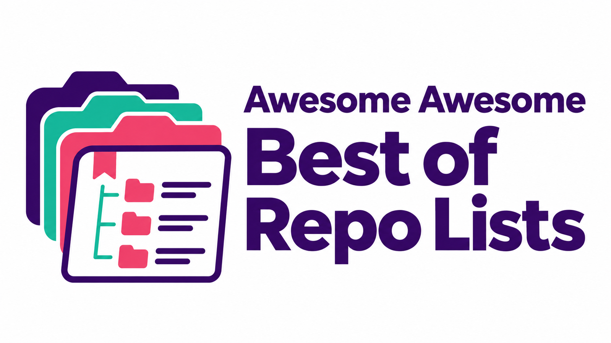

# Awesome Awesome Best of Repo Lists




<details>
<summary><strong>Languages · Sprachen · 18</strong></summary>

[ English](README.md) · [ Deutsch](README.de.md) · [ Español](README.es.md) · [ Français](README.fr.md) · [ Italiano](README.it.md) · [ Português](README.pt.md)

[ Nederlands](README.nl.md) · [ Polski](README.pl.md) · [ Türkçe](README.tr.md) · [ 日本語](README.ja.md) · [ 한국어](README.ko.md) · [ 中文](README.zh.md)

[ العربية](README.ar.md) · [ हिन्दी](README.hi.md) · [ Bahasa Indonesia](README.id.md) · [ Tiếng Việt](README.vi.md) · [ Українська](README.uk.md) · [ Svenska](README.sv.md)

</details>

## 探索精选代码仓库列表

涵盖 15 个类别、900 个开源列表和资源。

> 已收录全部 900 个链接。名称和标签保留原文；详细说明见英语和德语目录。

**复制仓库链接:**

```text
https://github.com/Supersynergy/awesome-awesome-best-of-repo-lists
```

**数据与链接:** [JSONL](data/sources.jsonl) · [URLs](data/urls.txt) · [Agent guide](CATALOG.md)

## 分类

- [综合列表](#c-meta-meta) · 225
- [人工智能 · LLM · MCP · 智能体](#c-ai-llm-mcp) · 225
- [语言与生态系统](#c-languages) · 157
- [安全 · 隐私](#c-security-privacy) · 68
- [数据 · API · 抓取](#c-data-domains) · 62
- [DevOps · 云 · 基础设施](#c-devops) · 35
- [自托管 · Docker · 家庭实验室](#c-selfhosted) · 20
- [商业 · SaaS](#c-business-saas) · 24
- [研究 · 论文](#c-research) · 20
- [供应链 · 许可证](#c-supply-chain) · 19
- [最佳排行榜](#c-best-of) · 5
- [入门项目 · 模板](#c-starters) · 12
- [公共部门](#c-public-sector) · 6
- [注册表 · 目录](#c-registries) · 14
- [官方目录](#c-official-catalogs) · 8

---

<a id="c-meta-meta"></a>
## 综合列表 <sub>(225)</sub>

<details>
<summary><strong>展开 225 条</strong></summary>

- **[sindresorhus/awesome](https://github.com/sindresorhus/awesome)** · `awesome` `index` `all`
- **[bayandin/awesome-awesomeness](https://github.com/bayandin/awesome-awesomeness)** · `awesome` `index`
- **[codecrafters-io/build-your-own-x](https://github.com/codecrafters-io/build-your-own-x)** · `reimplement` `learning`
- **[public-apis/public-apis](https://github.com/public-apis/public-apis)** · `api` `data` `integrations`
- **[ripienaar/free-for-dev](https://github.com/ripienaar/free-for-dev)** · `saas` `free-tier` `infra`
- **[practical-tutorials/project-based-learning](https://github.com/practical-tutorials/project-based-learning)** · `learning` `skeleton`
- **[EbookFoundation/free-programming-books](https://github.com/EbookFoundation/free-programming-books)** · `learning` `books`
- **[nilbuild/developer-roadmap (vormals kamranahmedse/developer-roadmap)](https://github.com/nilbuild/developer-roadmap)** · `learning` `roadmap`
- **[donnemartin/system-design-primer](https://github.com/donnemartin/system-design-primer)** · `architecture` `system-design`
- **[best-of-lists/best-of](https://github.com/best-of-lists/best-of)** · `best-of` `ranking` `quality-score`
- **[Smile-L/AwesomeAwesome](https://github.com/Smile-L/AwesomeAwesome)** · `awesome` `ranking`
- **[star-history.com](https://www.star-history.com)** · `stars` `trend`
- **[Trendshift](https://trendshift.io)** · `trending` `momentum`
- **[GitHub Trending](https://github.com/trending)** · `trending` `momentum` `github`
- **[GitHub Topics](https://github.com/topics)** · `topics` `github` `discovery`
- **[GitHub Collections](https://github.com/collections)** · `github` `curated`
- **[GitLab Explore](https://gitlab.com/explore)** · `forge` `gitlab` `discovery`
- **[Codeberg Explore](https://codeberg.org/explore/repos)** · `forge` `codeberg` `foss`
- **[OSS Insight](https://ossinsight.io)** · `analytics` `contributors`
- **[context-awesome](https://www.context-awesome.com)** · `awesome` `mcp` `agent`
- **[Awesome Explorer](https://awexplor.github.io)** · `awesome` `search`
- **[Project Awesome](https://project-awesome.org)** · `awesome` `browse`
- **[alexanderop/awesome-local-first](https://github.com/alexanderop/awesome-local-first)** · `local-first` `sync` `crdt` `offline`
- **[lo-fi.so Local-First Landscape](https://lo-fi.so)** · `local-first` `landscape` `products`
- **[gitstars.io](https://gitstars.io)** · `trending` `momentum` `api` `discovery` `gitlab` `unauth`
- **[gitstars /explore](https://gitstars.io/explore)** · `trending` `momentum` `api` `discovery` `query-search` `unauth`
- **[gitstars /trending](https://gitstars.io/trending)** · `trending` `momentum` `api` `unauth`
- **[MunGell/awesome-for-beginners](https://github.com/MunGell/awesome-for-beginners)** · `beginner-project` `beginners-friendly`
- **[wasabeef/awesome-android-ui](https://github.com/wasabeef/awesome-android-ui)** · `android` `ui`
- **[goabstract/Awesome-Design-Tools](https://github.com/goabstract/Awesome-Design-Tools)** · `animations` `design` `design-systems` `design-tools` `font-awesome` `ui-design`
- **[hesamsheikh/awesome-openclaw-usecases](https://github.com/hesamsheikh/awesome-openclaw-usecases)** · `clawdbot` `moltbot` `openclaw` `openclaw-plugin` `openclaw-setup` `openclaw-skills`
- **[abhisheknaiidu/awesome-github-profile-readme](https://github.com/abhisheknaiidu/awesome-github-profile-readme)** · `github` `github-profile-readme` `github-readme` `portfolio` `profile-readme`
- **[viatsko/awesome-vscode](https://github.com/viatsko/awesome-vscode)** · `visual-studio` `visual-studio-code` `visual-studio-code-extension` `visual-studio-code-theme` `visualstudio` `vscode`
- **[ashishps1/awesome-low-level-design](https://github.com/ashishps1/awesome-low-level-design)** · `design-patterns` `interview` `interview-practice` `interview-questions` `lld` `low-level-design`
- **[Igglybuff/awesome-piracy](https://github.com/Igglybuff/awesome-piracy)** · `audiobooks` `comics` `ebooks` `movies` `music` `piracy`
- **[awesome-dsh-plugin/awesome-dsh-plugin](https://github.com/awesome-dsh-plugin/awesome-dsh-plugin)** · `deepseek-harness` `dsh` `dsh-plugin`
- **[PicoTrex/Awesome-Nano-Banana-images](https://github.com/PicoTrex/Awesome-Nano-Banana-images)** · `gemini-2-5-flash-image` `nano-banana`
- **[jbhuang0604/awesome-computer-vision](https://github.com/jbhuang0604/awesome-computer-vision)**
- **[matiassingers/awesome-readme](https://github.com/matiassingers/awesome-readme)** · `readme`
- **[iCHAIT/awesome-macOS](https://github.com/iCHAIT/awesome-macOS)** · `apple` `awesome-lists` `mac` `macos`
- **[gztchan/awesome-design](https://github.com/gztchan/awesome-design)** · `adobe` `creative` `curated` `design` `design-system` `designer-news`
- **[jtoy/awesome-tensorflow](https://github.com/jtoy/awesome-tensorflow)**
- **[vitejs/awesome-vite](https://github.com/vitejs/awesome-vite)** · `vite` `vitejs`
- **[thibmaek/awesome-raspberry-pi](https://github.com/thibmaek/awesome-raspberry-pi)** · `raspberry-pi` `rpi`
- **[chentsulin/awesome-graphql](https://github.com/chentsulin/awesome-graphql)** · `graphql`
- **[nestjs/awesome-nestjs](https://github.com/nestjs/awesome-nestjs)** · `nestjs`
- **[rShetty/awesome-podcasts](https://github.com/rShetty/awesome-podcasts)** · `awesome-lists` `podcast` `software`
- **[iptv-org/awesome-iptv](https://github.com/iptv-org/awesome-iptv)** · `epg` `iptv` `players` `tv`
- **[theanalyst/awesome-distributed-systems](https://github.com/theanalyst/awesome-distributed-systems)** · `architecture` `consensus` `distributed-systems` `lamport` `paper` `paxos`
- **[xgrommx/awesome-redux](https://github.com/xgrommx/awesome-redux)** · `redux` `redux-documentation`
- **[mehdihadeli/awesome-software-architecture](https://github.com/mehdihadeli/awesome-software-architecture)** · `architectural-patterns` `architectural-styles` `architecture` `clean-architecture` `ddd` `ddd-architecture`
- **[oz123/awesome-c](https://github.com/oz123/awesome-c)** · `c`
- **[cjwirth/awesome-ios-ui](https://github.com/cjwirth/awesome-ios-ui)**
- **[kjw0612/awesome-deep-vision](https://github.com/kjw0612/awesome-deep-vision)**
- **[bnb/awesome-hyper](https://github.com/bnb/awesome-hyper)** · `hyper` `hyperterm` `terminal` `zeit`
- **[webpro/awesome-dotfiles](https://github.com/webpro/awesome-dotfiles)** · `bash` `dotfiles` `dotfiles-resources` `fish` `shell` `tools`
- **[timschneeb/awesome-shizuku](https://github.com/timschneeb/awesome-shizuku)** · `adb` `android` `android-mods` `no-root` `rootless` `shizuku`
- **[paralax/awesome-honeypots](https://github.com/paralax/awesome-honeypots)** · `honeyd` `honeypot`
- **[rothgar/awesome-tmux](https://github.com/rothgar/awesome-tmux)** · `tmux`
- **[awesome-lists/awesome-bash](https://github.com/awesome-lists/awesome-bash)** · `bash`
- **[aikorea/awesome-rl](https://github.com/aikorea/awesome-rl)**
- **[aalhour/awesome-compilers](https://github.com/aalhour/awesome-compilers)** · `books` `compiler` `interpreter` `programming-language` `runtime` `virtual-machine`
- **[awesome-jellyfin/awesome-jellyfin](https://github.com/awesome-jellyfin/awesome-jellyfin)** · `jellyfin`
- **[troxler/awesome-css-frameworks](https://github.com/troxler/awesome-css-frameworks)** · `collection` `css` `css-framework` `framework` `scss`
- **[emacs-tw/awesome-emacs](https://github.com/emacs-tw/awesome-emacs)** · `emacs`
- **[davidsonfellipe/awesome-wpo](https://github.com/davidsonfellipe/awesome-wpo)** · `webperf` `webperf-metrics` `webperformance`
- **[ashishps1/awesome-behavioral-interviews](https://github.com/ashishps1/awesome-behavioral-interviews)** · `behavioral-interviews` `interview-preparation` `interviews` `software-engineering`
- **[grpc-ecosystem/awesome-grpc](https://github.com/grpc-ecosystem/awesome-grpc)** · `grpc` `protocol-buffers`
- **[kitspace/awesome-electronics](https://github.com/kitspace/awesome-electronics)** · `altium` `eagle` `electronics` `gerber` `hardware` `kicad`
- **[crownpku/Awesome-Chinese-NLP](https://github.com/crownpku/Awesome-Chinese-NLP)** · `chinese-nlp` `nlp`
- **[reHackable/awesome-reMarkable](https://github.com/reHackable/awesome-reMarkable)** · `remarkable-tablet`
- **[infoslack/awesome-web-hacking](https://github.com/infoslack/awesome-web-hacking)** · `appsec` `hacking` `hacking-tools` `metasploit` `owasp` `penetration-testing`
- **[kiloreux/awesome-robotics](https://github.com/kiloreux/awesome-robotics)** · `robotics`
- **[ChromeDevTools/awesome-chrome-devtools](https://github.com/ChromeDevTools/awesome-chrome-devtools)**
- **[RyanNielson/awesome-unity](https://github.com/RyanNielson/awesome-unity)** · `game-development` `unity`
- **[sirredbeard/awesome-wsl](https://github.com/sirredbeard/awesome-wsl)** · `hacktoberfest-accepted` `microsoft` `windows-10` `windows-subsystem` `windows-subsystem-for-linux` `windows-subsystem-linux`
- **[chubin/awesome-console-services](https://github.com/chubin/awesome-console-services)** · `curl` `terminal`
- **[dontriskit/awesome-ai-system-prompts](https://github.com/dontriskit/awesome-ai-system-prompts)**
- **[ebertti/awesome-telegram](https://github.com/ebertti/awesome-telegram)** · `telegram`
- **[stoeffel/awesome-fp-js](https://github.com/stoeffel/awesome-fp-js)**
- **[djadmin/awesome-bug-bounty](https://github.com/djadmin/awesome-bug-bounty)**
- **[awesome-android-root/awesome-android-root](https://github.com/awesome-android-root/awesome-android-root)** · `android` `android-app` `android-root` `android-tweaks` `apatch` `awesome-resources`
- **[korfuri/awesome-monorepo](https://github.com/korfuri/awesome-monorepo)** · `monorepo`
- **[lightSky/Awesome-MaterialDesign](https://github.com/lightSky/Awesome-MaterialDesign)**
- **[tastejs/awesome-app-ideas](https://github.com/tastejs/awesome-app-ideas)**
- **[awesome-css-group/awesome-css](https://github.com/awesome-css-group/awesome-css)** · `css`
- **[nix-community/awesome-nix](https://github.com/nix-community/awesome-nix)** · `nix` `nixos`
- **[wasabeef/awesome-android-libraries](https://github.com/wasabeef/awesome-android-libraries)**
- **[zhaoxin94/awesome-domain-adaptation](https://github.com/zhaoxin94/awesome-domain-adaptation)** · `adversarial-learning` `domain-adaptation` `few-shot-learning` `image-translation` `optimal-transport` `paper`
- **[onqtam/awesome-cmake](https://github.com/onqtam/awesome-cmake)** · `cmake` `cmake-examples` `cmake-modules` `cmake-resources` `cmake-scripts` `cmake-toolchains`
- **[hyprland-community/awesome-hyprland](https://github.com/hyprland-community/awesome-hyprland)** · `awesome-lists` `awesome-readme` `awesome-resources` `hyprland` `hyprland-ipc`
- **[wesbos/awesome-uses](https://github.com/wesbos/awesome-uses)** · `hacktoberfest`
- **[qmonnet/awesome-ebpf](https://github.com/qmonnet/awesome-ebpf)** · `bcc` `bpf` `ebpf` `xdp`
- **[inputsh/awesome-linux](https://github.com/inputsh/awesome-linux)** · `desktop-environment` `linux` `linux-distribution` `x-window-manager`
- **[hemanth/awesome-pwa](https://github.com/hemanth/awesome-pwa)** · `modern-web` `progressive-web-app` `pwa` `service-worker` `web-development`
- **[dustinspecker/awesome-eslint](https://github.com/dustinspecker/awesome-eslint)** · `eslint`
- **[webpack-contrib/awesome-webpack](https://github.com/webpack-contrib/awesome-webpack)** · `documentation` `webpack`
- **[willianjusten/awesome-svg](https://github.com/willianjusten/awesome-svg)** · `svg`
- **[ipfs/awesome-ipfs](https://github.com/ipfs/awesome-ipfs)** · `awesome-ipfs` `ipfs`
- **[parro-it/awesome-micro-npm-packages](https://github.com/parro-it/awesome-micro-npm-packages)**
- **[fosslife/awesome-ricing](https://github.com/fosslife/awesome-ricing)** · `arch-linux` `cli-tool` `linux` `panel` `rice` `ricing`
- **[yvoronoy/awesome-english](https://github.com/yvoronoy/awesome-english)** · `english` `english-resources` `esl` `learn-english`
- **[tylerha97/awesome-reversing](https://github.com/tylerha97/awesome-reversing)**
- **[Ravencentric/awesome-arr](https://github.com/Ravencentric/awesome-arr)** · `automation`
- **[agarrharr/awesome-macos-screensavers](https://github.com/agarrharr/awesome-macos-screensavers)** · `screensavers`
- **[kakoni/awesome-healthcare](https://github.com/kakoni/awesome-healthcare)** · `health`
- **[jinwchoi/awesome-action-recognition](https://github.com/jinwchoi/awesome-action-recognition)** · `action-classification` `action-detection` `action-recognition` `activity-recognition` `activity-understanding` `object-recognition`
- **[JefMari/awesome-wysiwyg-editors](https://github.com/JefMari/awesome-wysiwyg-editors)** · `rich-text-editor` `wysiwyg` `wysiwyg-editor`
- **[micromata/awesome-css-learning](https://github.com/micromata/awesome-css-learning)** · `css` `css-learning` `learning`
- **[inputsh/awesome-c](https://github.com/inputsh/awesome-c)** · `c`
- **[reed-hong/awesome-libra](https://github.com/reed-hong/awesome-libra)**
- **[myles/awesome-static-generators](https://github.com/myles/awesome-static-generators)** · `website`
- **[sporto/awesome-elm](https://github.com/sporto/awesome-elm)** · `elm` `elm-apps` `elm-language` `elm-news` `elm-tutorial` `elm-videos`
- **[dreamingechoes/awesome-mental-health](https://github.com/dreamingechoes/awesome-mental-health)** · `mental-health` `mental-health-awareness` `self-care`
- **[oven-sh/awesome-bun](https://github.com/oven-sh/awesome-bun)** · `awesome-bun` `bun` `bunjs`
- **[neiesc/awesome-minimalist](https://github.com/neiesc/awesome-minimalist)** · `awesome-lists` `hacktoberfest` `minimalistic`
- **[mhxion/awesome-discord-communities](https://github.com/mhxion/awesome-discord-communities)** · `beginner` `community` `discord` `discord-server` `game-development` `web`
- **[web-padawan/awesome-web-components](https://github.com/web-padawan/awesome-web-components)** · `custom-elements` `shadow-dom` `web-components` `webcomponents`
- **[dawdle-deer/awesome-learn-gamedev](https://github.com/dawdle-deer/awesome-learn-gamedev)** · `education` `game-development` `gamedev` `learn` `learning`
- **[sanjeed5/awesome-cursor-rules-mdc](https://github.com/sanjeed5/awesome-cursor-rules-mdc)**
- **[veelenga/awesome-crystal](https://github.com/veelenga/awesome-crystal)** · `crystal` `shards`
- **[dweinstein/awesome-frida](https://github.com/dweinstein/awesome-frida)** · `android` `dynamic-analysis` `frida` `hooking` `ios` `r2frida`
- **[qazbnm456/awesome-cve-poc](https://github.com/qazbnm456/awesome-cve-poc)** · `cve` `poc`
- **[styfle/awesome-online-ide](https://github.com/styfle/awesome-online-ide)** · `ide`
- **[snoopysecurity/awesome-burp-extensions](https://github.com/snoopysecurity/awesome-burp-extensions)**
- **[pawelborkar/awesome-repos](https://github.com/pawelborkar/awesome-repos)** · `awesome-repos` `free` `github-repos`
- **[jondot/awesome-devenv](https://github.com/jondot/awesome-devenv)**
- **[Keycapsss/awesome-mechanical-keyboard](https://github.com/Keycapsss/awesome-mechanical-keyboard)** · `3d-printing` `gridsome-website` `hacktoberfest` `keyboard` `keyboard-layout` `mechanical-keyboard`
- **[stefanbuck/awesome-browser-extensions-for-github](https://github.com/stefanbuck/awesome-browser-extensions-for-github)** · `browser-extension` `chrome-extension` `github` `github-extension`
- **[gdcmarinho/awesome-project](https://github.com/gdcmarinho/awesome-project)** · `awesome-lists` `collection` `curated` `curated-list` `design` `links`
- **[websemantics/awesome-ant-design](https://github.com/websemantics/awesome-ant-design)**
- **[desireevl/awesome-quantum-computing](https://github.com/desireevl/awesome-quantum-computing)** · `quantum` `quantum-computing`
- **[adamsitnik/awesome-dot-net-performance](https://github.com/adamsitnik/awesome-dot-net-performance)**
- **[shubhamgrg04/awesome-diagramming](https://github.com/shubhamgrg04/awesome-diagramming)** · `diagram` `uml`
- **[emijrp/awesome-awesome](https://github.com/emijrp/awesome-awesome)**
- **[Bogdanp/awesome-advent-of-code](https://github.com/Bogdanp/awesome-advent-of-code)** · `advent-of-code` `advent-of-code-2018` `advent-of-code-2019` `advent-of-code-2020` `advent-of-code-2021` `advent-of-code-2022`
- **[dwisiswant0/awesome-oneliner-bugbounty](https://github.com/dwisiswant0/awesome-oneliner-bugbounty)** · `bash` `bug-bounty` `bugbounty` `bugbountytips` `hacktoberfest` `liner-scripts`
- **[alfred-workflows/awesome-alfred-workflows](https://github.com/alfred-workflows/awesome-alfred-workflows)** · `alfred` `alfred-workflow` `text-manipulation`
- **[gamontal/awesome-katas](https://github.com/gamontal/awesome-katas)** · `awesome-lists` `code-katas` `coding` `coding-exercises` `coding-katas` `dojo`
- **[0PandaDEV/awesome-windows](https://github.com/0PandaDEV/awesome-windows)** · `microsoft` `windows`
- **[ocaml-community/awesome-ocaml](https://github.com/ocaml-community/awesome-ocaml)** · `ocaml` `programming-language`
- **[jkup/awesome-personal-blogs](https://github.com/jkup/awesome-personal-blogs)**
- **[postlight/awesome-cms](https://github.com/postlight/awesome-cms)** · `cms` `labs` `toml`
- **[kba/awesome-ocr](https://github.com/kba/awesome-ocr)**
- **[ahkscript/awesome-AutoHotkey](https://github.com/ahkscript/awesome-AutoHotkey)**
- **[mjebrahimi/Awesome-Microservices-DotNet](https://github.com/mjebrahimi/Awesome-Microservices-DotNet)** · `asp-net` `asp-net-core` `aspnet` `aspnet-core` `aspnet-mvc` `aspnetcore`
- **[amusi/awesome-lane-detection](https://github.com/amusi/awesome-lane-detection)** · `lane-detection` `lane-lines-detection`
- **[olilarkin/awesome-musicdsp](https://github.com/olilarkin/awesome-musicdsp)** · `audio` `audiounit` `dsp` `plugin` `vst` `vst2`
- **[manuzhang/awesome-streaming](https://github.com/manuzhang/awesome-streaming)** · `stream-processing`
- **[SubmitGame/awesome-decomp-games](https://github.com/SubmitGame/awesome-decomp-games)** · `decompilation` `game-preservation` `recompilation` `reverse-engineering` `source-port`
- **[CodyReichert/awesome-cl](https://github.com/CodyReichert/awesome-cl)** · `common-lisp` `common-lisp-tools` `libraries` `lisp` `quicklisp`
- **[aljazceru/awesome-nostr](https://github.com/aljazceru/awesome-nostr)** · `nostr`
- **[dictcp/awesome-git](https://github.com/dictcp/awesome-git)** · `awesome-lists` `git`
- **[logseq/awesome-logseq](https://github.com/logseq/awesome-logseq)**
- **[simonaronsson/awesome-software-architecture](https://github.com/simonaronsson/awesome-software-architecture)** · `architecture` `hacktoberfest` `software-architecture`
- **[rafi/awesome-vim-colorschemes](https://github.com/rafi/awesome-vim-colorschemes)** · `collection` `color-scheme` `colors` `gvim` `macvim` `neovim`
- **[YanjieZe/awesome-humanoid-robot-learning](https://github.com/YanjieZe/awesome-humanoid-robot-learning)**
- **[Juude/awesome-android-performance](https://github.com/Juude/awesome-android-performance)** · `android` `android-performance` `memory-leak` `performance-optimization`
- **[networktocode/awesome-network-automation](https://github.com/networktocode/awesome-network-automation)**
- **[editor-js/awesome-editorjs](https://github.com/editor-js/awesome-editorjs)** · `editorjs` `libraries` `tools`
- **[plenaryapp/awesome-rss-feeds](https://github.com/plenaryapp/awesome-rss-feeds)** · `feed` `opml` `opml-files` `plenary` `rss` `rss-feed`
- **[razum2um/awesome-clojure](https://github.com/razum2um/awesome-clojure)** · `clojure` `hacktoberfest`
- **[diegocard/awesome-html5](https://github.com/diegocard/awesome-html5)**
- **[nicolesaidy/awesome-web-design](https://github.com/nicolesaidy/awesome-web-design)** · `design` `ui-design` `ux-design` `webdesign`
- **[ttt30ga/awesome-product-design](https://github.com/ttt30ga/awesome-product-design)** · `article` `bookmark` `design` `design-resource` `font` `iot`
- **[chartjs/awesome](https://github.com/chartjs/awesome)** · `chartjs` `charts` `integrations` `plugins`
- **[rollup/awesome](https://github.com/rollup/awesome)**
- **[iipc/awesome-web-archiving](https://github.com/iipc/awesome-web-archiving)** · `webarchiving`
- **[jsuarezruiz/awesome-dotnet-maui](https://github.com/jsuarezruiz/awesome-dotnet-maui)** · `dotnet` `dotnet-maui` `maui`
- **[italiaremote/awesome-italia-remote](https://github.com/italiaremote/awesome-italia-remote)** · `italy` `jobs` `remote` `remote-jobs`
- **[docsifyjs/awesome-docsify](https://github.com/docsifyjs/awesome-docsify)** · `docsify` `docsify-plugin`
- **[chihming/awesome-network-embedding](https://github.com/chihming/awesome-network-embedding)** · `graph-embeddings` `knowledge-graph` `network-embedding` `representation-learning`
- **[luruke/awesome-casestudy](https://github.com/luruke/awesome-casestudy)** · `case-studies` `development` `frontend` `performance` `reading` `webgl`
- **[mauhai/awesome-jupyterlab](https://github.com/mauhai/awesome-jupyterlab)** · `collections` `jupyterlab` `jupyterlab-extension`
- **[shlomi-noach/awesome-mysql](https://github.com/shlomi-noach/awesome-mysql)**
- **[kgryte/awesome-peer-to-peer](https://github.com/kgryte/awesome-peer-to-peer)** · `p2p` `peer-to-peer`
- **[zigcc/awesome-zig](https://github.com/zigcc/awesome-zig)** · `andrew-kelley` `bun` `mach` `zig` `zig-lib` `zig-library`
- **[davidgasquez/awesome-duckdb](https://github.com/davidgasquez/awesome-duckdb)**
- **[gabrielelana/awesome-terminal-fonts](https://github.com/gabrielelana/awesome-terminal-fonts)**
- **[nikgraf/awesome-draft-js](https://github.com/nikgraf/awesome-draft-js)** · `draft-js`
- **[heyalexej/awesome-images](https://github.com/heyalexej/awesome-images)**
- **[bungle/awesome-resty](https://github.com/bungle/awesome-resty)**
- **[yaolifeng0629/Awesome-independent-tools](https://github.com/yaolifeng0629/Awesome-independent-tools)** · `awesome-resources` `dev` `developer` `developer-tools` `development` `independent`
- **[dend/awesome-product-management](https://github.com/dend/awesome-product-management)** · `pm` `product` `product-management`
- **[eug/awesome-opengl](https://github.com/eug/awesome-opengl)** · `computer-graphics` `game-development` `glsl-editors` `graphics-pipeline` `opengl` `opengl-library`
- **[aolofsson/awesome-opensource-hardware](https://github.com/aolofsson/awesome-opensource-hardware)**
- **[mojoaxel/awesome-regression-testing](https://github.com/mojoaxel/awesome-regression-testing)** · `test-automation` `testing` `testing-tools`
- **[awesome-mqtt/awesome-mqtt](https://github.com/awesome-mqtt/awesome-mqtt)** · `internet-of-things` `mqtt` `smarthome`
- **[jubalh/awesome-os](https://github.com/jubalh/awesome-os)** · `kernel` `linux` `linux-kernel` `operating-system` `os` `os-dev`
- **[stax76/awesome-mpv](https://github.com/stax76/awesome-mpv)** · `libmpv` `media-player` `mpv` `mpv-config` `mpv-player` `mpv-script`
- **[StefanoCecere/awesome-opensource-unity](https://github.com/StefanoCecere/awesome-opensource-unity)** · `assets` `creative-commons` `game` `game-development` `gamedev` `opensource`
- **[t3chnoboy/awesome-awesome-awesome](https://github.com/t3chnoboy/awesome-awesome-awesome)**
- **[mundimark/awesome-markdown-editors](https://github.com/mundimark/awesome-markdown-editors)**
- **[workos/awesome-developer-experience](https://github.com/workos/awesome-developer-experience)**
- **[uhub/awesome-c](https://github.com/uhub/awesome-c)** · `c` `curated-list`
- **[vert-x3/vertx-awesome](https://github.com/vert-x3/vertx-awesome)**
- **[stevemao/awesome-git-addons](https://github.com/stevemao/awesome-git-addons)** · `add-on` `add-ons` `addon` `addons` `cli` `git`
- **[natpen/awesome-wayland](https://github.com/natpen/awesome-wayland)** · `sway` `swaywm` `wayland` `wayland-compositor` `window-manager` `wm`
- **[mobxjs/awesome-mobx](https://github.com/mobxjs/awesome-mobx)**
- **[Carlos487/awesome-wpf](https://github.com/Carlos487/awesome-wpf)** · `controls` `dotnet` `dotnet-core` `net` `ui-components` `wpf`
- **[michelpereira/awesome-games-of-coding](https://github.com/michelpereira/awesome-games-of-coding)** · `game` `guido-van-robot` `programming-language` `robocode`
- **[akrawchyk/awesome-vim](https://github.com/akrawchyk/awesome-vim)** · `vim`
- **[vlang/awesome-v](https://github.com/vlang/awesome-v)** · `v`
- **[matchai/awesome-pinned-gists](https://github.com/matchai/awesome-pinned-gists)** · `pinned-gist`
- **[Friz-zy/awesome-linux-containers](https://github.com/Friz-zy/awesome-linux-containers)** · `best-practices` `containers` `linux-containers`
- **[Fr0sT-Brutal/awesome-pascal](https://github.com/Fr0sT-Brutal/awesome-pascal)** · `delphi` `freepascal` `lazarus` `pascal-language`
- **[ad-si/awesome-3d-printing](https://github.com/ad-si/awesome-3d-printing)** · `3d` `3d-printer` `3d-printing` `3d-scanner` `3d-scanning` `cad`
- **[gleam-lang/awesome-gleam](https://github.com/gleam-lang/awesome-gleam)** · `gleam` `libraries` `projects`
- **[szabgab/awesome-for-non-programmers](https://github.com/szabgab/awesome-for-non-programmers)** · `awesome-lists` `readme`
- **[PanJiaChen/awesome-bookmarks](https://github.com/PanJiaChen/awesome-bookmarks)**
- **[agarrharr/awesome-static-website-services](https://github.com/agarrharr/awesome-static-website-services)**
- **[Wenzel/awesome-virtualization](https://github.com/Wenzel/awesome-virtualization)** · `hypervisor` `virtual-machine` `virtualization`
- **[thomasdarimont/awesome-keycloak](https://github.com/thomasdarimont/awesome-keycloak)**
- **[mundimark/awesome-markdown](https://github.com/mundimark/awesome-markdown)**
- **[mehcode/awesome-atom](https://github.com/mehcode/awesome-atom)** · `atom`
- **[alexellis/awesome-baremetal](https://github.com/alexellis/awesome-baremetal)**
- **[awesome-spark/awesome-spark](https://github.com/awesome-spark/awesome-spark)** · `apache-spark` `pyspark` `sparkr`
- **[Famolus/awesome-sass](https://github.com/Famolus/awesome-sass)** · `css` `sass` `scss`
- **[tramcar/awesome-job-boards](https://github.com/tramcar/awesome-job-boards)** · `job-board` `jobs`
- **[agamm/awesome-developer-first](https://github.com/agamm/awesome-developer-first)** · `developer-first` `developer-tools`
- **[libukai/Awesome-ChatTTS](https://github.com/libukai/Awesome-ChatTTS)** · `ai` `chattts`
- **[MuxaJlbl4/Awesome-PlayStation-Vita](https://github.com/MuxaJlbl4/Awesome-PlayStation-Vita)** · `playstation` `playstation-vita` `ps-vita` `pstv` `psv` `psvita`
- **[warpnet/awesome-prometheus](https://github.com/warpnet/awesome-prometheus)** · `hacktoberfest` `prometheus`
- **[aloisdg/awesome-regex](https://github.com/aloisdg/awesome-regex)**
- **[alexdebrie/awesome-dynamodb](https://github.com/alexdebrie/awesome-dynamodb)**

</details>

<a id="c-ai-llm-mcp"></a>
## 人工智能 · LLM · MCP · 智能体 <sub>(225)</sub>

<details>
<summary><strong>展开 225 条</strong></summary>

- **[Shubhamsaboo/awesome-llm-apps](https://github.com/Shubhamsaboo/awesome-llm-apps)** · `llm` `agents` `rag` `donor-code`
- **[punkpeye/awesome-mcp-servers](https://github.com/punkpeye/awesome-mcp-servers)** · `mcp` `integrations`
- **[wong2/awesome-mcp-servers](https://github.com/wong2/awesome-mcp-servers)** · `mcp`
- **[MCP Registry (offiziell)](https://registry.modelcontextprotocol.io)** · `mcp` `registry` `api`
- **[modelcontextprotocol/servers](https://github.com/modelcontextprotocol/servers)** · `mcp` `reference`
- **[Smithery](https://smithery.ai)** · `mcp` `marketplace`
- **[PulseMCP](https://www.pulsemcp.com)** · `mcp` `news`
- **[Glama MCP](https://glama.ai/mcp/servers)** · `mcp` `search`
- **[e2b-dev/awesome-ai-agents](https://github.com/e2b-dev/awesome-ai-agents)** · `agents` `market`
- **[Hannibal046/Awesome-LLM](https://github.com/Hannibal046/Awesome-LLM)** · `llm` `papers`
- **[hesreallyhim/awesome-claude-code](https://github.com/hesreallyhim/awesome-claude-code)** · `claude-code` `hooks` `skills` `ai-coding`
- **[affaan-m/ECC (vormals affaan-m/everything-claude-code)](https://github.com/affaan-m/ECC)** · `claude-code` `aggregator`
- **[ComposioHQ/awesome-claude-skills](https://github.com/ComposioHQ/awesome-claude-skills)** · `skills` `claude-code`
- **[agentsmd/agents.md](https://github.com/agentsmd/agents.md)** · `agents-md` `standard`
- **[mahseema/awesome-ai-tools](https://github.com/mahseema/awesome-ai-tools)** · `ai-tools`
- **[steven2358/awesome-generative-ai](https://github.com/steven2358/awesome-generative-ai)** · `genai`
- **[kyrolabs/awesome-langchain](https://github.com/kyrolabs/awesome-langchain)** · `langchain` `rag`
- **[malteos/awesome-anonymization-for-llms](https://github.com/malteos/awesome-anonymization-for-llms)** · `pii` `dsgvo` `gdpr` `privacy` `presidio`
- **[Hugging Face Trending Papers](https://huggingface.co/papers/trending)** · `papers` `research`
- **[openclaw/openclaw](https://github.com/openclaw/openclaw)** · `agents` `reference` `security-warning`
- **[VoltAgent/awesome-design-md](https://github.com/VoltAgent/awesome-design-md)** · `design-md` `design-system` `design-tokens` `figma` `landing-page` `vibe-coding`
- **[VoltAgent/awesome-openclaw-skills](https://github.com/VoltAgent/awesome-openclaw-skills)** · `agent-skills` `awesome-lists` `clawd` `clawdbot` `clawdbot-skill` `clawdhub`
- **[VoltAgent/awesome-agent-skills](https://github.com/VoltAgent/awesome-agent-skills)** · `agent-skills` `ai-agents` `claude-code` `claude-code-skills` `claude-skills` `codex`
- **[aishwaryanr/awesome-generative-ai-guide](https://github.com/aishwaryanr/awesome-generative-ai-guide)** · `generative-ai` `interview-questions` `large-language-models` `llms` `notebook-jupyter` `vision-and-language`
- **[ChristosChristofidis/awesome-deep-learning](https://github.com/ChristosChristofidis/awesome-deep-learning)** · `deep-learning` `deep-learning-tutorial` `deep-networks` `face-images` `machine-learning` `neural-network`
- **[VoltAgent/awesome-claude-code-subagents](https://github.com/VoltAgent/awesome-claude-code-subagents)** · `ai-agent-framework` `ai-agent-tools` `ai-agents` `claude` `claude-ai` `claude-code-subagents`
- **[enescingoz/awesome-n8n-templates](https://github.com/enescingoz/awesome-n8n-templates)** · `ai-agents` `ai-automation` `automation` `automation-templates` `integration` `low-code`
- **[terryum/awesome-deep-learning-papers](https://github.com/terryum/awesome-deep-learning-papers)** · `deep-learning` `deep-neural-networks` `machine-learning`
- **[dipakkr/awesome-ai-engineering](https://github.com/dipakkr/awesome-ai-engineering)** · `agentic-ai` `ai-agents` `ai-engineering` `ai-projects` `ai-resources` `ai-tools`
- **[LiLittleCat/awesome-free-chatgpt](https://github.com/LiLittleCat/awesome-free-chatgpt)** · `chat` `chatgpt` `free` `freechatgpt`
- **[EthicalML/awesome-production-machine-learning](https://github.com/EthicalML/awesome-production-machine-learning)** · `data-mining` `deep-learning` `explainability` `interpretability` `large-scale-machine-learning` `large-scale-ml`
- **[keon/awesome-nlp](https://github.com/keon/awesome-nlp)** · `deep-learning` `language` `machine-learning` `natural-language-processing` `nlp` `text-mining`
- **[composio-community/awesome-codex-skills](https://github.com/composio-community/awesome-codex-skills)** · `awesome-lists` `awesome-resources` `codex` `codex-cli` `codex-skills` `coding-agent-skills`
- **[owainlewis/awesome-artificial-intelligence](https://github.com/owainlewis/awesome-artificial-intelligence)** · `ai` `artificial-intelligence` `deep-learning` `intelligent-machines` `intelligent-systems` `machine-intelligence`
- **[bharathgs/Awesome-pytorch-list](https://github.com/bharathgs/Awesome-pytorch-list)** · `computer-vision` `cv` `data-science` `deep-learning` `facebook` `machine-learning`
- **[Arindam200/awesome-ai-apps](https://github.com/Arindam200/awesome-ai-apps)** · `agents` `ai` `hacktoberfest` `llm` `mcp`
- **[travisvn/awesome-claude-skills](https://github.com/travisvn/awesome-claude-skills)** · `agentic-coding` `anthropic` `awesome-lists` `claude` `claude-ai` `claude-code`
- **[paperswithbacktest/awesome-systematic-trading](https://github.com/paperswithbacktest/awesome-systematic-trading)** · `algorithmic-trading` `algotrading` `alpha` `arbitrage-bot` `book` `finance`
- **[yihui-dev/awesome-opus5-5-videos](https://github.com/yihui-dev/awesome-opus5-5-videos)** · `ai-video` `claude` `claude-opus` `creative-coding` `motion-graphics` `prompts`
- **[visenger/awesome-mlops](https://github.com/visenger/awesome-mlops)** · `ai` `data-science` `devops` `engineering` `federated-learning` `machine-learning`
- **[donnemartin/awesome-aws](https://github.com/donnemartin/awesome-aws)** · `aws` `aws-cli` `aws-sdk` `cloud` `cloud-management` `cloudformation`
- **[YouMind-OpenLab/awesome-nano-banana-pro-prompts](https://github.com/YouMind-OpenLab/awesome-nano-banana-pro-prompts)** · `ai-image-generation` `ai-prompts` `gemini` `gemini-ai` `google-gemini` `image-generation`
- **[mnfst/awesome-free-llm-apis](https://github.com/mnfst/awesome-free-llm-apis)** · `ai` `aion` `api` `cohere` `free` `gemini`
- **[diff-usion/Awesome-Diffusion-Models](https://github.com/diff-usion/Awesome-Diffusion-Models)** · `artificial-intelligence` `diffusion-models` `generative-model` `machine-learning` `score-based` `score-matching`
- **[awesome-opencode/awesome-opencode](https://github.com/awesome-opencode/awesome-opencode)**
- **[BehiSecc/awesome-claude-skills](https://github.com/BehiSecc/awesome-claude-skills)**
- **[ZeroLu/awesome-nanobanana-pro](https://github.com/ZeroLu/awesome-nanobanana-pro)** · `gemini` `nanobanana` `nanobanana-pro` `nanobanana2` `nanobananapro` `prompt-engineering`
- **[YouMind-OpenLab/awesome-gpt-image-2](https://github.com/YouMind-OpenLab/awesome-gpt-image-2)** · `ai-image-generation` `ai-prompts` `commercial-illustration` `duct-tape` `gpt` `gpt-image`
- **[CodingDocs/awesome-java](https://github.com/CodingDocs/awesome-java)** · `code-quality` `database` `java` `mysql` `spring-boot` `springai`
- **[NirantK/awesome-project-ideas](https://github.com/NirantK/awesome-project-ideas)** · `classification` `dataset` `deep-learning` `forecasting` `image-classification` `machine-learning`
- **[ai-boost/awesome-prompts](https://github.com/ai-boost/awesome-prompts)** · `agents` `chatgpt` `context-engineering` `llm` `papers` `prompt`
- **[WangRongsheng/awesome-LLM-resources](https://github.com/WangRongsheng/awesome-LLM-resources)** · `book` `course` `large-language-models` `llama` `llm` `mistral`
- **[MrNeRF/awesome-3D-gaussian-splatting](https://github.com/MrNeRF/awesome-3D-gaussian-splatting)** · `3d-gaussian-splatting` `3dgs` `gaussian-splatting` `nerf` `neural-rendering`
- **[WenyuChiou/awesome-agentic-ai-zh](https://github.com/WenyuChiou/awesome-agentic-ai-zh)** · `agentic-ai` `agentic-workflows` `ai-agent` `ai-agents` `chinese-llm` `claude-code`
- **[humanloop/awesome-chatgpt](https://github.com/humanloop/awesome-chatgpt)** · `chatgpt` `gpt-3` `gpt3` `openai`
- **[jamez-bondos/awesome-gpt4o-images](https://github.com/jamez-bondos/awesome-gpt4o-images)** · `ai-art` `ai-image-examples` `anime-ai-art` `cartoon-style` `curated-collection` `generative-art`
- **[agmmnn/awesome-blender](https://github.com/agmmnn/awesome-blender)** · `3d` `3d-models` `blender` `blender-addon` `blender-extension` `blender-python`
- **[bkrem/awesome-solidity](https://github.com/bkrem/awesome-solidity)** · `contract-solidity` `dapps` `ethereum` `linter-solidity` `solidity` `solidity-compiler`
- **[likedan/Awesome-CoreML-Models](https://github.com/likedan/Awesome-CoreML-Models)** · `apple` `caffe` `caffemodel` `core-ml` `coreml` `coreml-framework`
- **[pliang279/awesome-multimodal-ml](https://github.com/pliang279/awesome-multimodal-ml)** · `computer-vision` `deep-learning` `healthcare` `machine-learning` `multimodal-learning` `natural-language-processing`
- **[hijkzzz/Awesome-LLM-Strawberry](https://github.com/hijkzzz/Awesome-LLM-Strawberry)** · `chain-of-thought` `coding` `llm` `mathematics` `mcts` `openai-o1`
- **[awesome-NeRF/awesome-NeRF](https://github.com/awesome-NeRF/awesome-NeRF)** · `nerf`
- **[georgezouq/awesome-ai-in-finance](https://github.com/georgezouq/awesome-ai-in-finance)** · `analysis` `cryptocurrency` `deep-learning` `financial` `neural-network` `quant`
- **[src-d/awesome-machine-learning-on-source-code](https://github.com/src-d/awesome-machine-learning-on-source-code)** · `machine-learning` `machine-learning-on-source-code`
- **[punkpeye/awesome-mcp-clients](https://github.com/punkpeye/awesome-mcp-clients)** · `clients` `mcp`
- **[fr0gger/Awesome-GPT-Agents](https://github.com/fr0gger/Awesome-GPT-Agents)** · `agents` `cybersecurity` `infosec` `llm`
- **[sindresorhus/awesome-chatgpt](https://github.com/sindresorhus/awesome-chatgpt)** · `ai` `artificial-intelligence` `chatgpt` `gpt` `gpt-3` `gpt-4`
- **[VoltAgent/awesome-codex-subagents](https://github.com/VoltAgent/awesome-codex-subagents)** · `ai-agents` `chatgpt` `codex` `codex-skills` `codex-subagents` `subagents`
- **[reorx/awesome-chatgpt-api](https://github.com/reorx/awesome-chatgpt-api)** · `chatgpt` `chatgpt-api`
- **[jason718/awesome-self-supervised-learning](https://github.com/jason718/awesome-self-supervised-learning)** · `computer-vision` `deep-learning` `machine-learning` `natural-language-processing` `reinforcement-learning` `robotics`
- **[promptslab/Awesome-Prompt-Engineering](https://github.com/promptslab/Awesome-Prompt-Engineering)** · `chatgpt` `chatgpt-api` `deep-learning` `few-shot-learning` `gpt` `gpt-3`
- **[heilcheng/awesome-agent-skills](https://github.com/heilcheng/awesome-agent-skills)** · `agent-skills` `ai-agents` `ai-development` `anthropic` `automation` `claude`
- **[ikaijua/Awesome-AITools](https://github.com/ikaijua/Awesome-AITools)** · `agent-skills` `agents` `ai` `ai-tools` `artificial-intelligence` `awesome-lists`
- **[kjw0612/awesome-rnn](https://github.com/kjw0612/awesome-rnn)**
- **[EwingYangs/awesome-open-gpt](https://github.com/EwingYangs/awesome-open-gpt)** · `agentgpt` `ai` `aigc` `autogpt` `chatbox` `chatgpt`
- **[0xNyk/awesome-hermes-agent](https://github.com/0xNyk/awesome-hermes-agent)** · `agent-skills` `ai-agents` `ai-tools` `hermes-agent` `mcp` `memory`
- **[tensorchord/Awesome-LLMOps](https://github.com/tensorchord/Awesome-LLMOps)** · `ai-development-tools` `llmops` `mlops`
- **[appcypher/awesome-mcp-servers](https://github.com/appcypher/awesome-mcp-servers)** · `ai` `anthropic-claude` `context` `mcp` `model-context-protocol` `servers`
- **[showlab/Awesome-Video-Diffusion](https://github.com/showlab/Awesome-Video-Diffusion)** · `diffusion-models` `motion-customization` `video-editing` `video-generation` `video-generation-evaluation`
- **[lauragift21/awesome-learning-resources](https://github.com/lauragift21/awesome-learning-resources)** · `ai` `css` `developer-stories` `javascript` `machine-learning` `open-source`
- **[xlite-dev/Awesome-LLM-Inference](https://github.com/xlite-dev/Awesome-LLM-Inference)** · `awesome-llm` `deepseek` `deepseek-r1` `deepseek-v3` `flash-attention` `flash-attention-3`
- **[filipecalegario/awesome-vibe-coding](https://github.com/filipecalegario/awesome-vibe-coding)** · `ai-agent` `ai-agents` `ai-coding-assistant` `ai-coding-tools` `cursor` `lovable`
- **[sacridini/Awesome-Geospatial](https://github.com/sacridini/Awesome-Geospatial)** · `data-analysis` `deep-learning` `earth-observation` `geoprocessing` `geospatial` `geospatial-analysis`
- **[kelvins/awesome-mlops](https://github.com/kelvins/awesome-mlops)** · `ai` `data-science` `machine-learning` `machine-learning-engineering` `ml` `mle`
- **[libukai/awesome-agent-skills](https://github.com/libukai/awesome-agent-skills)** · `agent` `awsome-list` `claudecode` `openclaw` `skills`
- **[ai-boost/awesome-harness-engineering](https://github.com/ai-boost/awesome-harness-engineering)** · `agent-harness` `agent-memory` `agent-orchestration` `ai-agent-harness` `ai-agents` `context-engineering`
- **[nibzard/awesome-agentic-patterns](https://github.com/nibzard/awesome-agentic-patterns)**
- **[cmhungsteve/Awesome-Transformer-Attention](https://github.com/cmhungsteve/Awesome-Transformer-Attention)** · `attention-mechanism` `attention-mechanisms` `computer-vision` `deep-learning` `detr` `papers`
- **[alvinreal/awesome-opensource-ai](https://github.com/alvinreal/awesome-opensource-ai)** · `agents` `ai` `artificial-intelligence` `generative-ai` `llm` `machine-learning`
- **[serenakeyitan/awesome-notebookLM-prompts](https://github.com/serenakeyitan/awesome-notebookLM-prompts)** · `ai` `ai-agents` `gemini` `google` `nanobananapro` `notebooklm`
- **[nichtdax/awesome-totally-open-chatgpt](https://github.com/nichtdax/awesome-totally-open-chatgpt)** · `alternative` `awesome-lists` `chatgpt` `open-source`
- **[xixu-me/awesome-persona-distill-skills](https://github.com/xixu-me/awesome-persona-distill-skills)** · `agent-skills` `persona-distill`
- **[gostor/awesome-go-storage](https://github.com/gostor/awesome-go-storage)** · `golang` `hacktoberfest` `storage`
- **[walkinglabs/awesome-harness-engineering](https://github.com/walkinglabs/awesome-harness-engineering)** · `agent` `agentic` `agentic-ai` `ai` `ai-agents` `awesome-lists`
- **[armankhondker/awesome-ai-ml-resources](https://github.com/armankhondker/awesome-ai-ml-resources)** · `artifical-intelligense` `machine-learning` `roadmap`
- **[Astrosp/Awesome-OSINT-List](https://github.com/Astrosp/Awesome-OSINT-List)** · `ai` `ai-tools` `bug-bounty` `cybersecurity` `information-gathering` `osint`
- **[luban-agi/Awesome-AIGC-Tutorials](https://github.com/luban-agi/Awesome-AIGC-Tutorials)** · `ai` `aigc` `chatgpt` `courses-resource` `deep-learning` `llm`
- **[GT-RIPL/Awesome-LLM-Robotics](https://github.com/GT-RIPL/Awesome-LLM-Robotics)**
- **[HumanSignal/awesome-data-labeling](https://github.com/HumanSignal/awesome-data-labeling)** · `3d-annotation` `annotation` `annotation-tool` `audio-annotation` `audio-annotation-tool` `bounding-box`
- **[opendilab/awesome-RLHF](https://github.com/opendilab/awesome-RLHF)** · `deep-learning` `deep-reinforcement-learning` `human-feedback` `large-language-models` `reinforcement-learning` `rlhf`
- **[hibayesian/awesome-automl-papers](https://github.com/hibayesian/awesome-automl-papers)** · `automated-feature-engineering` `automl` `hyperparameter-optimization` `neural-architecture-search`
- **[jphall663/awesome-machine-learning-interpretability](https://github.com/jphall663/awesome-machine-learning-interpretability)** · `ai-safety` `data-science` `explainable-ml` `fairness` `interpretability` `interpretable-ai`
- **[jamesmurdza/awesome-ai-devtools](https://github.com/jamesmurdza/awesome-ai-devtools)**
- **[jghoman/awesome-apache-airflow](https://github.com/jghoman/awesome-apache-airflow)** · `airflow` `apache-airflow` `workflow-management`
- **[chrieke/awesome-satellite-imagery-datasets](https://github.com/chrieke/awesome-satellite-imagery-datasets)** · `computer-vision` `deep-learning` `earth-observation` `instance-segmentation` `machine-learning` `object-detection`
- **[M-3LAB/awesome-industrial-anomaly-detection](https://github.com/M-3LAB/awesome-industrial-anomaly-detection)** · `anomaly-detection` `anomaly-segmentation` `computer-vision` `dataset` `deep-learning` `defect-detection`
- **[eosphoros-ai/Awesome-Text2SQL](https://github.com/eosphoros-ai/Awesome-Text2SQL)** · `ai` `datset` `deep-learning` `finetuning` `hacktoberfest` `hacktoberfest2024`
- **[openblockchains/awesome-blockchains](https://github.com/openblockchains/awesome-blockchains)** · `blockchain` `content-addressable-storage` `cryptohash` `distributed-database` `ethereum` `git`
- **[nightrome/really-awesome-gan](https://github.com/nightrome/really-awesome-gan)**
- **[krishnakumarsekar/awesome-quantum-machine-learning](https://github.com/krishnakumarsekar/awesome-quantum-machine-learning)** · `ai` `ant-colony-optimization` `artificial-intelligence` `artificial-neural-networks` `fcm` `hmm-model`
- **[krzjoa/awesome-python-data-science](https://github.com/krzjoa/awesome-python-data-science)** · `awesome-python` `data-analysis` `data-science` `data-visualization` `deep-learning` `machine-learning`
- **[bergside/awesome-design-skills](https://github.com/bergside/awesome-design-skills)** · `agent-skills` `agentic-ai` `agentic-workflow` `agents` `ai` `ai-agents`
- **[awesome-scripts/awesome-userscripts](https://github.com/awesome-scripts/awesome-userscripts)** · `ad-blocking` `chatgpt` `chrome` `discord` `duckduckgo` `firefox`
- **[dk-liang/Awesome-Visual-Transformer](https://github.com/dk-liang/Awesome-Visual-Transformer)** · `detr` `transformer` `transformer-awesome` `transformer-cv` `transformer-with-cv` `visual-transformer`
- **[filipecalegario/awesome-generative-ai](https://github.com/filipecalegario/awesome-generative-ai)** · `ai-art` `chatgpt` `dall-e` `dalle2` `embeddings` `generative-ai`
- **[knightnemo/Awesome-World-Models](https://github.com/knightnemo/Awesome-World-Models)** · `dynamical-systems` `embodied-ai` `generative-model` `world-models`
- **[codefuse-ai/Awesome-Code-LLM](https://github.com/codefuse-ai/Awesome-Code-LLM)** · `ai` `datasets` `llm` `nlp` `papers` `software-engineering`
- **[taishi-i/awesome-ChatGPT-repositories](https://github.com/taishi-i/awesome-ChatGPT-repositories)** · `agent` `agent-skills` `ai` `chatgpt` `codex` `gpt-5`
- **[Meirtz/Awesome-Context-Engineering](https://github.com/Meirtz/Awesome-Context-Engineering)** · `agent` `agentic-ai` `agi` `cognitive-science` `context-engineering` `llm`
- **[yoloytang/Awesome-LLMs-for-Video-Understanding](https://github.com/yoloytang/Awesome-LLMs-for-Video-Understanding)**
- **[dangkhoasdc/awesome-ai-residency](https://github.com/dangkhoasdc/awesome-ai-residency)** · `artificial-intelligence` `internships` `jobs` `machine-learning`
- **[rob-med/awesome-TS-anomaly-detection](https://github.com/rob-med/awesome-TS-anomaly-detection)** · `anomaly-detection` `data-analysis` `data-mining` `machine-learning` `outlier-detection` `temporal-data`
- **[luspr/awesome-ml-courses](https://github.com/luspr/awesome-ml-courses)** · `ai-courses` `artificial-intelligence` `deep-learning` `machine-learning` `reinforcement-learning`
- **[RKiding/Awesome-finance-skills](https://github.com/RKiding/Awesome-finance-skills)** · `agent` `agent-skills` `finances` `fintech`
- **[jslee02/awesome-robotics-libraries](https://github.com/jslee02/awesome-robotics-libraries)** · `machine-learning` `motion-planning` `multibody-dynamics` `optimization` `robotics` `robotics-libraries`
- **[weiaicunzai/awesome-image-classification](https://github.com/weiaicunzai/awesome-image-classification)** · `computer-vision` `deep-learning` `image-classification` `papers`
- **[rafska/awesome-local-llm](https://github.com/rafska/awesome-local-llm)** · `ai` `llm` `local` `local-ai` `local-llm` `self-hosted`
- **[punkpeye/awesome-remote-mcp-servers](https://github.com/punkpeye/awesome-remote-mcp-servers)** · `mcp`
- **[endymecy/awesome-deeplearning-resources](https://github.com/endymecy/awesome-deeplearning-resources)** · `code` `corpus` `deep-learning` `modelzoo` `neural-network` `nlp`
- **[kyrolabs/awesome-agents](https://github.com/kyrolabs/awesome-agents)**
- **[ybayle/awesome-deep-learning-music](https://github.com/ybayle/awesome-deep-learning-music)** · `article` `audio` `audio-processing` `bib` `deep-learning` `deep-neural-networks`
- **[subeeshvasu/Awesome-Deblurring](https://github.com/subeeshvasu/Awesome-Deblurring)** · `burst-deblurring` `camera-shake` `deblurring` `deep-learning` `defocus-blur` `defocus-deblurring`
- **[hoya012/awesome-anomaly-detection](https://github.com/hoya012/awesome-anomaly-detection)** · `anomaly` `anomaly-detection` `anomalydetection` `awesome-anomaly-detection` `awesomeanomalydetection` `deep-learning`
- **[slavakurilyak/awesome-ai-agents](https://github.com/slavakurilyak/awesome-ai-agents)** · `agent` `agentic` `agents`
- **[FreedomIntelligence/Awesome-AI4Med](https://github.com/FreedomIntelligence/Awesome-AI4Med)** · `awesome-lists` `collection` `datasets` `medical` `medical-imaging` `medical-llms`
- **[moul/awesome-ssh](https://github.com/moul/awesome-ssh)** · `devops` `mosh` `openssh` `ssh` `ssh-agent` `ssh-key`
- **[i365dev/awesome-seo](https://github.com/i365dev/awesome-seo)** · `ai-search` `content-marketing` `generative-engine-optimization` `google-search-console` `robots-txt` `search-engine`
- **[ZeroLu/awesome-seedance](https://github.com/ZeroLu/awesome-seedance)** · `ai` `how-to-use` `prompt-engineering` `prompts` `seedance` `seedance-2`
- **[rohitg00/awesome-claude-code-toolkit](https://github.com/rohitg00/awesome-claude-code-toolkit)** · `claude` `claude-code` `claudecode` `claudecode-hooks` `plugins` `skills`
- **[merrymercy/awesome-tensor-compilers](https://github.com/merrymercy/awesome-tensor-compilers)** · `code-generation` `compiler` `deep-learning` `high-performance-computing` `machine-learning` `programming-language`
- **[underlines/awesome-ml](https://github.com/underlines/awesome-ml)**
- **[subeeshvasu/Awesome-Learning-with-Label-Noise](https://github.com/subeeshvasu/Awesome-Learning-with-Label-Noise)** · `deep-neural-networks` `label-noise` `noisy-data` `noisy-labels` `robust-learning` `unreliable-labels`
- **[DEEP-PolyU/Awesome-GraphRAG](https://github.com/DEEP-PolyU/Awesome-GraphRAG)** · `graphrag` `graphrag-paper` `graphrag-survey` `knowledge-graph` `large-language-models` `rag`
- **[vsitzmann/awesome-implicit-representations](https://github.com/vsitzmann/awesome-implicit-representations)**
- **[guyulongcs/Awesome-Deep-Learning-Papers-for-Search-Recommendation-Advertising](https://github.com/guyulongcs/Awesome-Deep-Learning-Papers-for-Search-Recommendation-Advertising)** · `advertising` `ctr` `cvr` `deep-learning` `recommender-system` `reinforcement-learning`
- **[reacher-z/Awesome-REA](https://github.com/reacher-z/Awesome-REA)** · `agent-skills` `ai-agents` `android-reverse-engineering` `awesome-resources` `binary-analysis` `decompilation`
- **[RManLuo/Awesome-LLM-KG](https://github.com/RManLuo/Awesome-LLM-KG)** · `awsome` `chatgpt` `gpt-4` `kg` `knowledge-graph` `language-model`
- **[webfuse-com/awesome-autoresearch](https://github.com/webfuse-com/awesome-autoresearch)** · `agentic-systems` `ai-agents` `ai-research` `ai-tools` `autonomous-agents` `autoresearch`
- **[yibie/awesome-jev](https://github.com/yibie/awesome-jev)** · `jev` `llm`
- **[hwalsuklee/awesome-deep-text-detection-recognition](https://github.com/hwalsuklee/awesome-deep-text-detection-recognition)** · `awesome-lists` `deep-learning` `ocr` `ocr-detection` `ocr-paper` `ocr-paper-list`
- **[LearnPrompt/awesome-seedance](https://github.com/LearnPrompt/awesome-seedance)** · `agent-skill` `ai-video` `ai-video-generation` `bytedance` `claude-code` `codex`
- **[akuity/awesome-argo](https://github.com/akuity/awesome-argo)** · `argo` `argo-events` `argo-rollouts` `argo-workflows` `argocd` `awesome-lists`
- **[he-y/Awesome-Pruning](https://github.com/he-y/Awesome-Pruning)** · `model-acceleration` `model-compression` `pruning`
- **[benedekrozemberczki/awesome-decision-tree-papers](https://github.com/benedekrozemberczki/awesome-decision-tree-papers)** · `cart` `catboost` `classification-model` `classification-trees` `classifier` `decision-tree`
- **[cbsudux/awesome-human-pose-estimation](https://github.com/cbsudux/awesome-human-pose-estimation)** · `2d-human-pose` `3d-human-pose` `computer-vision` `deep-learning` `deep-learning-papers` `human-pose-estimation`
- **[AI-Efficiency/Awesome-Model-Quantization](https://github.com/AI-Efficiency/Awesome-Model-Quantization)** · `awesome-lists` `binarization` `binary-neural-networks` `data-free-quantization` `diffusion-models` `efficient-inference`
- **[benedekrozemberczki/awesome-community-detection](https://github.com/benedekrozemberczki/awesome-community-detection)** · `bigclam` `clustering` `community-detection` `data-science` `deep-learning` `deepwalk`
- **[Jason2Brownlee/awesome-llm-books](https://github.com/Jason2Brownlee/awesome-llm-books)** · `books` `gpt` `llm-book` `llms`
- **[XiaoxinHe/Awesome-Graph-LLM](https://github.com/XiaoxinHe/Awesome-Graph-LLM)**
- **[sindresorhus/awesome-whisper](https://github.com/sindresorhus/awesome-whisper)** · `ai` `artificial-intelligence` `gpt` `openai` `speech-to-text` `transcription`
- **[qosf/awesome-quantum-software](https://github.com/qosf/awesome-quantum-software)** · `compilers` `quantum-algorithms` `quantum-annealing` `quantum-assembly` `quantum-chemistry` `quantum-circuit-simulator`
- **[eon01/awesome-chatgpt](https://github.com/eon01/awesome-chatgpt)** · `chatbot` `chatgpt` `chatgpt-api` `chatgpt-api-wrapper` `chatgpt-browser-extension` `chatgpt-chrome-extension`
- **[yudataguy/awesome-japanese](https://github.com/yudataguy/awesome-japanese)** · `hiragana` `japan` `japanese-language` `kanji` `katakana`
- **[andyrewlee/awesome-agent-orchestrators](https://github.com/andyrewlee/awesome-agent-orchestrators)** · `agent-coordination` `agent-orchestration` `agent-swarm` `agentic-ai` `ai-agents` `ai-coding`
- **[KrishMunot/awesome-startup](https://github.com/KrishMunot/awesome-startup)** · `ai` `ai-agents` `ai-tools` `code` `discounts` `engineering`
- **[manfreddiaz/awesome-autonomous-vehicles](https://github.com/manfreddiaz/awesome-autonomous-vehicles)** · `autonomous-cars` `autonomous-vehicles` `car-driving` `computer-vision` `deep-learning`
- **[wenhwu/awesome-remote-sensing-change-detection](https://github.com/wenhwu/awesome-remote-sensing-change-detection)** · `change-detection` `dataset` `deep-learning` `remote-sensing`
- **[weihaox/awesome-neural-rendering](https://github.com/weihaox/awesome-neural-rendering)** · `computer-graphics` `computer-vision` `neural-rendering` `neural-representations`
- **[D-X-Y/Awesome-AutoDL](https://github.com/D-X-Y/Awesome-AutoDL)** · `autodl` `automl` `deep-learning` `hyper-parameter-optimization` `nas` `neural-architecture-search`
- **[WLiK/LLM4Rec-Awesome-Papers](https://github.com/WLiK/LLM4Rec-Awesome-Papers)** · `datasets` `large-language-models` `llm4rec` `recommender-system` `survey`
- **[TrustAGI-Lab/Awesome-Graph-Neural-Networks](https://github.com/TrustAGI-Lab/Awesome-Graph-Neural-Networks)** · `convolutional-networks` `deep-learning` `generated-graphs` `graph-attention` `graph-auto-encoder` `graph-network`
- **[LMD0311/Awesome-World-Model](https://github.com/LMD0311/Awesome-World-Model)** · `artificial-intelligence` `artificial-intelligence-algorithms` `autonomous-driving` `autonomous-vehicles` `computer-vision` `deep-learning`
- **[ZeroLu/awesome-gpt-image](https://github.com/ZeroLu/awesome-gpt-image)** · `gpt-image` `gpt-image-2` `gpt-image-2-5` `gpt-image-2-5-api` `gpt-image-2-5-prompts` `image-generator`
- **[ActiveVisionLab/Awesome-LLM-3D](https://github.com/ActiveVisionLab/Awesome-LLM-3D)**
- **[ai-for-developers/awesome-ai-coding-tools](https://github.com/ai-for-developers/awesome-ai-coding-tools)** · `ai-code-generation` `ai-code-generator` `ai-coding` `ai-coding-assistant` `ai-coding-tools` `ai-developer`
- **[MaxBenChrist/awesome_time_series_in_python](https://github.com/MaxBenChrist/awesome_time_series_in_python)** · `machine-learning` `python` `statistics` `time-series`
- **[vaaaaanquish/Awesome-Rust-MachineLearning](https://github.com/vaaaaanquish/Awesome-Rust-MachineLearning)** · `awasome` `deep-learning` `image-processing` `machine-learning` `machine-learning-library` `natural-language-processing`
- **[hyp1231/awesome-llm-powered-agent](https://github.com/hyp1231/awesome-llm-powered-agent)** · `chatgpt` `embodied-agent` `embodied-ai` `foundation-model` `foundation-models` `generative-agents`
- **[radi-cho/awesome-gpt4](https://github.com/radi-cho/awesome-gpt4)** · `gpt-4`
- **[FoundationAgents/awesome-foundation-agents](https://github.com/FoundationAgents/awesome-foundation-agents)**
- **[UnderleveledBuilder/awesome-short-drama-skills](https://github.com/UnderleveledBuilder/awesome-short-drama-skills)** · `agent-skills` `ai-drama` `ai-short-drama` `claude-code` `claude-skills` `codex`
- **[wangkai930418/awesome-diffusion-categorized](https://github.com/wangkai930418/awesome-diffusion-categorized)** · `continual-learning` `controlnet` `detection` `diffusion` `diffusion-model` `diffusion-models`
- **[pliang279/awesome-phd-advice](https://github.com/pliang279/awesome-phd-advice)** · `computer-science` `machine-learning` `phd-application` `phd-students` `research`
- **[YouMind-OpenLab/awesome-seedance-2-prompts](https://github.com/YouMind-OpenLab/awesome-seedance-2-prompts)** · `ai-video` `prompt-engineering` `seedance` `seedance-2` `seedance-api` `seedance2`
- **[bleedline/Awesome-gptlike-shellsite](https://github.com/bleedline/Awesome-gptlike-shellsite)**
- **[Xnhyacinth/Awesome-LLM-Long-Context-Modeling](https://github.com/Xnhyacinth/Awesome-LLM-Long-Context-Modeling)** · `agent` `awsome-list` `benchmark` `blogs` `compress` `evaluation`
- **[Thinklab-SJTU/awesome-ml4co](https://github.com/Thinklab-SJTU/awesome-ml4co)** · `combinatorial-optimization` `machine-learning` `operations-research` `paper-list`
- **[n2cholas/awesome-jax](https://github.com/n2cholas/awesome-jax)** · `autograd` `deep-learning` `jax` `machine-learning` `neural-network` `numpy`
- **[imaurer/awesome-llm-json](https://github.com/imaurer/awesome-llm-json)** · `function-calling` `gpt-actions` `large-language-models` `llm` `structured-generation`
- **[devisasari/awesome-gpt-store](https://github.com/devisasari/awesome-gpt-store)** · `ai` `chatgpt` `gpt` `gpt-4` `gpt-store` `gpts`
- **[CryptoAILab/Awesome-LM-SSP](https://github.com/CryptoAILab/Awesome-LM-SSP)** · `adversarial-attacks` `diffusion-models` `jailbreak` `language-model` `llm` `nlp`
- **[innovation-cat/Awesome-Federated-Machine-Learning](https://github.com/innovation-cat/Awesome-Federated-Machine-Learning)** · `computer-vision` `deep-learning` `differential-privacy` `distributed-computing` `edge-computing` `federated-learning`
- **[ai4s-research/awesome-ai-for-science](https://github.com/ai4s-research/awesome-ai-for-science)** · `ai-for-science` `ai4s` `ai4science` `bioinformatics` `scientific-ai`
- **[caramaschiHG/awesome-ai-agents-2026](https://github.com/caramaschiHG/awesome-ai-agents-2026)** · `2026` `ai-agents` `artificial-intelligence` `chatgpt` `langchain` `llm`
- **[morluto/awesome-reverse-engineering](https://github.com/morluto/awesome-reverse-engineering)** · `agent-skills` `ai-agents` `binary-analysis` `ctf` `cybersecurity` `debugging`
- **[xinychen/awesome-latex-drawing](https://github.com/xinychen/awesome-latex-drawing)** · `latex` `machine-learning`
- **[cbailes/awesome-deep-trading](https://github.com/cbailes/awesome-deep-trading)** · `cryptocurrency` `deep-learning` `deep-neural-networks` `deep-reinforcement-learning` `deep-trading` `fintech`
- **[leofan90/Awesome-World-Models](https://github.com/leofan90/Awesome-World-Models)** · `artificial-intelligence` `autonomous-driving` `deep-learning` `embodied-ai` `future-prediction` `video-prediction`
- **[horseee/Awesome-Efficient-LLM](https://github.com/horseee/Awesome-Efficient-LLM)** · `compression` `efficient-llm` `knowledge-distillation` `language-model` `llm` `llm-compression`
- **[janhq/awesome-local-ai](https://github.com/janhq/awesome-local-ai)**
- **[vonzosten/awesome-LangGraph](https://github.com/vonzosten/awesome-LangGraph)** · `ai` `langchain` `langgraph` `llm` `llm-agents`
- **[jim-schwoebel/awesome_ai_agents](https://github.com/jim-schwoebel/awesome_ai_agents)** · `agent-based-modeling` `agentic` `agentic-ai` `agentic-workflow` `agents` `ai`
- **[chaoyanghe/Awesome-Federated-Learning](https://github.com/chaoyanghe/Awesome-Federated-Learning)** · `adversarial-attack-and-defense` `communication-efficiency` `computation-efficiency` `computer-vision` `continual-learning` `decentralized-federated-learning`
- **[youngfish42/Awesome-FL](https://github.com/youngfish42/Awesome-FL)** · `artificial-intelligence` `computer-vision` `data-mining` `database` `deep-learning` `efficiency`
- **[brunopulis/awesome-a11y](https://github.com/brunopulis/awesome-a11y)** · `a11y` `accessibility` `assistive-technology` `wai-aria` `wcag`
- **[AstraZeneca/awesome-explainable-graph-reasoning](https://github.com/AstraZeneca/awesome-explainable-graph-reasoning)** · `deep-learning` `explainable-ai` `explainable-ml` `graph` `graph-algorithms` `graphml`
- **[composio-community/awesome-claude-plugins](https://github.com/composio-community/awesome-claude-plugins)** · `anthropic` `claude-ai` `claude-code` `claude-code-plugin` `claude-code-plugin-marketplace` `claude-code-plugins`
- **[Guang000/Awesome-Dataset-Distillation](https://github.com/Guang000/Awesome-Dataset-Distillation)** · `deep-learning`
- **[ydyjya/Awesome-LLM-Safety](https://github.com/ydyjya/Awesome-LLM-Safety)**
- **[Picrew/awesome-agent-harness](https://github.com/Picrew/awesome-agent-harness)** · `agent-harness` `context-engineering` `harness-engineering`
- **[yenchenlin/awesome-adversarial-machine-learning](https://github.com/yenchenlin/awesome-adversarial-machine-learning)**
- **[zchoi/Awesome-Embodied-Robotics-and-Agent](https://github.com/zchoi/Awesome-Embodied-Robotics-and-Agent)** · `agent` `embodied-agent` `embodied-ai` `large-language-model` `manipulator-robotics` `navigation`
- **[wq2012/awesome-diarization](https://github.com/wq2012/awesome-diarization)** · `deep-learning` `machine-learning` `speaker-diarization` `speech-processing` `speech-recognition`
- **[Thinklab-SJTU/Awesome-LLM4AD](https://github.com/Thinklab-SJTU/Awesome-LLM4AD)** · `large-language-models` `vision-language-action-model` `vision-language-model` `world-model`
- **[ZHOUYI1023/awesome-radar-perception](https://github.com/ZHOUYI1023/awesome-radar-perception)** · `autonomous-driving` `autonomous-vehicles` `dataset` `deep-learning` `detection` `fusion`
- **[VoltAgent/awesome-ai-agent-papers](https://github.com/VoltAgent/awesome-ai-agent-papers)** · `ai-agents` `llm` `llm-agents` `memory` `rag` `research-paper`
- **[HuangOwen/Awesome-LLM-Compression](https://github.com/HuangOwen/Awesome-LLM-Compression)**
- **[zhihongz/awesome-low-light-image-enhancement](https://github.com/zhihongz/awesome-low-light-image-enhancement)** · `computer-vision` `contrast-enhancement` `deep-learning` `histogram-equalization` `image-enhancement` `image-enhancment`
- **[Hironsan/awesome-embedding-models](https://github.com/Hironsan/awesome-embedding-models)** · `embedding-models` `embeddings` `machine-learning` `natural-language-processing` `papers` `word2vec`
- **[Prat011/awesome-llm-skills](https://github.com/Prat011/awesome-llm-skills)** · `anthropic` `awesome-lists` `claude-code` `claude-skills` `claude-skills-creator` `codex`
- **[yassouali/awesome-semi-supervised-learning](https://github.com/yassouali/awesome-semi-supervised-learning)** · `computer-vision` `deep-learning` `generative-model` `graph-neural-networks` `machine-learning` `natural-language-processing`
- **[Awesome-Interview/Awesome-Interview](https://github.com/Awesome-Interview/Awesome-Interview)** · `android` `backend` `cpp` `deep-learning` `frontend` `interview`
- **[benedekrozemberczki/awesome-fraud-detection-papers](https://github.com/benedekrozemberczki/awesome-fraud-detection-papers)** · `churn` `classification` `classifier` `credit-card-fraud` `credit-card-fraud-detection` `credit-card-validation`
- **[altryne/awesome-ai-art-image-synthesis](https://github.com/altryne/awesome-ai-art-image-synthesis)** · `ai`
- **[guillaume-chevalier/Awesome-Deep-Learning-Resources](https://github.com/guillaume-chevalier/Awesome-Deep-Learning-Resources)** · `cnn` `deep-learning` `lstm` `machine-learning` `tensorflow`

</details>

<a id="c-languages"></a>
## 语言与生态系统 <sub>(157)</sub>

<details>
<summary><strong>展开 157 条</strong></summary>

- **[vinta/awesome-python](https://github.com/vinta/awesome-python)** · `python`
- **[avelino/awesome-go](https://github.com/avelino/awesome-go)** · `go`
- **[rust-unofficial/awesome-rust](https://github.com/rust-unofficial/awesome-rust)** · `rust`
- **[dzharii/awesome-typescript](https://github.com/dzharii/awesome-typescript)** · `typescript`
- **[sindresorhus/awesome-nodejs](https://github.com/sindresorhus/awesome-nodejs)** · `node` `typescript` `javascript`
- **[sorrycc/awesome-javascript](https://github.com/sorrycc/awesome-javascript)** · `javascript` `frontend`
- **[enaqx/awesome-react](https://github.com/enaqx/awesome-react)** · `react` `frontend`
- **[brillout/awesome-react-components](https://github.com/brillout/awesome-react-components)** · `react` `components`
- **[unicodeveloper/awesome-nextjs](https://github.com/unicodeveloper/awesome-nextjs)** · `nextjs` `react`
- **[vuejs/awesome-vue](https://github.com/vuejs/awesome-vue)** · `vue`
- **[TheComputerM/awesome-svelte](https://github.com/TheComputerM/awesome-svelte)** · `svelte`
- **[rajasegar/awesome-htmx](https://github.com/rajasegar/awesome-htmx)** · `htmx`
- **[mjhea0/awesome-fastapi](https://github.com/mjhea0/awesome-fastapi)** · `python` `fastapi`
- **[wsvincent/awesome-django](https://github.com/wsvincent/awesome-django)** · `python` `django`
- **[chiraggude/awesome-laravel](https://github.com/chiraggude/awesome-laravel)** · `php` `laravel`
- **[akullpp/awesome-java](https://github.com/akullpp/awesome-java)** · `java` `jvm`
- **[quozd/awesome-dotnet](https://github.com/quozd/awesome-dotnet)** · `dotnet` `csharp`
- **[ziadoz/awesome-php](https://github.com/ziadoz/awesome-php)** · `php`
- **[Heapy/awesome-kotlin (vormals KotlinBy/awesome-kotlin)](https://github.com/Heapy/awesome-kotlin)** · `kotlin` `jvm`
- **[h4cc/awesome-elixir](https://github.com/h4cc/awesome-elixir)** · `elixir`
- **[fffaraz/awesome-cpp](https://github.com/fffaraz/awesome-cpp)** · `cpp`
- **[Solido/awesome-flutter](https://github.com/Solido/awesome-flutter)** · `flutter` `mobile`
- **[vsouza/awesome-ios](https://github.com/vsouza/awesome-ios)** · `ios` `swift` `mobile`
- **[JStumpp/awesome-android](https://github.com/JStumpp/awesome-android)** · `android` `mobile`
- **[tauri-apps/awesome-tauri](https://github.com/tauri-apps/awesome-tauri)** · `tauri` `desktop`
- **[sindresorhus/awesome-electron](https://github.com/sindresorhus/awesome-electron)** · `electron` `desktop`
- **[mbasso/awesome-wasm](https://github.com/mbasso/awesome-wasm)** · `wasm`
- **[denolib/awesome-deno](https://github.com/denolib/awesome-deno)** · `deno` `typescript`
- **[aniftyco/awesome-tailwindcss](https://github.com/aniftyco/awesome-tailwindcss)** · `tailwind` `css` `ui`
- **[birobirobiro/awesome-shadcn-ui](https://github.com/birobirobiro/awesome-shadcn-ui)** · `shadcn` `ui` `react`
- **[alexpate/awesome-design-systems](https://github.com/alexpate/awesome-design-systems)** · `design-system` `ui`
- **[DopplerHQ/awesome-interview-questions](https://github.com/DopplerHQ/awesome-interview-questions)** · `android-interview-questions` `angularjs-interview-questions` `awesomeness` `interview-practice` `interview-questions` `interviewing`
- **[lukasz-madon/awesome-remote-job](https://github.com/lukasz-madon/awesome-remote-job)**
- **[DovAmir/awesome-design-patterns](https://github.com/DovAmir/awesome-design-patterns)** · `architecture` `cloud-computing` `design-patterns` `gof-patterns` `microservices`
- **[LeCoupa/awesome-cheatsheets](https://github.com/LeCoupa/awesome-cheatsheets)** · `backend` `bash` `cheatsheet` `cheatsheets` `database` `django`
- **[ashishps1/awesome-system-design-resources](https://github.com/ashishps1/awesome-system-design-resources)** · `backend` `computer-science` `distributed-systems` `high-level-design` `hld` `interview`
- **[jondot/awesome-react-native](https://github.com/jondot/awesome-react-native)** · `mobile` `react` `react-native`
- **[matteocrippa/awesome-swift](https://github.com/matteocrippa/awesome-swift)** · `awesome-lists` `awesome-swift` `ios` `linux` `swift` `swift-extensions`
- **[tayllan/awesome-algorithms](https://github.com/tayllan/awesome-algorithms)**
- **[kahun/awesome-sysadmin](https://github.com/kahun/awesome-sysadmin)**
- **[rockerBOO/awesome-neovim](https://github.com/rockerBOO/awesome-neovim)** · `neovim` `neovim-plugins` `nvim-lua`
- **[thangchung/awesome-dotnet-core](https://github.com/thangchung/awesome-dotnet-core)** · `csharp` `dotnet-core` `microsoft`
- **[RunaCapital/awesome-oss-alternatives](https://github.com/RunaCapital/awesome-oss-alternatives)** · `alternatives` `open-source` `python` `saas` `startups`
- **[mahmoud/awesome-python-applications](https://github.com/mahmoud/awesome-python-applications)** · `application` `audio` `education` `game` `graphics` `gui`
- **[ashishps1/awesome-leetcode-resources](https://github.com/ashishps1/awesome-leetcode-resources)** · `algorithms` `coding` `data-structures` `dsa` `leetcode` `leetcode-patterns`
- **[vitalysim/Awesome-Hacking-Resources](https://github.com/vitalysim/Awesome-Hacking-Resources)** · `buffer-overflow` `ctf` `exploit` `hacking` `malware` `mitm`
- **[lnishan/awesome-competitive-programming](https://github.com/lnishan/awesome-competitive-programming)** · `algorithm` `competitive-programming` `contest` `data-structure` `learning-materials` `practice`
- **[markets/awesome-ruby](https://github.com/markets/awesome-ruby)** · `collection` `curated-list` `ruby` `ruby-libraries`
- **[rigtorp/awesome-modern-cpp](https://github.com/rigtorp/awesome-modern-cpp)** · `cpp` `cpp11` `cpp14` `cpp17` `cpp1z` `cpp20`
- **[humiaozuzu/awesome-flask](https://github.com/humiaozuzu/awesome-flask)** · `flask` `flask-resources` `python`
- **[Calinou/awesome-godot](https://github.com/Calinou/awesome-godot)** · `game-development` `godot` `godot-engine`
- **[PatrickJS/awesome-angular](https://github.com/PatrickJS/awesome-angular)** · `angular` `angular-components` `angular10` `angular11` `angular2` `angular4`
- **[AdrienTorris/awesome-blazor](https://github.com/AdrienTorris/awesome-blazor)** · `asp-net-core` `aspnetcore` `blazor` `blazor-application` `blazor-component` `blazor-crud`
- **[lauris/awesome-scala](https://github.com/lauris/awesome-scala)** · `scala` `scala-library` `scalajs`
- **[greatfrontend/awesome-front-end-system-design](https://github.com/greatfrontend/awesome-front-end-system-design)** · `front-end` `front-end-system-design` `javascript` `react` `system-design` `system-design-interview`
- **[lorien/awesome-web-scraping](https://github.com/lorien/awesome-web-scraping)** · `captcha-bypass` `captcha-recaptcha` `crawler` `crawling` `crawling-framework` `crawling-python`
- **[olucurious/Awesome-ARKit](https://github.com/olucurious/Awesome-ARKit)** · `arkit` `augmented-reality` `ios` `objective-c` `swift`
- **[BruceDone/awesome-crawler](https://github.com/BruceDone/awesome-crawler)** · `crawler` `node-crawler` `scraper` `spider` `web-crawler` `web-scraper`
- **[atinfo/awesome-test-automation](https://github.com/atinfo/awesome-test-automation)** · `android` `build-automation` `c-sharp` `framework` `ios` `java`
- **[secfigo/Awesome-Fuzzing](https://github.com/secfigo/Awesome-Fuzzing)** · `fuzzing` `fuzzing-framework` `secfigo`
- **[terrakok/kmp-awesome](https://github.com/terrakok/kmp-awesome)** · `android` `compose` `compose-multiplatform` `ios` `jetbrains` `kmm`
- **[Wolg/awesome-swift](https://github.com/Wolg/awesome-swift)** · `objective-c` `swift` `swift-framework` `swift-language` `swift-library`
- **[diimdeep/awesome-split-keyboards](https://github.com/diimdeep/awesome-split-keyboards)** · `ergonomic-keyboard` `hardware` `keyboards` `mechanical-keyboard` `split-keyboard`
- **[micromata/awesome-javascript-learning](https://github.com/micromata/awesome-javascript-learning)** · `javascript` `javascript-learning` `learning`
- **[sqreen/awesome-nodejs-projects](https://github.com/sqreen/awesome-nodejs-projects)**
- **[nuxt/awesome](https://github.com/nuxt/awesome)** · `nuxt` `nuxtjs` `tutorial` `vue` `welcome-pr`
- **[v5tech/awesome-ios-animation](https://github.com/v5tech/awesome-ios-animation)** · `animations` `ios-animation` `swift-animation`
- **[onmyway133/awesome-ios-animation](https://github.com/onmyway133/awesome-ios-animation)** · `animation` `ios` `swift`
- **[wangzhe3224/awesome-systematic-trading](https://github.com/wangzhe3224/awesome-systematic-trading)** · `algorithmic-trading` `alpha` `backtesting` `bitcoin` `cryptocurrencies` `cryptocurrency`
- **[wbkd/awesome-d3](https://github.com/wbkd/awesome-d3)** · `charts` `d3js` `datavisualization` `javascript` `maps`
- **[alphaSeclab/awesome-reverse-engineering](https://github.com/alphaSeclab/awesome-reverse-engineering)** · `android-security` `angr` `apk-analysis` `binaryninja` `binnavi` `cuckoo`
- **[timofurrer/awesome-asyncio](https://github.com/timofurrer/awesome-asyncio)** · `asyncio` `closember` `coroutines` `python` `python-asyncio`
- **[happydog-intj/Awesome-RxJava](https://github.com/happydog-intj/Awesome-RxJava)**
- **[benedekrozemberczki/awesome-graph-classification](https://github.com/benedekrozemberczki/awesome-graph-classification)** · `attention-mechanism` `classification-algorithm` `deep-graph-kernels` `deepwalk` `graph-attention-model` `graph-attention-networks`
- **[sindresorhus/awesome-npm](https://github.com/sindresorhus/awesome-npm)** · `node` `nodejs` `npm` `package-manager` `yarn`
- **[markusschanta/awesome-jupyter](https://github.com/markusschanta/awesome-jupyter)** · `data-science` `data-visualization` `frontend` `ipython` `jupyter` `jupyter-notebook`
- **[JsonChao/Awesome-Android-Interview](https://github.com/JsonChao/Awesome-Android-Interview)** · `android` `android-interview` `android-interview-practice` `cheatsheet` `cheatsheets` `interview`
- **[LewisJEllis/awesome-lua](https://github.com/LewisJEllis/awesome-lua)**
- **[ityouknow/awesome-spring-boot](https://github.com/ityouknow/awesome-spring-boot)** · `spring` `spring-boot` `springboot` `springboot-learning` `vue-springboot`
- **[love2d-community/awesome-love2d](https://github.com/love2d-community/awesome-love2d)** · `game-development` `love2d` `lua`
- **[sathishvj/awesome-gcp-certifications](https://github.com/sathishvj/awesome-gcp-certifications)** · `certification` `cloud` `gcp` `google-cloud-platform`
- **[baba-s/awesome-unity-open-source-on-github](https://github.com/baba-s/awesome-unity-open-source-on-github)** · `unity` `unity-asset` `unity-assets` `unity-editor` `unity-extension` `unity-mobile`
- **[appcypher/awesome-wasm-langs](https://github.com/appcypher/awesome-wasm-langs)** · `asmjs` `astro` `c` `cpp` `csharp` `java`
- **[uraimo/Awesome-Swift-Playgrounds](https://github.com/uraimo/Awesome-Swift-Playgrounds)** · `apple` `apple-playground` `learning-swift` `playground` `swift` `swift-language`
- **[p-ranav/awesome-hpp](https://github.com/p-ranav/awesome-hpp)** · `c-plus-plus` `cplusplus` `cpp-library` `cpp03` `cpp11` `cpp14`
- **[TaKO8Ki/awesome-alternatives-in-rust](https://github.com/TaKO8Ki/awesome-alternatives-in-rust)**
- **[hotheadhacker/awesome-selfhost-docker](https://github.com/hotheadhacker/awesome-selfhost-docker)**
- **[semlinker/awesome-typescript](https://github.com/semlinker/awesome-typescript)** · `react-typescripts` `typescript` `vue-typescript`
- **[unicodeveloper/awesome-opensource-apps](https://github.com/unicodeveloper/awesome-opensource-apps)** · `android` `django` `firebase` `ios` `laravel` `meteor`
- **[gramantin/awesome-rails](https://github.com/gramantin/awesome-rails)** · `opensource-apps` `rails`
- **[seandavi/awesome-single-cell](https://github.com/seandavi/awesome-single-cell)** · `analysis-pipeline` `atac-seq` `bioinformatics` `cell-clusters` `cell-differentiation` `cell-populations`
- **[rawfilejson/awesome-osint-arsenal](https://github.com/rawfilejson/awesome-osint-arsenal)** · `cybersecurity` `data-breach` `ethical-hacking` `goverment-data` `hacking` `information-gathering`
- **[arainho/awesome-api-security](https://github.com/arainho/awesome-api-security)** · `api-hacking` `api-hacks` `api-hardening` `api-hunting` `api-pentest` `api-sec`
- **[rohan-paul/Awesome-JavaScript-Interviews](https://github.com/rohan-paul/Awesome-JavaScript-Interviews)** · `challenges` `css` `expressjs` `github` `html5` `interview`
- **[xyflow/awesome-node-based-uis](https://github.com/xyflow/awesome-node-based-uis)** · `etl` `node-based-ui` `visual-programming` `workflow-editor`
- **[styled-components/awesome-styled-components](https://github.com/styled-components/awesome-styled-components)** · `css` `css-in-js` `react` `styled-components`
- **[madhavanmalolan/awesome-reactnative-ui](https://github.com/madhavanmalolan/awesome-reactnative-ui)**
- **[mhrimaz/AwesomeJavaFX](https://github.com/mhrimaz/AwesomeJavaFX)** · `graphics` `java` `java-8` `javafx` `javafx-frameworks` `javafx-library`
- **[rguo12/awesome-causality-algorithms](https://github.com/rguo12/awesome-causality-algorithms)** · `baselines` `causal-inference` `causality` `causality-algorithms` `causality-analysis` `learning-to-rank`
- **[mintisan/awesome-kan](https://github.com/mintisan/awesome-kan)**
- **[krispo/awesome-haskell](https://github.com/krispo/awesome-haskell)**
- **[AvaloniaCommunity/awesome-avalonia](https://github.com/AvaloniaCommunity/awesome-avalonia)** · `avalonia` `avaloniaui` `awsome` `awsome-list` `csharp` `dotnet`
- **[brillout/awesome-angular-components](https://github.com/brillout/awesome-angular-components)** · `angular-component` `angular-components` `angular-library` `angular2-component` `angular2-components` `angular2-directive`
- **[fluttergems/awesome-open-source-flutter-apps](https://github.com/fluttergems/awesome-open-source-flutter-apps)** · `flutter` `flutter-app` `flutter-apps` `flutter-desktop` `flutter-examples` `flutter-project`
- **[pico-8/awesome-PICO-8](https://github.com/pico-8/awesome-PICO-8)** · `8-bit-computer` `8bit` `cartridge` `fantasy-console` `game-development` `game-engine`
- **[dahlia/awesome-sqlalchemy](https://github.com/dahlia/awesome-sqlalchemy)** · `databases` `orm` `python` `rdbms` `sqlalchemy`
- **[lirantal/awesome-nodejs-security](https://github.com/lirantal/awesome-nodejs-security)** · `cybersecurity` `hacktoberfest` `infosec` `nodejs` `owasp` `pentest`
- **[jupyter-naas/awesome-notebooks](https://github.com/jupyter-naas/awesome-notebooks)** · `hacktoberfest` `hacktoberfest2023` `jupyter` `jupyter-notebook` `jupyterlab` `naas`
- **[restyler/awesome-n8n](https://github.com/restyler/awesome-n8n)**
- **[mcxiaoke/awesome-kotlin](https://github.com/mcxiaoke/awesome-kotlin)** · `android-development` `java` `kotlin` `kotlin-android` `kotlin-language` `kotlin-plugin`
- **[amitshekhariitbhu/awesome-android-complete-reference](https://github.com/amitshekhariitbhu/awesome-android-complete-reference)** · `android` `android-optimization` `best-practices` `blogs` `kotlin` `performance`
- **[rust-in-blockchain/awesome-blockchain-rust](https://github.com/rust-in-blockchain/awesome-blockchain-rust)** · `blockchain` `consensus` `cryptography` `p2p` `rust`
- **[hothero/awesome-rails-gem](https://github.com/hothero/awesome-rails-gem)**
- **[agucova/awesome-esp](https://github.com/agucova/awesome-esp)** · `arduino` `awesome-lists` `esp` `esp32` `esp8266` `espressif`
- **[androiddevnotes/awesome-android-kotlin-apps](https://github.com/androiddevnotes/awesome-android-kotlin-apps)** · `android` `beginner-friendly` `coroutines` `dagger` `dagger-hilt` `firebase`
- **[insthync/awesome-unity3d](https://github.com/insthync/awesome-unity3d)**
- **[ramnes/awesome-mongodb](https://github.com/ramnes/awesome-mongodb)** · `mongodb` `mongodb-resources`
- **[mikalv/awesome-qt-qml](https://github.com/mikalv/awesome-qt-qml)** · `cpp` `javascript` `qml` `qml-bindings` `qpm` `qt`
- **[jetpack-compose/jetpack-compose-awesome](https://github.com/jetpack-compose/jetpack-compose-awesome)** · `android` `android-jetpack` `jetpack-compose` `kotlin`
- **[sfermigier/awesome-functional-python](https://github.com/sfermigier/awesome-functional-python)** · `functional-programming` `python`
- **[fenbf/AwesomePerfCpp](https://github.com/fenbf/AwesomePerfCpp)**
- **[yissachar/awesome-dart](https://github.com/yissachar/awesome-dart)** · `dart` `dart-frameworks`
- **[hastagAB/Awesome-Python-Scripts](https://github.com/hastagAB/Awesome-Python-Scripts)** · `hacktoberfest`
- **[gianarb/awesome-angularjs](https://github.com/gianarb/awesome-angularjs)**
- **[ucg8j/awesome-dash](https://github.com/ucg8j/awesome-dash)** · `plotly` `python`
- **[PavelGrigoryevDS/awesome-data-analysis](https://github.com/PavelGrigoryevDS/awesome-data-analysis)** · `ai` `analytics` `big-data` `business-intelligence` `dashboard` `data-analysis`
- **[wagtail/awesome-wagtail](https://github.com/wagtail/awesome-wagtail)** · `cms` `django-cms` `hacktoberfest` `python` `wagtail`
- **[deephacks/awesome-jvm](https://github.com/deephacks/awesome-jvm)**
- **[dgryski/awesome-consensus](https://github.com/dgryski/awesome-consensus)** · `consensus-algorithm` `paxos` `raft`
- **[zero-equals-false/awesome-programming-books](https://github.com/zero-equals-false/awesome-programming-books)** · `books` `learning-resources` `programming`
- **[zingchart/awesome-charting](https://github.com/zingchart/awesome-charting)** · `charts` `commercial` `javascript` `open-source`
- **[brabadu/awesome-fonts](https://github.com/brabadu/awesome-fonts)** · `fonts` `free-fonts` `google-fonts` `icon-font` `programming-fonts`
- **[Caerind/AwesomeCppGameDev](https://github.com/Caerind/AwesomeCppGameDev)**
- **[oshliaer/google-apps-script-awesome-list](https://github.com/oshliaer/google-apps-script-awesome-list)** · `awesome-lists` `gas` `google-apps-script` `google-appsscript` `snippets`
- **[ratatui/awesome-ratatui](https://github.com/ratatui/awesome-ratatui)** · `ratatui` `rust` `tui`
- **[rigtorp/awesome-lockfree](https://github.com/rigtorp/awesome-lockfree)** · `assembly` `concurrency` `concurrent-programming` `cpp` `lock-free` `wait-free`
- **[chentsulin/awesome-react-renderer](https://github.com/chentsulin/awesome-react-renderer)**
- **[vuepress/awesome-vuepress](https://github.com/vuepress/awesome-vuepress)**
- **[mikbry/awesome-webgpu](https://github.com/mikbry/awesome-webgpu)** · `3d` `gpu-computing` `javascript` `w3c` `webgl` `webgpu`
- **[typeddjango/awesome-python-typing](https://github.com/typeddjango/awesome-python-typing)** · `mypy` `mypy-plugins` `mypy-stubs` `pep484` `pyi` `python`
- **[shahednasser/awesome-resources](https://github.com/shahednasser/awesome-resources)** · `awesome-lists` `awesome-resources` `hacktoberfest` `jekyll` `ruby` `sass`
- **[vlondon/awesome-swiftui](https://github.com/vlondon/awesome-swiftui)** · `combine` `guide` `ios` `swift` `swiftui` `tutorial`
- **[guardrailsio/awesome-golang-security](https://github.com/guardrailsio/awesome-golang-security)** · `golang` `security` `security-tools` `static-analysis`
- **[androiddevnotes/awesome-android-learning-resources](https://github.com/androiddevnotes/awesome-android-learning-resources)** · `android` `android-kotlin` `beginner-friendly` `coroutines-android` `dagger` `first-issue`
- **[pAulseperformance/awesome-pinescript](https://github.com/pAulseperformance/awesome-pinescript)** · `algorithmic-trading` `collections` `pine` `pinescript` `pinescript-guides` `pinescript-indicators`
- **[Olanetsoft/awesome-hackathon-projects](https://github.com/Olanetsoft/awesome-hackathon-projects)** · `hackathon` `hacktoberfest` `hashnode` `hashnode-hackathon` `javascript` `projects`
- **[Mixaill/awesome-gog-galaxy](https://github.com/Mixaill/awesome-gog-galaxy)** · `galaxy` `gog`
- **[felipefialho/awesome-made-by-brazilians](https://github.com/felipefialho/awesome-made-by-brazilians)** · `awesome-brazil` `awesome-opensource` `awesomebrazil` `css` `javascript` `made-by-brazilians`
- **[softwareunderground/awesome-open-geoscience](https://github.com/softwareunderground/awesome-open-geoscience)** · `cheatsheet` `geochemistry` `geology` `geophysics` `geoscience` `geosciences`
- **[quasarframework/quasar-awesome](https://github.com/quasarframework/quasar-awesome)** · `cordova` `electron` `ios` `material` `material-design` `quasar`
- **[raphamorim/awesome-canvas](https://github.com/raphamorim/awesome-canvas)** · `awesome-canvas` `canvas-element` `canvas2d` `draw-graphics` `html5-canvas` `javascript`
- **[facundofarias/awesome-websockets](https://github.com/facundofarias/awesome-websockets)** · `html5-websockets` `node-websocket` `php-websocket` `websocket` `websocket-api` `websocket-chat`
- **[uhub/awesome-go](https://github.com/uhub/awesome-go)** · `curated-list` `go`
- **[Daisy-Zhang/Awesome-Deepfakes-Detection](https://github.com/Daisy-Zhang/Awesome-Deepfakes-Detection)** · `code` `dataset` `deepfake-detection` `deepfakes` `image` `paper-with-code`
- **[Vishal-raj-1/Awesome-JavaScript-Projects](https://github.com/Vishal-raj-1/Awesome-JavaScript-Projects)** · `bootstrap` `css3` `html5` `javascript` `vanila-js` `vanilla-javascript`
- **[florimondmanca/awesome-asgi](https://github.com/florimondmanca/awesome-asgi)** · `asgi` `python`
- **[Jiakui/awesome-bert](https://github.com/Jiakui/awesome-bert)** · `bert` `google-bert` `nlp` `xlnet`

</details>

<a id="c-security-privacy"></a>
## 安全 · 隐私 <sub>(68)</sub>

<details>
<summary><strong>展开 68 条</strong></summary>

- **[sbilly/awesome-security](https://github.com/sbilly/awesome-security)** · `security`
- **[enaqx/awesome-pentest](https://github.com/enaqx/awesome-pentest)** · `security` `pentest`
- **[Hack-with-Github/Awesome-Hacking](https://github.com/Hack-with-Github/Awesome-Hacking)** · `security`
- **[pluja/awesome-privacy](https://github.com/pluja/awesome-privacy)** · `privacy`
- **[Lissy93/awesome-privacy](https://github.com/Lissy93/awesome-privacy)** · `privacy`
- **[spekulatius/awesome-privacy-friendly-web-analytics](https://github.com/spekulatius/awesome-privacy-friendly-web-analytics)** · `analytics` `dsgvo` `gdpr`
- **[casosorg/casos (vormals casbin/awesome-auth)](https://github.com/casosorg/casos)** · `auth` `authz`
- **[OWASP](https://github.com/OWASP)** · `appsec` `security` `official`
- **[OpenSSF](https://github.com/ossf)** · `supply-chain` `security` `official`
- **[BSI TR-03183 SBOM](https://www.bsi.bund.de/dok/TR-03183)** · `sbom` `cra` `dach` `compliance`
- **[EU Cyber Resilience Act (2024/2847)](https://digital-strategy.ec.europa.eu/en/policies/cyber-resilience-act)** · `cra` `compliance` `eu` `dach`
- **[yackermann/awesome-webauthn](https://github.com/yackermann/awesome-webauthn)** · `webauthn` `passkey` `fido2`
- **[sobolevn/awesome-cryptography](https://github.com/sobolevn/awesome-cryptography)** · `crypto` `libraries`
- **[jivoi/awesome-osint](https://github.com/jivoi/awesome-osint)** · `osint` `website`
- **[carpedm20/awesome-hacking](https://github.com/carpedm20/awesome-hacking)** · `hacking`
- **[qazbnm456/awesome-web-security](https://github.com/qazbnm456/awesome-web-security)** · `penetration-testing` `security` `web` `websecurity`
- **[apsdehal/awesome-ctf](https://github.com/apsdehal/awesome-ctf)** · `ctf` `penetration` `security`
- **[edoardottt/awesome-hacker-search-engines](https://github.com/edoardottt/awesome-hacker-search-engines)** · `awesome-lists` `bugbounty` `cve` `dns` `exploit` `hacking`
- **[hslatman/awesome-threat-intelligence](https://github.com/hslatman/awesome-threat-intelligence)** · `hacktoberfest` `security`
- **[ashishb/android-security-awesome](https://github.com/ashishb/android-security-awesome)** · `android` `security`
- **[meirwah/awesome-incident-response](https://github.com/meirwah/awesome-incident-response)** · `cybersecurity` `dfir` `incident-response` `incident-response-tooling` `security`
- **[yeyintminthuhtut/Awesome-Red-Teaming](https://github.com/yeyintminthuhtut/Awesome-Red-Teaming)** · `cobalt-strike` `empire` `phishing` `redteam` `redteaming` `uac`
- **[JoseDeFreitas/awesome-youtubers](https://github.com/JoseDeFreitas/awesome-youtubers)** · `youtube` `youtubers`
- **[jakejarvis/awesome-shodan-queries](https://github.com/jakejarvis/awesome-shodan-queries)** · `cloud` `dorks` `hacking` `infosec` `internet-of-things` `iot`
- **[paragonie/awesome-appsec](https://github.com/paragonie/awesome-appsec)** · `application-security` `curated` `owasp` `reading-list` `security` `security-experts`
- **[decalage2/awesome-security-hardening](https://github.com/decalage2/awesome-security-hardening)** · `best-practices` `blue-team` `blueteam` `cis-benchmarks` `computer-security` `cyber-security`
- **[vavkamil/awesome-bugbounty-tools](https://github.com/vavkamil/awesome-bugbounty-tools)** · `bugbounty` `security-tools` `tools` `web-security`
- **[devanshbatham/Awesome-Bugbounty-Writeups](https://github.com/devanshbatham/Awesome-Bugbounty-Writeups)** · `bugbounty` `bugbounty-blogs` `bugbounty-facebook` `bugbounty-writeups` `bugbounty-yahoo` `bugbountytips`
- **[onlurking/awesome-infosec](https://github.com/onlurking/awesome-infosec)** · `courses` `infosec` `lab` `penetration-testing` `pentest` `security`
- **[fabacab/awesome-cybersecurity-blueteam](https://github.com/fabacab/awesome-cybersecurity-blueteam)** · `blue-team` `computer-security` `cybersecurity` `defensive-security` `infosec` `security`
- **[cugu/awesome-forensics](https://github.com/cugu/awesome-forensics)** · `computer-forensics` `dfir` `digital-forensics` `forensic-analysis` `free` `open-source`
- **[may215/awesome-termux-hacking](https://github.com/may215/awesome-termux-hacking)** · `android` `hacking-tools` `osint` `penetration-testing` `termux-hacking` `wifi-security`
- **[0x4D31/awesome-threat-detection](https://github.com/0x4D31/awesome-threat-detection)** · `detection` `incident-response` `security` `threat-detection` `threat-hunting`
- **[joe-shenouda/awesome-cyber-skills](https://github.com/joe-shenouda/awesome-cyber-skills)**
- **[jaredthecoder/awesome-vehicle-security](https://github.com/jaredthecoder/awesome-vehicle-security)** · `automotive` `car-hacking` `cars` `cybersecurity` `hacking` `hacking-vehicles`
- **[zer0yu/Awesome-CobaltStrike](https://github.com/zer0yu/Awesome-CobaltStrike)** · `cobalt-strike` `redteam` `security`
- **[coreb1t/awesome-pentest-cheat-sheets](https://github.com/coreb1t/awesome-pentest-cheat-sheets)** · `cheatsheet` `penetration-testing` `pentest` `pentest-cheat-sheets` `security` `security-cheat-sheets`
- **[giuliacassara/awesome-social-engineering](https://github.com/giuliacassara/awesome-social-engineering)** · `infosec` `osint` `psychology` `social-engineering`
- **[pedramamini/awesome-yara](https://github.com/pedramamini/awesome-yara)** · `awesome-yara` `ioc` `malware-analysis` `malware-detection` `malware-research` `malware-rules`
- **[0xor0ne/awesome-list](https://github.com/0xor0ne/awesome-list)** · `cybersecurity` `exploitation` `reverse-engineering`
- **[PaulSec/awesome-sec-talks](https://github.com/PaulSec/awesome-sec-talks)** · `conferences` `hacking` `infosec` `security`
- **[jekil/awesome-hacking](https://github.com/jekil/awesome-hacking)** · `curated-list` `forensics` `hacking` `hacking-tools` `malware` `penetration-testing`
- **[husnainfareed/awesome-ethical-hacking-resources](https://github.com/husnainfareed/awesome-ethical-hacking-resources)** · `ctf` `ethical-hacking` `hacking` `hacking-resources` `hacktoberfest` `learning-hacking`
- **[vaib25vicky/awesome-mobile-security](https://github.com/vaib25vicky/awesome-mobile-security)** · `android` `android-security` `bugbounty` `hacking` `hacking-tools` `ios`
- **[V33RU/awesome-connected-things-sec](https://github.com/V33RU/awesome-connected-things-sec)** · `automotive-security` `ble-security` `bluetooth-security` `embedded-security` `firmware-analysis` `firmware-security`
- **[iDoka/awesome-canbus](https://github.com/iDoka/awesome-canbus)** · `automotive` `automotive-security` `bus-monitoring` `can` `can-bus` `can-fd`
- **[0x4D31/awesome-oscp](https://github.com/0x4D31/awesome-oscp)** · `offensive-security` `oscp` `oscp-prep` `oscp-tools` `penetration-testing` `pentest`
- **[ItIsMeCall911/Awesome-Telegram-OSINT](https://github.com/ItIsMeCall911/Awesome-Telegram-OSINT)** · `osint` `osint-resources` `telegram` `telethon`
- **[redhuntlabs/Awesome-Asset-Discovery](https://github.com/redhuntlabs/Awesome-Asset-Discovery)** · `asset-discovery` `infosec` `osint` `recon` `reconnaissance`
- **[user1342/Awesome-Android-Reverse-Engineering](https://github.com/user1342/Awesome-Android-Reverse-Engineering)** · `android` `application-security` `crackmes` `ctfs` `malware-analysis` `mobsec`
- **[fkie-cad/awesome-embedded-and-iot-security](https://github.com/fkie-cad/awesome-embedded-and-iot-security)** · `embedded` `firmware` `iot` `security`
- **[4ndersonLin/awesome-cloud-security](https://github.com/4ndersonLin/awesome-cloud-security)** · `aws` `aws-security` `azure` `azure-security` `cloud-computing` `cloud-security`
- **[nebgnahz/awesome-iot-hacks](https://github.com/nebgnahz/awesome-iot-hacks)** · `hack` `iot` `security`
- **[ARPSyndicate/awesome-intelligence](https://github.com/ARPSyndicate/awesome-intelligence)** · `awesome-intelligence` `awesome-lists` `crypto` `cybersecurity` `economics` `geopolitics`
- **[Escapingbug/awesome-browser-exploit](https://github.com/Escapingbug/awesome-browser-exploit)** · `browser-exploitation`
- **[alphaSeclab/awesome-rat](https://github.com/alphaSeclab/awesome-rat)** · `c2` `command-and-control` `command-control` `malware-analysis` `rat` `rat-analysis`
- **[FabioBaroni/awesome-exploit-development](https://github.com/FabioBaroni/awesome-exploit-development)**
- **[shramos/Awesome-Cybersecurity-Datasets](https://github.com/shramos/Awesome-Cybersecurity-Datasets)** · `attack` `cybersecurity` `data` `dataframe` `datasets` `deep`
- **[RogueMaster/awesome-flipperzero-withModules](https://github.com/RogueMaster/awesome-flipperzero-withModules)** · `flipper` `flipper-zero` `flipperzero` `pentesting` `roguemaster` `security-tools`
- **[hslatman/awesome-industrial-control-system-security](https://github.com/hslatman/awesome-industrial-control-system-security)** · `hacktoberfest` `ics` `iiot` `security`
- **[saeidshirazi/awesome-android-security](https://github.com/saeidshirazi/awesome-android-security)** · `android-awesome` `android-cookbook` `android-malware` `android-pentest` `android-pentesting` `android-security`
- **[fabionoth/awesome-cyber-security](https://github.com/fabionoth/awesome-cyber-security)** · `certification` `cyber-security` `hacking` `operation-systens` `papers-published`
- **[mthcht/awesome-lists](https://github.com/mthcht/awesome-lists)** · `blueteam` `blueteam-tools` `cti` `detection` `detection-engineering` `dfir`
- **[fabacab/awesome-lockpicking](https://github.com/fabacab/awesome-lockpicking)** · `keypicking` `lockpicking` `locksmith` `locksmithing` `locksport` `physec`
- **[p0dalirius/Awesome-RCE-techniques](https://github.com/p0dalirius/Awesome-RCE-techniques)** · `bugbounty` `cms` `code` `execution` `exploit` `framework`
- **[cyb3rxp/awesome-soc](https://github.com/cyb3rxp/awesome-soc)** · `architecture` `cert` `csirt` `cybersecurity` `detection-engineering` `dfir`
- **[rootkit-io/awesome-malware-development](https://github.com/rootkit-io/awesome-malware-development)** · `malware` `malware-development` `malware-research`
- **[hysnsec/awesome-threat-modelling](https://github.com/hysnsec/awesome-threat-modelling)** · `appsec` `devsecops` `devsecops-university` `practical-devsecops` `security-review` `threat-modeling`

</details>

<a id="c-data-domains"></a>
## 数据 · API · 抓取 <sub>(62)</sub>

<details>
<summary><strong>展开 62 条</strong></summary>

- **[awesomedata/awesome-public-datasets](https://github.com/awesomedata/awesome-public-datasets)** · `data` `datasets`
- **[igorbarinov/awesome-data-engineering](https://github.com/igorbarinov/awesome-data-engineering)** · `data` `pipelines`
- **[dhamaniasad/awesome-postgres](https://github.com/dhamaniasad/awesome-postgres)** · `postgres` `database`
- **[numetriclabz/awesome-db](https://github.com/numetriclabz/awesome-db)** · `database`
- **[josephmisiti/awesome-machine-learning](https://github.com/josephmisiti/awesome-machine-learning)** · `ml`
- **[wilsonfreitas/awesome-quant](https://github.com/wilsonfreitas/awesome-quant)** · `trading` `quant` `finance`
- **[leoncuhk/awesome-quant-ai](https://github.com/leoncuhk/awesome-quant-ai)** · `trading` `quant` `timeseries`
- **[grananqvist/Awesome-Quant-Machine-Learning-Trading](https://github.com/grananqvist/Awesome-Quant-Machine-Learning-Trading)** · `trading` `ml`
- **[cuge1995/awesome-time-series](https://github.com/cuge1995/awesome-time-series)** · `timeseries`
- **[noteflakes/awesome-music](https://github.com/noteflakes/awesome-music)** · `audio` `music`
- **[faroit/awesome-python-scientific-audio](https://github.com/faroit/awesome-python-scientific-audio)** · `audio` `python` `dsp`
- **[willianjusten/awesome-audio-visualization](https://github.com/willianjusten/awesome-audio-visualization)** · `audio` `visualization`
- **[zzw922cn/awesome-speech-recognition-speech-synthesis-papers](https://github.com/zzw922cn/awesome-speech-recognition-speech-synthesis-papers)** · `speech` `tts` `asr`
- **[HQarroum/awesome-iot](https://github.com/HQarroum/awesome-iot)** · `iot`
- **[frenck/awesome-home-assistant](https://github.com/frenck/awesome-home-assistant)** · `smarthome` `iot`
- **[rust-embedded/awesome-embedded-rust](https://github.com/rust-embedded/awesome-embedded-rust)** · `embedded` `rust`
- **[nhivp/Awesome-Embedded](https://github.com/nhivp/Awesome-Embedded)** · `embedded` `firmware` `rtos`
- **[djsime1/awesome-flipperzero](https://github.com/djsime1/awesome-flipperzero)** · `hardware`
- **[transitive-bullshit/awesome-ffmpeg](https://github.com/transitive-bullshit/awesome-ffmpeg)** · `video` `ffmpeg`
- **[krzemienski/awesome-video](https://github.com/krzemienski/awesome-video)** · `video`
- **[ComfyUI-Workflow/awesome-comfyui](https://github.com/ComfyUI-Workflow/awesome-comfyui)** · `image` `video` `comfyui` `genai`
- **[Calinou/awesome-gamedev](https://github.com/Calinou/awesome-gamedev)** · `gamedev`
- **[terkelg/awesome-creative-coding](https://github.com/terkelg/awesome-creative-coding)** · `3d-graphics` `art` `computer-graphics` `creative-coding` `data-visualization` `design`
- **[oxnr/awesome-bigdata](https://github.com/oxnr/awesome-bigdata)** · `bigdata` `data` `data-analytics` `data-science` `data-stream` `data-visualization`
- **[TonnyL/Awesome_APIs](https://github.com/TonnyL/Awesome_APIs)** · `android` `api` `ios` `web` `windows`
- **[madd86/awesome-system-design](https://github.com/madd86/awesome-system-design)** · `distributed-systems` `hadoop-ecosystem` `interview` `message-broker` `microservices` `microservices-architecture`
- **[heynickc/awesome-ddd](https://github.com/heynickc/awesome-ddd)**
- **[pingcap/awesome-database-learning](https://github.com/pingcap/awesome-database-learning)** · `blogs` `books` `course` `database` `papers`
- **[Axorax/awesome-free-apps](https://github.com/Axorax/awesome-free-apps)** · `android` `free-apps` `ios` `linux` `macos` `microsoft`
- **[liuchong/awesome-roadmaps](https://github.com/liuchong/awesome-roadmaps)** · `roadmap`
- **[dastergon/awesome-chaos-engineering](https://github.com/dastergon/awesome-chaos-engineering)** · `chaos` `chaos-community` `chaos-engineering` `chaos-monkey` `chaos-testing` `netflix-chaos-monkey`
- **[qinwf/awesome-R](https://github.com/qinwf/awesome-R)** · `data-analysis` `data-science` `r` `rstats`
- **[sshuair/awesome-gis](https://github.com/sshuair/awesome-gis)** · `geo` `geospatial` `geospatial-library` `geotools` `gis` `map`
- **[dzharii/awesome-elasticsearch](https://github.com/dzharii/awesome-elasticsearch)** · `database` `elastalert` `elasticsearch` `elasticsearch-cluster` `elasticsearch-configuration` `kibana`
- **[hal9ai/awesome-dataviz](https://github.com/hal9ai/awesome-dataviz)** · `chart` `data-visualization` `dataviz` `visualization` `visualize-data`
- **[openMVG/awesome_3DReconstruction_list](https://github.com/openMVG/awesome_3DReconstruction_list)** · `3d-reconstruction` `computer-vision` `motion-estimation` `multiple-view-geometry` `opensource` `stereo-vision`
- **[danielecook/Awesome-Bioinformatics](https://github.com/danielecook/Awesome-Bioinformatics)** · `bioinformatics`
- **[oxnr/awesome-analytics](https://github.com/oxnr/awesome-analytics)**
- **[briatte/awesome-network-analysis](https://github.com/briatte/awesome-network-analysis)** · `complex-networks` `disease-networks` `graph-theory` `historical-networks` `network-analysis` `network-science`
- **[yosriady/awesome-api-devtools](https://github.com/yosriady/awesome-api-devtools)** · `api` `api-client` `api-documentation` `api-gateways` `api-management` `json-schema`
- **[stackshareio/awesome-stacks](https://github.com/stackshareio/awesome-stacks)** · `full-stack` `mobile` `stacks` `tech-stacks` `web`
- **[marmelab/awesome-rest](https://github.com/marmelab/awesome-rest)** · `rest`
- **[denji/awesome-http-benchmark](https://github.com/denji/awesome-http-benchmark)** · `benchmark` `canary` `development` `http` `http-benchmarking` `http-pipelining`
- **[jdorfman/awesome-json-datasets](https://github.com/jdorfman/awesome-json-datasets)** · `data` `dataset` `datasets` `json` `json-dataset`
- **[pawl/awesome-etl](https://github.com/pawl/awesome-etl)** · `etl`
- **[zhashkevych/awesome-backend](https://github.com/zhashkevych/awesome-backend)** · `architecture` `backend` `backend-developers` `backend-engineers` `computer-science` `curated-list`
- **[gunnarmorling/awesome-opensource-data-engineering](https://github.com/gunnarmorling/awesome-opensource-data-engineering)** · `data-engineering`
- **[ChaofWang/Awesome-Super-Resolution](https://github.com/ChaofWang/Awesome-Super-Resolution)**
- **[Kikobeats/awesome-api](https://github.com/Kikobeats/awesome-api)**
- **[bytewax/awesome-public-real-time-datasets](https://github.com/bytewax/awesome-public-real-time-datasets)** · `data` `data-science` `data-visualization` `datasets` `real-time` `streaming`
- **[toolleeo/awesome-cli-apps-in-a-csv](https://github.com/toolleeo/awesome-cli-apps-in-a-csv)** · `cli` `cli-apps` `command-line` `command-line-tool` `linux` `linux-command`
- **[12britz/awesome-free-models](https://github.com/12britz/awesome-free-models)**
- **[transitive-bullshit/awesome-puppeteer](https://github.com/transitive-bullshit/awesome-puppeteer)** · `automation` `crawling` `headless-chrome` `puppeteer` `scraping`
- **[orbitalindex/awesome-space](https://github.com/orbitalindex/awesome-space)** · `astronomy-apis` `space`
- **[openmedlab/Awesome-Medical-Dataset](https://github.com/openmedlab/Awesome-Medical-Dataset)**
- **[AntBranch/awesome-github](https://github.com/AntBranch/awesome-github)** · `awesome-github` `git` `gitbook` `github` `github-api` `github-card`
- **[gokceneraslan/awesome-deepbio](https://github.com/gokceneraslan/awesome-deepbio)**
- **[wbkd/awesome-interactive-journalism](https://github.com/wbkd/awesome-interactive-journalism)** · `datavisualization` `ddj` `journalism`
- **[youngguncho/awesome-slam-datasets](https://github.com/youngguncho/awesome-slam-datasets)**
- **[totogo/awesome-knowledge-graph](https://github.com/totogo/awesome-knowledge-graph)** · `graph` `graph-database` `knowledge-graph` `nlp`
- **[MobilityData/awesome-transit](https://github.com/MobilityData/awesome-transit)** · `bus` `datasets` `gtfs` `gtfs-analysis` `gtfs-converters` `gtfs-feed`
- **[XamSome/awesome-xamarin](https://github.com/XamSome/awesome-xamarin)** · `xamarin` `xamarin-binding` `xamarin-library` `xamarin-plugin`

</details>

<a id="c-devops"></a>
## DevOps · 云 · 基础设施 <sub>(35)</sub>

<details>
<summary><strong>展开 35 条</strong></summary>

- **[rothgar/awesome-tuis](https://github.com/rothgar/awesome-tuis)** · `tui` `terminal`
- **[agarrharr/awesome-cli-apps](https://github.com/agarrharr/awesome-cli-apps)** · `cli` `terminal`
- **[alebcay/awesome-shell](https://github.com/alebcay/awesome-shell)** · `shell` `terminal`
- **[unixorn/awesome-zsh-plugins](https://github.com/unixorn/awesome-zsh-plugins)** · `zsh` `terminal`
- **[wmariuss/awesome-devops](https://github.com/wmariuss/awesome-devops)** · `devops`
- **[sdras/awesome-actions](https://github.com/sdras/awesome-actions)** · `ci` `github-actions`
- **[ligurio/awesome-ci](https://github.com/ligurio/awesome-ci)** · `ci`
- **[dastergon/awesome-sre](https://github.com/dastergon/awesome-sre)** · `sre` `reliability`
- **[adriannovegil/awesome-observability](https://github.com/adriannovegil/awesome-observability)** · `observability` `otel`
- **[crazy-canux/awesome-monitoring](https://github.com/crazy-canux/awesome-monitoring)** · `monitoring`
- **[shuaibiyy/awesome-tf](https://github.com/shuaibiyy/awesome-tf)** · `terraform` `opentofu` `iac`
- **[ansible-community/awesome-ansible](https://github.com/ansible-community/awesome-ansible)** · `ansible` `iac`
- **[meirwah/awesome-workflow-engines](https://github.com/meirwah/awesome-workflow-engines)** · `workflow` `temporal` `airflow`
- **[taowen/awesome-lowcode](https://github.com/taowen/awesome-lowcode)** · `lowcode`
- **[TheJambo/awesome-testing](https://github.com/TheJambo/awesome-testing)** · `testing` `qa`
- **[luong-komorebi/Awesome-Linux-Software](https://github.com/luong-komorebi/Awesome-Linux-Software)** · `applications` `cli-app` `cross-platform` `desktop-environment` `free` `freeware-icon`
- **[zhuima/awesome-cloudflare](https://github.com/zhuima/awesome-cloudflare)**
- **[mfornos/awesome-microservices](https://github.com/mfornos/awesome-microservices)** · `cloud-computing` `cloud-native` `microservices` `microservices-architecture`
- **[samber/awesome-prometheus-alerts](https://github.com/samber/awesome-prometheus-alerts)** · `alert` `alerting` `alerting-rules` `alertmanager` `collection` `exporter`
- **[anaibol/awesome-serverless](https://github.com/anaibol/awesome-serverless)** · `cloud` `cloud-computing` `microservice` `nobackend` `serverless-applications` `webservices`
- **[devsecops/awesome-devsecops](https://github.com/devsecops/awesome-devsecops)** · `devops` `devsecops` `podcast` `threat-intelligence`
- **[phodal/awesome-iot](https://github.com/phodal/awesome-iot)** · `awesome-iot` `azure-iot` `iot` `iot-application` `iot-cloud` `iot-device`
- **[Yochengliu/awesome-point-cloud-analysis](https://github.com/Yochengliu/awesome-point-cloud-analysis)** · `3d-graphics` `3d-reconstruction` `3d-registration` `3d-representation` `point-cloud-classification` `point-cloud-dataset`
- **[DopplerHQ/awesome-bots](https://github.com/DopplerHQ/awesome-bots)** · `alexa` `alexa-sdk` `alexa-skills-kit` `bot-framework` `bots` `chatbot`
- **[anu0012/awesome-computer-science-opportunities](https://github.com/anu0012/awesome-computer-science-opportunities)** · `android` `computer-science-students` `data-science` `devops` `education` `fellowship`
- **[ivbeg/awesome-status-pages](https://github.com/ivbeg/awesome-status-pages)** · `monitoring` `opensource` `status` `statuspage`
- **[nathanpeck/awesome-ecs](https://github.com/nathanpeck/awesome-ecs)** · `aws` `aws-ecs` `aws-fargate` `containers`
- **[woop/awesome-quantified-self](https://github.com/woop/awesome-quantified-self)** · `quantified` `quantified-self` `self` `tracking` `wearables`
- **[rootsongjc/awesome-cloud-native](https://github.com/rootsongjc/awesome-cloud-native)** · `cloud-native` `containers` `devops` `microservices`
- **[tzutalin/awesome-visual-slam](https://github.com/tzutalin/awesome-visual-slam)** · `books` `computervision` `learning` `point-cloud` `reconstruction` `ros`
- **[mthenw/awesome-layers](https://github.com/mthenw/awesome-layers)** · `aws` `aws-lambda` `cloud` `serverless` `serverless-application-model` `serverless-framework`
- **[sudhakar3697/awesome-electron-alternatives](https://github.com/sudhakar3697/awesome-electron-alternatives)** · `cross-platform-desktop-app-dev` `electron` `electron-alternatives` `pwa`
- **[pmuens/awesome-serverless](https://github.com/pmuens/awesome-serverless)** · `serverless` `serverless-applications` `serverless-architectures` `serverless-framework` `serverless-functions` `serverless-plugin`
- **[kalaiser/awesome-cdk](https://github.com/kalaiser/awesome-cdk)** · `aws` `aws-cdk` `cdk`
- **[DangJin/awesome-social-media-downloader](https://github.com/DangJin/awesome-social-media-downloader)** · `bilibili-download` `downloader` `iqiyi` `video` `youku` `youtube-dl`

</details>

<a id="c-selfhosted"></a>
## 自托管 · Docker · 家庭实验室 <sub>(20)</sub>

<details>
<summary><strong>展开 20 条</strong></summary>

- **[awesome-selfhosted](https://github.com/awesome-selfhosted/awesome-selfhosted)** · `selfhosted` `apps` `business`
- **[awesome-selfhosted non-free.md](https://github.com/awesome-selfhosted/awesome-selfhosted/blob/master/non-free.md)** · `selfhosted` `license` `negative-list`
- **[awesome-selfhosted.net](https://awesome-selfhosted.net)** · `selfhosted` `filter`
- **[OpenAlternative](https://openalternative.co)** · `alternatives` `saas-replacement`
- **[piotrkulpinski/open-source-alternatives (vormals piotrkulpinski/openalternative)](https://github.com/piotrkulpinski/open-source-alternatives)** · `alternatives` `license`
- **[AlternativeTo](https://alternativeto.net)** · `alternatives`
- **[selfh.st](https://selfh.st)** · `selfhosted` `newsletter`
- **[awesome-foss/awesome-sysadmin](https://github.com/awesome-foss/awesome-sysadmin)** · `ops` `sysadmin`
- **[veggiemonk/awesome-docker](https://github.com/veggiemonk/awesome-docker)** · `docker` `containers`
- **[docker/awesome-compose](https://github.com/docker/awesome-compose)** · `docker` `compose` `starter`
- **[ramitsurana/awesome-kubernetes](https://github.com/ramitsurana/awesome-kubernetes)** · `kubernetes` `infra`
- **[fffaraz/awesome-selfhosted-aws](https://github.com/fffaraz/awesome-selfhosted-aws)** · `aws` `s3` `selfhosted`
- **[timokoessler/awesome-selfhosted](https://github.com/timokoessler/awesome-selfhosted)** · `selfhosted` `curated`
- **[anderspitman/awesome-tunneling](https://github.com/anderspitman/awesome-tunneling)** · `nebula` `ngrok` `ngrok-alternative` `self-hosted` `ssh` `tailscale`
- **[lissy93/awesome-privacy](https://github.com/lissy93/awesome-privacy)** · `privacy` `security` `self-hosted` `software`
- **[tomhuang12/awesome-k8s-resources](https://github.com/tomhuang12/awesome-k8s-resources)** · `kubernetes` `kubernetes-clusters` `kubernetes-networking` `kubernetes-operational` `kubernetes-resources`
- **[Anil-matcha/awesome-open-source-saas-alternatives](https://github.com/Anil-matcha/awesome-open-source-saas-alternatives)** · `alternatives` `auth0-alternative` `figma-alternative` `firebase-alternative` `free-software` `notion-alternative`
- **[joseadanof/awesome-cloudnative-trainings](https://github.com/joseadanof/awesome-cloudnative-trainings)** · `cloud-native` `cncf` `containers` `continuous-learning` `devops` `devsecops`
- **[iknowjason/Awesome-CloudSec-Labs](https://github.com/iknowjason/Awesome-CloudSec-Labs)**
- **[magnologan/awesome-k8s-security](https://github.com/magnologan/awesome-k8s-security)**

</details>

<a id="c-business-saas"></a>
## 商业 · SaaS <sub>(24)</sub>

<details>
<summary><strong>展开 24 条</strong></summary>

- **[EinGuterWaran/awesome-opensource-boilerplates](https://github.com/EinGuterWaran/awesome-opensource-boilerplates)** · `starter` `saas` `boilerplate`
- **[tyaga001/awesome-saas-boilerplates-and-starter-kits](https://github.com/tyaga001/awesome-saas-boilerplates-and-starter-kits)** · `starter` `saas`
- **[xcomptek/awesome-saas-boilerplates](https://github.com/xcomptek/awesome-saas-boilerplates)** · `starter` `saas` `affiliate-warning`
- **[boxyhq/saas-starter-kit](https://github.com/boxyhq/saas-starter-kit)** · `starter` `sso` `multi-tenant` `audit`
- **[GitHub Topic open-source-saas](https://github.com/topics/open-source-saas)** · `saas` `discovery`
- **[kdeldycke/awesome-billing](https://github.com/kdeldycke/awesome-billing)** · `billing` `payments`
- **[mezod/awesome-indie](https://github.com/mezod/awesome-indie)** · `indie` `business`
- **[zudochkin/awesome-newsletters](https://github.com/zudochkin/awesome-newsletters)** · `newsletter`
- **[public-api-lists/public-api-lists](https://github.com/public-api-lists/public-api-lists)** · `api` `integrations`
- **[kuchin/awesome-cto](https://github.com/kuchin/awesome-cto)** · `architecture` `cto` `decision-making` `engineering-management` `hiring` `interviewing`
- **[PanXProject/awesome-certificates](https://github.com/PanXProject/awesome-certificates)** · `badges` `career` `certificate` `certificates` `certifications` `courses`
- **[matter-labs-archive/awesome-zero-knowledge-proofs](https://github.com/matter-labs-archive/awesome-zero-knowledge-proofs)** · `explaining-snarks` `knowledge-proofs` `snark` `team-crypto` `zk-snarks`
- **[yjjnls/awesome-blockchain](https://github.com/yjjnls/awesome-blockchain)** · `bitcoin` `blockchain` `bulletproofs` `digital-currency` `dpos` `eos`
- **[jyguyomarch/awesome-productivity](https://github.com/jyguyomarch/awesome-productivity)** · `productivity`
- **[minar09/awesome-virtual-try-on](https://github.com/minar09/awesome-virtual-try-on)** · `2d-virtual-try-on` `3d-virtual-try-on` `awesome-lists` `cloth` `collection` `curated`
- **[dakshshah96/awesome-startup-credits](https://github.com/dakshshah96/awesome-startup-credits)** · `startup-credits` `startups`
- **[engineering-management/awesome-engineering-management](https://github.com/engineering-management/awesome-engineering-management)** · `engineering-management` `leadership` `productivity` `project-management`
- **[jonathandion/awesome-emails](https://github.com/jonathandion/awesome-emails)** · `email` `email-campaigns` `email-marketing` `email-template` `emails` `html`
- **[kuchin/awesome-ceo](https://github.com/kuchin/awesome-ceo)** · `ceo` `decision-making` `entrepreneurship` `leadership` `management` `principles`
- **[mr-karan/awesome-investing](https://github.com/mr-karan/awesome-investing)** · `finance` `investing` `stock-market`
- **[thenaturalist/awesome-business-intelligence](https://github.com/thenaturalist/awesome-business-intelligence)** · `business-intelligence` `data-analysis` `data-science` `data-visualization` `database` `etl`
- **[therebelrobot/awesome-workshopper](https://github.com/therebelrobot/awesome-workshopper)**
- **[pFarb/awesome-crypto-papers](https://github.com/pFarb/awesome-crypto-papers)** · `applied-cryptography` `awesome-lists` `cryptography` `howto`
- **[rdragos/awesome-mpc](https://github.com/rdragos/awesome-mpc)** · `crypto` `multiparty-computation` `secure-computation`

</details>

<a id="c-research"></a>
## 研究 · 论文 <sub>(20)</sub>

<details>
<summary><strong>展开 20 条</strong></summary>

- **[Zenodo](https://zenodo.org)** · `research` `doi` `archive` `api`
- **[Software Heritage](https://www.softwareheritage.org)** · `archive` `provenance`
- **[WorkflowHub](https://workflowhub.eu)** · `research` `workflows`
- **[Research Software Directory](https://research-software-directory.org)** · `research` `software`
- **[bio.tools](https://bio.tools)** · `research` `bioinformatics`
- **[prakhar1989/awesome-courses](https://github.com/prakhar1989/awesome-courses)** · `computer-science` `courses`
- **[rossant/awesome-math](https://github.com/rossant/awesome-math)** · `lecture-notes` `mathematics`
- **[joho/awesome-code-review](https://github.com/joho/awesome-code-review)** · `code-review` `code-reviews`
- **[nashory/gans-awesome-applications](https://github.com/nashory/gans-awesome-applications)** · `applications` `curated-list` `demonstration` `generative-adversarial-network` `github` `papers`
- **[ChanChiChoi/awesome-Face_Recognition](https://github.com/ChanChiChoi/awesome-Face_Recognition)** · `face-alignment` `face-detection` `face-generation` `face-recognition` `face-reconstruction` `face-retrieval`
- **[jonyzhang2023/awesome-embodied-vla-va-vln](https://github.com/jonyzhang2023/awesome-embodied-vla-va-vln)**
- **[caesar0301/awesome-pcaptools](https://github.com/caesar0301/awesome-pcaptools)**
- **[watson/awesome-computer-history](https://github.com/watson/awesome-computer-history)** · `computer-history` `documentary` `hackers` `history` `video`
- **[MenghaoGuo/Awesome-Vision-Attentions](https://github.com/MenghaoGuo/Awesome-Vision-Attentions)**
- **[emptymalei/awesome-research](https://github.com/emptymalei/awesome-research)** · `awesomeness` `research` `research-tool` `research-tools` `tools`
- **[rekihattori/awesome-programmers](https://github.com/rekihattori/awesome-programmers)** · `best-software-engineers` `software-engineers`
- **[fendouai/Awesome-Chatbot](https://github.com/fendouai/Awesome-Chatbot)** · `chatbot` `corpus` `seq2seq` `seq2seq-chatbot` `seq2seq-model` `tensorflow`
- **[zengyh1900/Awesome-Image-Inpainting](https://github.com/zengyh1900/Awesome-Image-Inpainting)** · `face-completion` `image-inpainting` `paper-list` `video-inpainting`
- **[3D-Vision-World/awesome-NeRF-and-3DGS-SLAM](https://github.com/3D-Vision-World/awesome-NeRF-and-3DGS-SLAM)** · `3dgs` `gaussiansplatting` `lidar-slam` `nerf` `robotics` `slam`
- **[huggingface/awesome-papers](https://github.com/huggingface/awesome-papers)**

</details>

<a id="c-supply-chain"></a>
## 供应链 · 许可证 <sub>(19)</sub>

<details>
<summary><strong>展开 19 条</strong></summary>

- **[deps.dev](https://deps.dev)** · `dependencies` `license` `scorecard` `api`
- **[libraries.io](https://libraries.io)** · `packages` `maintenance`
- **[ecosyste.ms](https://ecosyste.ms)** · `packages` `maintainers` `api`
- **[Repology](https://repology.org)** · `packages` `freshness`
- **[ClearlyDefined](https://clearlydefined.io)** · `license` `provenance` `api`
- **[OSV.dev](https://osv.dev)** · `vulnerabilities` `api` `security`
- **[ossf/scorecard](https://github.com/ossf/scorecard)** · `security` `scorecard` `ci`
- **[scorecard.dev](https://scorecard.dev)** · `security` `scorecard` `api`
- **[SPDX License List](https://spdx.org/licenses/)** · `license` `spdx`
- **[OSI Approved Licenses](https://opensource.org/licenses)** · `license` `osi`
- **[bureado/awesome-software-supply-chain-security](https://github.com/bureado/awesome-software-supply-chain-security)** · `sbom` `signing` `security`
- **[gbdev/awesome-gbdev](https://github.com/gbdev/awesome-gbdev)** · `assembler` `cartridge` `dmg` `documentation` `game-boy-development` `game-development`
- **[michelpereira/awesome-open-source-games](https://github.com/michelpereira/awesome-open-source-games)** · `games` `opensource`
- **[johnjago/awesome-free-software](https://github.com/johnjago/awesome-free-software)** · `free-software` `gnu` `gpl` `libre` `open-source` `software-freedom`
- **[44bits/awesome-opensource-documents](https://github.com/44bits/awesome-opensource-documents)**
- **[BolajiAyodeji/awesome-technical-writing](https://github.com/BolajiAyodeji/awesome-technical-writing)** · `content` `documentation` `open-source` `technical-writing` `writing`
- **[Separius/awesome-sentence-embedding](https://github.com/Separius/awesome-sentence-embedding)** · `bert` `contextualized-representation` `cross-lingual` `embedding-models` `language-model` `natural-language`
- **[sereneblue/awesome-oss](https://github.com/sereneblue/awesome-oss)** · `awesome-lists` `open-source` `opensource`
- **[mjyc/awesome-robotics-projects](https://github.com/mjyc/awesome-robotics-projects)** · `projects` `robotics`

</details>

<a id="c-best-of"></a>
## 最佳排行榜 <sub>(5)</sub>

<details>
<summary><strong>展开 5 条</strong></summary>

- **[lukasmasuch/best-of-ml-python](https://github.com/lukasmasuch/best-of-ml-python)** · `best-of` `python` `ml`
- **[lukasmasuch/best-of-python (vormals ml-tooling/best-of-python)](https://github.com/lukasmasuch/best-of-python)** · `best-of` `python`
- **[ml-tooling/best-of-web-python](https://github.com/ml-tooling/best-of-web-python)** · `best-of` `python` `web`
- **[ml-tooling/best-of-python-dev](https://github.com/ml-tooling/best-of-python-dev)** · `best-of` `python` `devtools`
- **[ml-tooling/best-of-jupyter](https://github.com/ml-tooling/best-of-jupyter)** · `best-of` `jupyter`

</details>

<a id="c-starters"></a>
## 入门项目 · 模板 <sub>(12)</sub>

<details>
<summary><strong>展开 12 条</strong></summary>

- **[Vite create-vite templates](https://github.com/vitejs/vite/tree/main/packages/create-vite)** · `starter` `vite` `typescript`
- **[Next.js examples](https://github.com/vercel/next.js/tree/canary/examples)** · `starter` `nextjs` `react`
- **[Dev Container Templates](https://github.com/devcontainers/templates)** · `starter` `devcontainer`
- **[neutraltone/awesome-stock-resources](https://github.com/neutraltone/awesome-stock-resources)** · `font` `free-photos` `icon-font` `icons` `music` `patterns`
- **[kautukkundan/Awesome-Profile-README-templates](https://github.com/kautukkundan/Awesome-Profile-README-templates)**
- **[pditommaso/awesome-pipeline](https://github.com/pditommaso/awesome-pipeline)** · `workflow`
- **[PrideChung/FontAwesomeKit](https://github.com/PrideChung/FontAwesomeKit)**
- **[devspace/awesome-github-templates](https://github.com/devspace/awesome-github-templates)**
- **[mcanouil/awesome-quarto](https://github.com/mcanouil/awesome-quarto)** · `quarto` `quarto-extension` `quarto-template`
- **[tianshanghong/awesome-anki](https://github.com/tianshanghong/awesome-anki)** · `anki` `anki-addon` `anki-cards` `anki-deck` `anki-flashcards` `anki-template`
- **[zhoubolei/bolei_awesome_posters](https://github.com/zhoubolei/bolei_awesome_posters)**
- **[Louis3797/awesome-readme-template](https://github.com/Louis3797/awesome-readme-template)** · `boilerplate` `readme` `readme-boilerplate` `readme-bolierplate` `readme-template` `template`

</details>

<a id="c-public-sector"></a>
## 公共部门 <sub>(6)</sub>

<details>
<summary><strong>展开 6 条</strong></summary>

- **[openDesk (ZenDiS/BMI)](https://www.opendesk.eu)** · `dach` `workplace` `keycloak` `souveraen`
- **[openCode](https://opencode.de)** · `dach` `government` `forge`
- **[code.europa.eu](https://code.europa.eu)** · `eu` `government` `forge`
- **[Joinup](https://joinup.ec.europa.eu)** · `eu` `government` `eupl`
- **[pluwen/awesome-testflight-link](https://github.com/pluwen/awesome-testflight-link)** · `app` `collection` `ios` `ipad` `iphone` `macos`
- **[matteofigus/awesome-speaking](https://github.com/matteofigus/awesome-speaking)** · `conference` `speaking` `speaking-resources`

</details>

<a id="c-registries"></a>
## 注册表 · 目录 <sub>(14)</sub>

<details>
<summary><strong>展开 14 条</strong></summary>

- **[Hugging Face Models](https://huggingface.co/models)** · `models` `ai` `registry` `api`
- **[Hugging Face Datasets](https://huggingface.co/datasets)** · `datasets` `ai` `registry`
- **[npm](https://www.npmjs.com)** · `typescript` `javascript` `registry` `api`
- **[PyPI](https://pypi.org)** · `python` `registry` `api`
- **[Maven Central](https://central.sonatype.com)** · `java` `jvm` `registry` `api`
- **[crates.io](https://crates.io)** · `rust` `registry` `api`
- **[pkg.go.dev](https://pkg.go.dev)** · `go` `registry`
- **[NuGet](https://www.nuget.org)** · `dotnet` `registry` `api`
- **[Packagist](https://packagist.org)** · `php` `registry`
- **[Docker Hub](https://hub.docker.com)** · `docker` `images`
- **[Artifact Hub](https://artifacthub.io)** · `helm` `operators` `kubernetes`
- **[Terraform Registry](https://registry.terraform.io)** · `terraform` `iac`
- **[OpenTofu Registry](https://search.opentofu.org)** · `opentofu` `iac`
- **[GitHub Repo-Search API](https://github.com/search)** · `search` `live` `github` `discovery`

</details>

<a id="c-official-catalogs"></a>
## 官方目录 <sub>(8)</sub>

<details>
<summary><strong>展开 8 条</strong></summary>

- **[CNCF Landscape](https://landscape.cncf.io)** · `cloud-native` `kubernetes` `architecture`
- **[Google Open Source](https://github.com/google)** · `official` `company`
- **[Microsoft](https://github.com/microsoft)** · `official` `company` `dotnet`
- **[AWS Samples](https://github.com/aws-samples)** · `official` `aws` `reference`
- **[SAP](https://github.com/SAP)** · `official` `company` `dach` `enterprise`
- **[Apache Software Foundation](https://github.com/apache)** · `foundation` `data` `messaging`
- **[Eclipse Foundation](https://projects.eclipse.org)** · `foundation` `iot` `eu`
- **[passkeys.dev](https://passkeys.dev)** · `passkey` `webauthn` `guide`

</details>
